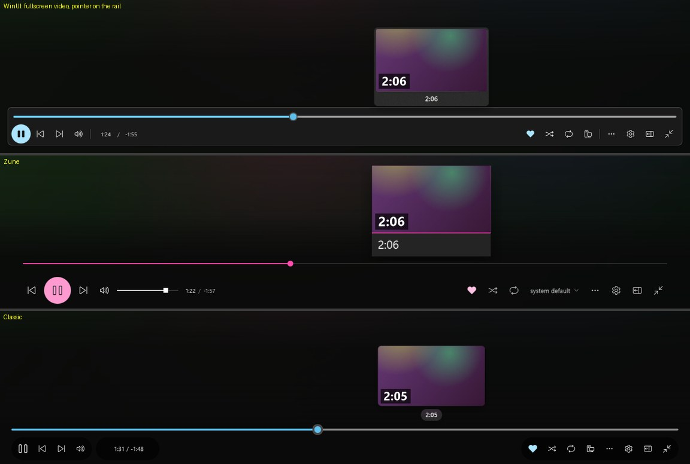
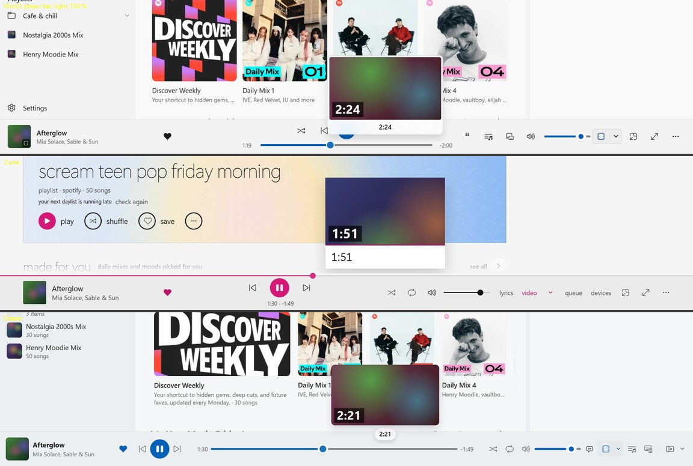

# Video seek preview: the picture under the pointer on the seek rail (spike)

Status: **spike**. The code on this branch compiles clean, renders in all three themes and is traced in the headless
inspector against generated sheets. It has **not** been run against a live video. Section 8 lists what is open.

What it is: while the pointer hovers or scrubs the seek rail of a video, the rail's tip shows the frame at that time, the
time, and on an episode the chapter. YouTube calls it the seek preview.





The frames in these renders are generated (`tools/seekpanels.py`): each carries its own time in a corner, so a render shows
whether the picture and the tip's time agree.

## 1. Where the pictures come from: `seekpanels`

The v9 video manifest Wavee already fetches (`/manifests/v9/json/sources/{id}/options/supports_drm`) carries a block the
parser ignored. Measured 2026-11-16 on three PlayReady music videos and four video podcast episodes (market NL, Premium):

```json
"seekpanels": {
  "base_urls": ["https://seekpanels.spotifycdn.com/"],
  "templates": ["seekpanels/v1/origins/<o>/sources/<id>/<e>/{{variant_id}}/{{panel_id}}.jpg?__token__=<signed>&fauth=<signed>"],
  "variants": [
    { "id": "0", "mime_type": "image/jpeg", "frame_width": 180, "frame_height": 100, "rows": 6, "columns": 6,
      "frames": { "frame_deltas_in_seconds": { "values": [0, 1, 1, 1, "..."] } } },
    { "id": "1", "mime_type": "image/jpeg", "frame_width": 452, "frame_height": 254, "rows": 3, "columns": 3,
      "frames": { "frame_deltas_in_seconds": { "values": [0, 1, 1, 1, "..."] } } }
  ]
}
```

| Fact | Measured |
|---|---|
| Who has it | all 3 PlayReady music videos, all 4 podcast episodes (2 shows) |
| Frame step | music videos 1 s; podcasts 8 s or 10 s (it is a per-frame list, so it may vary) |
| Frame count | duration / step + 1 (a 245.1 s video: 246 frames) |
| Variant "0" | 6 x 6 cells; 180 x 100 for 16:9, the width or height follows the aspect (146 x 100, 178 x 74) |
| Variant "1" | 3 x 3 cells; 452 x 254 for 16:9 |
| Panel numbering | from 0; panel `ceil(frames / cells)` answers 404 |
| Cell order | reading order (left to right, top to bottom) |
| Last panel | cropped to the rows it uses (30 frames of 36 -> 1080 x 500, not 1080 x 600) |
| Sheet weight | variant "0": 50-100 KB each, 370-470 KB for a whole music video; variant "1": 1.5-2.0 MB for a whole music video |
| What the CDN needs | the signed query only: 200 with no bearer and no `Origin`/`Referer`; 403 without the query |
| Lifetime | token about 168 h; `Cache-Control: public, max-age=10800` |

`spritemaps` in the same manifest is **not** the seek sheet: it is one frame (`"number": 1`, half the natural size; for the
measured music video, its title card).

**The time rule**, and how it was proven. Frame `i` shows the video at the running sum of the deltas. A video podcast's stream
is unencrypted, so real frames were decoded with ffmpeg from the segment that starts at that time and compared with the sheet:

```
frame  T(i) s  panel  cell | diff to predicted cell | best match of all 177 cells | diff of the frame half a step later
    1       8      0     1 |                   3.14 |                     1       |                              56.57
   36     288      1     0 |                   4.67 |                    36       |                              10.90
  143    1144      3    35 |                   3.77 |                   143       |                              12.04
  175    1400      4    31 |                   6.04 |                   175       |                              51.12
```

Seven frames across all five sheets: the predicted cell was the best match every time, and the frame half a step later always
matched worse, so the rule has no offset. PlayReady frames cannot be decoded for comparison; for those the same rule holds
by construction (same block, same generator) and by order (title cards first, credits last).

## 2. The shape

```
manifest JSON
   |  Playback.Video.Manifest.Parse            <-- new: SeekPanels.Parse(root, manifestId)
   v
Playback.Video.VideoSource.SeekPanels          <-- new init member; null = no sheets
   |  Playback.Video.Source (the resolved source signal, unchanged)
   v
Shell.BarSeekRail (core host of every seek rail: player bar, stage transport, on-media strip)
   |  PlayerBarFacts.Seek.PreviewRail(hasSheets, mode, SeekRail.PreviewFits(onMedia, railPx))
   |  SeekRailProps.HoverTip = chapterRail || previewRail      <-- was ChapterRail
   v
Shell.BarRailTip (core host; was BarChapterTimeline)           one tip per rail
   |  sheets -> Player.SeekPreview bubble, PopupChrome.Raw (the tip fade)
   |  no sheets, chapters -> Player.ChapterTip bubble, as before
   v
theme template SeekPreview(SeekPreviewProps)                   the look: plate, corners, ring, type, motion
   |  props.Frame(width, corners)
   v
Shell.SeekFrame (core host) + SeekFrameBoxes                   the picture: which sheet, which cell
```

### The model (`Playback/Playback.Video.SeekPanels.cs`, pure)

```csharp
public sealed class SeekPanels
{
    public sealed record Variant(string Id, int FrameW, int FrameH, int Rows, int Columns, int[] TimesSec)
    {
        public int FrameAt(long ms);       // the LAST frame at or before ms (binary search)
        public int RowsIn(int panel);      // the last panel is cropped to the rows it uses
    }
    public Variant Coarse { get; }         // the most frames per panel: what a sweep reads
    public Variant Fine { get; }           // the largest frame: what a resting pointer sharpens to
    public string Url(Variant v, int panel);
    public static SeekPanels? Parse(JsonElement root, string key);
}
```

### The contract (`Theming/Contracts`)

```csharp
public static readonly ViewKey<SeekPreviewProps> SeekPreview = new("Player.SeekPreview");

public sealed record SeekPreviewProps
{
    public required Func<float, CornerRadius4, Element> Frame { get; init; }   // the picture's core host at the theme's width and corners
    public required float Aspect { get; init; }
    public required Func<string> Time { get; init; }                           // bound
    public required Func<string> Label { get; init; }                          // an episode's chapter; "" on a track
    public required Func<bool> HasLabel { get; init; }
    public required IReadSignal<bool> Scrubbing { get; init; }
}
```

`SeekRailProps.ChapterRail` is renamed `HoverTip` ("the rail has a tip that follows the pointer"): the three rail templates
wire their hover handlers on it. Nothing else in a rail template changes.

## 3. The picture: two layers, no wrong frame

```
SeekFrame (core)                         a clip window, width x width / aspect, the theme's corners
 +- coarse sheets (variant "0")          follow the pointer at once
 |    each sheet: an ImageEl at the FILE's pixel size (so the decode is the file's, whatever the tip's width)
 |    under one bound transform:  scale a cell to the window, translate cell (col, row) into it
 |    and one bound opacity:      1 while the frame under the pointer is one of this sheet's cells
 +- fine sheets (variant "1")            follow only once the pointer rested 120 ms (SeekRail.PreviewSharpenMs)
      hidden until the settled frame IS the frame under the pointer
```

- **A move inside a sheet repaints and nothing else.** The cell is a compositor transform; no component re-renders, no
  layout runs for the picture, no image is fetched.
- **A sweep fetches no fine sheet.** The fine layer's frame follows a 120 ms dwell; while it is behind the pointer its layer
  is hidden and the coarse layer shows through.
- **No wrong picture.** A sheet's transform and opacity read the same signal, so they change in the same bind flush; a
  sheet that has not decoded draws nothing, and the theme's plate (`Tok.MediaLetterbox`) shows.
- **The last sheet.** Its file is shorter than the grid. The image box stays the grid's size with `ImageFit.Fill`, and the
  transform's y scale is multiplied by `rowsUsed / rows`, which undoes the stretch.
- **Which sheets are mounted.** Up to 12 coarse sheets (`SeekRail.PreviewMountAll`) all stay mounted, so a jump across a
  music video never waits. A longer video keeps the pointer's sheet and one each side. Fine sheets: the settled one and one
  each side.
- **Memory while the tip is open** (computed, not measured): a coarse sheet is 1080 x 600 x 4 = 2.6 MB decoded, so a music
  video's seven are 18 MB; three fine sheets are 12 MB. The tip unmounts them when it closes.

## 4. Where the picture shows

```
rail                               picture in the tip?
player bar                         yes
stage transport (fullscreen)       yes
on-media strip, rail >= 420 DIP    yes
on-media strip, rail <  420 DIP    no: the time readout, as today      (the mini player, a docked card at its resting width)
DVR window / live line             no
no sheets (local file, module)     no: the time readout, as today
```

The 420 (`SeekRail.PreviewMinRailPx`) is a first proposal: under it the picture would cover most of the video it previews.
The on-media strip is told apart by its chrome feed (only it has one).

One tip per rail: while a rail has the preview, the plain time readout stays shut, and on an episode with sheets the
chapter's title rides in the preview instead of a second bubble.

## 5. The three looks

No board draws this surface: these are proposals in each theme's existing tip language. Every number is in the theme's
`Rules` record.

**WinUI: a thumbnail flyout.** The acrylic card of every WinUI flyout (overlay radius 8, flyout ring and elevation). The
picture is inset 4 with radius 4, so the corners are concentric. One caption line: the time (14, semibold, tabular), the
chapter beside it (12, secondary). It stops on the page gutter (16) when the window clamps it.

```
 .----------------------------.
 | .------------------------. |
 | |                        | |   232 x 130
 | |        picture         | |
 | '------------------------' |
 |            2:06            |
 '----------------------------'
              |  14 above the rail's line
 ======o=====================
```

**Zune: the readout's plate, grown around a picture.** Square, `R.Layer.FloatingChrome`. The picture runs to the plate's
edges, the rail's own 2 px accent line closes it, and the time stands under it in the plate's large type (24/30), left like
every Zune caption. The chapter is the line under the time (13/18, two lines at most).

```
 +----------------------------+
 |                            |   248 x 139
 |          picture           |
 |                            |
 +============================+   2 px accent
 | 2:06                       |
 +----------------------------+
```

**Classic: no card.** The picture floats alone (card radius, flyout ring and elevation) and the time rides under it in the
readout's bubble drawn as a pill; the chapter rides in the pill beside the time.

```
 .--------------------------.
 |                          |     224 x 126
 |         picture          |
 '--------------------------'
          ( 2:05 )
```

Motion, all three: the host's tip fade (`PopupChrome.Raw`, the Slider's value tip) plus an `Enter` from a few DIP below
(WinUI and Classic also 3-4 % small), so the tip rises out of the rail. The fine sheet arrives as a 160 ms fade.

## 6. What the trace says

Inspector, WinUI, fullscreen video, 1440 x 960, generated sheets:

- A drag of 30 DIP per frame for 20 frames: the picture moved exactly 30 DIP every frame and stayed on the release point.
  0 snaps, 0 instants, 0 component re-renders during the drag, 0 images applied. CPU per frame: 3.1 ms average, 5.4 ms
  worst.
- Opening the tip from nothing (`hover ... trace=40`, gated): 0 motion failures. CPU worst 7.7 ms.
- `lint min=warn` with the tip open, `--gate error`: 0 errors and 0 warnings in WinUI, Zune and Classic. (Zune lists one
  todo warning on the remaining-time label, which this branch does not touch.)

One bug the renders found and this branch fixes: after a scrub was released, the tip fell back to the last HOVERED point
(no hover move follows a release), so it jumped away from the pointer and showed that other moment. The drag now keeps the
hover point in step. The chapter tip had the same jump.

## 7. Staging it in the inspector

```text
python -I tools/seekpanels.py --out C:/WAVEE/scratch/<lane>/run/assets/seekpanels     # once per run copy
python -I tools/inspect.py --exe C:/WAVEE/scratch/<lane>/run/Wavee.exe \
  -c "mount w=1440 h=960 theme=zune route=home video=fullscreen player=fake chrome=shown seekPreview=on images=real" \
  -c "hover x=900 y=866" -c "frames 60" -c "render path=C:/WAVEE/scratch/<lane>/seek.zune.png"
```

`seekPreview=on` (beside `video=`) publishes a source that carries sheets in the two measured sizes, 246 frames at 1 s. The
sheets are files beside the exe, `assets/seekpanels/<variant>/<panel>.jpg`; none are bundled. Rail lines at 1440 x 960
fullscreen: WinUI `y=884`, Zune `y=866`, Classic `y=887`. Player bar (with `video=docked`): WinUI `y=942`, Zune `y=889`,
Classic `y=924`. `images=real` is needed to see the frames (the default decoder paints gradients).

## 8. Open, in the order it matters

1. **Not run against a live video.** `ImageEl.Source` gets the signed https url; nothing here proved that the app's image
   pipeline fetches `seekpanels.spotifycdn.com` with its query intact. The disk cache should key a sheet on its path without
   the query (the token changes with every manifest), or every manifest refresh refetches.
2. **Long videos.** Above 12 coarse sheets only the pointer's sheet and its neighbours are mounted, so a far jump shows the
   plate until that sheet arrives. A two-hour podcast is 26 sheets of about 100 KB: prefetch them to disk on the first hover.
3. **Video podcasts do not resolve today.** Their manifests carry no `encryption_infos`, and `Manifest.Parse` returns null
   without a PlayReady entry, so there is no source and no sheets. That is a playback fix, separate from this.
4. **No sheets for a local file or a module's video.** The tip stays the time. Generating frames needs a second decoder.
5. **The merged episode tip is not staged.** The label path (chapter title in the preview) compiles and follows the chapter
   tip's code, but no fixture has an episode with both chapters and sheets.
6. **The WinUI player bar.** Its rail sits under the transport buttons, so the tip covers them while the pointer is on the
   rail. The chapter tip does the same today.
7. **Precise seeking** ("pull up" on YouTube) is not built. At one frame a second a filmstrip is possible for music videos.
8. **Not exercised:** reduced motion, touch, the keyboard ladder (it opens no tip), the pop-out window and the mini player.
9. **The numbers** (sizes, the 420 rule, the 120 ms dwell, the 12-sheet cap) are first proposals.

## 9. Files

| File | What |
|---|---|
| `Playback/Playback.Video.SeekPanels.cs` | the model: parse, `FrameAt`, `Url` (new) |
| `Playback/Playback.Video.cs`, `.Source.cs` | `VideoSource.SeekPanels`; `Manifest.Parse` reads the block |
| `Shell/Shell.PlayerBar.Chapters.UI.cs` | `BarRailTip` (was `BarChapterTimeline`), `SeekFrame`, `SeekFrameBoxes` |
| `Shell/Shell.PlayerBar.UI.cs`, `Shell.PlayerBar.cs` | the rail's preview decision; the hover point follows a drag; the rules and constants |
| `Theming/Contracts/ViewKeys.Player.cs`, `PlayerTransportProps.cs` | `Player.SeekPreview`, `SeekPreviewProps`, `HoverTip` |
| `Themes/{WinUi,Zune,Classic}/Structure/...` | the template, its `Rules` numbers, the registration, the renamed hover fact |
| `Screens/Diagnostics.Inspect*.cs`, `tools/seekpanels.py` | `seekPreview=on` and the generated sheets |
