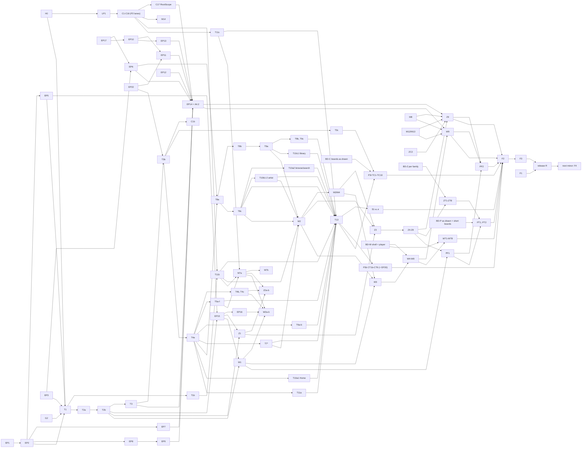

# Wavee themes, step 4: the technical plan

Status: **revision 6, 2026-10-11.** Answers the round-4 review `plan-review-r4.md` (1 blocker, 12 majors, 16 minors)
and applies the owner's "Revision 5 follow-ups" and "Round-4 review follow-ups" (NQ1/NQ7 revised: clamp Auto zoom only
out of Standard, monotonic, no zoom jump during a resize; NQ8 canvas wins, conflicts listed; Panorama's missing pages
being drawn; one 800 × 330 short board per theme). Code unchanged (`origin/main` WaveeMusic `b665627e`, fluent-gpu
`9aff04403`). The big changes: E22 gains a small host step that commits a pending tier just before FLIP capture on the
first non-resized frame (R4-B1), so EP22 edits the `AppHost.cs` frame step and joins Engine B's serialization; the zoom
clamp becomes "never push a Huge window into Standard", computed synchronously on settled sizes (no tier hold); H0 skips
the GUI-only boot calls, scopes `Platform.Boot` and lives in its own test process (`Wavee.ShellTests`); Panorama's
ladder is now Zune's (its four ladder parameters are deleted); ladder edges carry a direction-aware hold; Zune docks a
second pane at Huge; Short-height layouts are gated on the per-theme short boards; the §3.6 inventory reflects the
finished canvases; PT2 is gated on "BD-P as drawn"; WVTH013 gets its own PR. **176 PRs.** Every change and its reason
is in Appendix A.5; §10 lists the decisions applied and two new questions with defaults.

Revision 5 (`parts\r6\technical-plan.rev5.md`) answered `plan-review-r3.md` (2 blockers, 8 majors, 14 minors): the H0
headless shell host, tier crossings on the engine's resize rule, the explicit lyrics −1 → 100 rule, a theme-independent
zoom clamp (C1b), a fifth width band, per-family tier PRs and per-PR edges (Appendix A.4).

Revision 4 (`parts\r5\technical-plan.rev4.md`) applied the owner's answers to all 38 open questions and the size-tier
requirement: PR #205 discarded, no golden harness or pixel identity, no page state carried across a switch, the four
full-screen layouts and the Mosaic/Type/Spotlight faces in every theme, size tiers first-class (Appendix A.3).
Earlier revisions: revision 3 answered `plan-review-r2.md` (4 blockers, 9 majors, 22 minors; Appendix A.2) and merged
the Classic tuning delta; revision 2 answered `plan-review.md` (7 blockers, 24 majors, 41 minors; Appendix A.1);
revision 1 was written from the blueprint `abstraction-map.md`, `map-shell.md`, `map-pages.md`, `map-engine.md`,
`research-external.md` and the canvases. Canvases used by revision 4 (local copies identical to the published ones,
under `..\live\`): `classic` (tuned Classic, 56 boards), `winui` (58), `zune` (56 + `Z-Theme-Options`), `panorama` (28),
`calm-discover-concept` (18, the Liked Songs and Detail-Bar concept board). Nothing in the repos was edited, built or run.

Path conventions: app paths are relative to `WaveeMusic\src\apps\Wavee\`, engine paths to `fluent-gpu\src\` and are
prefixed `E\`. Blueprint references are `BP §x`. Owner questions keep their numbers `Q1`-`Q38` (all answered, §10.1);
revision 4's questions `NQ1`-`NQ6` and revision 5's `NQ7`-`NQ8` are answered (§10.1.1, §10.1.2); `NQ9` stays open and
revision 6 adds `NQ10`-`NQ11` (§10.2).

Reading order: §1 is the one-page architecture; §2 is the phase plan and the PR list (the executable part); §3 is the
size-tier model; §4-§8 are the detailed tracks; §9 is risks, the critical path, lanes and the execution model; §10 is
the decisions and the open questions; Appendix A is the review disposition and the revision-4, revision-5 and revision-6 change logs.

Contents: 1 Overview · 2 Phases and PRs (2.0 sequencing and phases · 2.1 P0 and what replaces the goldens · 2.2 PR
catalogue · 2.3 switch → readers → M-PR · 2.4 analyzers and tests · 2.5 repo gates per PR) · 3 Window size tiers (3.1
today · 3.2 model · 3.3 no jumps · 3.4 engine items · 3.5 tests · 3.6 boards and PRs) · 4 Engine track (4.1 startup,
4.2 how a change applies, 4.3 OS surfaces) · 5 Core extraction (5.1 X rows, 5.2 P rows, 5.3 API, 5.4 roles, 5.5
policies and metrics, 5.6 page state across a switch, 5.7 props stability) · 6 Theme tracks (6.1 Classic, 6.2 WinUI,
6.3 Zune, 6.4 Panorama, 6.5 Common, 6.6 Classic tuning delta) · 7 Switch migration · 8 Settings › Appearance · 9
Risks, critical path, lanes, execution · 10 Decisions applied and new questions · Appendix A Review dispositions (A.1
round 1, A.2 round 2, A.3 revision 4 changes, A.4 revision 5 changes, A.5 revision 6 changes)

---

## 1. Overview: the target architecture

### 1.1 One paragraph

A theme is a **composition of a structure layer and a style layer** (BP §1.3, §1.11), optionally with a counted
composition option layer (Panorama). The structure layer is a flat, immutable table from versioned view keys
(`ViewKey<TProps>`) and list-style keys (`StyleKey<TStyle>`) to static template functions, plus its options,
parameters, policies and capabilities. The style layer is an engine `ThemeDefinition` (colour sets, accent, type ramp,
spacing, radii, elevation, motion, font chains, material policy, icons, control style tables, Wavee's role table)
computed from its own options. Core code never names a theme: every surface is a **core host** (a component that owns
hooks, state machines and verbs, with its UI state in a session store keyed by contract) that builds one immutable
props record and mounts `Slots.View(key, props)`, a props-gated component that resolves the key through the nearest
`ViewRegistry` provider. **A theme switch (and an option that changes non-colour definition fields or swaps views) is one engine
transaction**: the outgoing frame is frozen as a GPU snapshot with its alpha (immutable, so no hybrid frame), the change is
applied in one flush, the new tree settles off-screen under a snap scope (end values, frozen tickers, keyed
measurements, fonts and pinned images ready), and a 250 ms premultiplied dissolve over the live DWM backdrop reveals it;
a failure rolls back. **Light/dark, colour-only options and every Classic option keep production's live path and
motion unchanged.** A switch carries no page UI state: the new theme's pages mount as a fresh navigation would mount
them (owner Q26); navigation behaves exactly as production. Startup keeps the window hidden until the first frame of
the target theme has presented with its fonts ready. **Every page of every theme has window size tiers** (Compact
~400 DIP wide, Small ~800×600, Standard, Huge 2560×1440 and, where a structure draws it, Huge 4K 3840×2160 DIP): the core
measures the window and publishes the tier as a contract fact, each structure declares its breakpoints and per-tier
layouts as policy, views never hard-code widths, and a tier crossing animates on the frame after the resize instead of
snapping (§3.3).

### 1.2 Layers, types and where they live

```
 ┌─────────────────────────────────────────────── WaveeMusic\src\apps\Wavee ──────────────────────────────────────────┐
 │ App.cs  (composition root)  Themes.Install(ClassicTheme.Create(), WinUiTheme.Create(), ZuneTheme.Create(),         │
 │                                            PanoramaTheme.Create())                                               │
 │ Themes\            namespace Wavee.Themes.<Name>   (referenced only by App.cs and ThemeCatalog; WVTH001 edges)    │
 │   Common\          view blocks, no options/policies/capabilities (diagnostics, logs, history, not-found, ...)      │
 │   Classic\  Structure\{Views,Lists,Rules,LegacyPrefs.cs (bridge until P3m)}  Style\{ClassicStyle, Roles, Controls} │
 │   WinUi\    Structure\...  Style\...         Zune\  Structure\...  Style\...                                       │
 │   Panorama\PanoramaTheme.cs  = Zune.Structure × WinUi.Style + 7 composition options + 4 parameters + 1 override│
 │ ───────────────────────────────────────────── layer 3/4: structure + style ───────────────────────────────────────│
 │ Theming\           namespace Wavee.Theming   (core; never names a theme)                                           │
 │   Contracts\       TProps records, I…Verbs, state enums, ViewKeys.*, StyleKeys.*, PageChrome, ContractVersion       │
 │   Composition\     ThemeManifest, IStructureLayer, IStyleLayer, ThemeComposition, ThemeCatalog, Themes,            │
 │                    ThemePickerFacts                                                                                │
 │   Options\         option kinds, schema, ThemeOptionStore, ThemeOptionsSection (generated Settings rows), ThemeState│
 │   Policies\        ThemePolicies, ShellCapabilities, StyleMetrics       Roles\  WaveeStyleRoles, R facade          │
 │   Appearance.cs    the one owner of mode/kind/zoom-at-boot     ThemeBootstrap.cs  named copy-only migration steps  │
 │ ───────────────────────────────────────────── layer 2: contracts ──────────────────────────────────────────────────│
 │ Shell\ Entities\ Home\ Playback\ Screens\ Platform\   core hosts, models, verbs, RootScope, WindowTiers (tier fact) │
 │ ───────────────────────────────────────────── layer 1: core state + behaviour ─────────────────────────────────────│
 │ Wavee.Analyzers (WVTH001-011, WVTH013)    Wavee.Analyzers.Tests                                                    │
 └────────────────────────────────────────────────────────────────────────────────────────────────────────────────────┘
 ┌─────────────────────────────────────────────── fluent-gpu\src ─────────────────────────────────────────────────────┐
 │ FluentGpu.Engine\Theming\   ViewKey, StyleKey, ViewTemplate, ViewRegistry(+Builder), ViewContext, Slots.View        │
 │                             (ViewSlotHost on Embed.Comp, no new element type), OptionKey, OptionStore,             │
 │                             ThemeDefinition (+ TypeRamp, SpacingScale, RadiiScale, ElevationSet, MotionTable,      │
 │                             FontSet chains, MaterialPolicy, IconSet, ExtTokenTable)                                │
 │ FluentGpu.Engine\Hosting\   Freeze/Thaw (GPU snapshot + held presents), Settle, RunThemeTransaction, reveal gate,  │
 │                             MeasureMemory, first-layout scroll restore, window tiers, Flow.Persist            │
 │ FluentGpu.Controls\Styling\ ControlStyleTable (replaces the one StyleHook), TitleBar two-row mode, BoundRowTemplate │
 │ FluentGpu.Windows\          one FontRegistry for both resolution paths, WindowMaterial None/Mica/MicaAlt/Acrylic,  │
 │                             composited decoupled from Mica                                                         │
 │ FluentGpu.SourceGen\Analyzers  FGTH001-FGTH004                                                                      │
 └────────────────────────────────────────────────────────────────────────────────────────────────────────────────────┘
```

**Owner Q1 (2026-10-11):** one `Wavee.csproj` with folder fences enforced by Roslyn analyzers (`Wavee.Analyzers`,
rules WVTH001-WVTH011 and WVTH013, §2.4; the repo forbids source-text tests) and engine analyzers FGTH001-FGTH005.

### 1.3 Registration, resolution, change (the life of a theme)

```
 Program.Main
   └─ Recovery (engine-free; TaskDialog gains "Reset appearance")
   └─ Platform.Boot: settings opened → ThemeBootstrap.Run (named, copy-only, order-independent steps)
   └─ Crash.Host.BeginGuiRun: previous run crashed before frame 0 with a non-Classic theme → Classic this run + toast
   └─ App.cs: Themes.Install(4 compositions) → t = ThemeCatalog.Resolve(theme.id)   (unknown/unavailable → Classic)
   └─ o = ThemeOptionStore.Load(t)  (structure, style, composition layers)
   └─ Appearance.Seed: kind; Tok.Use(t.Definition(o, osAccent), kind); Fonts.Preload; zoom from the monitor
   └─ core seeding (Nav, NavModel, WizardModel, palette claim); Themes.Facts = (policies, capabilities, metrics)
   └─ FluentApp.Run(AppOptions{ Composited, RevealOnFirstPresent, FirstFrameReady = fonts, InitialMaterial })
        hidden window → material → mount RootHost (ViewRegistry, OptionStore, ThemeFacts providers) → first present → show

 Live change  Appearance.SetMode | Themes.Apply(Live option)
   today's reactive path: option cell / Tok.Use + RethemeAll + 250 ms colour fade, production motion, nothing closed

 Transaction  Themes.Switch(id) | Themes.Apply(Transaction option)
   coalesce → close other popups → resolve + options + definition + facts → prewarm (fonts hard, images soft)
   → Freeze (GPU snapshot with alpha, presents held, input swallowed) on the main and every pop-out host
     → SnapScope: one apply flush (Tok.Use; providers; facts; capability reactions; new root or in-place
     re-render + list slot rebuild) → Settle (≤ 6 passes / 250 ms) → Thaw (premultiplied dissolve; DWM changes ordered
     with presents) → persist (failure: roll back, cut, toast). Nothing is carried: the new root's pages mount fresh (Q26)
```

Resolution at render: `Slots.View` is an `Embed.Comp` keyed by the view key; its host reads the registry provider
signal (cached) and calls the template only when the props record changed, the registry epoch changed, or an option or
role the template read changed. Built-in tables are complete (registry test); a missing key in a future loaded theme
renders nothing and logs once.

### 1.4 What "done" looks like

| Theme | Structure | Style | Own views | Common blocks | Options |
|---|---|---|---|---|---|
| Wavee Classic (`wavee.classic`) | `Classic.Structure` | `Classic.Style` | every key (today's builders, moved then rewritten), then tuned in P3b (§6.6) | diagnostics, logs, history, not-found, customize, module page | §6.1 (8 structure, 4 style; the stage options are core since Q16) |
| WinUI (`wavee.winui`) | `WinUi.Structure` | `WinUi.Style` | every canvas board | same set (Q14) | §6.2 (exactly the six of W-ThemeOptions) |
| Zune (`wavee.zune`) | `Zune.Structure` | `Zune.Style` | every canvas board | same set | §6.3 (3 structure + 5 parameters, 4 style, app-mode/motion/face references) |
| Panorama (`wavee.panorama`) | `Zune.Structure` | `WinUi.Style` | none (composition) | Zune's | §6.4 (the 8 of ZF-ThemeOptions + background and the face reference) |

The 5 other structure × style pairs are rendered only by the S3 probe. Every theme covers the window size tiers
Compact, Small, Standard, Huge and (where its boards draw it) Huge 4K (§3).

## 2. Phases and PRs

### 2.0 Sequencing (BP R1, refined after review and the owner's answers of 2026-10-11)

Five facts shape the order:
1. **No half-migrated switch on main, and no feature lost on releasable main.** A switch has readers in many surfaces
   (e.g. `detail.rowstyle` is read by the queue, the track table, the artist chart, the detail frame and Settings).
   So surfaces move into `Themes\Classic` **without** migrating switches; the moved Classic views read legacy prefs
   only through one typed bridge file (`Themes\Classic\Structure\LegacyPrefs.cs`, the single WVTH002 exception, a
   shrink-only baseline). Each switch then migrates in **one M-PR** after the last surface that reads it is a template:
   the option enters the schema (and so the generated Settings section in that PR), the named bootstrap step is
   added, every old read and writer is deleted, the bridge member is deleted. §2.3 lists switch → readers →
   prerequisite PRs.
2. **The generated options machinery lands early** (T1b, right after T1): the "‹Theme› options" section, palette option
   commands, the `Setup.Theme` page. From T1b the Classic section shows every Classic row in its final grouping, the
   not-yet-migrated rows bound to their legacy keys through `SettingsDoc`; an M-PR only re-binds its rows, so the
   Appearance tab changes layout once (T1b, shown to the owner) and no Settings row ever disappears.
3. **The repo forbids source-text tests** (`WaveeMusic\CLAUDE.md:70-72`, `AGENTS.md:15`, `CONTRIBUTING.md:117-118`;
   engine CLAUDE.md likewise): every fence is a Roslyn analyzer in `src\apps\Wavee.Analyzers` (WVTH*) or the engine
   SourceGen (FGTH*); stale-baseline detection is an analyzer diagnostic over AdditionalFiles, not a test.

4. **There is no golden harness and no pixel-identity gate** (owner Q23). Every PR passes the CLAUDE.md gate (a clean Debug
   build and headless inspector renders/traces). Behaviour that revision 3 pinned with goldens is
   pinned by ordinary tests (§2.1); the Live-option pins (LP1) are written on `main` before any view moves, on the
   headless shell host H0 (revision 5, R3-B1), which mounts the real frame headlessly.
5. **Window size tiers are part of every theme** (§3). The engine primitive (EP22) lands in P1 so every view is
   written against tier layouts; a tier crossing animates on the frame after a resize (§3.3); each tier PR waits for
   its own family's boards (BD-C, BD-W, BD-Z, BD-P, §3.6).
PR #205 is discarded (owner Q3): nothing in this sequence depends on it.

| Phase | Goal | Entry | Exit |
|---|---|---|---|
| **P0 Guard** | analyzers (G2), the headless shell host with the settings store probes (H0, C0 folded in), Live-option behaviour pins (LP1) | the owner's answers (2026-10-11) | `Wavee.Analyzers` builds Debug + Release; H0 mounts the frame headlessly with no behaviour change (same `boot.*` marks, `BootOrderingTests` green); LP1 green on `main` in both configs |
| **P1 Engine foundation** | E12, E3, E16, E1 + E4, E17a/b, E13, E9 + E19, E22 (E23 deleted, §3.4) | none (engine PRs do not wait for P0) | engine gate green (clean Debug build) for each PR; each app pair green |
| **P2 Core extraction** | BP §3.1 X1-X47 + `RootScope` (C17); M14 (lyrics Auto removed) lands here | P0 (LP1 green) | every X row done or explicitly assigned (X26 → T5a, X44 → T2b); tests and LP1 green |
| **P3 Theming core + Classic registry** | contracts, catalogue, options machinery (T1b), roles, policies, tier policy (T3b) and the zoom clamp (C1b), Classic views for every key; **no switch migrated** | per PR (§9.2): T1 needs EP2, EP3, EP5, H0; each view PR needs its C-PR | registry completeness for Classic; tests and LP1 green; the Appearance tab regrouped once (T1b) |
| **P3m Switch migrations** | one M-PR per switch (§2.3), batched per family before a release | each M-PR's prerequisite PRs merged | every §7.2 row migrated; `LegacyPrefs.cs` deleted |
| **P3c Classic S1 conversion** | WVTH003 Classic baseline emptied, one PR per family | T13 | `analyzer-baseline\WVTH003.txt` deleted |
| **P3b Classic tuning** | the tuned Classic design (§6.6: 69 items in CT1b-CT9, engine item EP20 with E21) | T13 (+ the M-PR for any option an item touches) | every §6.6.3 item landed; the owner's review against the tuned canvas |
| **P3t Classic tiers** | Compact, Small, Huge (and Huge 4K where drawn) for every Classic surface (TC1-TC10) | per family: T13, T3b, EP22 and that family's BD-C boards | WVTH013 Classic baseline deleted; `TierLayoutTests`/`TierResizeTests` green for Classic; the owner's review against BD-C |
| **P4 Live switching + style infra** | E6, E10, E2, E17c, E8, E7, E5, E14, E11; `Themes.Switch` and Transaction-mode options on the transaction | per PR (§4.0); app pairs need T1-T3 and H0 | transaction suites green (0 settle timeouts over 100); the test-only `ClassicAlt` theme switches live; `SwitchResetsStateTests` green |
| **P5 Zune**, **P6 WinUI** | structure + style + tiers each | per PR (R3-M6, §9.2): Z1/W1 need T2 and EP15; Z2/W2 need T4 and M7a; Z3/W3 need M2 and M3/M4; Z9/W9 need EP14 + A4.2; W4a and each WT/ZT PR need their family's boards | every key Own/Common/Nothing at every tier; owner canvas and tier-board review; S1 and WVTH013 clean with no baseline; `Availability = Developer` |
| **P7 Panorama** | composition + its tier review | P5, P6; PT1 needs BD-P | S2/S3 for 9 pairs; the owner's review of PF2 and PT1 |
| **P8 Finalise** | themes public, zero legacy, release R, bootstrap removed in the next minor | P3b, P3c, P3t, P5-P7 | every analyzer baseline deleted; `Availability = Public`; release R; F4 in the next minor (Q12) |

### 2.1 P0: guard foundation

PR #205 (`feat/shell-cohesion`) is discarded (owner Q3): nothing from that branch, its engine pair (fluent-gpu #53) or
a `themes/zune-seed` branch is merged, cherry-picked or replayed. The themes work starts from `origin/main`. Its
salvage branch is a different matter: `fix/salvage-205` was merged to main on 2026-10-10 as WaveeMusic #207
(`b665627e`, 33 commits) and fluent-gpu #54 (`9aff04403`, 4 commits), so those fixes are production now and the plan
treats them as today's Classic (§6.6.3 says which tuned-Classic items they already deliver).

There is no golden-frame harness and no pixel-identity requirement (owner Q23). The per-PR gate is the CLAUDE.md gate
(§2.5). Where revision 3 used a golden trace to guard real behaviour, an ordinary test replaces it:

| Behaviour revision 3 pinned with a golden | Replacement (an ordinary test; no source text read, no baseline) | PR |
|---|---|---|
| Live options keep production motion (R2-B4: density, row style, sidebar layout, stage layout via popover and `[`/`]`, washes, lyrics blur, page layout, hide art, marquee) | `LiveOptionBehaviourTests`, written on `main` before any view moves, **on the frame mounted by the H0 shell host** (revision 5, R3-B1): per option it changes the option through today's writer and asserts the production mechanism on named mounted nodes through the engine's public inspection (`host.Animation.HasTracks(node)` and `TryGetTransition`, `E\…\AnimScheduler.Parity.cs:241, 293`, via `AppHost.Animation` `AppHost.cs:3123`; node keys via `SceneStore.DebugKeyOf`/`CopyDebugKeys`, `SceneStore.cs:2586-2590`, searched by prefix under a keyed ancestor because keys are not unique). Node by node: stage layout (popover writer `Stage.Options.UI.cs:318`; `[`/`]` step the layout only in Visualizer mode with no modifier held, `Stage.UI.cs:509-517`, so the fixture sets `Prefs.Stage.SetMode(Visualizer)` first and sends the keys through `HeadlessWindow.QueueInput`, `HeadlessPlatform.cs:112`; revision 6, round-4 minor 7) → `stage:cover` (`Stage.UI.cs:21, 655`) carries the Bounds FLIP spring (`:657`) and the stage pane its spring (`:625-626, 747, 758`), asserted on the mounted stage (no rule is extracted to make it testable); sidebar layout → the pane remounts under the other key `sidebar.library`/`sidebar.classic` (`Sidebar.UI.cs:95`; the signal is `Sidebar.Host.cs:158`); row style and density → the list re-keys (`list:<key>:[vh:]d<N>:classic|modern`, `Track.Table.cs:1065-1066`; `vh:` is the vertical-mode segment); page layout → `detail:vertical`/`detail:two-column` (`Detail.UI.cs:771, 868`; the Hero → vertical rule is `Detail.UI.cs:702-705`); washes → `shell.material.tint` carries a scene brush animation, asserted with `SceneStore.TryGetBrushAnim` (`:999`; `HasTracks`/`TryGetTransition` do not see it, `Reconciler.cs:5170-5176`), and the artwork-keyed `shell.wash.*` nodes fade through Enter/Exit, asserted as Enter tracks found by key prefix (`Shell.Masthead.UI.cs:157-159, 186-210`; round-4 minor 6); `artist-wash-*`/`profile-wash` re-tint. Hide art, lyrics blur, marquee and sidebar density have no node key of their own: LP1 asserts them structurally under the nearest keyed ancestor (the art child present or absent in a row of the keyed list; for lyrics blur the fixture starts a fake play with a manual clock (the blur is a `BlurSigma` on line paints that follow the playhead, `Lyrics.UI.cs:1261-1290`; the fake play runs the silent audio graph on its own thread, `Playback.Audio.cs:900-906`, stopped on dispose) and asserts `Lyrics.Prefs.BlurStrength(onStage)` (`Lyrics.cs:1425`) plus one painted line's sigma (R4-M-lp1); the marquee ticker on the player-bar title; the library row extent), never by adding keys, because a new key changes node matching and so production behaviour. Plus "no freeze requested" and "the hosting popup stays open" once A4.2 exists | LP1 |
| Navigation resets page state; the hero copy arrives before the photo | `SwitchResetsStateTests` (A4.2, §5.6, on the H0 host); the hero order stays covered by the existing `ArtistRevealTests.cs` and `ArtistReadinessTests.cs` over `ArtistReadiness.BodyReady` (`Entities\Artist.Rules.cs:41, 207-211`) | A4.2 |
| Settled transaction frames (R2-B2), Mica dissolve and DWM order (R2-B3) | engine suites `theme-transaction`, `frame-freeze`, `snap-scope` and `DwmOrderTests` over a recording present/DWM seam (§4 E2, E10) | EP10, EP9, EP14 |
| First visible frame is the target theme | `RevealGateTests` on the headless window: show happens after the first present with fonts ready (§4 E6) | EP8 |
| Light/dark fade completeness, entrance clocks (tuning F10/F11) | `LiveFadeCompletenessTests`, `EntranceFirstFrameTests` (§4 E20, E21) | EP20 |
| Classic looks the same after the move | not guarded by pixels (owner Q23): each move PR keeps the moved code's tests, the two-commit move + rewrite pattern keeps the diff reviewable, and the owner reviews the phase-exit screenshots | – |

#### P0 PRs

| PR | Branch | Repo | Size | Scope |
|---|---|---|---|---|
| G2 | `chore/theme-analyzers` | app | M | `src\apps\Wavee.Analyzers` (netstandard2.0, Microsoft.CodeAnalysis.CSharp 4.14.0) + `Wavee.Analyzers.Tests` (in-memory harness after `FluentGpu.SourceGen.Tests\Harness.cs:56`), both in `Wavee.slnx`, referenced as analyzer; baselines as AdditionalFiles with a compilation-end "stale entry" diagnostic; WVTH001 |
| H0 | `test/headless-shell-host` | app | L (≈ 1.0-1.2k lines for the host and the R4-M-h0a/b scoping, + ≈ 400 for C0: under the 3k cap) | **Restored in revision 5 (R3-B1)**: revision 3's G1b without anything golden (no decoder, no clock rule, no baselines). Facts it is built on (`origin/main`): the root is a private nested `RootHost` (`Shell\Shell.Host.cs:1041`) created only inside `Run` (`:250`), but it only adds root services before calling the public `Shell.Frame()` (`Shell.UI.cs:89`; `Shell.Host.cs:1043-1068`); the assembly has no `InternalsVisibleTo` (no csproj item; stated at `Diagnostics\Capture.Recent.cs:39`, `Entities\Artist.Discography.cs:1010`, `Platform\Controls.cs:268`) and the repo's convention is public `*ForTests` members (`Shell.cs:295-306`, `Playback.Host.cs:1390`), so H0 adds public test API rather than IVT; the engine's headless types and `AppHost` ctor/`Post`/`RunFrame` are public (`E\…\Headless\Pal\HeadlessPlatform.cs:6, 45`; `AppHost.cs:4829, 5340`; `AppHost.Ledger.cs:41`); the only headless mount today is one table (`TrackRowRecycleAllocationTests.cs:73-82`). **The four prerequisites:** (1) `App.BootCore(BootProfile)` extracted from `App.cs:142-231` in the same order, with `Diagnostics.Install` split into page and service halves (`Screens\Diagnostics.UI.cs:58-84`); **revision 6 (R4-M-h0a):** `BootProfile.HeadlessFake` skips the three GUI-process calls in that range, `Shell.InstallMarshallers()` (`:142`, one-way, subscribes the static frame tick `Shell.Host.cs:399`), `Shell.AcquireInstance()` (`:147`, the single-instance gate that reads argv, `Shell.Host.cs:157-170`) and `Shell.Run()` (`:232`), and `Platform.Boot()` (`App.cs:88`, before the range) becomes `Platform.Boot(argv, profile)` whose headless profile skips the log file, process culture, `Diag.Sink` (`Platform.Host.cs:124`, which would route later engine tests' diagnostics into Wavee's log), the crash-bundle `UnhandledException` writer (`:149-163`) and `RealtimeCaptureHost.Init`, and takes argv from `Args.Use` instead of re-parsing (`Platform.cs:1140`); (2) injectable argv: public `Platform.Args.Use(argv)` + `ResetForTests` (`Platform.cs:912-922` is internal today and argv is re-read at `:1140`, `Shell.Host.cs:157, 201`), with the other direct argv reads routed through it (`Diagnostics.UI.cs:63, 75`, `Update.Host.cs:491`, `Platform.Host.cs:130`); (3) a frame-tick seam: the tick lambda (`Shell.Host.cs:399-419`) becomes the public `Shell.FrameTick(FrameStats)` that `FluentApp.FrameCompleted` (`E\FluentGpu.Windows\Hosting\FluentApp.cs:124`, relayed only inside `Run`, `:401-402`) or a headless `AppHost.FrameCompleted` (`AppHost.cs:1654`) drives; (4) a mountable root: `RootHost` split into `RootServices()` (GUI only) and the frame call, and a public `Shell\Shell.Headless.cs` with `Boot(ShellHostOptions)` (once per process: temp profile, Memory settings, `--fake`, `BootCore(HeadlessFake)`, the `Run` prelude without crash net, single-instance gate, protocols or tray) and `Mount(…)` returning a disposable handle (`Host`, `Window`, `RunFrames`, `Resize`, `Find`/`FindPrefix` by node key); the poster seams are pointed at `host.Post` with the publish step and restored on dispose instead of the one-way `InstallMarshallers` (`:359`): **all nine** seams of `Shell.Host.cs:368-396`, including `Fetch.WakeForDrain` (`:396`), the fetch idle and drain wakes (`:511`, `:522-528`) and `Diagnostics.StoreShot.ToUi` (`:375`), so a drain requested outside a rendered frame still runs; `Sidebar.Activate` (`Sidebar.Host.cs:139-148`) is reset to an inline poster on dispose. **Gated side services** (`ShellHostOptions`): tray, protocols, toasts, jump list, updater, crash host/net/uploader, the network-cost subscription, AiLyrics' NPU scan and file cleanup (`AiLyrics.Host.cs:149-153`), the 3 s audio warm and 30 s memory poll (`Shell.Host.cs:555-566`), login and lyrics providers, and (revision 6, R4-M-h0b) every timer that writes after a test ends: Modules' idle timer (`Modules.Host.cs:77`), the History/Session debounces, `Playback.Boot`'s ticker (`Playback.Host.cs:340`) and `WireMaterialPolicy`'s power-session subscription (`App.cs:46-58`); the theme is forced (`SeedTheme` reads the OS theme from the registry, `:230`). **Own test process (revision 6, R4-M-h0b):** the once-per-process boot leaves process statics behind (page table, AppActions, the Modules latch `Modules.Host.cs:59`, `Args.Fake`, the settings backing, `UiThreadId`; `BootOrderingTests.cs:26-33` already snapshots the page table for this reason), and the Debug `Settings.Set` assert (`UiThreadId == CurrentManagedThreadId`, `Platform.cs:972-977`) fired from an xUnit worker thread tears down the whole testhost. So H0's harness and every suite on it (LP1, `ViewHarness`, `TierLayoutTests`, `TierResizeTests`, `SwitchResetsStateTests`, `RootScopeTests`, the rendering contract tests and S3) live in a new project `src\apps\Wavee.ShellTests` (own process, ≈ 50 lines of setup), added to `Wavee.slnx` and to the test commands in `WaveeMusic\CLAUDE.md` (the workspace `CLAUDE.md` command list is the owner's to update; the orchestrator asks); its one dedicated UI thread boots and runs every mount, so `UiThreadId` is that thread and tests marshal onto it; the 15k `Wavee.Tests` never boot the shell. A serialized `ShellHarness` collection with smoke facts (frame mounts at 1180 × 760 and 400 × 860, a route navigates, nothing reaches the network). **No behaviour change**: same `boot.*` log-mark sequence, `BootOrderingTests` green, the owner's `--fake` run. **C0 folded in** (round-3 minor 12): `IAppSettings.TryGet<T>`, `Has`, `Remove` for the six production implementors (`FileAppSettings` `Platform.Host.cs:417`, `RegistryAppSettings` `:488`, `DefaultsOnlySettings` `Platform.Settings.cs:109`, the facade `Platform.cs:968`, `PostedSettings` `Update.Host.cs:698`, `OverlaySettings` `Diagnostics.Headless.cs:881`, whose `Remove` needs tombstones) and the 4 test doubles ("There is no key-exists probe", `Platform.cs:79-80`; round-4 minor 8), tests per backing; the bootstrap needs `Has` (§7.1) and the host's Memory settings use it. Risks named for its plan: process-static leakage between mounts (own process, boot once, one serialized collection, reset between mounts), `Platform.Args` reset, the Debug settings thread assert (`UiThreadId` = the test thread), `Sidebar.Activate`/`Residency.Install` called directly, the fake composition followed exactly so nothing reaches the network, and no AOT warning from the new public type |
| LP1 | `test/live-option-behaviour` | app | M | `Wavee.ShellTests\LiveOptionBehaviourTests.cs` as in the table above, on the H0 host, green on `main`; each later PR that moves a surface keeps it green (the M-PRs re-point the option write from the legacy key to `Themes.Apply`, the assertions stay). Needs H0 |

### 2.2 PR catalogue

Size targets: S < 500, M 500-1,500, L 1,500-3,000 changed lines; nothing larger. Every view-moving PR uses two
commits: a pure move/extract commit, then the rewrite commit (props, `ctx.Hooks`, host/template split), so review sees
the real diff. ("Moved, not rewritten" is not claimed: the analyzers force a rewrite of every moved builder.)

**P0 — guard** (§2.1): G2, H0 (C0 folded in), LP1.

**P1 — engine** (§4 table): EP1, EP2 + A1, EP3 (E4 folded in), EP5, EP17, EP6, EP7 (E19 folded in), EP22 (window
tiers, §3, L; with revision 6's pending-tier commit step in the `AppHost.cs` frame step, R4-B1).

**P2 — core extraction** (§5.1): C1-C16 and C17 (`RootScope` only; nothing is carried across a switch, owner Q26,
§5.6), and M14 (lyrics blur Auto removed, §2.3), which needs only C5 and C13. The zoom clamp of §3.2 is C1b in P3
(after T3b), not C1. C0 is folded into H0 (P0).

**P3 — theming core + Classic registry**

| PR | Branch | Size | Scope |
|---|---|---|---|
| T1 | `feat/theming-core` | M | `Theming\Composition|Options|Policies|Roles|Contracts` skeleton, `ContractVersion 1.0`, `ThemeCatalog` (Classic), `Themes` (Current, `Facts` signal, `Switch/Apply` that run a cut transaction until A4.2), `ThemeOptionStore`, `ThemeState`, `ThemeBootstrap` (named steps, none yet), `ThemePickerFacts`, `RootHost` providers; WVTH002-WVTH011; `docs\guide\theming.md`; `Wavee.ShellTests\ViewHarness.cs` (§2.4: a thin layer on the H0 shell host that mounts a view key with fixture props, a composition, options and a window size; no baselines) |
| T1b | `feat/theme-options-ui` | M | the generated "‹Theme› options" section (`Theming\Options\ThemeOptionsSection.cs` builds `SettingsRow`s from the schema; the Classic rows not yet migrated come from `SettingsDoc` bound to legacy keys, already in their final grouping), palette option commands, the `Setup.Theme` page (replaces today's Layout page in M7a; until then Setup is unchanged); the Appearance tab is regrouped once here (Theme · Wavee Classic options · App mode · Zoom), shown to the owner in the PR |
| T2a/T2b | `feat/classic-style-roles`, `feat/classic-style-colors` | L, L | `Design.cs` split: role vocabulary + `R` facade + type/space/motion (T2a); colour, on-media, stage-arm, wash roles, `ColorScience`, the 27 `Tok.Theme ==` branches, X44 (T2b) |
| T3 | `feat/theme-policies` | M | `ThemePolicies` with Classic values; core state machines take the policy |
| T3b | `feat/tier-policy` | L (near the cap; revision 6, round-4 minor 13) | §3.2-§3.3: `TierFacts`, `TierPolicy` (five bands, direction-aware edge holds, `NamedRung`s), `Shell\WindowTiers.cs` over E22's pending-tier `UseTier`, `ctx.Tier()`, the synchronous content-width estimate, the clip-region API of the tier layout records (§3.3 rule 2), the core-consumed Classic ladders moved verbatim into `Themes\Classic\Structure\Rules\Tiers*.cs` (the view ladders move with their views, §3.6); `TierPolicyTests`, `TierResizeTests` |
| T3c | `chore/tier-fence` | S | **new in revision 6** (split out of T3b, round-4 minor 13): WVTH013 with its analyzer tests (§2.4) and the Classic baseline. Needs T3b |
| C1b | `feat/zoom-tier-clamp` | S | §3.2: `ZoomTierReference`, the monotonic "never out of Standard" Auto clamp (owner NQ1 revised), the synchronous Auto zoom on settled sizes (the 500 ms debounce kept only for size streams), `ZoomService.InitialZoom` computed with the same rule, the Manual floor; `ZoomTierTests`; CHANGELOG (Auto zoom on 1440p-class monitors at 100 % and 4K at 150 % changes, §3.2). Needs T3b, C1 |
| T4a/T4b/T4c | `feat/classic-frame`, `feat/classic-titlebar`, `feat/classic-frame-bits` | L, L, M | frame + content states (`Shell.ContentState`: offline lane, empty body, not-found, page transition); title bar + tabs + search; masthead, material, drawer, palette, history menu, file drop, drag chip, cover scrim, fps; `PageChrome` |
| T5a-f | `feat/classic-nav-rows`, `-nav-heads`, `-nav-flyouts`, `-nav-edit`, `-nav-drop`, `-nav-library` | M-L each | sidebar views by sub-surface over `NavModel`; `SidebarPlanner` + geometry → Classic rules and X26 deleted (T5a) |
| T6a/T6b | `feat/classic-player-bar`, `feat/classic-panel` | L, L | player bar (+ podcast, chapters, overflow); panel, now-playing hero, friends, deck flyout, device picker, on-media |
| T7a1/T7a2/T7b/T7c/T7d | `feat/classic-stage-frame`, `-stage-layouts`, `-lyrics`, `-video`, `-queue` | L each | stage frame/options/gallery/caption; the 4 layouts (core choice since Q16)/hero/artist pane; lyrics + `LyricsLines`; video (6 keys); queue (2 keys, both skins) |
| T8a/T8b/T8c | `feat/classic-track-rows`, `-track-chrome`, `-lists-other` | L, L, M | `TrackTable` style (Modern + Classic bound-row templates, E13); header/command bar/filter card/selection bar/placeholder; eager/episode rows, surface, artist chart, track drawer |
| T9a/T9b/T9c | `feat/classic-detail-frame`, `-detail-album-playlist`, `-detail-liked-podcasts` | L each | detail frame/hero/rail + insights sheet; album + playlist sub-contracts; Liked, show, episode (+ reader, discussion) |
| T10a1/a2, b1/b2/b3, c1/c2 | `feat/classic-home`, `-browse-search`, `-artist`, `-artist-more`, `-concerts-module`, `-library`, `-recents-profile` | L/M | Home (zones, daylist, section, customize); browse ×3 + search; artist page + hero; chart/reader/lightbox/discography; concerts ×3 + module page; library (+4 panes); recents, profile ×2, Local files |
| T11a/T11b/T11c | `feat/classic-overlays`, `-settings-page`, `-screens` | L each | menus, toasts, notifications, identity, dialogs (11), banners/tips; Settings page over `SettingsDoc`; setup (7 keys), release notes (3), feedback, crash, Common blocks (diagnostics, logs, history, not-found, customize: Classic registers them too, they are today's views converted) |
| T13 | `chore/classic-fences` | S | WVTH008 baseline deleted (empty); WVTH003 Classic baseline frozen for P3c; registry completeness + contract surface final for Classic |

**P3m — switch migrations** (each M or S, after its prerequisites in §2.3): M1 page motion, M2 row style, **M3/M4**
density + hide track art (one PR, revision 5), M6 washes (Off/Subtle; Rich and the two new wash options are CT9), M7a
sidebar layout + density, M7b pane width/collapse + library view, M8 page layout + rail, **M12/M13** panel and
docked-video sizes + library column widths (one PR, revision 5). M14 (lyrics blur Auto removed, S, Q37) is counted in
P2, where it lands. M7a and M7b stay two PRs: M7a alone moves 211 enum-level sidebar test references and is L.
Revision 3's M9 (stage layouts) is gone: the stage options are core prefs (Q16). Marquee, the NPV presentation, the
face and the stage options are core prefs typed by C-PRs, with no M-PR.

**P3c — Classic S1 conversion**: S1-a frame/nav, S1-b player/stage/lyrics/video/queue, S1-c lists, S1-d detail/pages,
S1-e overlays/screens (L at most each; inline Classic literals become Classic rule values or roles; tests green).

**P3b — Classic tuning**: CT1b, CT1c, CT2, CT3a, CT3b, CT4, CT5a, CT5b, CT5c, CT6a, CT6b, CT7, CT8, CT9 (§6.6.4;
revision 4's CT1a is folded into CT1b and TC1) plus the engine item EP20 (E21 folded in).

**P3t — Classic tiers** (§3.6; each waits for its own family's BD-C boards): TC1 frame/title bar/nav (+ F3, F8),
TC2 player bar + panel, TC3 stage/lyrics/video/queue, TC4 discovery, TC5 detail, TC6 artist and people, TC7 collection,
TC8 screens, TC9 overlays/dialogs/toasts/states, TC10 the shared `Themes\Common` blocks (deletes the WVTH013 Classic
baseline).

**P4 — live switching** (§4 table): EP8 + A4.1, EP9, EP10, EP11 + A4.0 (keyed measurement adoption), EP12 (scroll in the
first layout), EP13, EP14 + A4.2 (`Themes.Switch/Apply` on the transaction, `Appearance` via the transaction where a
definition changes non-colour fields, `Flow.Persist("video.presenter")`, gesture rules, `ClassicAlt` test theme,
`SwitchResetsStateTests`), EP15 + A4.3 (`ClassicControls`), EP16.

**P5 Zune**: Z1, Z2a, Z2b, Z3, Z4a, Z4b, Z4c, Z5, Z6a, Z6b, Z7, Z8a, Z8b, Z9 (§6.3), the core PRs ZC1 (Browse bands,
Q30) and ZC2 (on this PC, Q29), and the tier PRs ZT1-ZT8. **P6 WinUI**: W1, W2a, W2b, W3, W4a, W4b, W4c, W5, W6a, W6b,
W7, W8a, W8b, W9 (§6.2) and WT1-WT8. **P7 Panorama**: PF1, PF2, PT1, PT2.

**P8**: F1 `chore/release-skip-issue-comments` (S, before the release), F2 `feat/themes-public`, F3 `chore/zero-legacy`,
then release R (not a PR, §2.5), then F4 `chore/remove-theme-bootstrap` in the next minor release (owner Q12, §7.4).

Totals (counted from the tables, revision 5): P0 3 (G2, H0, LP1); P1 9 (EP1, EP2, A1, EP3, EP5, EP17, EP6, EP7,
EP22); P2 18 (C1-C17, M14); P3 41 (T1, T1b, T2a-b, T3, T3b, T3c, C1b, T4a-c, T5a-f, T6a-b, T7 ×5, T8a-c, T9a-c, T10 ×7,
T11a-c, T13); P3m 8 (M1, M2, M3/M4, M6, M7a, M7b, M8, M12/M13); P3c 5; P3b 15 (14 CT + EP20); P3t 10 (TC1-TC10);
P4 13 (9 engine + the 4 app pairs A4.0-A4.3); P5 24 (14 Z + ZC1, ZC2 + ZT1-ZT8); P6 22 (14 W + WT1-WT8); P7 4 (PF1,
PF2, PT1, PT2); P8 4. **176 PRs** (revision 6: +1, T3c split out of T3b; revision 5: 175; revision 4: 170). Removed or folded (−8): C0 into H0, EP4 into EP3, EP7b into EP7,
EP21 into EP20, EP23 deleted (no engine change is needed, §3.4), M4 into M3, M13 into M12, CT1a into CT1b/TC1. Added
(+13): H0 (R3-B1), C1b (R3-M2), and 11 tier PRs from the per-family re-split (R3-M5: TC 6 → 10, WT 5 → 8, ZT 5 → 8,
PT 1 → 2). Declined consolidations: M2 with M3/M4 and M7a with M7b (each would exceed 3k lines).

Rough size and serial length (R3-M6; one serial PR = plan → plan check → implement → orchestrator gate → up to 3 review
rounds; assumed S ½ day, M 1 day, L 1½ days of wall clock, plus owner approval at push time; the orchestrator gate is
the shared bottleneck at about 40 minutes per gate run for the app and longer for engine PRs with VerticalSlice):

| Phase | PRs | Changed lines (rough) | Serial length inside the phase | Runs beside |
|---|---|---|---|---|
| P0 | 3 | ~3.5k | 2 PRs (H0 → LP1), ~3 days | P1 |
| P1 | 9 | ~11k | 4 PRs (EP1 → EP2 → EP5; EP3), ~4 days | P0, P2 |
| P2 | 18 | ~20k | 7 PRs (the C2 → C6 chain), ~7 days | P1, start of P3 |
| P3 | 41 | ~65k | 14 PRs (T1 → … → T9a → T10b2), ~19 days | P2 tail, P4 |
| P3m | 8 | ~9k | 3 PRs (M2 → M3/M4; M7a → M7b), ~3 days | P3b, P3c, P3t |
| P3c / P3b / P3t | 5 / 15 / 10 | ~8k / ~20k / ~20k | 3 / 4 / 3 per family, ~5 days each | P4-P6 |
| P4 | 13 | ~15k | 6 PRs (EP17 → EP10 → EP11 → EP13 → EP14 + A4.2), ~8 days | P2, P3 |
| P5 | 24 | ~45k | 9 PRs (Z1 → Z3 → Z6a → Z6b → Z9 …, ZT after the boards), ~12 days | P6 |
| P6 | 22 | ~40k | 9 PRs (W1 → W2a → W4a → … → W9), ~12 days | P5 |
| P7 | 4 | ~4k | 3 PRs, ~3 days | – |
| P8 | 4 | ~1.5k | 3 PRs + release, ~3 days; F4 one minor later | – |

Total work is about 176 PR-days; with four lanes busy the calendar is bounded by the critical path of §9.2 (about 28
serial PRs, ~43 working days of PR time plus orchestrator-gate contention) and by the remaining design work (the four short boards, §3.6), whichever comes later. These are planning estimates, not commitments.

### 2.3 Switch → every reference → migration PR (the sequencing gate)

Regenerated from a grep of `main` at revision 3 (21abd98e) and re-checked at `b665627e` for revisions 4 and 5 (the refs below are at `b665627e`; `origin/main` has not moved since) over `src/apps/Wavee` and `src/apps/Wavee.Tests` (key string, `Keys.*` name,
`Prefs` accessor, derived booleans). Each M-PR's plan file re-runs the grep and must account for every hit. Kinds:
VIEW (becomes a Classic template, so it reads the switch through `LegacyPrefs` until the M-PR), CORE (stays core; each
gets (a) move into the Classic structure as a rule, (b) a structure-declared verb that core calls, or (c) the switch
is a core pref), ACCESSOR, SETTINGS (rows are already in the T1b final grouping, bound to legacy keys), TEST.

**Decisions** (owner intent: "Classic keeps row style classic/modern and sidebar v3/classic as its options"):
- Classic options: row style (M2), density (M3, Classic style), hide track art (M4), washes (M6), sidebar layout and
  density (M7), page layout + rail uniform (M8). Stage layouts are **not** Classic options any more (owner Q16: the four
  full-screen layouts exist in every theme, so the choice is a core content pref; revision 3's M9 is deleted). Their core sites move into Classic rules (a) or
  become structure verbs (b).
- Core prefs (c), no key migration, typed by C-PRs: page motion is deleted (M1); **lyrics blur intensity** (honoured by every
  `LyricsLines` style; owner Q37, its Auto state removed in M14), marquee, NPV presentation, the **stage layout, spectrum
  and hero options** and the face (Q16, Q21; typed by C4); Classic theme **state** for rail/pane/library
  sizes (M12, M13, the M7 width/collapse part) uses core-declared `StateKey`s through `ThemeState` (per theme, Q6).

| M-PR | Switch | VIEW (→ templates; PR) | CORE (decision) | ACCESSOR / SETTINGS | TEST | Prerequisites |
|---|---|---|---|---|---|---|
| M1 | page motion `appearance.pageMotion.style` (deleted) | – | `Design.cs:1739, 1743, 1786` enum/default, `:1856-1886` (+`:1922`) `Nav.RecipeFor(style,…)` → (a) the structure's recipe kind + `R.Motion` durations; `Shell.cs:1007-1017` (+`:1019`), `Shell.UI.cs:920, 976-977` → (b) core asks the structure for the recipe; `Setup.UI.cs:692` unchanged (default recipe) | `Platform.cs:127`, `Prefs.cs:119-122`; `Settings.UI.Appearance.cs:104, 125-128, 215-232`, `Settings.cs:122` | `DesignTests.cs:825-958`, `PrefsTests.cs:114-121`, `SettingsCatalogTests.cs:64, 81`, `ShellNavTests.cs:252-279` | T4a, T11b |
| M2 | row style `detail.rowstyle` | `Track.Table.cs:2067-2169`, `Track.Table.Chrome.cs:633-700, 784-794`, `Track.UI.cs:230-1170`, `Track.UI.Bound.cs:151-727`, `Queue.UI.cs:469-935`, `Artist.UI.Chart.cs:92-866`, `Artist.Page.cs:116, 1132` (T7d, T8a-c, T10b1-2) | (a) into Classic rules: `Track.Rules.cs:113-115` (`ColumnSet.Classic` → lane table), `:156-160`, `:166, 170`, `:215`, `:225-242`, `:413`, `:1626-1629`; `Track.UI.Bound.cs:30-75` (`RowCellRules`); `Queue.UI.cs:1487` (`QueueRowRules.Extent`); `Artist.UI.cs:181-191` (`ArtistPopularLayout`); (b) `Track.Table.cs:558-562, 612, 644-670, 1020, 1066`: the snapshot carries the structure's `TrackListStyle` stamp instead of `Classic` | `Platform.cs:116`, `Prefs.cs:98-101` (+ readers `Artist.Page.cs:296`, `Artist.UI.Chart.cs:176`, `Queue.UI.cs:468`); `Settings.UI.Appearance.cs:315, 364-376`, `Settings.cs:125` | `TrackRowStyleRulesTests` (25), `ArtistPopularLayoutTests` (14), `TrackFormatTests` (7), `TableRowShapeTests` (5), `TrackRowCellRulesTests` (4), `QueueRowRulesTests` (3) → Classic structure tests | T7d, T8a-c, T9a, T10b1-2, T11b |
| M3 (PR M3/M4) | density `detail.rowdensity` (Classic style) | `Track.Table.Chrome.cs:393-403, 851-882` (density items, slider panel → the Classic template writes through `ctx.OptionRequests`), `Album.Pane.cs:192` | (a) the Classic arm of `Track.Rules.cs:166, 215, 1626-1629`; core `RowMetrics.RowHeightFor/ArtSizeFor/EpisodeRowHeightFor` (`:382, 385, 390`) take heights from `Themes.Facts.Metrics` (b); `Track.Table.cs:644-647` reads metrics; writer `Track.Table.cs:903` → `Themes.Apply` | `Platform.cs:115`, `Prefs.cs:91-94`; `Settings.UI.Appearance.cs:324-358`, `Settings.cs:123` | `PlatformTests.cs:267`, `PrefsTests.cs:51, 61, 94-95`, `TableRowShapeTests.cs:31-34`, `TrackFormatTests.cs:372-373`, `TrackRowStyleRulesTests.cs:71-120` | T8a-b, T10c1, T11b |
| M4 (PR M3/M4) | hide track art `appearance.trackArtwork.hidden` | `Queue.UI.cs:469, 985`, `Rail.UI.cs:732`, `Stage.Artist.UI.cs:561`, `Recents.UI.cs:296, 316`, `User.Page.Library.cs:1397, 1510`, `Artist.Page.cs:297, 1132`, `Artist.UI.Chart.cs:177, 709-849`, `Search.UI.cs:386, 407, 815` | rules keep their `showArtwork` **parameter** (`Drag.cs:552-585`, `Track.UI.cs:1410`, `User.UI.cs:801`, `Search.UI.cs:827`), the Classic templates pass it (a); `Track.Table.cs:612, 654, 1901-1902` → the style's art flag (b); `Search.Page.cs:136, 151` / `HitContext.HideTrackArt` (`Search.UI.cs:64`) → the Search template's `HitStyle` (a) | `Platform.cs:119`, `Prefs.cs:66-69`; `Settings.UI.Appearance.cs:334-337`, `Settings.cs:124` | `PrefsTests.cs:52`, `LibrarySearchRowTests.cs:43-54`, `TrackRowDataTests.cs:49-51`, `SearchHitDataTests.cs:107` | T4c, T6b, T7a2, T7d, T8a, T10a2, T10b1-2, T10c1-2, T11b |
| M6 | washes `appearance.colorWashes.enabled` (the only wash key on main; PR 205's `appearance.wash.*` never landed) | hosts `Detail.UI.cs:669`, `Artist.Page.cs:295, 356, 364, 517`, `Profile.Page.cs:242, 257, 349`, `Recents.Page.cs:1162`, `Home\HomeScreen.cs:500` (added by `a7ffe5ed`, #207) | `Recents.Page.cs:1205` `ShellMaterial.Publish(definite: …)` → the Classic material view decides wash drawing; the core claim publishes data only (a). The tuned canvas's three Surfaces options are new Classic options built in CT9 (§6.6.3), not a migration | `Platform.cs:144`, `Prefs.cs:82-85`; `Settings.UI.Appearance.cs:118-119`, `Settings.cs:118` | `PlatformTests.cs:268`, `PrefsTests.cs:41-44` | T2b, T4c, T6b, T7a1, T7d, T9a, T10a1, T10b1, T10c2, T11b |
| M7a | sidebar layout + density `sidebar.layout.id`, `sidebar.pane.density` | `Sidebar.UI.cs:84, 163, 860` (the layout reads; `:323, 1645, 2109` read `Sidebar.Width` and belong to M7b), `Sidebar.UI.Edit.cs:43-580`, `Sidebar.UI.Library.cs:105`, `Sidebar.UI.Slot.cs:452`, `Sidebar.UI.Menus.cs:153-159, 275`, `Track.Table*` (3), `Settings.UI.Appearance.cs:551-563, 596-609, 644-668` previews | (a) Classic rules: `Sidebar.Layout.cs` (catalogue, `Resolve(state, layout, density)`, `ShapeFor`), `Sidebar.Edit.cs`, `Sidebar.Planner.cs:49`, `Sidebar.Rules.cs:173`, `Sidebar.cs:855-924`; (b) Classic structure verbs `SwitchLayout`/`SetDensity` (`Sidebar.Host.cs:260-287, 300-312`) called by the palette (`Shell.Palette.cs:102-103, 335`), menus and `Setup.Theme`; boot read `Sidebar.Host.cs:78-82` → option store; `Shell.UI.cs` layout reads (`:245-280, 526, 733, 763-765, 837-838, 1540-1554`) → `Themes.Facts.Policies.NavPane` (b); `Sidebar.Migration.cs:279-282, 25-64, 119` is an older data migration: allowed to read the legacy keys until its own retirement (listed in Q31) | `Platform.cs:83, 89` (+ legacy `:77-78`, read by `Setup.cs:698`); `Sidebar.Host.cs:158, 161`; `Setup.UI.cs:753-756` | `PlatformTests.cs:408-409`, `PlatformWave6Tests.cs:40-77`, `SetupTests.cs:181, 193`, `SidebarWiringTests.cs:421-440`, `SidebarFileStoreTests.cs:25, 95, 299`, and the enum-level `Sidebar{Catalogue, EditRules, Feeds, LayoutRules, MenuModel, MigrationV2, Planner, Projection, StoreV3, UndoRing, Visibility}Tests` (211 refs) → Classic structure tests | T5a-f, T11b, T11c, T1b |
| M7b | pane width/collapse, library view | `Sidebar.UI.cs:323, 1645, 2109` (`Sidebar.Width` reads), `Sidebar.UI*` resize/view views | `Sidebar.Host.cs:492, 496, 537, 561-573`, `Shell.UI.cs:757-758` → Classic `ThemeState` keys declared by the structure, written by the core host (b) | `Platform.cs:85, 87`; `sidebar.json` `view` (`Sidebar.Store.cs:299, 375, 418, 441`) | as M7a | M7a |
| M8 | page layout `detail.page.layout`, `detail.rail.*` (11 keys) | `Detail.UI.cs:703` (`Hero → VerticalMode`), rail views | (a) `RailPolicy` (`Detail.cs:633-812`, `KeysFor :757-777`, `ScopeFor`, `HasCustomizedRailPrefs`) → Classic rule; rail state (`Detail.UI.cs:411-487, 670-672, 792`) → Classic `ThemeState` (b) | `Platform.cs:135, 169-181`, `Prefs.cs:279-307, 326`; `Settings.UI.Appearance.cs:318, 395-431, 461-486, 499`, `Settings.cs:126-128` | `DetailRailPolicyTests.cs`, `DetailConfigTests.cs:150-198`, `PrefsTests.cs:60-74, 222-225`, `DetailTitleRuleTests.cs`, `DetailSkeletonGeometryTests.cs:188` | T9a, T11b |
| M12 (PR M12/M13) | `shell.rail.width`, `shell.rail.docked-video.height` (Classic theme state) | – | `Shell.UI.cs:125-127` (`SeedFrameState`), `:770-776` (`CommitRailDrag`), `Rail.UI.cs:172-179` (`CommitCap`) → `PanelHost` writes the `StateKey`s from `PanelPolicy` (b) | `Platform.cs:173-174` | none | T6b, T7c, C3 |
| M13 (PR M12/M13) | `library.<kind>.leftw/midw` (Classic theme state) | – | `User.Page.Library.cs:353-354` reads, `:379-380` writes → `ThemeState` (b) | `Platform.cs:355-356` | `PlatformTests.cs:405-407` | T10c1 |
| M14 + (c) | lyrics blur `appearance.lyrics.blurStrength` (−1 = Auto, 0 = off, 1-100; key default −1, `Platform.cs:158`). Owner Q37 (confirmed in the revision-4 follow-ups): remove Auto, keep the 0-100 intensity, **a stored −1 reads as 100**. Main has no separate on/off key; the only second state is the "Auto" link | `Lyrics.UI.cs:315` (the `_strength` seed reads `AutoDefault`), `:406`, `:417` (on stage the active-line halo follows the user's setting), `Verse.UI.cs:240` | core pref (`Lyrics.cs:175-191` `BlurPolicy`; accessor `Lyrics.cs:1425, 1431`) passed to every `LyricsLines` style. **Mechanism (revision 5, R3-M1):** deleting `Auto` alone would turn blur off, because `Resolve` would become `Clamp(−1, 0, 100) = 0` and `Prefs.BlurStrength` passes −1 through (`Prefs.cs:221`). So M14 (1) makes the accessor the one interpreter of stored values: `Prefs.Lyrics.BlurStrength()` returns `v < 0 ? 100 : Min(v, 100)` and the setter clamps to 0-100 (`Prefs.cs:217-237`); (2) changes the key default to 100; (3) deletes `BlurPolicy.Auto/AutoDefault`, the Auto branch of `Resolve` (now `Clamp(s, 0, 100)`), the Auto link and `ResetLyricsBlur`; (4) re-seeds the two `AutoDefault` readers the round-3 review found (`Settings.UI.Appearance.cs:47` slider seed, `Lyrics.UI.cs:315`) and the raw-key seed `SeedAppearance` (`Settings.UI.Appearance.cs:86`, which calls `Resolve` on the stored value and would seed a stored −1 at 0; round-4 minor 1) from the accessor, with a settings-seed test for a stored −1. The negative arm is a permanent range rule of the typed pref (out of range reads as the key default, §7.1), not a legacy path, so it does not expire at F4: removing it would switch blur off for a profile that skipped the 0.4 line. No bootstrap step (an in-place rewrite of the same key would bend the copy-only rule for nothing). **Stage rule (owner NQ5):** `BlurPolicy.ResolveFor(setting, onStage, stageDepthBlur)` returns `onStage && !stageDepthBlur ? 0 : Resolve(setting)` (`Lyrics.cs:191`, one caller `:1425`, live `onStage` only from `Lyrics.UI.cs:406`); `stageDepthBlur` is the declared `LyricsLinesStyle.StageDepthBlur` (WinUI true, every other style false), never a theme check; until T7b moves the lyrics view, Classic passes false | `Platform.cs:158`, `Prefs.cs:214-237`; `Settings.UI.Appearance.cs:47, 56-60, 86, 98, 145-148, 716-744` (the raw `< 0` read at `:98`, the Auto link and `ResetLyricsBlur` `:739-744` deleted), `Settings.cs:135`; loc `settings.appearance.lyricsBlurAuto` deleted | `LyricsRulesTests.cs:74-103` (the Auto case `:78` deleted; `[InlineData(-9, 0)]` `:85` becomes a `Resolve` clamp case of a non-negative input, and the "stored negative reads as 100" cases move to `PrefsTests`), `PrefsTests.cs:206-215` rewritten (stored −1 and −9 read 100, stored 140 reads 100, `Set(-40)` stores 0); `ResolveFor` cases for both `stageDepthBlur` values | C5, C13 (revision 5: no longer waits for T11b; it lands in P2 before the settings page moves) |
| (c) | marquee `appearance.marquee.enabled` | `Shell.PlayerBar.UI.cs:222`, `Track.Table.cs:612` → `Snapshot.Marquee` | core pref fact in props | `Platform.cs:142`, `Prefs.cs:73-77`; `Settings.UI.Appearance.cs:117`, `Settings.cs:117` | `PlatformTests.cs:234, 241`, `PlatformWave6Tests.cs:64, 72` (switch to a neutral fixture key), `PrefsTests.cs:29, 33` | C2 types it |
| (c) | NPV presentation `npv.presentation` | `Rail.UI.cs:362, 426, 463`, `Rail.Styles.UI.cs:192, 194` | core pref (`Prefs.Player.cs:41-101`, `Rail.cs:250-285`) → `DeckPrefs`; palette toggle `Shell.Palette.cs:99, 315` | `Platform.cs:254`; `Settings.UI.Appearance.cs:102, 172-176`, `Settings.cs:153` | `PrefsTests.cs:242-301`, `RailTests.cs:279-308`, `SettingsCatalogTests.cs:65, 81` | C3 types it |
| (c) | stage `stage.layout`, `stage.spectrum`, `stage.heroLyrics/heroMotion/heroDim` (owner Q16) | `Stage.UI.cs:402-877`, `Stage.Layouts.UI.cs:41-50`, `Stage.Hero.UI.cs:140, 156`, `Visualizer.UI.cs:298, 467`, `Stage.Options.UI.cs:56-58, 270, 303-340` | core prefs typed by C4 (`StageModel.LayoutState`); `Stage.LayoutRules` stays core (`Stage.Layouts.cs:18-20, 30, 54-153`); G (`Stage.UI.cs:205-215`) and `[`/`]` (`:513-517`) become core `IStageVerbs.Step/Gallery`; every theme registers views for the four layouts | `Platform.Settings.cs:63-71`, `Prefs.Stage.cs:43-54`; `Settings.UI.Appearance.cs:88, 797-798`, `Settings.cs:147` | `PlatformTests.cs:345-376`, `StageLayoutAxisTests.cs` | C4 types it |

Each M-PR: adds the option to the Classic schema (the T1b section row is re-bound from the legacy key to the option, so
the Appearance tab's layout does not change), adds the named bootstrap step (§7.1) and its
WVTH010 entries, deletes every VIEW read, the `LegacyPrefs` member, the accessor and the typed key, applies the CORE
decisions, moves or rewrites the tests, keeps `LiveOptionBehaviourTests` (LP1) green with the write re-pointed to
`Themes.Apply`, and adds a CHANGELOG bullet only if something user-visible changes (normally nothing does). M-PRs are batched so a release never ships a half-migrated
family (M7a/M7b together; M2/M3/M4 together).

### 2.4 Analyzer and test gates

| Id | Rule | Allowed (precise) | Baseline |
|---|---|---|---|
| WVTH001 | `Wavee.Themes.*` referenced only by `App.cs`, `Theming\Composition\ThemeCatalog.cs`, and inside themes along these edges: a composition file (`Themes\<X>\<X>Theme.cs`) may reference any layer and `Themes\Common`; a structure may reference `Themes\Common` | – | none |
| WVTH002 | `Themes\**` may not reference `Entities`, `Playback`, `Spotify`, `Store`, `Shell` state, `Platform.Settings`, `Prefs` | `Wavee.Theming.*`, engine, `Loc`/`Strings`, `Icons`, `ColorScience`, content-renderer catalogues (as `MediaSlot`s), `Platform\Controls*` builders moved with Classic (converted into Classic views by P3c) | `Themes\Classic\Structure\LegacyPrefs.cs` only, shrink-only, deleted by the last M-PR |
| WVTH003 (S1) | no literal looks in `Themes\*\Structure\**` and `Themes\Common\**` outside `Rules\**` | – | none (P3c done: hard gate, a baseline file is WVTH901) |
| WVTH004 (S4) | no identity reads | `Theming\Composition\**` (incl. `ThemePickerFacts`, the one API for "installed + current"), `App.cs`, `ThemeBootstrap.cs`, manifests in `Themes\<X>\<X>Theme.cs`, the feedback diagnostics line (id + option stamp as data) | none |
| WVTH005 | theme options read/written only by their own layer, `Theming\Options\**` (store, generated section, reset) | – | none |
| WVTH006 | key ids and props record shape | – | none |
| WVTH007 | `theme.*` writes only in `Theming\Options\**`, `Theming\ThemeBootstrap.cs`, `Theming\Composition\Themes.cs` (`theme.id`); `theme.mode` stays a core key written by `Appearance` | – | none |
| WVTH008 | core hosts build no presentation | engine behaviour controls passed as slots | shrinks per surface PR, deleted at T13 |
| WVTH009 | `ctx.Options.Set` only with own-layer keys | – | none |
| WVTH010 | legacy keys and deleted member names only in `Theming\ThemeBootstrap.cs` | – | empty after F4 (bootstrap removal at the next minor, Q12) |
| WVTH011 | each structure parameter (`OptionVisibility.Hidden`) is exercised with ≥ 2 values by the S3 probe matrix (AdditionalFiles) | – | none |
| WVTH012 | (retired with the golden harness, Q23: the wall-clock rule existed only for golden determinism) | – | – |
| WVTH013 (tiers) | a syntax rule over `Themes\**` and core hosts (revision 5, R3-M4): **(a)** no relational or equality comparison whose one side is `Viewport.Size.*`, the result of `ctx.Hooks.UseMeasuredWidth/UseMeasuredBounds`, the width parameter of a `Responsive.Of` build lambda, or a `TierFacts` width/height member, and whose other side is a numeric literal or a constant declared outside `Rules\Tiers*.cs`; **(b)** no `Responsive.Of` call and no `UseMeasuredWidth/Bounds` call whose lambda contains such a comparison outside `Rules\Tiers*.cs`; tier decisions read `ctx.Tier()` / `TierFacts` and the structure's layout record. **(c)** Page-level widths come from the layout record: this part is a review rule (§9.4 blocking findings), not an analyzer rule, because an analyzer cannot tell a page-level region from one of the ~255 control-size `Width = N` literals (§3.1) | `Rules\**` of a structure, `Theming\Policies\**`, `Shell\WindowTiers.cs` (the measurement) | Classic only (the comparisons and lambdas still in moved Classic views, listed per file), emptied family by family by the Classic tier PRs; deleted by TC10 |

Engine: FGTH001-FGTH005 (§4; FGTH005 = repeated view slots need a caller key).

Analyzer tests (`Wavee.Analyzers.Tests`, in-memory compilations, no source files read): every WVTH rule has at least
one diagnostic case and one clean case. WVTH013 has one diagnostic case per source kind of (a) (`Viewport.Size.X < 640`,
`UseMeasuredWidth() >= Breakpoint` with the constant outside `Rules\Tiers*.cs`, `Responsive.Of(w => w < 900 ? …)`,
`ctx.Tier().ContentWidth > 1200`), one per hook kind of (b), and clean cases for the same code under `Rules\Tiers*.cs`,
for a comparison against a `TierFacts`-derived layout-record member, and for a control-size literal (`Width = 32`),
which the rule must not flag.

**Contract tests** (`Wavee.Tests\Theming\`, runtime; those that render live in `Wavee.ShellTests`, the H0 process,
revision 6). Those that render use `ViewHarness` (T1, S), a thin layer on the H0 shell host (§2.1): it mounts the frame or a view key with fixture props, a theme composition, options and a window
size on the engine's headless `AppHost` (`HeadlessPlatformApp`, `HeadlessWindow(new WindowDesc(…, SizePx, scale))`,
`HeadlessGpuDevice`, `HeadlessFontSystem`) and exposes the scene and node-key lookup for assertions. `WindowDesc`'s
size is `Size2 SizePx`, in pixels (`E\…\Seams\Pal\Pal.cs:474-482`), so the harness takes DIP and multiplies by the
scale (they are equal only at scale 1). It keeps no
baselines and captures no images (owner Q23: no pixel identity); headless text has fixed advances, so assertions are
about structure and geometry rules, never typography. The tests: registry completeness per
theme and key (with the registering PR); contract-surface approval + version bump rule (the approved surface is a
checked-in file generated by reflection over the built assembly, compared at test time: it reads no source text, which
is the only kind of test the repo bans, `WaveeMusic\CLAUDE.md:70-72`, engine `CLAUDE.md:83-88`; it is an API approval
list, not a pixel or golden baseline); props fixtures (one per
published state value, generated from the state enums); style
completeness (S2); cross-product probe (S3: 9 pairs on the frame + 6 page fixtures; the 4 Zune parameters × 2 values run only under the 3 styles on the frame and Album fixtures, 48 headless renders on top of the 63 pair renders, budget ≤ 60 s); option schema round
trip; layout identical light vs dark; bound-row template guard (E13); `SwitchResetsStateTests` and `RootScopeTests` (§5.6); `TierLayoutTests` and `TierResizeTests` (§3.5);
`LiveOptionBehaviourTests` (LP1, §2.1);
props-stability census (§5.7); `ThemeBootstrapTests` (every merge order, §7.1).

### 2.5 Repo gates per PR (CLAUDE.md, CONTRIBUTING.md, owner memory)

| Gate | Rule | Who |
|---|---|---|
| Build + inspector | clean Debug build (compile check `dotnet build src/apps/Wavee/Wavee.csproj`) and headless inspector renders/traces; engine PRs: the engine Debug build | **orchestrator only** (implementers never build, test or launch; CLAUDE.md:77-79) |
| Justified extras | frame bench (`playlist-scroll`, `home-scroll`, `nav-burst`) on a copied profile only at phase exits and for `perf-sensitive` PRs (EP3, EP6, EP14, EP22, T8a, T9a, Z3, W3); a resize sweep bench (`resize-sweep`, 3840 → 400 DIP) for the tier PRs (§3); the stage-lyrics depth-blur frame-time check on the owner's 120 Hz device in W4c (owner NQ5, §6.2). Nothing else is re-measured unasked (memory: no unrequested verification). There is no golden, rebaseline or pixel-identity gate (owner Q23) | orchestrator |
| Plan file | `docs/plans/wavee/<branch>-implementation.md` with real code, by the Opus planner, before implementation (CLAUDE.md:77-79) | planner |
| Parallelism | implementers in parallel only on disjoint files (lane table §9.3) | orchestrator |
| No legacy paths | `CLAUDE.md:74`, `AGENTS.md:16`, `CONTRIBUTING.md:121-122` forbid keeping legacy paths beside new ones; the plan's transitional mechanisms (the `LegacyPrefs` bridge, the WVTH002/003/008/013 baselines, the bootstrap until the next minor, `Sidebar.Migration`'s legacy key reads) are the exception list the owner accepted with expiries (Q31, 2026-10-11) | owner |
| CHANGELOG | user-facing PRs add a bullet under `## [x.y.z] - unreleased` (`CONTRIBUTING.md:87-92`): C1 (no startup re-zoom: `ZoomService.InitialZoom` gives the first frame its Auto zoom; the 500 ms debounce for later resizes stays until C1b), C1b (Auto zoom on large monitors; zoom applied on settled sizes without the 500 ms wait), every M-PR including M14, every CT and tier PR, F2; refactor-only PRs state "no user-visible change" in the body | implementer |
| Issue refs | every fix references its issue, unconditionally (`CLAUDE.md:75-76`, `CONTRIBUTING.md:82, 94`): `Fixes #n` in the commit body + ` (#n)` on the CHANGELOG bullet. Where no issue exists (most P3b items and tier PRs), the orchestrator drafts one issue per fix or per PR group, shows the list, and creates them only after the owner approves (a `gh` write); open issues already cited: #197 (F8), #199 (P3) | orchestrator + owner |
| Docs | `docs/guide/theming.md` (T1, kept current; a tiers chapter from T3b), `docs/guide/sidebar.md` + `.claude/skills/wavee-sidebar/SKILL.md` (T5, M7), `docs/guide/fullscreen-visualizers.md` (T7; C4 for the core stage prefs), `docs/guide/scrolling.md` (EP12, C17) | implementer |
| GitHub | push and PR creation asked first (draft PRs the owner follows: push per phase, memory); **no issue comments ever**. The release script always comments on closed issues (`ops\release\wavee-release.ps1:60-95` params; `Invoke-Notify :1431-1454`; `-Resume` retries it). PR F1 `chore/release-skip-issue-comments` (S, before the release) adds a `-SkipIssueComments` switch honoured by `Invoke-Notify` and by `-Resume`, with Pester tests, gated by `Invoke-Pester -Path ops/release/tests` (`CONTRIBUTING.md:107-111`) | orchestrator |
| Release R | exempt from the per-PR gates: one Release build of Wavee and nothing else (root CLAUDE.md), run with `-SkipIssueComments` | orchestrator |
| Transitional mechanisms | each has an expiry PR: `LegacyPrefs.cs` → last M-PR; WVTH003 baseline → P3c; WVTH008 baseline → T13; WVTH013 Classic baseline → TC10; `ThemeBootstrap` → F4 at the next minor release (Q12) | – |
| Isolation | review builds of unmerged lanes are launched only with `--profile <temp dir>` (never the owner's HKCU store or `%LOCALAPPDATA%\Wavee`); owner-review screenshots use the existing capture switches `--fake --profile <fresh temp dir> --screenshot --width --height` (`ParseArgs`, `Shell\Shell.Host.cs:317-332`, parses `--frames`, `--screenshot`, `--width` and `--height`; only the two sizes have a ≥ 300 floor and the default is 1180 × 760, `:323-324, 329-330`; `--fake` is parsed by `Platform.Args.Parse`, `Platform\Platform.cs:912-914`, called at `:1140`; `--profile` by `Diagnostics.Probe.ProfileArg`, `Screens\Diagnostics.Probe.cs:69-73`, used at `App.cs:84`; Compact screenshots at 300-400 wide are therefore possible): evidence for the owner's board review, never a baseline or a gate | orchestrator |

## 3. Window size tiers (new in revision 4, reworked in revision 5)

Revision 3's §3 (the golden-frame harness) is deleted (owner Q23). This section takes its number.

**Requirement (owner, binding, 2026-10-11):** every page of every theme works at the window size tiers below, not only
at the standard desktop size, and a tier change during a live resize never jumps.

| Tier | Board size (DIP, `canvas-v2\SIZES-BRIEF.md`) | Meaning |
|---|---|---|
| **Compact** | 400 × 860 | one column, no docked pane, the panel as an overlay or sheet, the mini player bar, targets ≥ 40 |
| **Small** | 800 × 600 | the small window / laptop split; short height is the real constraint |
| **Standard** | 1440 × 960 | today's boards |
| **Huge** | 2560 × 1440 | a 32-inch 1440p screen at 100 % or a 4K screen at 150 %: a real design, not an upscale |
| **Huge 4K** | 3840 × 2160 | a 32-inch 4K screen at 100 %; boards for the frame with Home, Album, Artist and Now Playing. A structure may declare it as its own band (Zune from 3200, and so Panorama) or let its Huge layout cover it (Classic, WinUI). The boards are drawn at zoom 1; for what Auto zoom lays out on these monitors see §3.2 |

### 3.1 What main has today (verified on `origin/main` b665627e / engine 9aff04403)

- **Minimum window size.** `MinWidth = 300` DIP (`Shell\Shell.Host.cs:258`, rationale `:253-256`: 360 was a ~564-px floor
  at 150 % that broke half-screen snap); **no `MinHeight`**, so the window can be dragged down to a title-bar strip.
  Plumbing: `AppOptions.MinWidth/MinHeight` (`E\FluentGpu.Windows\Hosting\FluentApp.cs:764, 766`) →
  `WindowDesc.MinClientSizeDip` (`FluentApp.cs:307`; `E\FluentGpu.Engine\Seams\Pal\Pal.cs:466-480`) →
  `WM_GETMINMAXINFO` (`E\FluentGpu.Windows\Pal\Win32Platform.cs:1901-1924`); VerticalSlice already tests a 360-wide
  opt-in (`CoreSuite.cs:43-46`). **So Compact (~400 wide) is already reachable: no engine or app change is needed for
  the width.** Two gaps remain: the floor is in raw-DPI DIP and ignores app zoom (`Win32Platform.cs:610-621`), so a
  Manual zoom of 250 % gives a 120-DIP layout viewport; and there is no minimum height (#197, tuning item F8).
- **About 18 hand-rolled tier ladders**, each with its own thresholds and hysteresis, none aligned: nav pane band
  528/568 and 660/700 (`Shell\Sidebar.Resize.cs:20-102`) with the narrow drawer (`Shell.UI.cs:1418-1540`); right-rail fit
  (`Shell.cs:1143-1147, 1876-1881`); player bar 440/760/900/1100/1240 with 24 hysteresis on narrowing
  (`Shell.cs:1195-1320`); chrome allocator 520/1200/1360 (`Shell.Chrome.cs:28-65, 390-443`); detail table tiers
  860…300 and modes 820/660/560 + vertical 540/580 (`Entities\Detail.cs:73-131`), height rungs 760/900
  (`Detail.UI.cs:379-380, 1119-1123`); artist hero 360/600/880 (`Artist.UI.cs:69-130`); artist reader 640
  (`Artist.Reader.Shape.cs:132-135`); library 640 (`User.cs:672-686`); setup 770 (`Setup.cs:43-65`); stage aspect classes
  (`Stage.cs:65, 99-117`); concert, show, track command bar, profile, dialog ladders (`Concert.Rules.cs:246-255`,
  `Show.Page.cs:1380`, `Show.Rules.cs:500-530`, `Track.Rules.cs:700-735`, `Profile.Rules.cs:132`, `Controls.cs:1309`).
  Home and Settings have no tiers (a 1600 cap `Design.cs:87`, a 1000 cap `Settings.UI.cs:71`, a fixed 36 gutter).
- **No Huge tier exists, and Auto zoom (the default) folds Huge back into Standard**: `ZoomAutoPolicy`
  (`Platform\Platform.cs:389-460`, design box 1600 × 900, plateaus 1-2) gives a 2560 × 1440 window zoom 1.5 (layout
  ~1707 × 960) and a 3840 × 2160 window zoom 2.0 (1920 × 1080); the rescale lands in one step ~500 ms after a resize
  (`Shell.UI.cs:294-319`, `Shell.cs:1990-2042`).
- **Every frame whose window size changed snaps; the frame after it animates** (revision 5, R3-B2; revision 4 read this
  wrongly). The `WindowResize` suppression bit (`E\…\Hosting\AppHost.cs:6074`) only mirrors `_window.InModalLoop`; the
  real gate is keyed on `resized`: FLIP capture is skipped on a resized frame (`AppHost.cs:6180-6185`, `… && !resized`)
  and `_anim.CancelStructuralAll(_scene.BoundsAnimatedNodes)` runs on it (`:6186-6198`; the comment names maximize,
  restore, Snap and programmatic resizes, and the reason: stale pre-resize rects give a stale presented translation and
  an FPS collapse). Frame by frame on main:
  - **Composited edge drag** (Wavee is composited: `FluentApp.cs:304` passes `o.Mica`, default true `:768`): zero
    paints after the first `WM_SIZE` (`Win32Platform.cs:1949, 2047-2050`; `DeferModalResize` `AppHost.cs:8289-8290`,
    the `EnsureSize` early-out "pending until WM_EXITSIZEMOVE" `:8317`, layout size held `:8294-8302`; live video brings
    paints back but at the old size). At `WM_EXITSIZEMOVE` one settle paint lays out at the final size: a resized frame.
  - **Maximize, Snap, restore from maximized, programmatic resize:** one synchronous resized `Paint` from `WM_SIZE`
    (`Win32Platform.cs:1953`), then a keep-alive paint or `RunFrame` that is not resized. Restore from minimized is not a
    resize (`:1929`). **DPI change and app zoom:** a resized paint, then a second paint that is not resized.
  - **The first non-resized frame captures normally**, and its "before" rects are the post-resize ones (`RelRect` =
    bounds + local transform, `AppHost.cs:7517-7535`): a state change written in the layout phase of the resized frame
    (`ResponsiveBox.OnBoundsChanged`, `UseMeasuredWidth`'s "re-renders NEXT frame", `UseLayoutEffect`;
    `Hooks\RenderContext.cs:83-110`) is reconciled on that frame, and moved nodes FLIP and Enter/Exit run. That is how
    `Responsive.Of` already animates a rebuild today. The catch: timer drains (`AppHost.cs:6227`), paint-path posts
    (`:6222`) and the `FrameClock.Tick` publish (`:6234`) run after capture, so a deferral built on `UseTimeout(0)`,
    `FrameClock.Tick` or `HostDispatch.Post` would snap; only a layout-phase signal write is safe.
- **Measured widths arrive one frame late**: `Responsive.Of` (`E\FluentGpu.Controls\Responsive.cs:20-120`) builds its first
  frame at a fixed fallback (Home: 1100, `Browse.Modules.cs:29-47`) and rebuilds on every width change, with no tier,
  hysteresis or quantum; `UseMeasuredWidth` (`Hooks\RenderContext.Measure.cs:119-145`) re-renders the next frame. Only
  `Viewport.Size` (`Hooks\Context.cs:20-32`) is same-frame.
- **Engine caps at Huge**: 3840 × 2160 px fits every cap (texture 16384, 1024 × 512 tiles, 64 tile surfaces
  `AppHost.cs:492`, tile budget `clamp(5 × window, 48, 128 MiB)` `Render\Tiles\TileBudget.cs:7-24`). 3840 × 2160 DIP at
  200 % (7680 × 4320 px) exceeds the 64-surface cap and the 128 MiB ceiling: slices fall back to direct, untiled drawing
  (`SliceTable.cs:53, 237`), correct but slower.
- **Width literals in views**: ≈255 `Width = N`, ≈17 `MaxWidth`, ≈20 `MinWidth`, ≈177 width constants; ≈40 named
  breakpoint constants and ~5 inline comparisons. Worst files: `Track.Table.Chrome.cs` (15, incl. `MinWidth = 320f`
  `:1343`, which overflows at Compact), `Concert.UI.cs` (14), `Diagnostics.UI.cs` (13), `Rail.UI.cs` (10).
- **Boards** (revision 6: the four `canvas-v2` canvases are finished, §3.6). The spec boards define three different
  ladders; Panorama's now repeats Zune's:

| Structure (board) | Compact | Small | Standard | Huge | Huge 4K | Hysteresis | Other thresholds on the board |
|---|---|---|---|---|---|---|---|
| Classic (`C-Breakpoints`, `C-Frame-Narrow`, `C-Shell-*`; A.6) | < 528 (300-527; `C-Breakpoints`: "528, not 640", the tier changes where production's drawer does) | 528-1007 | 1008-1919 | ≥ 1920 | – ("Huge 4K uses the same rules at 3840"; 5 Huge 4K boards) | 40, direction per edge: on widening at 528 and 1008 (to Small at ≥ 568, to Standard at ≥ 1048, back below 528 / 1008), on narrowing at 1920 (back below 1880); production's 24 stays for heroes and player tiers | forced 48 rail over the whole Small band (production 528-660), Forward hides < 520; player bar 440/760/900/1100/1240, mini bar 56; side panels float at Small (340), dock one at Standard, two at Huge (Lyrics + Queue); Huge grids to 2400; Short below 680 tall, left at ≥ 720 |
| WinUI (`W-Tiers`) | < 641 | 641-1007 | 1008-1919 | ≥ 1920 | – (Huge rules, more columns at 3840) | 24 on narrowing | nav 641/1008; player 641/860/1100/1920, mini 64; panes dock when nav + 340 + 480 fits (868 at Small, 1100 at Standard); grids 2/4/6/10, 14 at 3840; short hero below 720 tall; content lines 560/720/860/900/1100 |
| Zune (`Z-Sizes-Breakpoints`) | 300-639 | 640-1007 | 1008-1919 | 1920-3199 | ≥ 3200 | 24 on narrowing | panel overlay below 1008, inline from 1008; Huge docks a second pane (720: queue · lyrics/friends), 4K a third (1080: queue · lyrics · friends); 4K: gutter 64, title bar 56, pill 400, pivots 40, play bar 88, rows 60; play bar 640/760/1240; heroes shrink below 700 tall |
| Panorama (`ZF-Breakpoints`, revision 6: aligned to Zune) | 300-639 | 640-1007 | 1008-1919 | 1920-3199 | ≥ 3200 | 24 on narrowing | Zune's thresholds and collapses; panel inline 1008 (overlay pane 340 below); two panes dock from 1920 (380 each; 4K 480 each, no third); Recents into More below 360; panorama titles Title Large below 1000 (a type rule, not a tier edge); reserved chrome 220 tall; heroes become a header row below 720 tall, mini play bar below 520 tall so the page keeps ≥ 260 |

### 3.2 The model: tiers are a core fact, breakpoints and per-tier layouts are structure policy

```csharp
namespace Wavee.Theming.Contracts;                                    // contract v1.0, core
public enum WidthTier : byte { Compact, Small, Standard, Huge, Huge4K }   // revision 5: Huge4K in v1.0 (R3-M3)
public enum HeightTier : byte { Short, Regular }                       // revision 6: Tall dropped, no board uses it
public readonly record struct TierFacts(
    WidthTier Window, HeightTier Height,          // the window's layout viewport (after app zoom)
    WidthTier Content, float ContentWidth,        // the content region left after nav pane, panel and gutters
    float ViewportWidth, float ViewportHeight,
    bool Resizing);                               // true inside an OS modal size-move loop (E22)

namespace Wavee.Theming.Policies;                                     // declared by each structure (T3b)
public sealed record TierPolicy(
    TierLadder Window, TierLadder Content, TierLadder Height,         // E22 primitive: edges with a direction-aware hold
    float CompactFloor,                                               // smallest layout width the structure supports
    ImmutableArray<NamedRung> Rungs);                                 // the board's own marks that are not tiers
public readonly record struct TierEdge(float At, float NarrowHold, float WidenHold = 0);   // revision 6 (R4-M-hyst)
public readonly record struct NamedRung(string Id, TierEdge Edge);   // e.g. "pane.second" 1920, "pane.third" 3200 (Zune)
// TierLadder has one optional TierEdge per tier boundary: a structure that draws no Huge 4K band leaves that edge empty and
// its Huge record covers every width ≥ its Huge threshold (Classic, WinUI); a structure that draws one sets it (Zune 3200).
// Widening commits at At + WidenHold, narrowing at At − NarrowHold. WinUI, Zune and Panorama hold on narrowing only (24);
// Classic's `C-Breakpoints` holds 40 on widening at 528 and 1008 and on narrowing at 1920 (A.6). Every Huge edge has
// WidenHold 0, so a fresh launch at 1920 and a window maximized to 1920 from below both land in Huge; a fresh resolve
// (no previous tier) uses At, so Classic's 528-567 and 1008-1047 are direction-dependent (§10.2 NQ12).
// ThemePolicies gains `TierPolicy Tiers`; WindowBandPolicy (revision 3) is replaced by it and NavPanePolicy.ModeFor,
// PlayerBarPolicy.Tiers, PanelPolicy and ChromePolicy are keyed by WidthTier (+ the structure's own sub-ladders).
```

- **What the model can express (revision 5, R3-M3).** Every number on the four spec boards (§3.1 table) has a home,
  without changing a board:
  - the five width bands, each structure with its own thresholds and narrowing holds (Classic Compact below 528, WinUI
    641, Zune and Panorama 640; Huge 4K only where drawn);
  - board marks that are not tiers, as `NamedRung`s of the structure's `TierPolicy` (Zune's `pane.second` 1920 and
    `pane.third` 3200, WinUI's pane-dock rule nav + 340 + 480, the content-line marks 560/720/860/900/1100, Zune and
    Panorama's `recents.inMore` below 360), read by layout records through `ctx.Tier().Rung("pane.second")`;
  - production's finer ladders (player bar, detail table, artist hero) as structure-internal sub-ladders (below);
  - height rules as the `Height` ladder (Short below 680 tall for Classic, 700 for Zune, 720 for WinUI and Panorama;
    Panorama's mini play bar below 520 tall as a height rung).
- **Panorama's ladder is Zune's** (revision 6: `ZF-Breakpoints` now uses 640/1008/1920/3200 with Zune's 24-DIP hold on
  narrowing, and the panel goes inline at 1008). Revision 5's four counted ladder parameters (`structure.tierStandardFrom`,
  `.tierHuge4KFrom`, `.tierHysteresis`, `.secondPaneFrom`) and `TierParam.FromMetrics` are deleted: no tier number differs
  between the two compositions. What still differs is not a tier edge: panorama titles drop to Title Large below 1000
  (the existing type metric `PanoramaCompactBelow`, §6.4.1 row 10), the docked pane widths (WinUI metrics
  `DockedPane`/`DockedPane4K` 380/480 against Zune's 360/360) and the pane count at 4K (`structure.maxDockedPanes`, Zune 3,
  Panorama 2; §6.4.1 row 41).

- **Who measures:** the core. `Shell\WindowTiers.cs` (T3b) resolves `TierFacts` from `Viewport.Size` (same-frame, so
  the tier is known **before the first layout**) and from a content-region width the shell computes synchronously
  (`Sidebar.PresentedWidth` + the panel reservation + gutters; the pattern of `Detail.EstimatePageWidthFromViewport`,
  `Detail.cs:81-91`, generalised), through the structure's `TierPolicy` ladders with their hysteresis. It is published
  as `Themes.Facts.Tiers` (core models) and `ctx.Tier()` (templates). A theme switch re-resolves the tier with the new
  structure's ladders inside the transaction's settle (no extra pass after thaw).
- **Who decides layout:** the structure. Each structure has `Rules\Tiers*.cs`: its ladders and a per-tier layout
  record for the shell (nav mode, pane and panel widths, player bar slot set, chrome allocation, gutters) and for every
  page key (columns, max content width or fill rule, hero geometry, which regions stack). A view reads
  `ctx.Tier()` and its layout record; it never compares a width with a number and never sets a literal page-level width
  (**WVTH013**, §2.4). Production's finer ladders (player bar 6 tiers, detail table 7 tiers, artist hero 4) stay as
  structure-internal sub-ladders, written with the same `TierLadder` primitive and kept in `Rules\Tiers*.cs`, so their
  hysteresis and transitions behave like the four contract tiers.
- **Per theme:** Classic, WinUI and Zune each declare their own ladders and layouts. Panorama uses the Zune structure, so
  its tiers are the Zune structure's ladders fed with WinUI metrics (BP §1.11 limit 4); its only tier-related deviation
  is the counted pane-count parameter (§6.4.1 row 41), never a copied view.
- **Huge is designed, not scaled:** the Huge layout records carry their own column counts, max content widths or fill
  rules and pane/panel sizes from the Huge boards. Huge at 3840 × 2160 DIP is a key-surface requirement (frame, player,
  Home, Album, Artist, Library, full screen); every other page must be correct (no broken or empty layout) and may use
  its Huge layout with a max content width.
- **Zoom (owner NQ1, applied per R3-M2).** Tiers are measured on the layout viewport, after app zoom, because that is
  the space views lay out in. The owner's rule (NQ1 as revised after round 4, superseding revision 5's "keep the
  unzoomed tier" clamp and the NQ7 acceptance): **clamp only out of Standard.** Auto zoom keeps today's curve, except
  that it never pushes a window whose unzoomed width is Huge back down into Standard; it never jumps during a resize
  and stays monotonic, as `ZoomAutoPolicy`'s contract requires ("a monitor with twice the DIPs must never suggest a
  SMALLER zoom", `Platform\Platform.cs:404-407`); Manual zoom stops before the Compact floor. Theme-independent:
  - The clamp is measured against one **core reference edge**, `ZoomTierReference.HugeFrom = 1920` in
    `Platform\ZoomService.cs`, the Huge edge of every shipped ladder. Huge and Huge 4K count as one band for zoom. It is
    not any structure's ladder, so a theme switch never changes the Auto zoom and no transaction ever rescales.
  - Auto zoom for an unzoomed window width W: `W < 1920 ? Suggest : min(Suggest, plateauDown(W / 1920))`, where
    `Suggest` is today's `ZoomAutoPolicy.Suggest` (`min(W/1600, H/900)` snapped down to the plateaus 0.75-2,
    `Platform.cs:425-452`). Both arms are non-decreasing in W and meet at W = 1920 (both 1.0), so the result is
    monotonic: widening a window never lowers the zoom and there are no flip points (R4-M-zoom-a). The layout width is
    always ≥ 1920 when W ≥ 1920. Manual zoom refuses a step whose layout width would fall below the core floor 300 DIP
    (the window minimum, `Shell.Host.cs:258`; today a 250 % zoom on a 300-DIP window lays out at 120 DIP).
  - The result per reference monitor (maximized; `ZoomAutoPolicy` measures the client area, and the taskbar changes
    none of these rows):

| Monitor | OS scale | Window DIP | Auto zoom today → layout | Auto zoom with the clamp → layout (tier) |
|---|---|---|---|---|
| 1920 × 1080 | 100 % | 1920 × 1080 | 1.0 → 1920 | 1.0 → 1920 (Huge; unchanged) |
| 2560 × 1440 | 100 % | 2560 × 1440 | 1.5 → 1707 (Standard) | **1.25 → 2048** (Huge) |
| 3840 × 2160 | 100 % | 3840 × 2160 | 2.0 → 1920 (Huge) | 2.0 → 1920 (Huge; unchanged) |
| 1920 × 1080 | 150 % | 1280 × 720 | 1.0 → 1280 | 1.0 → 1280 (Standard; unchanged) |
| 2560 × 1440 | 150 % | 1707 × 960 | 1.0 → 1707 | 1.0 → 1707 (Standard; unchanged) |
| 3840 × 2160 | 150 % | 2560 × 1440 | 1.5 → 1707 (Standard) | **1.25 → 2048** (Huge) |

    Two rows change: text is 1.25× instead of 1.5× on a 1440p-class monitor at 100 % and a 4K monitor at 150 % (17 %
    smaller), and those windows reach the Huge layout. **What the boards mean in Auto (R4-M-zoom-b):** the Huge boards
    are drawn at 2560 wide at zoom 1; Auto lays the two changed rows out at 2048 (0.8× the drawn width) and 4K at 100 %
    at 1920 (0.75×). Huge 4K (Zune and Panorama from 3200) is never reached in Auto on a 16:9 monitor below 6400 DIP wide
    (from 3200 DIP Auto sits at 2.0, so the layout is W/2; A.6): it needs Manual zoom (for example 100 % on a 4K monitor
    at 100 % → 3840). Only a 32:9 super-ultrawide reaches it in Auto (3840 × 1080 at 100 %: zoom 1.0 → 3840;
    5120 × 1440 at 100 %: 1.5 → 3413); 3440 × 1440 at 100 % gets 1.5 → 2293 (Huge). The Huge layout records therefore fill 1920-3199
    with their fill rules, and `TierLayoutTests` add the sizes Auto actually produces (2048 × 1114, 1920 × 1056) beside
    the drawn 2560 × 1440 and 3840 × 2160. The owner is asked to confirm Huge 4K as Manual-only (§10.2 NQ10).
  - **Sequencing:** the clamp needs the reference edge only, but `ZoomTierTests` assert it against the shipped
    structures' first frames, so it lands in **C1b `feat/zoom-tier-clamp`** (S, after T3b), not in C1. C1 keeps the
    zoom extraction (X18) and production's Auto zoom unchanged; C1 removes only the startup re-zoom, and C1b makes
    `ZoomService.InitialZoom` use the clamped rule so the first frame on a large monitor is already final (round-4
    minor 2).
  - **No zoom step during a resize, one crossing per settled size (R4-M-zoom-c; revision 5's "tier hold while
    `ZoomService.Pending`" is deleted).** Today the rescale is the trailing edge of a 500 ms quiet debounce
    (`Shell\Shell.UI.cs:294-319`, `FrameRules.ZoomAutoDebounceMs` `Shell\Shell.cs:2003`), so after every maximize, Snap
    or drag release the old zoom would stay on screen for 500 ms. C1b computes the Auto zoom **synchronously** on a
    settled size: the resized frame that is not inside the modal loop (`WM_EXITSIZEMOVE`'s settle paint, maximize,
    restore, Snap, `WM_DPICHANGED`, a monitor change) writes the new zoom in its layout phase. Zoom is folded into the
    window scale (`Win32Platform.cs:864-871`), so the zoom write gives one more resized frame; E22's pending tier is
    committed only on the first non-resized frame after both (§3.3 rule 3), so the user sees one animated crossing; the old
    tier stays on screen for two presented frames when the zoom changes (the settle frame at the old zoom, then the
    zoom's resized frame; A.6) and one when it does not, never 500 ms. Inside a modal drag nothing is rescaled (no paints there anyway,
    §3.1). The 500 ms debounce is kept only for a stream of non-modal sizes (a second size change within 500 ms of the
    previous one, for example a scripted resize animation), where it waits for the stream to end.
- **Minimum size.** Width: unchanged at 300 DIP (`Shell.Host.cs:258`, rationale `:253-256`); `CompactFloor` is 300 for
  every shipped structure, so Compact covers 300 to its upper threshold. Height: the window minimum is **330 DIP**
  (owner NQ2 revised after R3-M7, superseding 340), set as `AppOptions.MinHeight` in the Classic frame tier PR TC1 with
  F8 (#197). The arithmetic, re-done for revision 5: `MinHeight` is a client minimum (`WM_GETMINMAXINFO` computes
  `ceil(dip × dpi / 96)`, `Win32Platform.cs:1901-1924`), and with the custom frame `ClientToWindowPx` adds a
  bottom-only border of 8/10/12/14 px at 100/125/150/175 % (`:1118-1135`). The Windows 11 taskbar is 48 DIP, so 72 px
  at 150 %: a quarter of a 1080p work area at 150 % is (1080 − 72) / 2 = 504 px = **336 DIP** (round 3 used a 48-px
  taskbar and got 344). 330 DIP gives a 495-px client and a 507-px window: it fits the 504-px quarter **if** the
  3-px-wider bottom border lies in the frame's invisible resize zone, as it does for standard frames, and is 3 px too
  tall if Snap counts it. 340 (507 + 15) was over either way. Other quarters: 1080p at 100 % 516 DIP and at 125 %
  408 DIP fit; 1440p at 150 % 456 and at 175 % 387 fit; 1080p at 175 % (285 DIP) cannot fit any useful minimum.
  TC1 therefore checks the 1080p/150 % quarter-snap on a real display and, if the border counts, uses 328 (the largest
  value that clears 504 px with the border); §10.2 NQ9 asks the owner to accept that fallback. **Page height at 330
  tall is per structure (revision 6, R4-M-short)**, from each theme's own chrome: Classic 48 + 72 → **210** (226 with
  the 56 mini bar); WinUI 88 + 72 → **170**; Zune 48 + 84 + 72 → **126**; Panorama 48 + 88 + 84 → **110** (130 with
  its 64 mini bar, which it uses below 520 tall). Each `TierPolicy` declares its `ShortFloor` (the page height its
  Short layout guarantees at the window minimum) and the Short layout record says what yields (heroes to a header row,
  play bar to the mini bar, bands that keep their height). The designers are drawing **one short-window shell board
  per theme at 800 × 330** (owner, round-4 follow-ups, kept minimal); the 330-tall `TierLayoutTests` cases are gated on
  that board in each theme's frame tier PR (TC1, WT1, ZT1, PT1), and until it exists only the generic assertions (no
  overflow, no overlap) run at 330 tall. No engine change is needed for either floor.

### 3.3 No jumps on a tier crossing

The owner rule "no layout jumps: reserve, animate or FLIP, never snap" applies to every crossing. Revision 5 builds it on
the engine's existing resize rule instead of against it (R3-B2): **a resized frame lays out the old tier at the new size,
and the tier crosses on the next frame as an ordinary animated update.**

1. **Same-frame tier when nothing resized.** On a first frame, a navigation, a keep-alive re-activation and inside a
   theme transaction, the window and content tiers come from `Viewport.Size` and the shell's synchronous content width
   (§3.2), so the first frame of a page is already in its final tier. `Responsive.Of` and `UseMeasured*` gain a
   tier-gated mode seeded from that estimate (E22), so Home no longer builds a 1100-wide first frame and corrects it.
2. **The resized frame keeps the old tier.** `PublishViewport` changes the viewport only on a resized frame (it is
   value-gated), so every viewport-driven tier change starts on a resized frame. On that frame `Shell\WindowTiers.cs`
   (T3b) still publishes the old tier, and the old tier's layout is laid out at the new size, snapped, exactly as main
   does today (capture skipped, structural tracks cancelled, `AppHost.cs:6180-6198`). Regions the old tier cannot fit
   are clipped, never squeezed, because that frame is presented for one refresh: each tier layout record declares
   per-region minimum sizes and a clipping ancestor (the T3b API; `TierLayoutTests` assert that a shrinking resized
   frame clips only declared regions, round-4 minor 10).
3. **The tier crosses on the first non-resized frame, animated (revision 6, R4-B1).** A layout-phase signal write is
   **not** safe on its own: the global `_runtime.Flush()` inside `FlushRebindsToQuiescence` (`AppHost.cs:7197-7210`)
   runs after the layout effects of the resized frame whenever a scroll plan moved and virtual lists re-realize
   (`:6396-6405`, the normal case after a resize on any page with a virtual list), again in the flow pass (`:7716`) and
   in the realize loops (`:6324`, `:6379`), and a write left for the next frame is flushed at `:6319` even when that
   frame is resized too. Any of these reconciles the tier with no capture: it snaps. So E22's `UseTier` stores a new
   tier as a **pending value** in a host-owned table instead of writing its signal, and a new host step
   `CommitPendingTiers()` runs after `RunScrollFrame` (`:6167`) and before `willReconcile` is computed (`:6176`), so the
   committed write makes `_runtime.HasPending` true and the capture runs (A.6), **only when the frame is not resized**: it writes
   every pending tier into its signal and requests the frame. A resized frame (or two in a row: Win+Arrow from
   maximized, Snap assist, a DPI or zoom change) leaves them pending; the first non-resized frame commits, captures and
   then reconciles the write in its `FlushToQuiescence`, so FLIP capture runs with the post-resize rects as "before"
   (`AppHost.cs:7517-7535`), moved and resized nodes
   FLIP with their production recipes, subtrees the tier layout swaps cross-fade through the existing shared-transition
   machinery (opacity ~160 ms, `Design.Motion.Fast`), and regions that appear or disappear reserve or release their space
   through Enter/Exit. The deferral is a host commit before capture on purpose: timers, paint-path posts and the
   `FrameClock.Tick` publish drain after capture (`AppHost.cs:6222, 6227, 6234`), and the in-frame global flushes
   above reconcile any plain signal write, so a deferral built on either would snap. A first mount, a navigation and a
   transaction resolve in render (no pending value; rule 1).
   **Frame wake (D1, targeted revision-6 check):** storing a pending tier must request a frame immediately.
   Pending tiers count as work in the modal-loop keep-alive idle decision (`AppHost.cs:6096-6105`), so the wake
   cannot be skipped and the crossing cannot wait for an unrelated event. Commit still waits for a non-resized
   frame; a resized frame retains the pending value and schedules the next eligible frame.
4. **What the user sees.** A composited edge drag paints nothing until mouse-up (a deliberate perf choice of the engine,
   kept), so a drag produces exactly **one** animated crossing, at mouse-up, from the old tier's layout at the final size
   to the new tier's layout. This assumes the window is composited (Wavee's default, Mica on): with Mica off, or a theme
   that sets `AppOptions.Composited = false`, every drag tick is a resized frame, so crossings land mid-drag on the first
   tick that does not resize, one tick late, still animated. Maximize, Snap, restore from maximized, programmatic resizes, a DPI change and an app-zoom
   rescale get the same two-frame sequence. Revision 4's "crossings animate during a drag" and "maximize and Snap
   already animate" were wrong and are withdrawn (§3.1).
5. **Continuous tracking inside a tier** is unchanged: the resized frame lays out at the new size, snapped, as today.
6. **Hysteresis** (per edge and per structure, from its ladder) keeps a window that is resized back and forth across a
   threshold from flipping between tiers; because crossings land only on settled sizes, a drag cannot oscillate.
7. **Heights are reserved:** a tier that adds or removes a region (a panel docking, a hero stacking, a row-2 band)
   reserves its final height before it shows content (owner memory "no layout jumps").
8. **Inside a theme transaction nothing animates:** the new structure's ladders resolve the tier in the apply flush
   (no deferral: nothing resized), and the snap scope (E17a) lands every FLIP at its end value, so the thawed frame is
   already in the new theme's tier layout. A resize during a freeze cuts the freeze (E2), on the precedent of
   `EvaluateRestoreHold(resized)` (`AppHost.cs:1071-1077`, used `:6730`): the cut ends the E17a snap scope before the
   crossing frame, so the pending tier commits on the first non-resized frame after the cut and animates normally;
   during a composited drag the cut (or the 2 s watchdog) lands at mouse-up (round-4 minor 11).
9. **Production motion stays:** existing transitions (`SidebarPaneAnim`, `ContentCardAnim` `Shell.UI.cs:137-151`,
   `BarItemMotion`/`BarMoveMotion` `Shell.PlayerBar.UI.cs:107-122`, `HeroGeometryMotion` `Detail.UI.Hero.cs:127-131`)
   keep their recipes; the crossing frame simply lets them run, as a `Responsive.Of` rebuild already does today.

§3.3.1's same-frame rule therefore holds for first frames, navigation and transactions, and deliberately not for the
frame of a live resize (rule 2).

### 3.4 Engine items (§4)

| Item | PR | Phase | What |
|---|---|---|---|
| **E22** window tiers | EP22 `feat/window-tiers` (L: four suites, a VerticalSlice suite and the commit step; round-4 minor 13) | P1 | `TierLadder` (ascending `TierEdge`s with optional edges, a direction-aware hold per edge, optional aspect rule; pure `Resolve(value, previous)`), `UseTier(ladder, source)` returning a signal that changes only on a crossing; a crossing found after mount is stored as a **pending value** and committed by the new host step `CommitPendingTiers()` in `AppHost.cs` right before FLIP capture, only on a non-resized frame (≈ 20 lines; revision 6, R4-B1, §3.3 rule 3), while a first mount resolves in its own frame (source = viewport, a measured slot, or a supplied estimate); `Responsive.Of(key, ladder, estimate, build)` tier-gated and seeded (no fixed fallback); `InModalLoop` exposed as a host context signal; `SliceSurfaceCap` and the `TileBudget` ceiling derived from the window area so 3840 × 2160 DIP at 200 % stays tiled. Tests: `TierLadderTests` (hysteresis both edges, empty edges, aspect), `UseTierTests` (first frame resolved, fires once per crossing, a crossing from a resized frame lands one frame later), `TileBudgetScaleTests`, and **`TierCrossingTests`** (below); VerticalSlice `tiers` suite |
| ~~E23~~ | – | – | **Deleted in revision 5** (R3-B2): lifting the `WindowResize` bit changes nothing. **Revision 6 (R4-B1) corrects revision 5's "no engine change is needed"**: a plain layout-phase write snaps on common paths (§3.3 rule 3), so EP22 carries the small `CommitPendingTiers()` frame step instead. There is still no new transition class and no projection test hook (`AnimEngine.HasTracks` and `TryGetTransition`, `AnimScheduler.Parity.cs:241, 293`, are public, via `AppHost.Animation` `AppHost.cs:3123`). The deferral lives in `UseTier` + the host step (E22) and in the app's `WindowTiers` (T3b). An optional lane-B change, moving the timer/post/tick drains above the capture (`AppHost.cs:6222, 6227, 6234` vs `:6176`, ~10 lines), would make timer-based deferrals animate too; it is not needed by this plan and is not scheduled |

**`TierCrossingTests`** (engine, in EP22, serial collection, on `HeadlessWindow`, whose `ClientSizePx`, `Scale`,
`SetZoom`, `InModalLoop`, `SizedInModalLoop`, `Composited` and `ModalLoopTick` are settable,
`E\FluentGpu.Engine\Headless\Pal\HeadlessPlatform.cs:66-94`; the tests call the public `host.Paint(0, keepAlive: true)`
as VerticalSlice `LayoutShellSuite` RZ-DEFER does, rig precedent `Engine.Tests\ModalTickPolicyTests.cs:114-182`), with
`Composited = true`:
- drag: deferred sizes during the loop (no layout), the settle paint at exit is resized (tier still old, no tracks), the
  next frame has the new tier, `HasTracks(node)` for every keyed node whose rect changed, inverted deltas, Enter on the
  swapped subtree, and the tracks settle to zero;
- maximize with a keep-alive paint and with `RunFrame` after it; DPI change; zoom change;
- pending-tier wake: drive `RunFrame`, rather than calling `Paint` directly, after storing a pending tier with
  no other work queued; the modal-loop keep-alive idle skip must not suppress the wake, and the first eligible
  non-resized frame commits the crossing with tracks;
- mounting at a narrow size resolves the narrow tier in the first frame (no deferral);
- two consecutive resized `Paint(keepAlive)` calls (the DPI path, `Win32Platform.cs:1973`) both keep the old tier and
  the crossing lands, animated, on the following non-resized one;
- resize while scrolled to the end of a virtual list (the `SyncScrollPlansMidFrame` → `FlushRebindsToQuiescence` path,
  `AppHost.cs:6396-6405`): the tier stays pending through that flush and crosses animated on the next frame;
- a resize during a frame freeze: the cut ends the snap scope, then the crossing animates (§3.3 rule 8); written in
  EP10, which brings the freeze, because EP22 lands before EP10 (A.6);
- `Composited = false`: every tick resized, the crossing lands on the first non-resized tick, animated;
- negative controls: a crossing deferred with `UseTimeout(0)`, and one written as a plain layout-phase signal write,
  do not FLIP (they document the two catches of §3.3 rule 3).

E17c (EP11, keyed measurement) uses the E22 seed for its keyed `Responsive.Of`/`UseMeasured*` adoption, so EP11 needs EP22.

### 3.5 Tests (ordinary tests; no baselines, owner Q23)

- `TierLadderTests`, `UseTierTests`, `TierCrossingTests`, `TileBudgetScaleTests` (engine, EP22).
- `TierPolicyTests` (`Wavee.Tests\Theming\`, T3b): every shipped structure's ladders are ascending, have hysteresis on
  every present edge, cover `CompactFloor` to infinity, contain the board sizes (400, 800, 1440, 2560 and 3840 wide) in
  the board's tier, and reproduce the spec-board thresholds of §3.1 (Classic 528/1008/1920 with `C-Breakpoints`' 40
  holds, on widening at 528 and 1008 and on narrowing at 1920; WinUI 641/1008/1920; Zune 640/1008/1920/3200 with the 1920 and 3200 pane
  rungs; Panorama, through the composition, the same as Zune, all with a 24 narrowing hold and no widening hold).
- `TierLayoutTests` on the `ViewHarness` (T1, over the H0 shell host, §2.1): for every theme × the frame and every page
  fixture × these window sizes (DIP; `WindowDesc.SizePx` is in pixels, so the harness multiplies by the scale,
  `E\…\Seams\Pal\Pal.cs:474-482`): 300 × 640 (floor), 300 × 330 (minimum height), **400 × 860** (the Compact board),
  800 × 330 (the short board), 800 × 600, 1440 × 960, 1920 × 1056 and 2048 × 1114 (what Auto zoom produces on 4K at 100 %
  and on 1440p at 100 % / 4K at 150 %, §3.2), 2560 × 1440 and, for the key surfaces, 3840 × 2160; plus
  **threshold-edge sizes** generated from each structure's ladder: every threshold − 1 and + 0, and threshold −
  narrowing hold − 1 after arriving from above (e.g. 639/640, 1007/1008, 1919/1920, 3199/3200; Panorama the same), and
  threshold + widening hold − 1 after arriving from below (Classic 567, 1047). Assertions: the published tier is
  the expected one in the **first** frame and does not change in the second; no page-level horizontal overflow; nothing
  laid out outside the window except scroll content; top-level regions and hit targets do not overlap; **every hit
  target at Compact is at least 40 × 40** (the brief's Compact rule); at 330 tall the page region is at least the
  structure's `ShortFloor` (210 / 170 / 126 / 110, §3.2) and holds its Short layout without overlap (the designed
  assertions gated on that theme's 800 × 330 board); a shrinking resized frame clips only the regions its record
  declares; the layout record in use is the structure's record for that tier (column
  count, max content width), asserted on the record, never on pixels.
- `TierResizeTests` (app, on the H0 host with a `HeadlessWindow`, `Composited = true`): a scripted modal drag from 3840
  to 300 DIP and back (deferred sizes, exit at a size in each tier), maximize/restore and a DPI change. Assertions per
  crossing: the resized frame publishes the old tier and lays out without overflow (clipped regions only where the
  record declares them); the next frame publishes the new tier and `host.Animation.HasTracks(node)` is true for every
  keyed shell node whose rect changed (sidebar `sidebar.classic|library`, player bar, masthead/title bar, content card);
  no tier oscillates inside a hysteresis band; a theme switch changes no tier; navigating at a narrow size renders the
  narrow tier in its first frame.
- `ZoomTierTests` (C1b): the Auto zoom per reference monitor equals the §3.2 table in every theme; a width sweep 300 →
  3840 at several heights never lowers the Auto zoom (monotonic) and never lays a W ≥ 1920 window out below 1920; a
  theme switch never changes it; Manual zoom never takes the layout width below 300; a maximize, a Snap and a monitor
  change each apply the new zoom on the settled frame (no 500 ms wait) and show the old tier for exactly two presented
  frames (one when the zoom does not change), then cross once; `InitialZoom` equals the settled Auto zoom.

### 3.6 Design dependencies and PRs

Owner Q8 (tier boards before the WinUI player PRs) is superseded and widened: **every theme gets tier boards** (Compact,
Small and Huge for every page and the shell, Huge 4K for the frame with Home, Album, Artist and Now Playing, Compact for
the state boards). **Revision 6: the four canvases are finished** as far as the designers will draw them, so a tier PR
is no longer gated on boards "to come" but on the boards **as drawn**; a page or tier a canvas does not draw is built
from the theme's parts under owner Q18 and reviewed at phase exit (for Panorama: against Zune's board rendered with the
WinUI style). One drawing is still in progress and is the only design gate left: one short-window shell board per theme at
800 × 330 (owner, round-4 follow-ups; all four drawn and published on 2026-10-11: `C-Shell-Short`, `W-Shell-Short`, `Z-Shell-Short`, `ZF-Shell-Short`). Panorama's missing pages are drawn (A.6).

**Board inventory** (corrected in A.6; the designers' final copies of Classic, Zune and Panorama are under
`%LOCALAPPDATA%\Temp\claude\C--wavee-fgpu\21bc0c72-9a32-47b2-9a63-1a50481b0695\scratchpad\{classic,zune,pano}\project\`, WinUI's under the plan session's `scratchpad\canvas-v2\winui\project\`; the `canvas-v2` copies of
Classic and Zune are stale). Because counts move, the
rule is: **each tier PR's plan file lists its boards from `canvas.json` and from the files on disk at plan time** (the
two disagree: WinUI had drawn boards missing from `canvas.json`, Classic listed boards never drawn; round-4 minor 14).

| Set | State | Tier boards and what is not drawn |
|---|---|---|
| **BD-C** Classic | finished, 165 board files (`C-Breakpoints` is the breakpoint board) | 41 Compact, 29 Small, 33 Huge, 5 Huge 4K (Home, Album, Artist, Stage, StageFaces): every page family at C/S/H, the state boards at Compact only, Skeletons at C/H; no short board on disk |
| **BD-W** WinUI | finished, 158 boards (`W-Tiers` is the breakpoint board) | every family at C/S/H; Huge 4K for the frame and key pages |
| **BD-Z** Zune | finished, 177 board files (`Z-Sizes-Breakpoints`, unchanged from the `canvas-v2` copy) | every family at C/S/H, Huge 4K for the frame and key pages |
| **BD-P** Panorama | finished, 142 boards (`ZF-Breakpoints`, aligned to Zune: 640/1008/1920/3200, 24 hold on narrowing), including the owner-ordered pages, each at Standard + Compact/Small/Huge: Browse category, Discography, Playlist (followed), Recents, Profile, Show, Episode, Concert, Video, Setup, Release notes, Feedback, Library Playlists/Podcasts | PT1 has every board it needs (frame C/S/H/4K carry bar and panel tiers); PT2 takes **BD-P as drawn** (owner); no Panorama page is left to draw |
| **Short** (all four) | drawn: one 800 × 330 shell board per theme (`C-Shell-Short` Home, `W-Shell-Short` Album, `Z-Shell-Short` Home, `ZF-Shell-Short` Album), published on each canvas; local copies under the `21bc0c72` session scratchpad `short\{classic,winui,zune,pano}\project\` | gates the designed 330-tall cases in TC1, WT1, ZT1, PT1 (§3.2) |

No theme has a Local files board (it is undesigned in every theme, Q18: built from the theme's parts at every tier).

**The tier PRs** (R3-M5: split at the grain of the page PRs; each PR ≤ 3k changed lines; Queue belongs to the stage
family only):

| Family | Classic (P3t) | WinUI (P6) | Zune (P5) | Panorama (P7) |
|---|---|---|---|---|
| Frame, title bar, nav pane, content state (+ the short board) | **TC1** L (+ F3 gutter ladder, F8 330 min height) | **WT1** L | **ZT1** L (band) | **PT1** M |
| Player bar + panel | **TC2** L (Classic Huge two-pane rung, D3) | **WT2** L | **ZT2** L | (in PT1) |
| Stage, lyrics, video, queue | **TC3** L | **WT3** L | **ZT3** L | **PT2** M |
| Discovery (Home, HomeSection, Customize, Browse ×3, Search) | **TC4** L | **WT4** L | **ZT4** L | (in PT2) |
| Detail (Album, Playlist, Liked, Show, Episode + discussion, track table, drawer, insights) | **TC5** L | **WT5** L | **ZT5** L | (in PT2) |
| Artist and people (Artist + hero, reader, Discography, lightbox, Concerts ×3, Profile, ProfileList) | **TC6** L | **WT6** L | **ZT6** L | (in PT2) |
| Collection (Library + 4 panes, Recents, Local files, module page) | **TC7** M | **WT7** M | **ZT7** M | (in PT2) |
| Screens (Settings, Setup, release notes, feedback, crash) | **TC8** L | **WT8** L (screens + overlays + dialogs + states) | **ZT8** L (screens + overlays + dialogs + states) | (in PT2) |
| Overlays, dialogs, toasts, states | **TC9** M | (in WT8) | (in ZT8) | (in PT2) |
| `Themes\Common` blocks (diagnostics, logs, history, not-found, customize, module page) | **TC10** M: tiered once for every theme; no board in any theme, built under Q18; deletes the WVTH013 Classic baseline | – | – | – |

Panorama keeps two PRs because its views are Zune's: PT1 (frame, player, panel: Zune's ladder with WinUI metrics and
the pane-count parameter, §6.4.1 row 41) and PT2 (every page family reviewed against BD-P as drawn; fixes land in
`Zune.Structure` rules or as counted composition effects). Tier PRs: Classic 10, WinUI 8, Zune 8, Panorama 2 = **28**.

**Design gates left on the critical path** (§9.2): none. The four short boards and the Panorama pages are drawn (A.6, A.7); `ZF-Shell-Short`'s header sizes are being reconciled with `ZF-Breakpoints` by the Panorama designer. Everything else is drawn; the orchestrator re-lists boards from `canvas.json` and disk per tier PR.

| Track | PRs (each ≤ 3k lines) |
|---|---|
| Engine | EP22 (P1, L; with the pending-tier commit step, R4-B1) |
| Core | T3b `feat/tier-policy` (L, P3): `TierFacts`, `TierPolicy`, `Shell\WindowTiers.cs` (over E22's pending tiers, §3.3), `ctx.Tier()`, the content-width estimate, the clip-region API, `TierPolicyTests`, `TierResizeTests` for Classic; T3c `chore/tier-fence` (S): WVTH013 with the Classic baseline; **T3b moves only the ladders that core models consume** (nav pane band `Sidebar.Resize.cs:26-102`, player bar tiers `Shell.cs:1197-1204`, chrome allocator `Shell.Chrome.cs:28-65`, right-rail fit `Shell.cs:1143-1147`, detail breakpoints `Detail.cs:73-131`, stage aspect `Stage.cs:65, 99-117`) verbatim into `Themes\Classic\Structure\Rules\Tiers*.cs`; **each T4-T11 move PR moves its own view's ladders** (artist hero, reader, library, setup, concert, show, command bar, profile, dialog, Browse/Detail/Controls rule ladders) into `Rules\Tiers.<Family>.cs` in its rewrite commit; what cannot move without a behaviour change stays in the WVTH013 baseline for its TC PR (round-3 minor 9). C1b `feat/zoom-tier-clamp` (S, after T3b) adds the zoom rules (§3.2) |
| Classic (P3t) | TC1-TC10 (table above) |
| WinUI (P6) | WT1-WT8 |
| Zune (P5) | ZT1-ZT8 |
| Panorama (P7) | PT1, PT2 |

The non-Classic page PRs (W5-W8, Z5-Z8) build the Standard layout through the tier layout records from day one (WVTH013
has no baseline for them) and the tier PRs add the other tiers. While a theme is `Developer`-only this is acceptable;
F2 (themes public) requires every tier PR of every theme.

## 4. Engine track in dependency order

Facts verified on engine `main` (580b04464, re-checked on `origin/main` 9aff04403 for revision 4: the four commits of
fluent-gpu #54 touch `ItemsView` disclosure bands, `FlowCursor`, `SceneStore`, `Columns` and the reveal/anim schedulers;
the only cited lines that moved are `ItemsView.cs:704/757 → 727/780`) that shape this track:
- `ElementTypeId` 1-19 are taken (19 = `SpriteFieldEl`, `E\FluentGpu.Engine\Dsl\SpriteFieldEl.cs:33`). This track adds
  **no** new element type: view slots are components (E1), persistence is a reconciler table (E7).
- `Spacing`/`Radii` are `const float` (`Dsl\Spacing.cs:11-28`, `Radii.cs:10-15`; real names `Spacing.XXS … XXXL`, `M`,
  ...) plus `static readonly` composites (`Spacing.cs:30-32` `PagePad*`/`CardPad`, `Radii.cs:17-21` `*All`) used as
  `Corners = Radii.ControlAll` throughout Controls; `SplitButton.cs:45` has `public const float CornerRadius =
  Radii.Control`. `MotionTok.Get` is a hard switch (`Animation\MotionTok.cs:170-200`). `Theme.BodyFont/IconFont`
  are mutable statics (`Dsl\Theme.cs:33-34`); 81 reads in total. The real construction-time freezes are
  `AppHost.cs:4884` (interned in the ctor) and `Controls\IconButton.cs:38` (Style default init); `Factories.cs:56` and
  `IconRef.cs:54` read at render. `"Segoe UI"` is hard-coded at `Theme.cs:33`, `TextLayoutEngine.cs:69`,
  `GlyphRenderer.cs:180`, `DWriteTextShaper.cs:108` and in the `TextLayoutEngine` self-tests (`:1117-1152`).
- Exactly one `StyleHook` (`Controls\Button.cs:204`, read at `:216`), pinned by the VerticalSlice gate
  `gate.ctl.button.stylehook` (`AnimSuite.cs:2847-2857`).
- `TemplateParts.TryApplyCached` (`Dsl\TemplateParts.cs:75`) has zero callers (`ScrollSuite.cs:5302-5310` only).
- `RethemeAll` (`Reconciler.cs:681-696`) schedules every component **and every `_nodeBindings` list**; `ExitFrozen`
  freezes component render effects only, node binds still fire (`Reconciler.cs:2144-2147`). Re-rendered `ColorF`s
  cross-fade through `ThemeTransitionOr` (`:5170, 5984`); bound channels, token brushes, shadows, gradients, icon masks
  and `ListRowEl` cells snap (`:679-680, 2730-2743`). **So today's light/dark cross-fade already shows hybrid frames.**
- `window.Show()` runs at `FluentGpu.Windows\Hosting\FluentApp.cs:427`, before the first `host.RunFrame()` at `:494`.
  The pop-out path has a hidden-window + `revealFrame` + `_revealPending` reveal (`AppHost.cs:3203-3229, 3259-3268`),
  `DetachedRevealGate` is `internal` to Engine (`Hosting\DetachedRevealGate.cs:19`, 750 ms). Cloaked/hidden HWNDs are
  "covered" and their presents are stood down except the first `revealFrame` (`D3D12Device.cs:3530, 3747-3752`); a
  cloak parks the host after a debounce (`AppHost.cs:5625`).
- The swapchain is composited only when `o.Mica` (`FluentApp.cs:335`; `D3D12Device.cs:1292` uses ALPHA_MODE_IGNORE
  otherwise); `ApplyWindowMaterial` has no "none": `mica = false` selects TRANSIENTWINDOW (acrylic)
  (`Pal\Win32Theme.cs:146`).
- Pop-out windows are separate `AppHost`s with their own reconciler, scene and root (`AppHost.cs:3138-3231`);
  `Ctx.Provide` does not cross into them (`Video.Host.cs:39-43`); `OnApplyThemeMaterial` is wired for the main window
  only (`FluentApp.cs:396`); engine popups set their dark flag at creation (`Win32PopupWindow.cs:90`).
- Scroll memory exists: `ScrollEl.ScrollKey` / `VirtualListEl.ScrollKey` + `ScrollPositionMemory` (LRU 256,
  `Scroll\Runtime\ScrollPositionMemory.cs`, `AppHost.Scroll.cs:198-214`).
- Bound list slots (`ItemsView.CreateBound(Func<BoundItemScope<T>, Element>)`, `Controls\ItemsView.cs:727, 780`) run
  the template once per slot (`Reconciler.cs:3527`) and have no rebuild path (`:3399-3527`); `IsRecyclable` serves only
  the keyed `Virtual.List` path (`:4135`, rejects components/Show/providers/boundaries `:4227-4228`). Probes:
  `VirtualProbe` `Probes.cs:1020`, `BoundVirtualProbe :1130`, `SlotPoolFillOnlyProbe :1174`.
- Context resolution walks scene parents per read (`Reconciler.cs:845-851`).
- There are two font-resolution paths with their own caches and silent fallback: `TextLayoutEngine.cs:1081-1110`
  (ignores `#Family`, always face 0, `:1083-1095`) and `GlyphRenderer.cs:460-539` (fallback `:487, :514`).
- fluent-gpu ships the public `FluentGpu` NuGet (v0.1.x, `FluentGpu.Package.csproj:22`, tag-driven): EP2, EP10 and
  EP14 are breaking API changes and bump the package minor (0.2.0) when next published.
- Engine rules for a new hook/seam: implement in `Hooks\RenderContext.cs`, expose on `Component`, register in
  `docs\design\SPEC-INDEX.md §2` and `docs\design\subsystems\README.md` (theming hooks are owned by
  `subsystems\theming.md`), run `check-canon.ps1`. Engine fences are Roslyn analyzers in
  `FluentGpu.SourceGen\Analyzers\` tested in `FluentGpu.SourceGen.Tests` (`Harness.Analyze`, `AnalyzerTests.cs:26`).
  Engine tests: VerticalSlice suites (`Harness\SuiteRegistry.cs:41`, `Gate.Check`, `Harness\HeadlessFixture.cs`),
  Engine.Tests (xunit.v3, ~342 files).

Per-PR gate for every engine PR (CLAUDE.md "done"): a clean Debug build, run by the orchestrator (§2.5). `SPEC-INDEX.md`
and `subsystems\theming.md` are updated. Paired app PRs share the branch name and merge after the engine PR.

Facts added in revision 3 (round-2 review, verified):
- Composite kinds today: Tiles, Region, EraseVideoHole, Group, Backdrop, Direct, Image (`Seams\Rhi\Composite.cs:38`);
  src-over only. The swapchain never holds Mica pixels: DWM composites the backdrop beneath a transparent clear
  (`Pal\Win32Theme.cs:142-147`, `FluentApp.cs:328`). DWM attributes are set on the UI thread at the top of `Paint`
  (`OnApplyThemeMaterial`, `AppHost.cs:6295-6300`), not ordered with the render thread's present.
- Popups and detached windows are FLIP_DISCARD and present from the same publication (`RecordPopups`, `AppHost.cs:2313`);
  video releases still run while presents are held (`ReleasesOnly`, `AppHost.cs:2364, 2688-2689`;
  `VideoPlacementApplier.cs:60-62, 374`); `DecideHold` can extend a hold by up to 500 ms (`AppHost.cs:2428-2445`) and the
  owed-present retry path does not pass the hold flag (`:2124`); placements commit after `Present` returns
  (`D3D12Device.cs:3563-3569, 3639-3642`).
- Per-frame tickers (`FrameTicker` on `FrameClock.Tick`, `Platform\Controls.cs:749-772`: Deck, Stage caption, Verse,
  visualizers, the lyrics `Stepper` `Lyrics.UI.cs:2405`, `Concert.Page.cs:185, 1360`, `Track.Table.cs:2582`) and 100 ms
  intervals (`Lyrics.UI.cs:2578, 2596`, `Shell.PlayerBar.UI.cs:1618`, `Shell.UI.cs:1603`, `Rail.UI.cs:840`) keep
  scheduling work while music plays. Element brush transitions (`BrushTransitionMs`, 67 Wavee sites;
  `Reconciler.cs:5164-5180, 5978-5990`) fade every re-rendered colour; `PushSuppressBoundTransitions`
  (`Reconciler.cs:583-593`) covers bound channels only; image reveals cross-fade (`Scene\ImageCache.cs:895-926`).
- `Responsive.Of` (`Controls\Responsive.cs:28-107`) and `UseMeasuredWidth/Bounds` (`Hooks\RenderContext.Measure.cs:18-158`)
  take no key; no multi-pass reconcile/layout loop exists (only capped realize passes, `AppHost.cs:6377-6406`).
- Hook cells persist by (file, line, ordinal) and are never swept (`Hooks\RenderContext.cs:502, 519-546`); above 32
  siblings the keyed diff maps a key to its first index (`Reconciler.cs:4359-4361, 4396-4398`;
  `ChildReconcilePlan.cs:81, 95-96`).
- `CreateBound` is a propless `Embed.Comp(() => new ItemsView { RowTemplate = … })` (`Controls\ItemsView.cs:727-735, 780+`);
  a new `RowBind` is used only for newly created slots (`Reconciler.cs:3319, 3527, 3576`).
- The first-present reveal exemption latches once (`D3D12Device.cs:3527`, `HasPresentedContent`); presents to a hidden
  window stand down afterwards (`:3530, 3747-3752`). "Composited ⇔ Mica" is assumed at `FluentApp.cs:305, 328, 335`,
  `AppHost.cs:4993`, `D3D12Device.cs:568, 1297`, `Pal\Win32Platform.cs:713, 1948, 2047-2084`, `Win32Theme.cs:146`; video
  requires a composited swapchain (`D3D12Device.cs:345`).

### 4.0 Order and dependencies (one table, one graph; §9.2 is generated from the same edges)

```
EP1 E12 ─► EP2 E3 ─► EP5 E16 ─► EP15 E14 ─► EP16 E11
               ├──► EP7 E9 + E19
               ├──► EP8 E6 ─► EP9 E10
               └──► EP20 E20 + E21 (complete colour fade on the live path, entrance clocks; Classic tuning F10, F11)
EP3 E1 + E4 ─► EP6 E13 (needs EP17 snap scope for the rebuild)
EP17 E17a/b (snap scope + frozen sources) ─► EP10 E2 (freeze) ─► EP11 E17c (keyed measure + settle loop)
EP10 ─► EP13 E7 (persist; also defers video releases while frozen)
EP12 E8 (scroll restored in the first layout; navigation, Classic tuning F12) — independent
EP6, EP7, EP9, EP11, EP12, EP13 + app T1-T3, C17 ─► EP14 E5 (transaction)   [Q10, Q25, Q32 answered 2026-10-11]
EP22 E22 (window tiers: TierLadder, UseTier with pending tiers committed before capture on the first non-resized frame (AppHost frame step, R4-B1), seeded Responsive.Of, InModalLoop signal, tile caps, TierCrossingTests); E23 deleted (§3.4)
EP22 ─► EP11 (keyed measurement uses the tier seed)
E15 (high contrast): shape reserved in E3 only (owner Q11)
```

| # | Branch (engine; app pair) | E | Size | Phase | Needs |
|---|---|---|---|---|---|
| EP1 | `fix/theme-latent-epochs` | E12 | S | P1 | – |
| EP2 + A1 | `feat/theme-definition` | E3 | L + M | P1 | EP1 |
| EP3 | `feat/view-slots` | E1 + E4 (revision 5: EP4 folded in) | L | P1 | – |
| EP5 | `feat/app-roles` | E16 | S | P1 | EP2 |
| EP17 | `feat/snap-scope` | E17a/b | M | P1 | – |
| EP6 | `feat/bound-row-templates` | E13 | L | P1 | EP3, EP17 |
| EP7 | `feat/font-registry` | E9 + E19 (revision 5: EP7b folded in) | M | P1 | EP2 |
| EP8 + A4.1 | `feat/window-reveal-gate` | E6 | M + S | P4 | EP2 |
| EP9 | `feat/window-material` | E10 | M | P4 | EP8 |
| EP10 | `feat/frame-freeze` | E2 | L | P4 | EP17 |
| EP11 + A4.0 | `feat/settle` | E17c | M + M (keyed measure adoption in the app) | P4 | EP10, EP22 |
| EP12 | `feat/scroll-first-layout` | E8 | S | P4 (CT2 needs it) | – |
| EP13 | `feat/persist-subtrees` | E7 | M | P4 | EP10 |
| EP14 + A4.2 | `feat/theme-transaction` | E5 | M + M | P4 | EP6, EP7, EP9, EP11, EP12, EP13; app: T1-T3, C17 |
| EP15 + A4.3 | `feat/control-style-table` | E14 | L + M | P4 | EP5; app: T2 |
| EP16 | `feat/titlebar-rows` | E11 | L | P4 | EP15 |
| EP20 | `feat/live-fade-and-entrance-clock` | E20 + E21 (revision 5: EP21 folded in) | M | P3b (tuning F10, F11) | EP2 |
| EP22 | `feat/window-tiers` | E22 | M | P1 | – |


### E12 (EP1) — latent bugs a theme change would expose

- Parked replays: record the epoch at park (`CompEntry.ParkEpoch`); on un-park, when `ParkEpoch < Tok.Epoch` run the
  deferred renders in the activation flush, unbudgeted (`Reconciler.cs:1304, 1994-1999, 2186-2194`).
- `TemplateParts.TryApplyCached` and its cache are deleted (zero callers; the ScrollSuite references go with them).
- `AppHost.cs:5292-5296` baselines after the mount on purpose (`:5293-5294`); add a DEBUG (`FGGUARD`) assert that
  `Tok.Epoch` did not change during `MountRoot`.
- Icon font freezes `AppHost.cs:4884` and `IconButton.cs:38` read `Tok.Definition.Fonts.Icon` at use (after E3).
- Tests: `Engine.Tests\Theming\ParkedRethemeTests.cs`, `MountRootThemeGuardTests.cs`; VerticalSlice `theme-latent`.

### E3 (EP2 + app pair A1) — `ThemeDefinition`

(API as in revision 2, unchanged: `Id`, light/dark/HC token sets, shells, `Accent`, `Type`, `Spacing`, `Radii`,
`Elevation`, `Motion`, `Fonts` (chains), `Materials`, `Icons`, `Ext`, `Controls` (required), `AppRoles`;
`Tok.Definition`, `Tok.StyleEpoch`, `Tok.Use(def, kind)`; `Spacing`/`Radii` members and composites become properties.)

```csharp
public sealed record ThemeDefinition
{
    public required string Id { get; init; }
    public required TokenSet Light { get; init; }          public required TokenSet Dark { get; init; }
    public TokenSet? HighContrast { get; init; }
    public required ShellPalette LightShell { get; init; } public required ShellPalette DarkShell { get; init; }
    public required AccentRamp Accent { get; init; }
    public required TypeRamp Type { get; init; }            public required SpacingScale Spacing { get; init; }
    public required RadiiScale Radii { get; init; }         public required ElevationSet Elevation { get; init; }
    public required MotionTable Motion { get; init; }       public required FontSet Fonts { get; init; }
    public required MaterialPolicy Materials { get; init; } public required IconSet Icons { get; init; }
    public ExtTokenTable Ext { get; init; } = ExtTokenTable.Empty;
    public required ControlStyleTable Controls { get; init; }
    public object? AppRoles { get; init; }
    public static ThemeDefinition FluentDefault { get; } = BuildFluentDefault();
    public bool DiffersOnlyInColours(ThemeDefinition other);   // used to choose the live path vs a transaction (E5)
    static ThemeDefinition BuildFluentDefault() => throw null!; // sketch
}
```

- Deleted: `Tok.Use(ThemePalette, ThemeKind)`, the consts, `Theme.BodyFont/IconFont`, the hard-coded `"Segoe UI"`
  sites, the `MotionTok.Get` switch, `Tok.SetAccent` as a public path. **Kept**: the paint-time `Tok.Epoch` poll,
  `RethemeAll`, `ThemeControl.Request`, `SetThemeTransition` and the BrushAnim seeding: they are the live path that
  light/dark and colour-only options keep using exactly as production does (§4.2).
- FGTH004: no `const`/`static readonly` initialised from `Spacing`, `Radii`, `Tok`, `Theme`, type sizes or Wavee's `R`.
- App pair A1: the 35 `const … = Spacing.` lines in 19 files (+ consts derived from them, e.g. `Album.UI.cs:489`) become
  properties; the **6 optional-parameter defaults on 5 lines** (`Platform\Controls.cs:1150`,
  `Platform\Controls.Picker.cs:114, 126, 178 (two), 199`) become overloads; `Design.Install`/`SeedPalette`
  (`Platform\Design.cs:203-206`, `Shell\Shell.Host.cs:113, 672-690`) build a `ThemeDefinition` (after C1 on
  `Shell.Host.cs`).
- Tests and VerticalSlice `theme-definition` as in revision 2 (FluentDefault bit-for-bit; geometry change in one
  publication; 0 hot allocations).

### E16 (EP5) — app role table

`ThemeDefinition.AppRoles` + `ViewContext.App<T>()`; `RoleKey<T>`/`ExtRoleTable` reserved for the loader.

### E1 (EP3) — view slots on the existing component machinery

```csharp
public readonly record struct ViewKey<TProps>(string Id) where TProps : class;   // "wavee.player.bar@1"
public readonly record struct StyleKey<TStyle>(string Id) where TStyle : class;
public delegate Element ViewTemplate<TProps>(TProps props, in ViewContext ctx) where TProps : class;
public sealed record ViewSlotArgs<TProps>(ViewKey<TProps> Key, TProps Props) where TProps : class;   // record class: PropsSig
public static class Slots
{
    // Identity = view key (without @version) + template id + caller key. A template change (theme or registry epoch)
    // therefore REMOUNTS the slot: hook cells, timers, effects and measure hooks of the old template are disposed.
    public static Element View<TProps>(ViewKey<TProps> key, TProps props, string? callerKey = null) where TProps : class;
}
public readonly ref struct ViewContext
{
    public RenderContext Hooks { get; }      public IOptionReader Options { get; }
    public IOptionRequests OptionRequests { get; }                      // ctx.OptionRequests.Set(k, v) → Themes.Apply
    public bool Reduced { get; }
    public T App<T>() where T : class => throw null!;
    public Element View<TP>(ViewKey<TP> k, TP p, string? callerKey = null) where TP : class => throw null!;
    public TStyle StyleOf<TStyle>(StyleKey<TStyle> k) where TStyle : class => throw null!;
}
public interface IOptionRequests { void Set<T>(OptionKey<T> key, T value); }
```

- The slot's `Key` is `"{key.Id without @n}|{templateId}|{callerKey}"`; the caller's own `Key` is never overwritten.
  **FGTH005**: a `Slots.View`/`ctx.View` call inside a loop, `Flow.For` or a collection builder must pass `callerKey`.
- The props gate is record `Equals` of `ViewSlotArgs<TProps>` through the props signal (`ComponentEl.cs:53-55`); generic
  records are not DiffProps-generated (`DiffPropsGenerator.cs:53-56`). "Equal props skip the template with 0
  allocations" holds only under the §5.7 stability rules, so the slot acceptance includes the census: template runs
  per playback tick, scroll frame and unrelated signal = 0 on Home, Album, Artist, the player bar and the queue.
- Tests `ViewSlotTests`: registry swap re-renders only slot hosts; a template change remounts (hook cells disposed,
  intervals stopped, counted); equal props skip; two siblings with the same key and different caller keys keep identity
  above 32 siblings; parked pages do not run templates; `ExitFrozen` holds; missing key behaviour. Bench as before.

### E4 (EP3, folded in by revision 5) — option cells

`OptionKey<T>(string Id, T Default)`, `IOptionReader`, `IOptionPersistence`, `OptionStore` (as revision 2). Writes go
through `IOptionRequests` → the app's `Themes.Apply(change)`, which uses the option's declared apply mode (§4.2, §8.2).
Each `ThemeOption` record exposes its typed key (`SelectOption<TEnum>.Key : OptionKey<TEnum>`, etc., §5.3).

### E17a/b (EP17) — transaction snap scope and frozen sources (prerequisite of E2 and E13)

```csharp
public readonly struct SnapScope : IDisposable { public static SnapScope Enter(AppHost host); public void Dispose() { } }
// while active on a host:
//  - element brush transitions (BrushTransitionMs), bound-channel transitions, Transition/Enter/Exit/Stagger/Layout
//    slab channels and LayoutTransition FLIPs are applied at their END values (no old→new fade, no spring);
//  - ImageCache.BeginReveal completes instantly for images decoded within the scope;
//  - FrameClock.Tick and PaceableTick do not advance and the timer/interval drain is suspended, so FrameTicker and
//    UseInterval sources schedule nothing (visualizer and lyrics GPU visuals hold their last frame; DComp video plays on)
```

- Only the transaction (E5) enters a snap scope; ordinary navigation, live option changes and light/dark never do.
- Tests: `SnapScopeTests` (a re-rendered brush with `BrushTransitionMs = 250` is at its end colour in the same
  publication; a FLIP lands at its target; an interval does not fire; the scope exit restores the clocks).

### E13 (EP6) — bound-row templates and slot rebuild

```csharp
public delegate Element BoundRowTemplate<TRow>(BoundItemScope<TRow> row, in RowStyleContext ctx);
public readonly ref struct RowStyleContext { public T App<T>() where T : class => throw null!; public StyleMetrics Metrics { get; } }
public sealed record BoundListProps<TRow>(BoundRowTemplate<TRow> Template, int TemplateStamp, /* source, layout … */ object Source);
// ItemsView.CreateBound moves onto the props channel: Embed.Comp(props, factory) with BoundListProps
```

- When `TemplateStamp` changes, the `ItemsView` rebuilds **every** slot: realized slots, the Spare pool, the
  ContentType pools and the KeepAlive pool are removed and remounted with the same index signal, measured extents
  reset; inside a transaction this happens under the snap scope, outside it (a live option that re-keys today, e.g.
  Classic density) it is today's re-key path unchanged.
- FGTH003: row templates and keyed `Virtual.List` rows may not contain `Embed.Comp`, `Slots.View`, `ctx.View`, `Flow.*`,
  providers or boundaries.
- Acceptance (`bound-rows` suite + `BoundVirtualProbe :1130`, `SlotPoolFillOnlyProbe :1174`): stamp change on a
  2,000-row list → every visible row and every pooled slot has the new template in the same publication; recycle hit
  rate after the rebuild ≥ baseline; 0 hot-phase allocations outside the rebuild flush.

### E9 (EP7) — one font registry, preload, strict families

```csharp
public static class Fonts { public static Task Preload(FontSet set); public static bool IsReady(FontSet set); }
```

- `TextLayoutEngine` and `GlyphRenderer` resolve through one `FontRegistry` (one cache); `"path.ttf#Family"` selects
  the face by family name (no more face 0 only); a `FontSet` member is a **chain** declared by the style (e.g.
  "Segoe UI Variable Display, Segoe UI"): falling back along the declared chain is the style's choice, not a wrong
  frame. Falling off the chain is a DEBUG error and a logged Release error.
- Acceptance: `font-registry` suite (headless counts UI-thread face creations = 0 after preload); Windows test: no
  glyph run in a family outside the definition's chains in any published frame of the transaction suite.

### E19 (EP7, folded in by revision 5) — case transform at shaping

`TextEl.Case : TextCase { AsWritten, Lower, Upper }` applied culture-invariantly at shaping (no per-render `ToLower`
allocation, no Turkish-i issue); the measure cache keys on it. Wavee's `R.Case.For(LabelKind)` feeds it for
theme-written labels only; content strings never get it (WVTH003 bans `ToLower/ToUpper` in structure code).
Test: `TextCaseTests` (invariant lowering, cache keys, 0 allocations).

### E6 (EP8 + A4.1) — main-window reveal gate

- Cold start reuses the pop-out hidden-window + `revealFrame` path (`AppHost.cs:3203-3229, 3259-3268`), moved from the
  internal `DetachedRevealGate` into an `AppHost` API; the gate holds for `FirstFrameReady()` (fonts) with a 750 ms
  logged timeout.
- The one-shot first-present exemption (`D3D12Device.cs:3527`) becomes a **re-armable per-target exemption**
  (`ArmRevealExemption(target)`), used by every show-from-hidden path: tray restore, wake, restore after an OS theme or
  accent change while hidden or minimised (pending changes applied first, on the live path or as a transaction).
- `AppOptions.Composited` (default true) replaces the `o.Mica` inference at `FluentApp.cs:305, 328, 335`,
  `AppHost.cs:4993` (`_micaWindow` from the material, not from a transparent clear), `D3D12Device.cs:568, 1297` (tearing
  decided by `Composited`), `Pal\Win32Platform.cs:713, 1948, 2047-2084` (modal-resize paint), `Win32Theme.cs:146`.
- `WindowMaterial.None` maps to `DWMSBT_NONE` and requires an opaque clear (`InitialBackground` = the style's ground),
  because a composited window with no backdrop shows the desktop through transparent pixels; video keeps working
  (composited swapchain, `D3D12Device.cs:345`).
- Acceptance: `RevealGateTests` incl. tray restore and wake, on the headless window: `Show` is recorded after the first
  present whose fonts are ready, never before; the material and dark attribute are recorded before `Show`. (Revision 3
  used a DWM capture tool, G1d, as evidence; it is dropped with the golden work, owner Q23.)

### E10 (EP9) — window material and DWM ordering

- `FluentApp.SetWindowMaterial(WindowMaterial, bool dark)`; `Theme.WindowBackground` and the inactive fallback read
  `Tok.Definition.Materials.For(kind)`.
- New render-thread hook `IPresentHook.BeforePresent(presentIndex)` + `DwmFlush`, so DWM attribute changes
  (`DWMWA_USE_IMMERSIVE_DARK_MODE`, `DWMWA_SYSTEMBACKDROP_TYPE`, caption/border colour) can be ordered with a specific
  present. The live path keeps today's UI-thread order (production behaviour); the transaction uses the hook (E5).

### E2 (EP10) — frame freeze

```csharp
public readonly record struct DissolveSpec(float Ms);
public sealed partial class AppHost
{
    public FreezeToken Freeze() => throw null!;                         // sketch
    public void Thaw(FreezeToken t, DissolveSpec d, DwmPlan dwm) { }
}
public sealed record DwmPlan(bool ChangeAtThawStart, bool ChangeAtThawEnd, WindowMaterial Material, bool Dark);
```

- **Capture**: on the first held turn the render thread re-composites the pre-freeze publication **whole** into a
  retained offscreen target (premultiplied, with alpha; never a copy of the presented front buffer, which is not
  sanctioned and undefined for FLIP_DISCARD popups/pop-outs). The snapshot keeps alpha-0 video holes and the transparent
  Mica regions exactly as presented (StoreShot's readback already preserves alpha; no flattening).
- **Hold**: a public freeze-driven hold built on `HoldNextPresent` (`Seams\Rhi\Rhi.cs:459-468`); the owed-present retry
  path (`AppHost.cs:2124`) carries the hold flag; `DecideHold`'s restore extension does not apply to freeze holds.
  While frozen: input is swallowed (no hit-testing, cursor or IME changes against the invisible tree); popups cannot
  open; video **releases are deferred** until thaw (E7 adopts or releases them then); a resize or DPI change cuts the
  freeze (immediate thaw with `Dissolve(0)`), as the restore hold does (`AppHost.cs:1077`); a 2 s watchdog cuts too.
- **Dissolve**: new composite kind `Dissolve` = `out = (1−t)·S + t·N` on premultiplied colour **and** alpha (a true
  cross-dissolve, not src-over), drawn over a transparent clear so DWM composes the result over its live backdrop;
  every dissolve present is a **full** present (`FullPresent` knockout, `_ppHistFull`), so the other FLIP_SEQUENTIAL
  buffers never keep stale lerped pixels. Video holes (alpha 0 in both S and N) stay holes; a video whose rect changes
  moves at thaw start and waits on the fence like other video-moving frames (`D3D12Device.cs:3563-3569, 3639-3642`).
- **DWM ordering** (honest rules, per pair of materials; executed through the E10 hook):

| Old → new | Plan | Result |
|---|---|---|
| same material, same dark flag | no DWM change | exact dissolve |
| translucent (Mica/MicaAlt/Acrylic) → opaque (None, e.g. Zune) | keep the old backdrop during the dissolve; change at **thaw end**, in the present where N (fully opaque) covers the window | seamless |
| opaque → translucent | change at **thaw start**, in the first dissolve present, where S (fully opaque) still covers the window | seamless |
| translucent → translucent with a different type or dark flag (Classic dark → WinUI light; WinUI Mica → MicaAlt) | change at thaw start; S's transparent regions show the new backdrop tint for the 250 ms | one DWM backdrop step at thaw start, nothing else (owner Q32, 2026-10-11: accepted) |

- Detached hosts thaw in sequence on the same UI turn (`FluentApp.cs:494-495`); a refused non-blocking present
  (`AppHost.cs:2456-2465`) can put one window a frame behind. "Same frame" is best effort and documented.
- Acceptance (`frame-freeze` suite + Engine.Tests `DwmOrderTests` + Windows tests): no present during hold; dissolve
  frames equal the formula (CaptureBgra readback on the WARP D3D12 device in the Windows tests); snapshot pixels identical across the dissolve; holes
  preserved; the DWM attribute calls recorded by a test `IPresentHook`/DWM sink land at the planned present index for
  every row of the table above; one extra texture released at the end (`LayerTargetCensus`); 0 hot-phase allocations.

### E17c (EP11 + A4.0) — keyed measurement and the settle loop

```csharp
public static class Responsive { public static Element Of(string key, Func<float, Element> build, float fallback) => throw null!; }
// RenderContext: UseMeasuredWidth(string key), UseMeasuredBounds(string key) — seeded from MeasureMemory[key]
public static class MeasureMemory { public static void Capture(string key, Vector2 size) { } }
public sealed record SettleSpec(int MaxPasses = 6, int MaxMs = 250);
public sealed record SettleResult(int Passes, bool TimedOut, IReadOnlyList<string> UnsettledKeys);
```

- **Settle** (inside the snap scope, presents held): loop { flush scheduled render and structural effects; layout;
  run measured callbacks; } until a pass changes nothing. Quiescence counts only: no scheduled render/structural
  effect, layout clean, every measured decision unchanged across one pass, the definition's fonts ready, pinned images
  decoded or past their 150 ms soft wait (then they show their final-size placeholder and reveal after thaw, as
  production does). Tickers and intervals are excluded by construction (E17b).
- **Keys**: A4.0 adopts keyed `Responsive.Of`/`UseMeasured*` at every call site found by grep (the round-2 list:
  `Artist.UI.cs:228-230`, `Concert.Page.cs:866, 914, 1474, 1507`, `Search.UI.cs:533, 622, 714`, `Browse.UI.cs:335-337`,
  `Home\Zones.UI.cs:446`, `Daylist.UI.cs:201, 580`, `Track.Table.Chrome.cs:140`, `Show.Page.cs:956`,
  `User.Facts.UI.cs:833`, `Recents.Page.cs:1060`, `Controls.TrimTip.cs:108`; the PR's plan file regenerates it); keys are
  semantic (route instance + region role), so the first pass uses the remembered size. Unkeyed hooks settle within the
  pass cap.
- **Cap**: 6 passes or 250 ms after fonts, whichever comes first. If hit: the dissolve proceeds anyway; nothing is
  wrong-themed (the snap scope guarantees new colours and end poses), at worst one region shows a non-final width tier
  for a frame after thaw; `settle-timeout` is logged with the unsettled keys. Gate: 0 timeouts over 100 transactions on
  Home, Artist, Search, Concert, Browse, Show and the stage with lyrics playing; transaction latency (click → thaw start)
  recorded for Home and Artist.
- KeepAlive pages are not part of a transaction: the old root's parked pages are dropped with it and nothing is
  re-created (owner Q26, §5.6).

### E8 (EP12) — scroll restored in the first layout (Classic tuning F12)

Rescoped by owner Q26: no capture at freeze and no semantic re-keying for a switch. What stays is tuning item F12:
`ScrollPositionMemory` (keyed by the existing `ScrollKey`s, `Shell.cs:989-999`) applies a remembered offset **in the
first layout pass** of the mounting scroll node, clamped once extents are known (virtual lists use their analytic
extents), so a navigation that restores scroll (Back after a KeepAlive eviction, a revisit) never shows a "top, then
jump" frame; inside a transaction the same rule puts the offset into the settled frame. Test: `ScrollFirstLayoutTests`
(the first presented frame of a remounted list is at the remembered item).

### E7 (EP13) — persistent subtrees

`Flow.Persist(key, build)` re-parents a live subtree into the new root and renders it once against the new providers;
without an adopter it stays parked with resources for 10 s while the core `Video` model picks a supported placement.
Video releases are deferred while frozen (E2), so the DComp visual never disappears under a held frame.

### E5 (EP14 + A4.2) — the theme transaction (structure swaps and non-colour definition changes only)

```csharp
public sealed record ThemeTransactionRequest(
    ThemeDefinition Next, ThemeKind Kind, PrewarmSet Prewarm, Action Apply, Func<Element>? NextRoot,
    IReadOnlyList<AppHost> DetachedHosts, DissolveSpec Dissolve, DwmPlan Dwm,
    Action? OnCommitted, Action<Exception>? OnFailed);
public sealed partial class AppHost { public Task RunThemeTransaction(ThemeTransactionRequest r) => throw null!; }
```

- **Used for**: a theme switch, and options whose apply mode is `Transaction` (non-colour definition fields: type,
  spacing, radii, controls, materials, fonts, metrics that the engine does not animate; options that swap views).
  **Not used for** light/dark or colour-only options or view options with production behaviour (§4.2, §8.2).
- Sequence: (1) prewarm with live UI (fonts hard, images soft; the originating control shows its pressed state and a
  busy ring after 100 ms); (2) close transient popups **except the one hosting the originating control**; gestures are
  not cancelled (the triggering gesture has ended: transaction-mode controls apply on release/commit); (3) `Freeze()`
  on the main and every detached host (nothing is captured: owner Q26, §5.6); (4) `SnapScope.Enter`; one apply flush
  (`Tok.Use`, `Apply()`, root swap or in-place re-render + E13 stamp); (5) `Settle()`; (6) `Thaw()` per `DwmPlan`;
  (7) `OnCommitted`. Failure in (4)-(5) rolls back under the same freeze and thaws with a cut; `OnFailed` logs and Wavee
  toasts.
- EP14's scope includes the engine test fallout of the new paths (the freeze-hold flag on the owed-present path, the
  restore-hold interplay); the live path is unchanged, so the paint-time `Tok.Epoch` readers (`Stage.UI.cs:314`,
  `TitleBar.cs:283-285`) and the 9 VerticalSlice suites / 2 Engine.Tests files that use `Tok.Use`/`Theme.Dark=` keep
  working (verified in the PR).
- **Owner gate met**: Q10 (freeze, settle, 250 ms dissolve), Q25 (settled pose, no entrance replay) and Q32 (one
  backdrop step for translucent pairs) were answered with the defaults on 2026-10-11.
- Acceptance (`theme-transaction` suite): 100 transactions alternating definitions with different geometry and roots:
  every presented frame is S, N or the dissolve formula; no brush or slab fade inside N (snap scope); 0 `settle-timeout`
  over the 100 (R2-B2 gate) including runs with lyrics and a visualizer playing; latency recorded;
  a thrown template rolls back with no visible change; pop-outs thaw best effort as documented.
- **How "S, N or the formula" is measured** (revision 5, R3-M8; revision 3 used the golden decoder, which is gone):
  - (a) Headless, every run: at thaw start, `host.Animation.HasTracks(node) == false` and
    `host.Animation.TryGetTransition(node, …) == false` for every node of the settled scene (the engine's public
    inspection, `E\FluentGpu.Engine\…\AnimScheduler.Parity.cs:241, 293`, reached through `AppHost.Animation`,
    `AppHost.cs:3123`), no element brush transition is pending, and the snap scope reports zero end-value overrides
    left. That is what makes the thawed scene N and nothing between N and a fade.
  - (b) Windows tests on the WARP D3D12 device: `CaptureBgra` readback of every presented frame of the transaction,
    compared with the S captured at freeze and the N captured after the last dissolve frame, per pixel within the
    formula's rounding (`(1−t)·S + t·N` with the frame's `t`). The references are captured in the same test run and kept
    in memory: this is an engine mechanism test, not a stored baseline, so it is not a pixel-identity harness (owner
    Q23).

### E20 (EP20) — complete colour fade on the live path (Classic tuning F10)

The live light/dark path keeps its 250 ms cross-fade but makes it complete: bound channels and token brushes
(`Reconciler.cs:679-680, 2730-2743`), caption buttons and parked pages (E12) join the same fade, so no part snaps. This
is an approved tuning item (F10), lands in P3b, and is the only change to the light/dark motion. Test
`LiveFadeCompletenessTests` (engine): at t = 125 ms of a kind flip, a re-rendered fill, a bound channel, a token brush,
a caption button and a parked page that un-parks mid-fade are all at the lerp of their two colours.

### E21 (EP20, folded in by revision 5) — entrance clocks start at the first shown frame (Classic tuning F11)

Entrance animations (Enter/Stagger/reveal) start counting at the first frame in which their node is presented, not at
mount, so a page that mounts while hidden or under load never "pops" its first frames; choreography (order, durations,
curves) is unchanged. Tuning item F11. Test `EntranceFirstFrameTests` (engine): a node mounted under a held or covered
frame for n frames starts its Enter at t = 0 in its first presented frame; the same node mounted visible keeps today's
timeline exactly.

### E14 (EP15 + app pair A4.3) — control style tables

```csharp
public enum ControlRole : byte { PrimaryAction, SecondaryAction, QuietIcon, Choice, ListBackplate, Destructive, Link, Transport, Follow, CommandButton }
public sealed record ControlStyleTable
{
    public required Func<ControlRole, ButtonAppearance, ControlSize, Button.Style> Button { get; init; }
    public required Slider.Style Slider { get; init; }      public required ToggleSwitch.Style Toggle { get; init; }
    public required CheckBox.Style Check { get; init; }     public required RadioButton.Style Radio { get; init; }
    public required ToggleButton.Style ToggleButton { get; init; }
    public required ListBackplateStyle ListItem { get; init; }  public required MenuPresenterStyle Menu { get; init; }
    public required DialogStyle Dialog { get; init; }       public required CaptionButton.Style Caption { get; init; }
    public required CommandButtonStyle Command { get; init; }   // LabelMode Words | IconLabel | Icon per width tier
    /* one required member per control that has a Style record (24) */
    public static ControlStyleTable FluentDefault { get; }
}
```

- Every control reads `Tok.Definition.Controls` (required, so S2 completeness catches omissions). `Button.StyleHook`
  and the VerticalSlice gate `gate.ctl.button.stylehook` are deleted; acceptance is "symbol deleted, solution
  compiles". `MenuFlyout` and `ContentDialog` gain presenter parts (header + primary-verb strip; width, radius,
  button order).
- Acceptance: the gallery renders every control under FluentDefault identical to today, and — once W1/Z1 exist — under
  all three shipped styles (BP E3/E14 acceptance restored at W1/Z1).

### E11 (EP16) — TitleBar for three shells

Built from `main` (PR 205's engine pair, fluent-gpu #53, is discarded with it, owner Q3; nothing is cherry-picked):
keyed title-bar children with a drag-region push when they change (so a theme's lead, wordmark, tabs and search can
change without remounting the bar), caption-button and `AutoSuggestBox` inks from the control style table
(`ControlStyleTable.Caption`, E14), `TitleBarOptions.Rows` (1 | 2), `Lead`/`Wordmark` slots, and the tier behaviour
of §3 (the bar's slots collapse by tier through the theme's tier layout). Sized L for that reason. Acceptance:
`TitleBarSuite` + a two-row case + a keyed-children case (drag regions follow a child swap in the same publication);
caption buttons work after a transaction.

### E15 — high contrast

Not built (owner Q11: out of scope); `ThemeDefinition.HighContrast` reserved. If it is ever wanted: +1 engine PR and an HC token set
per style.

### E22 (EP22) — window tiers (E23 deleted in revision 5)

Specified in §3.4 with the facts that motivate it (§3.1). E22 is the measurement primitive and its hooks, including the
pending-tier commit that lands a crossing on the first non-resized frame, right before FLIP capture (§3.3 rule 3;
revision 6, R4-B1: the one `AppHost.cs` frame-step edit, ≈ 20 lines). Revision 4's E23 (exempt tier commits from the
`WindowResize` suppression) could not work and is deleted. E22 is P1 because the Classic tier PRs (TC1-TC10) and every theme's page PRs build on it.

### 4.1 Startup, end to end

| Step | Where | What | Guarantee |
|---|---|---|---|
| 1 | `Program.Main` | recovery check (`Screens\Recovery.Win32.cs`, engine-free); the TaskDialog gains "Reset appearance" (M19) | a broken theme can always be left |
| 2 | `Platform.Boot` | settings opened; `ThemeBootstrap.Run` (named, copy-only steps, §7) | old keys copied before reads |
| 3 | `Crash.Host.BeginGuiRun` (`Crash.Host.cs:624-643`) | if the previous run crashed before its first frame with a non-Classic `theme.id`, boot Classic for this run and toast "Wavee started in Classic because <theme> failed to start" | a crashing theme cannot loop |
| 4 | `App.cs` | `Themes.Install(...)`; resolve `theme.id` (unknown or unavailable → Classic) | – |
| 5 | `ThemeOptionStore.Load` | options of all layers of the resolved composition | – |
| 6 | `Appearance.Seed` | kind from `theme.mode` + OS; `Tok.Use(composition.Definition(o), kind)` (accent inside the definition); `Fonts.Preload`; zoom from the monitor | tokens, roles, fonts, zoom final before the window |
| 7 | core seeding | Nav restore, `NavModel` built, `WizardModel.Open` decided, restored route's material claim, `Themes.Facts` written | frame 0 has final rows, plate and tint |
| 8 | `Shell.Host.Run` | `AppOptions { Composited, RevealOnFirstPresent, FirstFrameReady = Fonts.IsReady, InitialMaterial/Background }` | – |
| 9 | E6 | hidden window, material + dark attribute, mount with providers, frames run, reveal at first present with fonts ready | first visible frame = target theme (`RevealGateTests`) |
| – | E22 + T3b | the window and content tiers resolve from `Viewport.Size` and the shell's synchronous content width before the first layout (§3.2) | frame 0 is in its final tier |

### 4.2 How a change applies (four paths)

| Path | Used for | Mechanism | Motion |
|---|---|---|---|
| **Live (production)** | light/dark in every theme; colour-only options (accents, Classic washes); view options whose production behaviour animates or snaps (Classic density, row style, page layout, sidebar layout, stage layout, lyrics blur, marquee, hide art; Zune band pins, background) | today's reactive path: option cell / `Tok.Use` + `RethemeAll` + 250 ms brush fade, DWM on the UI thread; no freeze, no popup closing, no gesture cancel | exactly production's (FLIP springs, fades, re-key snaps); E20 completes the colour fade as a tuning item |
| **Transaction** | theme switch; options declared `Transaction` (§8.2) | E5 | freeze, settled new frame, 250 ms dissolve (Q10) |
| **Navigation** | everything else | unchanged | production |
| **Resize / tier crossing** | window resize, maximize/Snap, DPI change, app zoom, panel open/close that changes the content width | the resized frame lays out the old tier at the new size (snapped, as today); the tier fact changes in its layout phase and the next frame reconciles the new tier layout, where moved nodes FLIP and swapped subtrees cross-fade (§3.3) | one animated crossing per settled size; no freeze |

Rules: an option's apply mode is declared in the schema (§5.3) and checked by `OptionApplyModeTests`: `Live` is legal
only if the definition differs only in colours (`DiffersOnlyInColours`) or the option is a view option whose templates
use engine-animated geometry or production's existing snap; anything else must be `Transaction`.

Transaction steps beyond E5: (a) coalescing: while a transaction runs only the latest request is kept; transaction-mode
sliders and colour pickers apply on release; (b) nothing is carried (owner Q26): the new root's pages mount as a fresh
navigation, the old root's KeepAlive pages are dropped, and Back after a switch is production's cache-miss navigation
(§5.6); (c) scroll offsets restore exactly as on navigation, in the first layout (E8); (d) OS fullscreen and immersive state are core
(`ImmersiveService`), so a transaction during stage or fullscreen video does not exit fullscreen; (e) modal flows with
core models re-render open; (f) navigation during a transaction is queued until thaw start.

### 4.3 OS surfaces (outside the theme system, stated so nothing is assumed)

| Surface | Theme coupling | Why no wrong-theme frame | Test |
|---|---|---|---|
| Tray icon + native menu (`Platform\Tray.cs:32-34`, `Tray.Host.cs:442-452`) | follows the **taskbar** theme by design | OS-drawn; independent of Wavee themes | existing tray tests + one case: taskbar theme change while a non-Classic theme is active |
| Thumbnail toolbar, overlay icon, jump list (`Playback\Playback.Os.cs:456-492`, `JumpListWorker`) | single-variant `.ico` | OS-drawn | – |
| Windows toasts, SMTC | none | OS-drawn | – |
| Engine popup HWNDs (`Win32PopupWindow.cs:90`) | dark flag at creation | closed before every transaction (step 2) | covered by the transaction suite |
| Recovery TaskDialog | OS theme | engine-free by design (Q9) | – |

## 5. Core extraction track

Rule for every P2 PR: views keep drawing exactly what they draw today, but call the new core model/verbs instead of
owning the logic. No theming types yet (they arrive in P3). Classic output does not change: the moved code keeps its tests, and the P0 behaviour pins (LP1, §2.1) stay green. Each new model gets pure unit
tests in `Wavee.Tests` (the existing CORE-rule style: engine-free where possible, `GC.GetAllocatedBytesForCurrentThread`
zero-alloc asserts for hot paths as in the existing 134 `GetAllocatedBytesForCurrentThread` sites in 68 test files). Writers of settings move behind typed services
(`Platform.Settings` is accessed only through typed `Platform.Keys.*` today: 523 `Platform.Keys.*` references, 330 `Settings.Get/Set` calls; new services keep that).

### 5.1 BP §3.1 rows as tasks (P2 unless marked)

| PR | Branch | X rows | From (path:line) | To (new or extended core type) | State record / verbs it becomes | Tests |
|---|---|---|---|---|---|---|
| C1 | `feat/core-appearance-zoom` | X18, X20 | `Shell.UI.cs:217-218, 295-319` ≡ `Settings.UI.Appearance.cs:247-299` (zoom twice); `Shell.Host.cs:672-690`, `Shell.UI.cs:698-708`, `Shell.Palette.cs:267-273`, `Settings.UI.Appearance.cs:195-213` (theme apply ×4) | `Theming\Appearance.cs` (static service; lives in the future `Theming` folder from day one), `Platform\ZoomService.cs` | `Appearance.Seed(mode)`, `SetMode(ThemeMode)`, `ToggleMode()`, `OnSystemColorsChanged()`, `Kind`; `ZoomService.InitialZoom(monitor)`, `Apply`, `PinManual`, `AutoZoom` (rules from `FrameRules.AutoZoom`); `ThemeControl.Request` consumers (`Shell.UI.cs:227`, `Settings.UI.cs:114`) call `Appearance` | `AppearanceTests` (mode→kind incl. OS follow, accent ramp seeded once), `ZoomServiceTests` (pre-window auto zoom = the value the 500 ms loop would settle on) |
| C2 | `feat/core-player-verbs` | X1-X8 | `Shell.PlayerBar.UI.cs:56-81, 270-296, 711-757, 876-933, 1377, 1429-1431, 1473-1488, 1546-1825`; `.Podcast.UI.cs:21-109`; `.Chapters.UI.cs:31-43` | `Playback\PlayerVerbs.cs`, `Shell\ScrubController.cs`, `Shell\NowPlayingFace.cs`, `Shell\DeviceVerbs.cs`, `Shell\QueueVerbs.cs` (DropPlayNext) | `IPlayerVerbs` (TogglePlay, Previous, Next, SeekBy, ToggleShuffle, CycleRepeat, ToggleLike, SetSpeed, GoLive, ToggleRemaining, OpenPanel, OpenStage, ToggleVideo, SetVideoPlacement, OpenDevicePicker, Navigate, DropPlayNext, NowPlayingMenu, Retry); `ScrubController.Begin/Update/Commit/Cancel/KeyStep(dir, fine)` with the seek-generation hold; `NowPlayingFace` (450 ms hold, `PlayerBarRules.FaceOf`); `PlayerBarFacts.Seek.Chapters`; `DevicePickerFacts.Quality` | `ScrubControllerTests` (dwell, generation hold, key ladder), `NowPlayingFaceTests` (hold), `PlayerVerbsTests` |
| C3 | `feat/core-panel-host` | X9, X10, X19 | `Rail.UI.cs:172-179, 217-222, 314, 493-497, 701-719, 838`; `Rail.Styles.UI.cs:101, 134-159, 187-194`; `Shell.UI.cs:770-776` | `Shell\PanelHost.cs`, `Shell\DeckPrefs.cs` | `PanelState{Open, Mode, Width, Floats, DockedVideo}`; `IPanelVerbs` (SetMode, Close, ResizePanel, ResizeDockedVideo, ShowVideoAt, OpenStage); `NextUpWindow` (≤5, pure); width/height persisted through a `PanelSizes` service (becomes `ThemeState` keys in M12) | `PanelHostTests`, `DeckPrefsTests` |
| C4 | `feat/core-stage-model` | X11, X12, X13, X14, X17 | `Stage.UI.cs:205-220` ≡ `Stage.Options.UI.cs:268-274`; `Stage.UI.cs:318-342, 509-525, 545-564, 1121-1150, 1208-1341, 1840`; `Video.UI.cs:1388-1434`; `Visualizer.UI.cs:292-562`; `Visualizer.Gallery.UI.cs:181-228, 400-404`; `Stage.Artist.UI.cs:49-159`; `Deck.UI.cs:444-483, 586-612` | `Shell\StageModel.cs`, `Shell\ImmersiveService.cs`, `Shell\CaptionClock.cs`, `Shell\VisualizerClock.cs`, `Shell\Stage.Rules.cs` (GalleryNav, SubtitleOf, ArtistRules, CaptionWipeRows), `Shell\Deck.Rules.cs` (SpectrumFold; the wash colour mixing half of X17 becomes `R.Wash` roles in T2b and the deck view reads them in T6b) | `StageModel{Mode, Face, HasTimedLyrics, ChromeIdle(counted MenuOpen), GalleryOpen, TipSeen, Aspect, LayoutState}`; `IStageVerbs` (SetMode, StepFace, SetFace, ToggleGallery (one rule), Exit, OpenOptions, Activity, Navigate-closes-stage); `ImmersiveService.Enter/Exit(ImmersiveKind)` state-keyed, restore rect, focus scope, idle machine (survives a root swap) | `StageModelTests`, `ImmersiveServiceTests` (enter/exit idempotent; a remount of the stage view does not exit fullscreen), `CaptionClockTests`, existing visualizer tests moved |
| C5 | `feat/core-lyrics-model` | X15 | `Lyrics.UI.cs:125-155, 167-2011, 2327-2332` | `Shell\LyricsModel.cs` | `LyricsState` (Nothing/Loading/NoLyrics/Failed/Unsynced/Synced), `Doc`, `ActiveLine` (`Prop<int>`), word progress binds, `SecondLine`, `Interlude`, `ResyncNeeded`, `AiState`, `Surface`; `ILyricsVerbs` (SeekToLine, ToggleSecondLine, Resync, ToggleAiPreferred, OpenAiSettings, ExpandToStage); ink mapping stays in the view until T7 (it becomes `Roles.Lyrics*`) | `LyricsModelTests` (follow/interlude/resync transitions) |
| C6 | `feat/core-video-rules` | X16 | `Video.UI.cs:265-281, 681-707, 997-1025` | `Shell\Video.cs` (rules), `Shell\PipGesture.cs` | aspect mapping, docked fit, PiP geometry + overlay placement as pure rules; PiP bounds as parameters (become policy in T3) | `VideoRulesTests` |
| C7 | `feat/core-queue-model` | X42 | `Queue.UI.cs:326, 948` + render subscriptions | `Shell\QueueModel.cs`, `QueueVerbs` | `QueueProps` data (`PlayingFrom`, `NowPlaying`, `NextInQueue`, `NextUp`, `Autoplay` + preview, `Shuffle`, `Repeat`, rows, `Empty`); `IQueueVerbs` (Play, Remove, Clear, Move, ToggleAutoplay (deletes the raw key writes at `Stage.UI.cs:1840`, `Queue.UI.cs:326, 948`), ShowMore, RowMenu) | `QueueModelTests` |
| C8 | `feat/core-frame-model` | X21, X22, X23, X24, X47 | `Shell.UI.cs:238-281, 1006, 1159-1268, 1825-1978`; `Shell.Overlays.UI.cs:93-110, 147-176, 204-249, 330-331, 381, 635, 678-706, 792`; `Shell.Masthead.UI.cs:219-237, 477-516, 699-714`; `Shell.History.UI.cs:65, 133, 324` | `Shell\FrameModel.cs`, `Shell\WorkspaceVerbs.cs`, `Shell\PinVerbs.cs`, `Shell\NotificationVerbs.cs`, `Shell\OverlayGates.cs`, `Shell\UpdateToastModel.cs`, `Shell\PlayLinkRouter.cs`, `Shell\TipService.cs`, `Shell\OmnibarModel.cs` (with `Shell.cs:2108-2380`), `Shell\HistoryVerbs.cs`, `Shell\OverlayService.cs` (CloseTransients) | `WindowFacts`, `NavPaneState` (mode from today's constants, policy in T3), `ChromeMounted`, `ImmersiveOpen`; `IFrameVerbs`, `IChromeVerbs` (tabs incl. `TabDrop(payload, target)`), `INotificationVerbs`, `IOmnibarVerbs` (SetQuery, Submit, Choose, Play, RowMenu, Retry, Focus, Escape); `Developer`/`Presenting` as facts; composition-root wiring moves to `App.cs` | `FrameModelTests`, `OmnibarModelTests` (cancel, focus tickets), `OverlayGatesTests`, `PlayLinkRouterTests` |
| C9 | `feat/core-nav-model` | X25 (core half) | `Sidebar.UI.cs:72-172, 243-250, 739-781, 951-1089, 1377-1538, 1796-1916, 1923-1928, 1972-2095 (the `DragPeek` write, section toggle, `MarkNewReleasesSeen`), 2158-2244`; binder `Sidebar.Host.cs:1484-1845`; projection `Sidebar.cs:2721-3040` | `Shell\NavModel.cs` (+ `NavModel.Binder.cs`, `NavModel.Selection.cs`) | `NavModel{Destinations(+counts), Pins, Rootlist, LibraryItems, Feeds, Selected, Playing, Readiness (publishes Failed: the gap at `Sidebar.Host.cs:1773`), Account, Editing, PersistenceHealth, Layout(NavLayoutDoc)}`; `INavVerbs` (Navigate, Play, ToggleSection, ToggleFolder, ActivateFolder, CreatePlaylist/Folder, Pin/Unpin/MovePin); built synchronously at boot (no skeleton until `PumpBinder`); row planning, `PlanDiff`, freeze stay in the Classic view code until T5 | `NavModelTests` (projection parity vs today's binder on 6 fixture libraries, readiness incl. Failed) |
| C10 | `feat/core-nav-library` | X27 | `Sidebar.UI.Library.cs:27-57, 94-337, 359-396, 719-724, 959-975` | `Shell\NavModel.Library.cs` | `LibrarySession` drill stack, debounce, empty-state facts, chip commit, Esc rule as model state + verbs (SetFilter, SetSort, Drill, Back, Find) | `NavLibraryTests` |
| C11 | `feat/core-nav-edit-menus` | X28, X29 | `Sidebar.UI.Edit.cs:54-65, 215, 232, 379-392, 443-444, 532-582`; `Sidebar.UI.Menus.cs:35-56, 151-259, 584-635, 751-766` | `Shell\NavEditModel.cs`, `Shell\NavMenuModel.cs` | edit ops, undo/redo, `s_enabledEmptySection` as model state, key dispatch table; `Menu(target)` → `SidebarMenuModel` + `Run` dispatch, ToggleKind/MoveBy/HideItem, legality, rename, "· modified" rule | `NavEditModelTests`, `NavMenuModelTests` (existing `SidebarMenuModelTests` moved) |
| C12 | `feat/core-nav-drop-facts` | X30, X31 | `Sidebar.UI.Drop.cs:59-334, 374-383, 496-506`; `Sidebar.UI.Slot.cs:219-248, 309, 394, 436, 800-827`; `Sidebar.UI.Rows.cs:537-561, 746-813, 1071-1081`; `Sidebar.UI.Flyout.cs:137, 175-179` | `Shell\NavDropRules.cs`, `NavModel` facts | `Drop(payload, NavDropTarget{Folder|Playlist|PinIndex|Section})` decisions + refusal toasts + signed-out guard; facts: online, label fallbacks, `RootlistSection`, `TreeRowFacts`, counts (`CountHost`, `ShortcutCount`), age-badge clock, folder expansion persist, liked mosaic urls; pointer→target mapping stays in the view (structure) | `NavDropRulesTests` (the pure rules of `Sidebar.cs:1234-1838` re-pointed) |
| C13 | `feat/core-settings-doc` | X34, X35 (writers), X36 | `Settings.UI.cs:107-131, 291-301, 396-402, 425-528, 702-706`; `Settings.UI.Appearance.cs:195-213, 229-234, 279-298, 355-378, 462-487, 551-625, 729-744, 773-821`; `Settings.UI.Playback.cs:219, 374-449, 560-569`; `Settings.UI.Video.cs:213-311`; `Settings.UI.Storage.cs:280-344`; `Settings.UI.Privacy.cs:135-168, 205, 326-391, 565-594`; `Settings.UI.About.cs:255-317` | `Screens\SettingsDoc.cs` (+ `SettingsDoc.Rows.*.cs`), `Screens\SettingsFacts.cs` | `SettingsDoc` tabs → sections → `SettingsRow{Kind, Value(Prop), Writer, Enabled+Reason, Visibility, GlyphRole, Caption}`; every writer is a core verb (EQ/crossfade persist + DSP push, GPU enumerate/pick, toast-delivery query, tray, language, crash mode, receipts sampling, file I/O off the render path); Appearance rows still point at today's keys (each moves in its M-PR, §2.3) | `SettingsDocTests` (every row has a writer; disabled reasons) |
| C14 | `feat/core-wizard-model` | X32, X33 | `Setup.UI.cs:426-434, 454-504, 511-658, 889-898, 993`; `Setup.UI.Runtime.cs:137-497` | `Screens\WizardModel.cs`, `Screens\RuntimeModel.cs` (moved, engine-free) | `WizardModel{Page, Direction, Primary/Secondary/Back, Step, Count, SignInFacet, PairingCode(Prop), RuntimePhase}`; `Open` decided in boot (frame 0 shows the plate); `LoadHero` I/O off the UI thread; crash-consent write via verb | `WizardModelTests` (entry FirstRun/Reauth/TermsRearm) |
| C15 | `feat/core-screen-models` | X37, X38 | `ReleaseNotes.UI.cs:137, 1155, 1201-1259, 1332`; `Feedback.UI.cs:370-537`; `Crash.UI.cs:62-91, 153-161, 260-264`; `LogsPage.UI.cs:328, 351-473`; `Diagnostics.Scroll.cs:84-110` | `Screens\ReleaseNotesModel.cs`, `Screens\ReportComposer.cs`, `Screens\CrashConsent.cs`, `Screens\LogStore.cs`, `Screens\ScrollProbePrefs.cs` | last-seen, after-update gate/latch/load, auto-show; report I/O; consent/enqueue/preview; log disk walk/export | model tests per type |
| C16 | `feat/core-page-hosts` | X39 (persist half), X40 (tempo/plays), X41, X43, X45, X46 | `Detail.UI.cs:419-489, 669-684, 703`; `Track.Table.Chrome.cs:395, 851-946`, `Track.Table.cs:903`; `Show.Page.cs:264-266, 414`; `Playlist.Page.cs:1005-1025`; `User.Page.Library.cs:20, 379-380`; `Home\HomeScreen.cs` facet effects, `Daylist.UI.cs:400`; `Controls.Cta.cs:474-485`, `Playback.CardSeam.cs:40-41`; `Controls.Podcast.cs:102-139` | `Entities\DetailRailPrefs.cs`, `Entities\TableColumnsPref.cs`, `Entities\LibraryViewPrefs.cs`, `Entities\ShowViewPrefs.cs`, `Home\HomeHost.cs`, `Playback\PlayRelation.cs`, `Platform\Podcast.Ledger.Rules.cs` | rail prefs written by the host, not the view; tempo/plays as a typed pref with verbs; library per-kind view/size/sort/desc/scope typed (`Platform.cs:355-372` keys); `HomeHost` owns facet effects; `PlayRelation` fact (`ShowsPause`) in props; ledger geometry pure | tests per service |
| (P3 T5) | – | X26 | `Sidebar.UI.cs:1474` `OwningSection` layout branch | deleted: the Classic planner owns its layouts | – | – |
| (P3 T2) | – | X44 | `Artist.Page.cs:144-291`, `Detail.UI.cs:514-735`, `Profile.Page.cs:102-238` | deleted: tone/wash keys use `Tok.Epoch` (kind and definition) | – | `WashKeyEpochTests` (§5.4) |

Order inside P2 (Classic keeps working at each step; C17 after C8 and C16): C1 → C2 → C3 → C7 → C4 → C5 → C6 → C8 → C9 → C10 → C11 → C12 →
C13 → C14 → C15 → C16 → C17. Lanes: (C1, C8, C13, C14, C15) · (C2, C3, C7, C4, C5, C6) · (C9-C12) · (C16, C17). Conflicts are
limited to `Shell.UI.cs` (C1, C8) and `Settings.UI.Appearance.cs` (C1, C13): serialise those two pairs.

(In §5.2 a PR name without a letter, e.g. T4, means the whole family T4a-c.)

### 5.2 BP §3.2 rows (presentation out of core) → where they land

| Row | Today | Goes to | PR |
|---|---|---|---|
| P1 | `Platform\Design.cs` (2,613 lines) | style roles (§1 Size, §3 Colors, §4 OnMedia, §5 StageArm, §8 Type, §9-10 Motion/Nav, §15 Wash) → `WaveeStyleRoles` + `ClassicRoles`; §17 cover leaves → `Themes\Classic\Structure\Views\Material*.cs`; §6/§7 colour science + placeholder math + `AccentLadder.cs` → `Platform\ColorScience.cs` (explicit kind/alpha params) | T2 (roles, science), T4 (material views) |
| P2 | `Shell.cs:148-204` route glyphs; `Shell.cs:1236-1323` `PlayerBarLayout.ForTier` | `IconRole` per `RouteKind` (style); tier visible-sets → `PlayerBarPolicy`; boxes/sizes → `StyleMetrics` | T3, T6 |
| P3 | `Shell.Chrome.cs:26-172` | `ChromePolicy` reading control heights from `StyleMetrics` | T3 |
| P4 | `Shell.PlayerBar.cs:21, 273-296, 354, 357, 369-378, 401-418, 423-431, 455-468, 585, 594-597` | `PlayerBarPolicy` + metrics + icon roles (loc keys stay) | T3, T6 |
| P5 | `Sidebar*.cs` pixel ladder (`Sidebar.cs:54-68, 340-623, 1345-1352, 1489-1520, 537-546`, `Sidebar.Library.cs`, `Sidebar.Edit.cs`, `Sidebar.Rules.cs`, `Sidebar.Resize.cs`, `Sidebar.Cards.cs:92-166`, `Sidebar.Layout.cs:595-598`) | `Themes\Classic\Structure\Rules\SidebarGeometry.cs`, `SidebarPlanner.cs`; band widths → `NavPanePolicy` | T3 (policy), T5 |
| P6 | `Stage.cs:78-102, 258-276, 351-357, 390-416`; `Stage.Layouts.cs:94, 188, 269-289, 367-380, 469-470` | `Themes\Classic\Structure\Rules\StageGeometry.cs` + roles; `StagePolicy` keeps aspect thresholds | T3, T7 |
| P7 | `Visualizer.Palette.cs:37-201`, `Visualizer.Particles.cs:68-79`, `Visualizer.Covers.cs:322`, `Verse.cs:724-748` | `Roles.StageArm` table; faces read it | T2 (role), T7 (faces re-pointed) |
| P8 | `Lyrics.cs:140-166, 1456-1521, 1599-1660` | `LyricsLinesStyle` metrics (Classic structure, from type roles) | T7 |
| P9 | `Video.cs:1374-1384, 1425` | `PanelPolicy.Pip` | T3 |
| P10 | `Rail.cs:130-131, 170-171, 344-361` | swatches stay (content catalogue); hero geometry → Classic structure | T6 |
| P11 | `Shell.Palette.cs:84-114` | glyph → `IconRole` by command id | T4 |
| P12 | `Shell.Omnibar.Rows.cs:43` `RowShape` | `ShapeRole.OmniRow` | T4 |
| P13 | `Setup.cs:41-104, 306-330, 405-434` | Classic structure rules + accent roles for the Lottie recolor | T11 |
| P14 | `ReleaseNotes.cs:1456-1632`; `ReleaseNotes.Host.cs:51-79` | Classic structure rules; loc mapping stays | T11 |
| P15 | `Settings.cs:102-216, 633-659`; `Diagnostics.Tiles.cs:31-122` | icon roles; hero tone → role | T11 |
| P16 | `Track.Rules.cs:113, 143-243, 274-413, 697-914, 1626-1629` | `ColumnSet.Classic` deleted; heights → `TrackListStyle.Extent`; relief ladder stays core over declared widths | T8 |
| P17 | `Detail.cs:73-144, 286-359, 569, 1162, 1475-1540` | Classic structure rail/hero geometry; `Detail.Config` split (`DetailFacts` core + Classic layout record) | T3, T9 |
| P18 | `Surface.Rules.cs:78-131`; `Surface.Parts.cs:45-59` | `ShapeRole` → `SurfaceShape` map in the structure; plate fills → roles | T8 |
| P19 | `Controls.cs:504-541, 1027-1044`; `ButtonRules.cs:50-129` | `ControlRole.Follow`; Classic material views | T2, A4.3 |
| P20 | `Artist.UI.cs:51-158, 993-1091, 1273` | Artist structure rules + on-media roles | T10b |
| P21 | `Concert.UI.cs:134, 251`; `User.Cover.cs:331-379, 528, 772-773, 869-871` | `DarkOr` → roles (T2b, the Concert views in T10b3); treatment inks = on-media ladder (content, T9c) | T2b, T9c, T10b3 |
| P22 | `Home\Zones.UI.cs:88-115` | Classic structure rules | T10a |
| P23 | page insets and head geometry spread over the page builders (no `Page.Rules.cs` exists on main; it was PR 205's) | structure rules over `Space.Gutter`, type line heights and the tier policy (§3); the tuned Classic's single inset ladder is CT1 (F3) | T4, T3b |
| P24 | (new) Zune band, artist bleed and pivot type | Zune structure rules + `Type.Pivot/SubPivot/Wordmark` roles in every style, built from the Zune canvas (PR 205 is discarded, owner Q3) | roles: T2a; band rules: Z2b; bleed: the Zune artist view, Z6a |
| P25 | engine consts/statics | `ThemeDefinition` | EP2 |

### 5.3 Theming core types (T1) — API

Code blocks are **API sketches**: member bodies are omitted or `=> throw null!`, and qualified names such as
`AppHost.Freeze()` are written as partial-class members. Members referenced elsewhere are declared here.

```csharp
namespace Wavee.Theming;

public enum ThemeAvailability : byte { Public, Developer }
public sealed record ThemePreview(string LightAsset, string DarkAsset);
public sealed record ThemeManifest(string Id, string DisplayNameKey, int ContractMajor, int ContractMinor,
    string StructureId, string StyleId, string? InheritsFrom, ThemeAvailability Availability, ThemePreview Preview);

public enum OptionLayer : byte { Structure, Style, Composition }
public sealed class OptionValues                                   // immutable snapshot of one layer's option values
{   public T Get<T>(OptionKey<T> key);  public int Stamp { get; } }
public readonly record struct RoleSet(ImmutableArray<string> RoleIds);
public enum CorePref : byte { AppMode, Zoom, ReducedMotionInfo, Marquee, StageFace }   // StageFace: Q21 (§6.3, §6.4)

public interface IStructureLayer
{
    string Id { get; }
    void Register(ViewTableBuilder views);                                  // once, at Install
    ThemeOptionSchema Options { get; }                                      // incl. structure parameters (Hidden)
    ThemePolicies Policies(OptionValues structure, in StyleMetrics metrics);
    ShellCapabilities Capabilities(OptionValues structure);
    RoleSet RequiredRoles { get; }
}
public interface IStyleLayer
{
    string Id { get; }
    ThemeOptionSchema Options { get; }
    ThemeDefinition Definition(OptionValues style, AccentRamp osAccent);   // memoized per (stamp, osAccent); AppRoles = WaveeStyleRoles
    StyleMetrics Metrics(OptionValues style);
}

// A composition may declare its OWN option layer; each composition option maps onto counted overrides.
public sealed record CompositionOption(ThemeOption Option, Func<OptionValues, CompositionEffect> Effect);
public sealed record CompositionEffect(
    Func<WaveeStyleRoles, WaveeStyleRoles>? Roles = null,
    Func<StyleMetrics, StyleMetrics>? Metrics = null,
    Func<AccentRamp, AccentRamp>? Accent = null,
    IReadOnlyDictionary<string, object>? StructureParameters = null);

public sealed record ThemeComposition(
    ThemeManifest Manifest, IStructureLayer Structure, IStyleLayer Style,
    IReadOnlyList<CompositionOption>? CompositionOptions = null,       // counted, listed per theme
    CompositionEffect? FixedEffect = null,                               // counted
    IReadOnlySet<string>? HiddenOptions = null,                          // counted: layer options this theme does not show
    IReadOnlyDictionary<string, object>? DefaultOverrides = null,        // counted: different defaults for shown or hidden options
    IReadOnlyDictionary<string, string>? ReplacedOptions = null)         // counted: layer option id -> composition option id that
{                                                                        // replaces it (the layer option is hidden, its effect suppressed)
    public ViewRegistry Registry { get; }                                // built once at Install
    // The ONLY entry points core uses. Order is fixed: (1) style.Metrics(o.Style) and style.Definition(o.Style, osAccent);
    // (2) every composition option's effect in declaration order; (3) FixedEffect last (so FixedEffect formulas such as
    // RowWithArt = RowSingle + 12 see the final RowSingle); (4) structure parameters = declared defaults, then
    // DefaultOverrides, then option effects, then FixedEffect. The definition gets a composition-scoped Id (manifest id +
    // option stamps) so two themes sharing a style never share a memoized definition instance.
    public ThemeDefinition Definition(ThemeOptionValues o, AccentRamp osAccent);
    public StyleMetrics Metrics(ThemeOptionValues o);
    public ThemePolicies Policies(ThemeOptionValues o);
    public ShellCapabilities Capabilities(ThemeOptionValues o);
    public ThemeOptionSchema ExposedOptions { get; }                     // structure ∪ style ∪ composition, minus Hidden
}
public sealed record ThemeOptionValues(OptionValues Structure, OptionValues Style, OptionValues Composition);

public static class ThemeCatalog
{
    public static ThemeComposition Resolve(string? id);                 // unknown / Developer-only without dev mode -> Classic
    public static IReadOnlyList<ThemeManifest> Installed { get; }
}
public static class ThemePickerFacts { public static ReadSignal<PickerState> State { get; } }   // installed + current, for core UI
public sealed record ThemeFacts(ThemePolicies Policies, ShellCapabilities Capabilities, StyleMetrics Metrics, TierFacts Tiers);   // Tiers: §3.2 (T3b)
public static class TierContext                                     // T3b: provided at the root, re-resolved on resize and on a switch
{   public static TierFacts Tier(this in ViewContext ctx) => throw null!; }   // templates read ctx.Tier(); never a width
public static class Themes
{
    public static void Install(params ThemeComposition[] themes);       // App.cs only
    public static ReadSignal<ThemeComposition> Current { get; }
    public static ReadSignal<ThemeFacts> Facts { get; }                  // core models read this; a Context mirrors it for templates
    public static Task Switch(string id);                                // E5 transaction
    public static Task Apply(OptionChange change);                       // E5 transaction (same structure)
}
public sealed record OptionChange(string ThemeId, string LayerQualifiedId, object Value);   // Apply decides the path from the option's ApplyMode

// Options (BP §1.6)
public enum OptionVisibility : byte { Always, Developer, Hidden /* structure parameter: set only by a composition */ }
public enum ApplyMode : byte { Live, Transaction }            // §4.2: Live only for colour-only or production-behaviour view options
public sealed record OptionCondition(string OptionId, object EqualsValue);
public abstract record ThemeOption(string Id, string TitleKey, string? DescriptionKey, string Group,
    OptionVisibility Visibility = OptionVisibility.Always, OptionCondition? VisibleWhen = null, bool Command = false,
    ApplyMode Apply = ApplyMode.Live);
public sealed record ToggleOption(string Id, string TitleKey, string? DescriptionKey, string Group, bool Default)
    : ThemeOption(Id, TitleKey, DescriptionKey, Group) { public OptionKey<bool> Key => new(Id, Default); }
public sealed record SelectChoice<TEnum>(TEnum Value, string TitleKey) where TEnum : struct, Enum;
public enum PickerStyle : byte { Radio, Combo, Cards, Swatches, Toggle /* exactly two choices */ }
public sealed record SelectOption<TEnum>(string Id, string TitleKey, string? DescriptionKey, string Group, TEnum Default,
    ImmutableArray<SelectChoice<TEnum>> Choices, PickerStyle Picker) : ThemeOption(Id, TitleKey, DescriptionKey, Group)
    where TEnum : struct, Enum { public OptionKey<TEnum> Key => new(Id, Default); }
public sealed record SliderOption(string Id, string TitleKey, string? DescriptionKey, string Group, float Default,
    float Min, float Max, float Step, string? UnitKey) : ThemeOption(Id, TitleKey, DescriptionKey, Group);
public sealed record ColorOption(string Id, string TitleKey, string? DescriptionKey, string Group, ColorF Default,
    ImmutableArray<ColorF> Swatches) : ThemeOption(Id, TitleKey, DescriptionKey, Group);
public sealed record ActionOption(string Id, string TitleKey, string Group, string VerbId) : ThemeOption(Id, TitleKey, null, Group);
public sealed record PrefReferenceOption(string Id, string Group, CorePref Pref) : ThemeOption(Id, "", null, Group);
public sealed record ThemeOptionSchema(ImmutableArray<ThemeOption> Options);
public sealed class ThemeOptionStore : IOptionPersistence
{   public static ThemeOptionValues Load(ThemeComposition t);           // theme.<id>.<layer>.<option>, typed by the schema
    public static void ResetOptions(string themeId); }
public readonly record struct StateKey<T>(string Id, T Default, T Min, T Max);
public static class ThemeState { public static T Get<T>(StateKey<T> k); public static void Set<T>(StateKey<T> k, T v); }  // theme.<id>.state.<key>
```

Why a composition option layer (a deviation from BP S5, which allowed only the union of the two layers; owner
Q28 accepted it): the Panorama board has options (navigation casing, panorama title size, big numbers, 32/40/48
density, accent Windows/magenta/Custom, right panel) that are neither WinUI's nor Zune's. Declaring them on the WinUI
style "for Panorama only" would be a disguised switch in the WinUI layer; declaring them on the composition keeps
both layers pure and makes every such effect a counted, reviewed override.

Structure parameters (`OptionVisibility.Hidden`) are documented knobs of a structure (like a component's props): they
are never shown, a composition sets them through `CompositionEffect.StructureParameters`, and WVTH011 requires the S3
probe to render every parameter with at least two values under every style, so a parameter is a real, exercised
variation and never an identity switch.

### 5.4 Style roles (T2a/T2b) — vocabulary and facade

```csharp
namespace Wavee.Theming.Roles;
public static class RoleVersion { public const int Major = 1; public const int Minor = 0; }
public enum LabelKind : byte { Label, Navigation, Heading, Command }
public sealed record CaseRoles(TextCase Label, TextCase Navigation, TextCase Heading, TextCase Command)
{   public TextCase For(LabelKind k) => k switch { LabelKind.Navigation => Navigation, LabelKind.Heading => Heading,
                                                   LabelKind.Command => Command, _ => Label }; }
public enum IconRole : ushort { /* one per route kind, command id and glyph role; complete per style (S2) */ }
public enum ShapeRole : byte { Card, Cover, Control, Overlay, Tile, PinArt, Avatar, CurrentMark, ContentSeam, OmniRow, SeekTrack }
public sealed record WaveeStyleRoles(
    TypeRoles Type,          // (TypeRoles has WithPanorama(PanoramaSize) and WithBigNumerals(bool) helpers used by compositions)
                             // the 37 Design.Type members + Panorama, PanoramaCompact, Hero, Pivot, SubPivot, Numeral,
                             // NumeralLarge, NowPlayingDisplay, Wordmark, LyricsLine (S2: every style defines all)
    InkRoles Ink, LayerRoles Layer, ShapeRoles Shape, SpaceRoles Space,
    OnMediaLadder OnMedia, StageArmTable StageArm, WashRoles Wash, LyricsInkRoles Lyrics,
    MotionRecipes Motion,    // durations/easings per relation; the structure picks the recipe KIND
    CaseRoles Case,
    IconTable Icons);
public static class R                                                // facade over Tok.Definition.AppRoles, cached per Tok.Epoch
{   public static WaveeStyleRoles Current { get; }
    public static TypeRoles Type => Current.Type;  /* Ink, Layer, Shape, Space, OnMedia, StageArm, Wash, Lyrics, Motion, Case */ }
```

- No role is an enum that selects structure: how a seek row, a pivot overflow or a panorama bleed is *arranged* is the
  structure's (options or parameters); how big, which colour, which radius, which casing is the style's (roles,
  metrics) — BP §1.11 limits 4 and 5. Word vs icon commands are a control style (`ControlRole.CommandButton`,
  `CommandButtonStyle.LabelMode`, E14), not a role.
- T2a/T2b replace `Design.Type.X` → `R.Type.X`, `Design.Colors.X` → `R.Ink.X`/`R.Layer.X` etc. mechanically (Classic
  values = today's `Design.*` expressions; their `Tok.Theme` branches become light/dark entries). The three
  `Signal<ThemeKind>` republishes (X44: `Artist.Page.cs:144, 193, 238`, `Detail.UI.cs:514`, `Profile.Page.cs:102`) are
  deleted by keying washes and tone planes on `Tok.Epoch` (kind **and** definition), not `StyleEpoch`; test: a kind
  flip on Artist/Album/Profile changes the wash keys in the same publication.

### 5.5 Policies and metrics (T3) — records

```csharp
public sealed record ThemePolicies(TierPolicy Tiers, NavPanePolicy NavPane, PanelPolicy Panel,
                                   PlayerBarPolicy PlayerBar, ChromePolicy Chrome, StagePolicy Stage);
// TierPolicy, WidthTier, HeightTier, TierFacts: §3.2. Revision 3's WindowBandPolicy is replaced by TierPolicy; Classic's
// window band 528/568 and 660/700 becomes Classic's Window ladder (moved verbatim in T3b; redesigned in TC1 from BD-C).
public enum NavPaneMode : byte { Expanded, Compact, Overlay, None }
public sealed record NavPanePolicy(Func<WidthTier, NavPaneMode> ModeFor, Func<WidthTier, (float Min, float Max, float Default)> Width,
                                   bool Resizable, float Seam);
public sealed record PipBounds(float MinWidth, float MaxWidth, float Margin);
public sealed record PanelPolicy(float MinWidth, float MaxWidth, float InlineMin, bool FullHeight, PipBounds Pip);
public sealed record PlayerTier(float MinWidth, ImmutableArray<string> VisibleSlots);
public sealed record PlayerBarPolicy(ImmutableArray<PlayerTier> Tiers, float Hysteresis, float Height);
public sealed record ChromePolicy(ChromeBudget Budget);
public sealed record StagePolicy(AspectThresholds Aspect);   // no default face: Bloom in every theme until the user picks (owner NQ3)
public sealed record ShellCapabilities(bool Tabs, bool NavTree, bool FriendsPanel, bool ForwardButton, bool HistoryMenu, int MaxBandPins);
public readonly record struct StyleMetrics(
    float RowSingle, float RowDouble, float RowWithArt, float ControlHeight,
    float PivotRow, float SubPivotRow, float SeekRow, float TransportRow, float SearchWidth,
    float Gutter, float Section, float MinPageColumn, float PanoramaCompactBelow);
```

Core consumers re-pointed in T3/T3b (outputs identical for Classic, proven by the existing rule tests run with
`ClassicPolicies`; the tier layouts change only in the Classic tier PRs TC1-TC10): `SidebarPaneModeRules` (`Sidebar.Resize.cs:26-100`), player tiers (`Shell.cs:1195-1323`), chrome
allocator (`Shell.Chrome.cs:26-513`), stage aspect, PiP bounds (`Video.cs:1374-1384`), the overflow composition
(`PlayerBarRules.Overflow`, `Shell.PlayerBar.cs:330-344`); the detail breakpoints (`Detail.cs:73-144`) move into the
Classic structure as a structure rule. Core models read `Themes.Facts` (a signal), never a Context.

### 5.6 Page state across a theme switch (owner Q26: nothing is carried)

**Decision (owner Q26, 2026-10-11): a theme switch carries no page UI state.** The new theme's pages mount the way a
fresh navigation mounts them. Revision 3's transaction-scoped carry-over is deleted: no `Carry`, no `CarryHooks`, no
`CarryKey`, no inventory of carried members, no post-thaw re-creation of KeepAlive pages. What remains of §5.6 is what
a root swap needs to be correct and wrong-frame-free.

What a switch keeps, because it is core state or production navigation behaviour (no transaction code):
- **Static core state** (process lifetime, unchanged): `Shell.Nav` (`static Nav s_nav`, `Shell\Shell.Host.cs:96`, up to
  200 entries `Shell.cs:516`), tabs (`:99`), history, the omnibar query, `PaletteOpen`, auth, the 38 `Playback.Host`
  signals, and the core models of P2 (`StageModel`, `LyricsModel`, `Video`, `WizardModel`, `NavModel`, `PanelHost`).
  The current route, the open panel, an open stage and fullscreen video are core state, so the new theme opens on the
  same route with the same panel and stage (§4.2 d).
- **Scroll**, exactly as on any navigation: scroll keys are composed by the core hosts from the route (`Shell.PageScrollScope`
  + route key, `Shell.cs:989-999`, provided per keep-alive slot at `Shell.UI.cs:986`), and `ScrollPositionMemory` saves an
  offset when a scroll node is destroyed and applies it when a node with the same key mounts (`AppHost.Scroll.cs:26`,
  `Reconciler.cs:4559`). The transaction adds nothing: a view whose key matches lands where a fresh navigation to that
  page would land. E8 (§4) makes that offset apply in the first layout pass, so the settled frame already has it (no
  "top, then jump" after thaw). The four keys that embed a field counter (`Track.Table.cs:1183` `_resetEpoch`,
  `Artist.Reader.cs:501` `_visit`, `Episode.Discussion.cs:465` `revision`, `Recents.Page.cs:1107` `shapeEpoch`) keep
  their production meaning.

What a switch resets (like a fresh navigation): everything held in component instances of the old root, i.e. find
text, filters, selection and multi-select, expanded/disclosure state, drafts, pivots, lightbox, drawers. A transaction
that changes an option of the **same** structure (in-place re-render) keeps the state of every slot whose template did
not change, because those components are not remounted (E1 slot identity); slots whose template changed remount fresh.
No code is written for either case.

KeepAlive: the old root's parked pages (`KeepAliveSlots = 3`, `Shell.cs:987`) are dropped with the old root. Back after
a switch is a cache miss and mounts the page through production's cache-miss path (a navigation, with its production
entrance). Nothing is re-created after thaw.

Focus: nothing is carried; after thaw focus is where a fresh mount of the page puts it. A switch started from the theme
picker lands on Settings › Appearance with the picker as the first row (§8.1), so it is in view.

**Stale statics into the old tree** (kept from revision 3; a root swap is wrong without it): NodeHandles
`Shell.UI.cs:105-117, 1055` (`s_scene`, `s_contentRegion`, `s_sidebarColumn`, `s_hooks`), `Video.UI.cs:87`; instances
`Shell.UI.cs` `s_strip` (TabStrip), `Sidebar.UI.Edit.cs:29` `s_active` (EditPane); also `Screens\Settings.UI.cs:79-80`,
`Settings.UI.Playback.cs:73-74`, `Playlist.Page.cs:119`, `Setup.UI.cs:67, 436`, `Shell.Overlays.UI.cs:792`. They move into
a per-root `RootScope` that is recreated on mount, so nothing in the new tree points at a node of the frozen one.

**Latches and protocol flags** re-run behind the frozen frame during settle because the pages mount fresh: reveal and
entrance latches (`Artist.Page.cs:148`, `Artist.Rules.cs:207-211`, `Profile.Page.cs:107`, `Profile.Rules.cs:21-22`),
the ListOpen handshake (`Playlist.Page.cs:819-821`), the per-mount deadline (`Album.Page.cs:635-638`) and the Home facet
decision (`HomeScreen.cs:80, 358-360`). The thawed page shows its settled pose without a second entrance (Q25, snap
scope E17a). `UseResource` results are not cached across the switch: the new page refetches with its production
shimmer decisions, and settle waits for pinned images up to their 150 ms soft wait (E17c), as before.

PR **C17 `feat/core-root-scope`** (P2, M): `RootScope` and the stale-static list above. Test `RootScopeTests`
(`Wavee.Tests\Theming\`, on the H0 shell host, §2.1; C17 needs H0): unmounting and remounting the root recreates every
`RootScope` member and none points at a destroyed node. The switch behaviour itself is tested in A4.2 with the test-only
`ClassicAlt` theme: `SwitchResetsStateTests` (set find text, open a drawer, expand a disclosure, switch → the remounted
page has none of them; route, panel and stage unchanged; a scrolled album lands at the offset a fresh navigation to it
gives, in the first presented frame) and `SameStructureOptionKeepsStateTests` (a Transaction option that changes
metrics only: slots whose template did not change keep their state).

### 5.7 Props stability (no wasted template runs)

Rules every host follows: verb interfaces implemented by the host or a cached instance (never a fresh lambda per
render); nested arrays and records memoized per data version (entity stamps, `RowStamp`/`PageStamp`); lists cross as
`ItemSource<T>`; hot values cross as `Prop<T>` binds. Acceptance per surface (Wavee.Tests facts on the `ViewHarness`
of T1): template runs per playback tick, per scroll frame and per unrelated signal change = 0; `RenderCensus` budgets
unchanged.

## 6. Theme tracks

Notation per key: **Own** (the layer registers its own template), **Common** (a `Themes\Common` block, registered
explicitly), **Nothing** (`Common.Nothing`: the surface is unreachable by policy/capability). "Undesigned" = no board
draws it: (owner Q18) utility pages use `Common` blocks (Q14); content surfaces without a board get Own views built
only from the theme's existing page vocabulary, reviewed by the owner at phase exit next to the boards (review
screenshots, §2.5; no golden report, owner Q23). Every key also has per-tier layout records in its structure (§3), so
"Own" includes Compact, Small, Standard and Huge.

### 6.0 The key list (contract version 1.0) and who registers what

Keys added after the review (missing from BP §2): `Pages.Local` (Local files route, `Shell.cs:54`), `Track.Drawer`
(+ `.FormatSplit`, `.Credits`; `Track.Drawer.cs`), `Detail.Insights` (+ `Detail.FactCard`), `Episode.Discussion`
(+ `Episode.CommentCard`, `Episode.ReactionFlyout`), `Shell.ContentState` (offline lane, empty body, not-found, page
transition; `Shell.UI.cs:965-1036`), `Shell.NavLibraryHead` and `Shell.NavEmpty` (T5b: Your Library's head with its host
`INavLibraryHeadHost`, and the pane's empty body; the section header, the "+", the count and the filter box ride the row slot).

| Family | Keys | Classic | WinUI | Zune | Panorama |
|---|---|---|---|---|---|
| Shell | `Shell.Frame`, `.TitleBar`, `.Search`, `.SearchSuggestions`, `.NavPane`, `.Panel`, `.NarrowDrawer`, `.CommandPalette`, `.Material`, `.Masthead`, `.HistoryMenu`, `.FileDrop`, `.DragChip`, `.CoverScrim`, `.Fps`, `.ContentState` | Own T4a-c, T5a-f (Fps: Common) | Own W2a-b; Material = Nothing (Mica); Fps Common | Own Z2a-b; NarrowDrawer, Masthead = Nothing (crumbs in the title bar); Fps Common | = Zune |
| Player | `Player.Bar`, `.DevicePicker`, `.ChapterTip`, `.SpeedPanel`, `.VolumePopup`, `.OnMediaTransport`, `.NowPlayingHero`, `.DeckStyleFlyout` | Own T6a-b | Own W4a (after BD-W, Q8) | Own Z4a | = Zune |
| Stage | `Stage.Root`, `.TopBar`, `.Transport`, `.Options`, `.Gallery`, `.Caption`, `.ArtistPane`, `.Hero`, `.QueuePane`; the four layouts Card, LargeArt, Centered, Artist (owner Q16: in every theme) | Own T7a1-2 | Own W4b (frame, Card, LargeArt), W4c (Centered, Artist layout = `Stage.Hero`, `Stage.ArtistPane`) | Own Z4b, Z4c (same split) | = Zune |
| Lyrics/Video/Queue/Panel | `Lyrics.View` + `StyleKeys.LyricsLines`; `Video.Docked`, `.Pip`, `.PopOut`, `.Fullscreen`, `.JoinPoster`, `.PlacementMenu`; `Queue.Panel`, `.StagePane`; `Panel.Friends` | Own T7b-d, T6b | Own W3, W4a, W4c (Friends undesigned) | Own Z3, Z4a, Z4c (Friends undesigned, Q5) | = Zune |
| Overlays | `Menu.Context`, `Overlay.Toast`, `.Notifications`, `.ProfileChip`, `.ProfileMenu`, `.RuntimeBanner`, `.TeachingTip`, `.OfflineStrip` | Own T11a | Own W8a | Own Z8a | = Zune |
| Dialogs | `Dialog.Confirm`, `.Prompt`, `.Sheet`, `.LogoutConfirm`, `.PlayLink`, `.Signature`, `.SidebarReset`, `.FolderPicker`, `.Rename`, `.Feedback`, `.Crash` (11) | Own T11a, T11c | Own W8a-b | Own Z8a-b | = Zune |
| Screens | `Pages.Settings` (+ rows `Settings.ThemePicker`, `.ThemeOptions`, `.OptionPreview`, `.Equalizer`, `.GpuPicker`, `.VideoOverrides`, `.StorageUsage`, `.Receipts`, `.AiLyricsCard`, `.RuntimeCard`, `.SavedReports`), `Setup.Wizard`, `.Terms`, `.SignIn`, `.Theme`, `.LocalPlayback`, `.SignInDoor`, `.RuntimeCard`, `Pages.WhatsNew`, `ReleaseNotes.Viewer`, `.AfterUpdatePlate`, `Pages.Logs`, `Pages.Diagnostics.{Playback,Connect,Capture}`, `Pages.History`, `Pages.NotFound` | Own T11b-c; Logs, Diagnostics, History, NotFound: Common (today's views converted) | Own W8b; Common: logs, diagnostics, history, not-found (Q14) | Own Z8b; Common as WinUI | = Zune |
| Pages | `Pages.Home` (+ `Home.FacetRow`, `.Daylist`, `.Quickplay`, `Home.Zone.<Kind>` ×16), `.HomeSection`, `.HomeCustomize`, `.Browse`, `.BrowseCategory`, `.BrowseSection`, `.Search`, `.Album`, `.Playlist`, `.Liked`, `.Show`, `.Episode` (+ detail sub-contracts, `Detail.Insights`, `Detail.FactCard`, `Episode.Discussion/CommentCard/ReactionFlyout`), `Library.AlbumPane`, `.ShowPane`, `.ArtistReader`, `.SavedEpisodes`, `Pages.Artist` (+ `Artist.Hero`, `Artist.Lightbox`), `.Discography`, `.Library`, `.Recents`, `.User`, `.ProfileList`, `.Concerts`, `.ArtistConcerts`, `.Concert`, `.Local`, `.Module` | Own T9a-c, T10*; `Home.Quickplay` = Nothing (Classic has none); Customize, Module: Common | Own W5-W7 (`Home.Quickplay` = Nothing; Customize, Module: Common, Q14) | Own Z5-Z7 (Customize, Module: Common) | = Zune |
| Components | `Page.Head`, `Control.Choice`, `State.Vacancy`, `Control.PlaySplit`, `.Secondary`, `.IconAction`, `.Follow`, `.Save`, `.More`, `Control.FacePile`, `.StatTile`, `.Countdown`, `.RichText`, `.SectionHeader`, `.JumpStrip`, `.SelectionBar`, `.ExplicitBadge`, `.Equalizer` | Own: Page.Head T4a; Choice, Vacancy, CTAs T8b; content components T9a | Own W1 (controls) + W5 | Own Z1 + Z5 | = Zune |
| List styles | `StyleKeys.TrackTable`, `.EagerTrackRow`, `.EpisodeRow`, `.Surface`, `.LyricsLines`, `.ArtistChart`, `Track.Drawer` | Own T8a-c, T7b | Own W3 | Own Z3 | = Zune |

`RegistryCompletenessTests` prints, per theme, every key with Own/Common/Nothing and the registering PR.

### 6.1 Wavee Classic = `Classic.Structure` + `Classic.Style` (P3)

**Views: Own for every key.** Each Classic template is a `static` method over its props record. Today's builders are
moved (first commit) and then rewritten (second commit): state reads become props members, positional hooks go through
`ctx.Hooks`, components with fields split into a core host plus a template, switch reads go through
`Themes\Classic\Structure\LegacyPrefs.cs` until their M-PR replaces them with `ctx.Options` (§2.0).

| PR | Classic files created (from) |
|---|---|
| T4a-c | `Views\Frame\ClassicFrame.cs` (`Shell.UI.cs:89, 223-650`), `ClassicContentState.cs` (`:965-1036`), `ClassicTitleBar.cs` (`:1038-1413`, `Shell.Chrome.cs:515-889` view half), `ClassicSearch.cs` (`Shell.Masthead.UI.cs:256-731`), `ClassicMasthead.cs` (`:41-132`), `ClassicMaterial.cs` (`:141-213` + `Design.cs:2270-2613` cover leaves), `ClassicDrawer.cs` (`Shell.UI.cs:1415-1563`), `ClassicPalette.cs` (`Shell.Palette.cs:375-539`), `ClassicFrameBits.cs`, `ClassicPageHead.cs` (today's masthead title row `Shell.Masthead.UI.cs:92-130` and the per-page heads); `Rules\ChromeLayout.cs` |
| T5a-f | `Views\Nav\*.cs` from `Sidebar.UI*.cs` by sub-surface (rows, heads, flyouts/menus, edit outline, drop cues, library grid); `Rules\SidebarPlanner.cs` (`Sidebar.Planner.cs`, `PlanDiff`, freeze), `Rules\SidebarGeometry.cs` (BP P5) |
| T6a-b | `Views\Player\ClassicPlayerBar.cs` (+ podcast, chapters), `ClassicDevicePicker.cs`, `ClassicOnMedia.cs`, `Views\Panel\ClassicPanel.cs`, `ClassicNowPlayingHero.cs` (hosts the deck `MediaSlot` when the core `npv.presentation` pref says Player), `ClassicFriends.cs`, `ClassicDeckFlyout.cs`; `Rules\PlayerBarLayout.cs` |
| T7a1-T7d | `Views\Stage\*.cs`, `Views\Lyrics\ClassicLyrics.cs` + `Lists\ClassicLyricsLines.cs`, `Views\Video\*.cs`, `Views\Queue\ClassicQueue.cs` (both skins); `Rules\StageGeometry.cs` |
| T8a-c | `Lists\ClassicTrackTable.cs` (`TrackListStyle`: Modern and Classic bound-row templates from `Track.Table.cs:2061-2151` + `Track.UI.Bound.cs`; header `Track.Table.Chrome.cs:623`, command/list bar `:142`, filter card `:980-1367`, selection bar `:1369`, placeholder), `ClassicEagerRow.cs`, `ClassicEpisodeRow.cs`, `ClassicSurface.cs`, `ClassicArtistChart.cs`, `ClassicTrackDrawer.cs`, `Views\Controls\*.cs` (Choice, Vacancy, CTAs) |
| T9a-c | `Views\Detail\ClassicDetailFrame.cs` (`Detail.UI.cs:1208-2147`, `Detail.UI.Hero.cs`), `ClassicInsights.cs`, `Rules\DetailLayout.cs` (breakpoints, rail, hero, today's `Detail.Config.SlimHead/HoverHeart/PlainRows`), sub-contract views, `ClassicDiscussion.cs` |
| T10* | `Views\Pages\*.cs` per page; `Rules\Zones.cs` (`Home\Zones.UI.cs:88-115`), `Rules\ArtistHero.cs` (`Artist.UI.cs:51-158`) |
| T11a-c | `Views\Overlays\*.cs`, `Views\Dialogs\*.cs`, `Views\Screens\ClassicSettings.cs`, `ClassicSetup*.cs` (`Rules\SetupGeometry.cs` from `Setup.cs:41-104`), `ClassicReleaseNotes.cs`, `ClassicFeedback.cs`, `ClassicCrash.cs`; `Themes\Common\*.cs` (diagnostics, logs, history, not-found, customize, module page, fps, Nothing) |

**Policies** (`ClassicPolicies.cs`, values = today's constants, T3; tiers T3b): today's ladders become Classic's
`TierPolicy` and sub-ladders verbatim (window 528/568 and 660/700, §3.1) and are redesigned from the Classic tier boards
(BD-C) in TC1-TC10; nav pane Expanded/Compact/Overlay by tier, 180-460 resizable; panel 200-500, floats per `RailFits`; player tiers
440/760/900/1100/1240 with −24 hysteresis; chrome budget 520/1200/1360 +40; stage aspect classes; PiP bounds.

**Capabilities:** `Tabs, NavTree, FriendsPanel, ForwardButton, HistoryMenu = true; MaxBandPins = 0`.

**Options** (added by the M-PRs; defaults = today's key defaults; picker cards reuse today's previews):

| Layer.id | Kind | Default | Replaces | M-PR | Visible when |
|---|---|---|---|---|---|
| `structure.sidebar` | Select{Classic, Library}, Cards | Classic | `sidebar.layout.id` 0/1 | M7a | always |
| `structure.showCovers` | Toggle | true (today's covers; owner NQ6, §10.1.1) | new (tuned item S0, CT3a) | – | sidebar = Classic |
| `structure.libraryDensity` | Select{Default, Compact} | Default | `sidebar.pane.density` | M7a | sidebar = Library |
| `structure.rowStyle` | Select{Modern, Classic}, Cards | Modern | `detail.rowstyle` | M2 | always |
| `structure.hideTrackArt` | Toggle | false | `appearance.trackArtwork.hidden` | M4 | always |
| `structure.pageLayout` | Select{Automatic, Hero}, Cards | Automatic | `detail.page.layout` | M8 | always |
| `structure.railUniform` | Toggle | today's default | `detail.rail.uniform` | M8 | pageLayout = Automatic |
| `structure.clearRememberedSizes` | Action | – | "reset rail sizes" (`Settings.UI.Appearance.cs:474-487`) | M8 | always |
| `style.density` | Select{Compact, Default, Cozy, Comfortable}, Cards | Default | `detail.rowdensity` | M3 | always |
| `style.surfaces` | Select{Off, Subtle, Rich} | Subtle (Q33) | `appearance.colorWashes.enabled`: false → Off, true → Subtle (today's alphas) | M6 (Off, Subtle); Rich in CT9 | always |
| `style.accentFromArtwork` | Toggle | true (today: the page accent ignores the washes switch) | new, CT9 (with the D13 contrast floor) | – | always |
| `style.nowPlayingColors` | Toggle | true | new, CT9 | – | always |

**Apply mode: every Classic option is `Live`** (§4.2): each keeps its production behaviour exactly (wash fades,
density/row-style/page-layout re-key snaps, sidebar remount), with no freeze or dissolve. The stage layout, spectrum and
hero options are **no longer Classic options** (owner Q16: the four full-screen layouts exist in every theme, so the
choice is a core content pref like the face; §7.2 row 18): they keep today's keys and their production motion (the
`stage:cover` FLIP spring) in every theme, pinned by LP1.

Marquee and the NPV presentation (deck in the now-playing hero) are **core prefs** honoured by every theme (owner
Q27; BP §1.5 rule 5 lists marquee as a user pref, and "never disable requested features" means the deck presets
must be usable in every theme).

**Theme state** (`ClassicState.cs`, M7/M8/M12/M13): `paneWidth` (180-460), `paneCollapsed`, `libraryView`,
`panelWidth` (200-500), `dockedVideoHeight`, `rail.<scope>.width/collapsed` (the 11 `detail.rail.*` keys),
`library.<kind>.leftw/midw`.

**Style:** `ClassicStyle.Definition(o, osAccent)` = `FluentDefault with { Light/Dark = Tok.NeutralPalette sets,
Accent = osAccent, Materials = Mica (MicaAlt false), Controls = ClassicControls (A4.3), AppRoles = ClassicRoles (T2) }`;
`Metrics(o)` from `style.density` (today's `TableRules.RowHeightFor/ArtSizeFor` values).

**Acceptance:** every key Own/Common/Nothing; the moved code's tests and LP1 green in Debug and Release after every
P3 PR; WVTH003 baseline emptied by P3c; WVTH013 baseline emptied by TC10; the owner reviews the phase-exit screenshots
next to the tuned canvas after P3b and the tier boards after P3t. There is no pixel-identity gate (owner Q23).

### 6.2 WinUI = `WinUi.Structure` + `WinUi.Style` (P6, lane W)

| PR | Branch | Size | Keys (Own unless noted) | Boards |
|---|---|---|---|---|
| W1 | `feat/winui-style` | L | tokens light/dark (#1c1c1c/#202020/#282828 layers, card white 5 %, accent #60cdff/#005fb8), Segoe UI Variable ramp (`FontSet` chain "Segoe UI Variable Display/Text, Segoe UI") Caption 12/16 … Display 68/92, radii 4 controls/rows and 8 overlays/cards/content layer, 4-px grid (inset 36, section 24), `WinUiControls` (E14: AccentButton 32 r4, standard/subtle, ToggleButton chips, Slider 4-px track + 18 thumb, ToggleSwitch, ListView backplate 6 % on 4-px inset + 3×16 pill, InfoBar, ContentDialog, MenuFlyout acrylic r8, ProgressRing, `CommandButtonStyle.LabelMode` IconLabel ≥ full tier / Icon below), materials from `style.backdrop`, icons (Fluent stroke 1); S2 roles the WinUI structure never reads but other structures do (values from the Panorama canvas): Panorama Display 68/92 600, PanoramaCompact Title Large 40/52, Pivot Title 28/36 600 (rest Text 3, selected Text 1 + 3-px pill, one weight so selection never reflows), SubPivot Body 14/20, Numeral 20/28 Regular Text 3 tabular, NumeralLarge 28/36 Regular, NowPlayingDisplay 68, LyricsLine Title Large 40/52, `Case = AsWritten` everywhere; metrics Standard/Compact (rows 40/48 → 32/40, pane item 36 → 32, card gap 16 → 12), `PivotRow 48`, `SubPivotRow 40`, `SeekRow 20`, `TransportRow 64`, `MinPageColumn 660`, `PanoramaCompactBelow 1000`, `SearchWidth 280`; the gallery renders every control under this style (E14 acceptance) | W-Tokens, W-RowStates, W-*Light |
| W2a/W2b | `feat/winui-frame`, `feat/winui-pane` | L, M | `Shell.Frame` (content layer r8 top-left, docked pane inside the card), `Shell.TitleBar` (two rows: TabView on Mica Alt 40 + toolbar 48 with AutoSuggestBox, E11), search + suggestions, palette, history menu, file drop, drag chip, cover scrim, content state (W2a); `Shell.NavPane` (NavigationView open 280 / compact 48 / minimal; its expanders follow the owner's "smooth, symmetric, interruptible, not WinUI's" motion rule), `Shell.NarrowDrawer` (minimal overlay), `Shell.Panel` (340 tabs Queue/Lyrics/Now playing/Friends), `Shell.Masthead` (BreadcrumbBar in the page head) (W2b) | Shell-Top, Shell-Nav, W-Narrow, W-Flyouts |
| W3 | `feat/winui-lists` | M | `TrackTable` (sortable headers, rows 40/48 by `structure.artworkInRows`, album rows never art, multi-select check column + selection CommandBar, unavailable/explicit/versions/playing; marquee per the core pref), `EagerTrackRow`, `EpisodeRow`, `Surface` (cards r8, hover play), `LyricsLines` (word wipe, romanization), `ArtistChart`, `Track.Drawer` | W-Album, W-RowStates, W-MultiSelect, W-Unavailable, W-Show, W-Lyrics |
| W4a | `feat/winui-player` | L | `Player.Bar` (72, centred 520 transport; music/podcast/video/remote; tiers from **BD-W**, owner Q8: W4a does not start before the WinUI tier board exists), device picker, chapter tip, speed, volume, on-media, `Player.NowPlayingHero` (pane; hosts the deck `MediaSlot` when `npv.presentation` = Player), `Player.DeckStyleFlyout` (Own: the deck preset picker in the pane's ⋯), `Queue.Panel`, `Panel.Friends` (undesigned) | Shell-Player, W-PlayerLight, W-PaneLyrics, W-PaneNowPlaying, W-Queue, W-Narrow, BD-W |
| W4b | `feat/winui-stage` | L | `Stage.Root/TopBar/Transport/Options/Gallery/Caption` (centred SelectorBar on an acrylic pill, acrylic r8 transport card 112 with 3 columns, 48 accent Play; the visualizer gallery stays reachable from Full screen options), layouts **Card** (W-Stage) and **LargeArt** (W-Lyrics: 440 r8 cover + lyrics, the dimmed face and spectrum strip added) | W-Stage, W-Lyrics |
| W4c | `feat/winui-stage-more` | L | layouts **Centered** (r8 cover, accent ring, Subtitle/Body title) and **Artist** (`Stage.Hero`: full-bleed photo, name capped by the ramp at Display 68/92 through a hero-name metric) and `Stage.ArtistPane` (owner Q16; both undesigned, Q18), `Lyrics.View`, `Queue.StagePane`, `Video.*` (floating mini, "Where to play the video" menu). Full-screen lyrics blur as W-Lyrics draws them (owner NQ5): the WinUI `LyricsLinesStyle` declares `StageDepthBlur = true` and `BlurPolicy.ResolveFor(onStage, style.StageDepthBlur)` then returns the user's intensity on stage (§2.3 M14); every other style declares false and keeps today's stage rule (depth blur off; the active-line halo follows the setting, `Lyrics.UI.cs:417`). Perf check (justified extra, §2.5): the code calls the stage depth blur "the stage's largest per-frame cost" (`Lyrics.cs:191`), so W4c measures stage lyrics at the owner's 120 Hz device (`render.pace`/`frame.slow` lines, copied profile) with blur 100 and 0 and records the frame-time table in the PR | W-Lyrics, W-Video |
| W5 | `feat/winui-discovery` | L | Home (greeting, sticky facet SelectorBar, daylist card, zones), HomeSection (undesigned), Browse, BrowseCategory (BreadcrumbBar), BrowseSection (undesigned), Search; components `Page.Head`, `Control.*` page parts | W-Home, W-Home2, W-Browse, W-BrowseCategory, W-Search, W-NoResults |
| W6a/W6b | `feat/winui-album-artist`, `feat/winui-entities-more` | L, L | Album (SplitButton Play), Artist (photo hero, Follow toggle, pivot SelectorBar), Discography (W6a); Playlist owned/followed, Liked (wall cover + facts bento + descriptor chips), Show, Episode (pivot About · Chapters · Transcript · Comments, discussion), Concert (+ hub, artist concerts undesigned), detail sub-contracts, insights (W6b) | W-Album, W-Artist, W-Discography, W-Playlist, W-PlaylistFollowed, W-LikedSongs, W-Show, W-Episode, W-Concert, W-SkeletonAlbum, W-EmptyPlaylist |
| W7 | `feat/winui-collection` | M | Library (SelectorBar views, filter + sort, grid; list + detail 380/1fr), 4 panes, Recents (heatmap), Profile, ProfileList (undesigned), Local files (undesigned) | W-Library, W-LibraryList, W-Recents, W-Profile, W-SkeletonList, W-EmptyLibrary |
| W8a/W8b | `feat/winui-overlays`, `feat/winui-screens` | L, L | menus, toasts above the player, notifications (InfoBar, flyout), profile chip/menu, banners, tips, offline strip, 11 dialogs (W8a); Settings (SettingsCards), Setup (browser + QR), release notes, feedback, crash; Common: logs, diagnostics, history, not-found, customize, module page (W8b) | W-ContextMenu, W-Flyouts, W-Notifications, W-Dialog, W-Settings, W-SettingsSections, W-ThemeOptions, W-Setup, W-ReleaseNotes, W-Feedback, W-Crash, W-Offline |
| W9 | `feat/winui-states-review` | M | states over all boards (generated from the state enums), light, owner review, `Availability = Developer` | W-Skeleton*, W-Empty*, W-NoResults, W-Offline, W-Unavailable, W-*Light |
| WT1-WT8 | `feat/winui-tiers-frame`, `-player-panel`, `-stage`, `-discovery`, `-detail`, `-artist-people`, `-collection`, `-screens-overlays` | L, L, L, L, L, L, M, L | Compact, Small, Huge (and Huge 4K where drawn) for every WinUI key from BD-W, one family per PR, each gated on its family's boards (§3.6) | BD-W, W-Tiers, W-Narrow |

- **Policies:** tiers (T3b, §3): nav pane minimal below 641, compact 641-1007, expanded from 1008 when
  `structure.navigationPane = Automatic` (`W-Tiers`, the finished breakpoint board, settles the older W-ThemeOptions
  660 / 1100 marks; round-4 R4-M-panel); pane not resizable; panel docked 340 inside the content card when nav + 340 +
  480 fits (868 at Small, 1100 at Standard, `W-Tiers` l.123, 139), overlay below; player tiers from
  BD-W (owner Q8).
- **Capabilities:** `Tabs = structure.tabs`, `NavTree, FriendsPanel, ForwardButton, HistoryMenu = true`,
  `MaxBandPins = 0`. Tabs on → off (owner Q4): the workspace collapses to the active tab inside the
  transaction; other tabs stay persisted and return when Tabs is on again.
- **Options** (W-ThemeOptions, exactly six; no hidden, opt-in or composition-only members):

| Layer.id | Kind | Default |
|---|---|---|
| `style.backdrop` | Select{Mica, MicaAlt, Acrylic, None}, Combo | Mica |
| `structure.navigationPane` | Select{Expanded, Compact, Automatic}, Combo | Automatic |
| `style.density` | Select{Standard, Compact}, Combo (labelled "Default", "Compact") | Standard |
| `structure.tabs` | Toggle | true |
| `structure.artworkInRows` | Toggle | true |
| `style.useWindowsAccent` | Toggle | true (off: the #0078d4 ramp) |

Apply modes: `useWindowsAccent` Live (colour-only); `navigationPane` and `tabs` Live (pane mode and the tab-strip row
animate through the engine's `LayoutTransition`, like a window-resize band change); `backdrop`, `density`,
`artworkInRows` Transaction (material, metrics, row extents).

### 6.3 Zune = `Zune.Structure` + `Zune.Style` (P5, lane Z)

Source: the Zune canvas (`live\zune`, 56 boards + `Z-Theme-Options`) and the binding owner decisions below. PR 205
and its Zune code are discarded (owner Q3): every view is written new against the contracts, reading roles (S1, no
baseline), taking props (WVTH002) and tier layouts (WVTH013, no baseline).

| PR | Branch | Size | Keys (Own unless noted) | Boards |
|---|---|---|---|---|
| Z1 | `feat/zune-style` | L | tokens (grounds #161616/#111111/#1b1b1b/#242424, light #f5f5f5…, ink #fff/#a8a8a8/#7a7a7a, hover 5 % white, selected 12 % accent), type roles (Panorama 120/130·200, PanoramaCompact (fit size), Hero 64/72·300, Title 40, Pivot 28/36 600·350, Heading 26/32·300, Group 22, Numeral 22 (28 on artist)·300 or Body when `style.bigNumerals` is off, SubPivot 14/20, Body 15/20, Meta 13/18, Micro 11/14, NowPlayingDisplay 150, LyricsLine 56 semilight), `Case(Label/Navigation/Heading/Command) = Lower`, gutter 48 / section 32, radii 0 (covers 2, focus 4, round metro buttons full), `ZuneControls` (PrimaryAction 36 round accent disc + lowercase label, chips flat rectangles, switch 40×20 rectangle, Slider = 2-px line with the thumb on hover, `CommandButtonStyle.LabelMode = Words`, list backplate 5 %/12 % accent), material opaque (`WindowMaterial.None` + ground), metrics rows 44/52/60, `PivotRow 52`, `SubPivotRow 32`, `SeekRow 2`, `TransportRow 70`, `MinPageColumn 480`, `SearchWidth` (pill) | Z-Tokens, Main, Compare, Z-State-Rows, Z-Light-* |
| Z2a/Z2b | `feat/zune-frame`, `feat/zune-band` | L, L | `Shell.Frame` (title bar / [band + card] / full-height inline-or-floating panel / bar), `Shell.TitleBar` (48: wordmark, Back with the history menu on right-click, search pill with ctrl f, account, notification dot, crumbs from `PageChrome`), search + suggestions (flyout = box width/left edge), palette, history menu, content state, `Shell.Panel` (inline 340 full height, floating below; queue/lyrics/now playing/friends pivots) (Z2a); `Shell.NavPane` = the band (row 1 pivots + ≤ 6 pins; row 2 sub-pivots/views/categories/context row from `PageChrome`; collapse per `structure.collapseBand`; overflow per `structure.pivotOverflow`), `Shell.Material` (flat ground + artist bleed from `PageChrome.Backdrop` + `structure.background`) (Z2b); Nothing: `NarrowDrawer`, `Masthead` | Z-Frame-Home, Z-Frame-Panel, Z-Frame-Narrow |
| Z3 | `feat/zune-lists` | M | `TrackTable` (numerals, no art in album rows, plays · time columns, playing in accent), `EagerTrackRow`, `EpisodeRow`, `Surface` (tiles r0), `LyricsLines` (line-level, accent active line, opacity ramps, translation, resync), `ArtistChart`, `Track.Drawer` | Main, Album, Artist, Search, Z-State-Rows |
| Z4a | `feat/zune-player` | L | `Player.Bar` (height `SeekRow + TransportRow`; the seek control sits in the seek row, times placed per `structure.seekTimes`; tiers full ≥ 1240 / medium 760 → ⋯ overflow / narrow; music/podcast/video/remote), flyouts, device picker, on-media, `Player.NowPlayingHero` (deck `MediaSlot` when `npv.presentation` = Player), `Player.DeckStyleFlyout` (Own, in the now-playing ⋯), `Queue.Panel`, `Panel.Friends` (undesigned) | Z-PlayBar, Z-Light-PlayBar, Queue |
| Z4b | `feat/zune-stage` | L | `Stage.Root/TopBar/Transport/Options/Gallery/Caption` (lowercase pivots, word actions, the flat full-width transport plate with the 2-px seek line and the 56 accent disc), layouts **Card** (Z-NowPlaying: the face full-bleed; Mosaic, Type and Spotlight are core faces reachable here like every face, owner Q21) and **LargeArt** (square cover, 56 semilight lyrics, flat spectrum) | Z-NowPlaying, Z-Lyrics, Z-Queue-Page |
| Z4c | `feat/zune-stage-more` | L | layouts **Centered** and **Artist** (`Stage.Hero`, name in the Spotlight face's type role so the two read as one family) and `Stage.ArtistPane` (owner Q16; undesigned, Q18), `Queue.StagePane` ("up next"), `Lyrics.View` full screen, `Video.*` (full-bleed, bottom controls on a fade, placement + aspect menu, floating mini, docked in panel) | Z-Queue-Page, Z-Video, Z-Mini |
| Z5 | `feat/zune-discovery` | L | Home (quickplay pins · history · new, daylist dayparts, every zone type; podcasts facet), HomeSection (undesigned), Browse with row 2 **top · for you · genres · charts · concerts** (owner Q30; data from ZC1), BrowseCategory (panorama word on a colour field), BrowseSection (undesigned), Search (facets with counts in row 2) | Z-Home, Z-Home-Podcasts, Z-Browse (row 2 superseded by Q30), Z-Browse-Category, Z-Search |
| Z6a/Z6b | `feat/zune-album-artist`, `feat/zune-entities-more` | L, L | Album (context row 2, art wash, panorama per `structure.panoramaFit`, numerals, more by), Artist (context row 2, panorama name, bleed, popular, latest release; production entrance choreography kept), Discography (undesigned) (Z6a); Playlist owned/followed, Liked (hero 64, flat chips, day groups), Show, Episode (context row 2 tabs, chapters with big numbers, transcript, discussion), Concert (big date numeral, facts as sentences, tickets slab), Concerts hub / ArtistConcerts (undesigned) (Z6b) | Z-Album, Album-Page, Z-Artist, Z-Playlist-Owned-Followed, Playlist-Page, Z-Liked, Liked, Z-Show, Z-Episode, Z-Concert |
| Z7 | `feat/zune-collection` | L | Library: albums / artists / playlists / podcasts / audiobooks in Zune columns 220 · grid · 380, sort and view words; panes; Recents; Profile; ProfileList, Local files (undesigned) | Z-Library-*, Z-Recents, Z-Profile |
| Z8a/Z8b | `feat/zune-overlays`, `feat/zune-screens` | L, L | track menu with round-verb strip (E14 presenter part), toasts ≤ 3, notifications, account menu (light-theme row = App mode, core), device picker, offline strip, dialogs (Z8a); Settings (lowercase left list; appearance with the theme picker; playback; sections), Setup (accent step column), release notes, feedback, crash (recovery OS-native, Q9); Common: logs, diagnostics, history, not-found, customize, module page (Z8b) | Z-Overlays, Z-Dialogs, Z-Feedback, Z-Settings-*, Z-Theme-Options, Z-Setup, Z-ReleaseNotes |
| Z9 | `feat/zune-states-review` | M | states generated from the state enums, the state boards, light, owner review, `Availability = Developer`. Owner Q29: no download states; rows show the core `OnThisPc` fact (ZC2) as the board's "downloaded"-style ↓ indicator, worded "on this PC", and while offline the other rows dim to "needs a connection"; the download quality, "remove all downloads", "download" actions and the "downloads & storage" section are not built | Z-State-*, Z-Light-* |
| ZC1 | `feat/core-browse-bands` | S | core, before Z5: a `band` argument on the Browse route (`browse?band=forYou`, `Shell.cs:149`) so a row-2 view is a route, not page state (Q26); `PageChrome` row-2 entries for Browse: top = the whole directory (today's view; Mood & activity and More stay there), for you = `BrowseGroup.ForYou`, genres = `Genres`, charts = the Charts category route (`ChartPages.Charts`, `Browse.Rules.cs:447-449`), concerts = `RouteKind.Concerts` with "browse" lit (`Shell.cs:185-187, 944-957`); `BrowseTaxonomyTests` extended. The row-2 order is a Zune/Panorama `PageChrome` order only: Classic's Browse page keeps main's band order (Top, Charts, For you, Genres, Mood, More; `Browse.Page.cs:86, 211`) and a test pins it | – |
| ZC2 | `feat/core-on-this-pc` | M | core, before Z9: a persisted (track, quality) → file id map recorded when `ChooseFor` resolves (`Spotify\Spotify.Audio.cs:1133`, called at `:1056, 1092`); `ChunkDiskCache.IsComplete(fileId)` with an in-memory index and a change signal maintained by `WriteChunk`/`Trim`/`Invalidate`/`ClearAll` (`src\apps\Wavee.Sdk\Streams\ChunkDiskCache.cs:377-775`); the key present in `KeyStore`; the row fact `OnThisPc` in track props (not in `TrackFlags`). No offline playback path (owner NQ4). The row indicator gets its own loc key (e.g. `track.onThisPc`), distinct from the Settings › Storage header `Strings.Settings.Storage.OnThisPc` (`Settings.UI.Storage.cs:124`) | – |
| ZT1-ZT8 | `feat/zune-tiers-frame`, `-player-panel`, `-stage`, `-discovery`, `-detail`, `-artist-people`, `-collection`, `-screens-overlays` | L, L, L, L, L, L, M, L | Compact, Small, Huge and the Huge 4K band (≥ 3200: gutter 64, title bar 56, pill 400, pivots 40, play bar 88, panel docked 1080, rows 60) for every Zune key from BD-Z, one family per PR, each gated on its family's boards (§3.6) | BD-Z, Z-Sizes-Breakpoints |

- **Policies:** no nav pane; panel inline from the Standard edge 1008 (`Z-Sizes-Breakpoints` l.40; revision 5's
  `MinPageColumn + 340` = 820 had no board behind it, R4-M-panel), a second pane docked at Huge (`pane.second` 1920,
  720 total) and a third at Huge 4K (`pane.third` 3200, 1080 total; R4-M-pane), and
  `structure.panelMode = InlineWhenRoom`, floating below or when `AlwaysOverlay`; pins when the page column ≥ 720 and
  `structure.bandPins`; band height `PivotRow + SubPivotRow` (52 + 32 = 84), collapsing to `PivotRow` while
  `structure.collapseBand`; player bar height `SeekRow + TransportRow` (2 + 70 = 72); tiers 1240/760 (+ narrow); toasts
  ≤ 3, bottom right above the bar.
- **Capabilities** (changed after review so no owner-requested feature becomes unreachable, owner Q5):
  `Tabs = false, NavTree = false, ForwardButton = false, MaxBandPins = 6`, `HistoryMenu = true` (right-click Back, as
  today), `FriendsPanel = true` (a "friends" panel pivot, undesigned, Q18).
- **Owner decisions from the PR 205 review rounds** (acceptance of Z2/Z5/Z6). Revision 4 called them binding; the
  owner's decisions file confirms only that #205 is discarded and calls the #205-era Classic designs "assumed … not
  confirmed by the owner", so revision 5 treats these as the plan's reading, asks for confirmation (§10.2 NQ8), and
  states the precedence: **where one of them conflicts with the Zune canvas, the canvas wins** (owner NQ8, confirmed in
  the revision-5 follow-ups, with the condition that **each conflict is listed** so the owner can overrule it one by
  one). Conflicts found so far (revision 6): none in a text scan of the finished Zune boards (`Z-Sizes-Breakpoints`
  agrees with "overlay only in narrow windows": overlay below 1008); Z2a, Z5 and Z6a's plan files compare each item
  below with their boards and add any conflict to a "canvas vs #205-era" table in the PR body, which the owner reviews
  before merge. The same rule holds for the Classic #205-era designs in CT5a-CT7 (§6.6.1). The list: panel inline full height from
  under the title bar to the play bar, band spans the page column only, the page column narrows with no vertical
  jump, overlay only in narrow windows; a hoisted page head collapses to nothing; Browse categories appear once (row
  2); row 2 never repeats the page title (title-only and detail pages collapse row 2, animated); breadcrumb B (parent
  pivot lit, row 2 visible on Browse sub-pages with the view lit, no display-size crumb, a row-2 page shows no head
  title, deeper pages one title + a small-caps ancestor trail, a hero never repeats the title); Browse row 2 reads
  top · for you · genres · charts · concerts (owner Q30, ZC1); search flyout = box width and left edge, the compact pill grows while focused
  (animated); artist bleed Zune-only, stops at a floating panel, off on narrow stacked tiers; D-8 shorter hero.
- **Options** (Z-Theme-Options board + BP):

| Layer.id | Kind | Default | Note |
|---|---|---|---|
| `style.accent` | Color, Swatches {pink #ff3ca6, orange #ff7a1a, blue #60cdff, green #8fd14f, purple #b983ff} | pink | light = one step darker |
| `style.useWindowsAccent` | Toggle | false | on: the OS ramp |
| ground | `PrefReferenceOption(CorePref.AppMode)` | – | owner Q19: the core App mode shown inside Zune's section |
| `structure.background` | Select{ArtworkWash, Mix, None} | ArtworkWash | Material view |
| `structure.panoramaFit` | Select{Bleed, Fit} | Bleed | the board's "panorama titles"; a structure option because bleed is arrangement (BP §1.11) |
| `style.density` | Select{Compact 44, Standard 52, Comfortable 60} | Standard | metrics |
| `style.bigNumerals` | Toggle | true | Numeral role |
| now playing | `PrefReferenceOption(CorePref.StageFace)` | – | owner Q21: Mosaic, Type and Spotlight are core faces in every theme (they already ship in the catalogue of every theme, `Shell\Visualizer.cs:47-48, 88-96, 120-130`); Zune shows the core face pref here with its group first. Revision 3's `structure.nowPlaying` is deleted. Default face: Bloom, as in every theme (owner NQ3; main already defaults to Bloom, `Visualizer.cs:85`, key default 9 `Platform\Platform.Settings.cs:46`), so no face code is written |
| `structure.bandPins` | Toggle | true | from `sidebar.zune.pins` |
| motion | `PrefReferenceOption(CorePref.ReducedMotionInfo)` | – | read-only |
| `structure.collapseBand` | structure parameter (Hidden) | true | Panorama sets false |
| `structure.pivotOverflow` | structure parameter (Hidden) {EdgeFadeScroll, MoreMenu} | EdgeFadeScroll | Panorama sets MoreMenu |
| `structure.seekTimes` | structure parameter (Hidden) {InFace, AtSliderEnds} | InFace | Panorama sets AtSliderEnds |
| `structure.panelMode` | structure parameter (Hidden) {InlineWhenRoom, AlwaysOverlay} | InlineWhenRoom | Panorama exposes it as a composition option |
| `structure.maxDockedPanes` | structure parameter (Hidden, numeric) | 3 (queue · lyrics · friends at Huge 4K) | revision 6 replaces revision 5's four ladder parameters (Panorama's ladder is now Zune's); Panorama sets 2 (`ZF-Breakpoints`: two panes at Huge and 4K); pane widths come from the style metrics `DockedPane`/`DockedPane4K` (Zune 360/360, WinUI 380/480) |

Apply modes: accent, useWindowsAccent Live (colour-only); background Live (wash fade); bandPins Live (pins enter/exit
with the engine's Enter/Exit + `LayoutTransition`); panoramaFit, density, bigNumerals Transaction.

### 6.4 Panorama = `Zune.Structure` + `WinUi.Style` (P7)

**Name.** The canvas (`live\panorama`, byte-identical to the canvas revision 3 used; `canvas.json` title "Wavee Zune
Fluent theme") uses "Zune Fluent" as the working name and proposes "Panorama" (`Main` eyebrow); revision 3 had that
backwards. The owner's decisions use Panorama, so revision 4 names the theme **Panorama**, id **`wavee.panorama`**,
options under `theme.wavee.panorama.<layer>.<option>`, loc `Strings.Panorama.*`. The id is fixed before PF1 because it is inside every persisted option key. Board names keep their `ZF-` prefix.

Source: the Panorama canvas (28 boards; `Main` = decisions, 20-row translation table, tokens; `ZF-ThemeOptions`,
`ZF-Settings`, `ZF-PlayBar`, `ZF-Chrome`, `ZF-Frame-*`). Its decisions are the defaults
of owner Q2 (a)-(g): sentence case with an optional lowercase for the two pivot rows; panorama title Display 68/92
Semibold, one line, ellipsis + tooltip, half-speed drift, **no** bleed, Title Large 40/52 below 1000 px; numerals 20/28
Regular Text 3 (28/36 on artist Popular); Metro round buttons become Accent/Standard/Subtle buttons (circles only for
transport Play/Pause, avatars, artists); play-bar words become subtle icon + label buttons, labels drop below 1240 px;
Mica base + one content layer; Windows accent by default, Zune magenta or Custom as options.

The canvas frames the theme as "Zune structure × WinUI style × a theme-owned role map (PanoramaTitle, PivotPrimary,
PivotSecondary, TrackNumber, PrimaryAction, SecondaryAction, RowBackplate, SeekBar, PaneSurface) + a casing policy +
its options". In this plan the role map is **not** a third layer: each of those roles is a member of the versioned
vocabulary (S2), and the WinUI style's values for them are the canvas values (W1); the WinUI structure never reads
them. What the composition owns is (1) structure parameters it sets, (2) its own option layer whose effects are
counted overrides (§5.3, owner Q28), and (3) one fixed metric override.

| Canvas role | Vocabulary member |
|---|---|
| PanoramaTitle | `R.Type.Panorama`, `R.Type.PanoramaCompact`; metric `PanoramaCompactBelow` |
| PivotPrimary / PivotSecondary | `R.Type.Pivot` + pivot inks + `R.Shape.CurrentMark`; `R.Type.SubPivot` |
| TrackNumber | `R.Type.Numeral`, `R.Type.NumeralLarge`, `R.Ink.Tertiary` |
| PrimaryAction / SecondaryAction | `ControlRole.PrimaryAction` / `.SecondaryAction` |
| RowBackplate | `ControlRole.ListBackplate` |
| SeekBar | the control table's `Slider` + metric `SeekRow` |
| PaneSurface | `R.Layer.Panel`, `R.Layer.FloatingPane`, `R.Shape.ContentSeam` |
| casing policy | `R.Case` (+ the composition option `navigationCasing`) |

#### 6.4.1 Every deviation from the Zune theme and its mechanism

Kinds: **SR** style role value; **SM** style metric; **SC** style control table (E14); **PF** a policy or layout
formula of the Zune structure over metrics (BP §1.10a); **SP** a Zune structure parameter set by the composition's
`FixedEffect` (counted; WVTH011 makes the S3 probe render both values under every style); **CO** a composition option
(counted; its effect is a role/metric/accent/parameter override); **RO** a fixed role/metric override (counted).
No row needs a copied view, a view override, an enum role that picks structure, or a theme check.

| # | Panorama (canvas) | Zune (canvas) | Mechanism | Kind |
|---|---|---|---|---|
| 1 | band 88 = row 1 48 + row 2 40 | 84 = 52 + 32 | band height = `PivotRow + SubPivotRow` | PF over SM |
| 2 | band never collapses | collapses to 52 | `structure.collapseBand = false` | SP |
| 3 | play bar 84 = 20-px seek-slider row + 64 transport | 72 = 2-px seek line + 70 | bar height = `SeekRow + TransportRow`; the seek control is the table's `Slider` (WinUI: 4-px track, 18-px thumb; Zune: 2-px line, thumb on hover) | PF over SM + SC |
| 4 | times at both ends of the slider row | times in the face column | `structure.seekTimes = AtSliderEnds` | SP |
| 5 | commands = subtle icon + label buttons, labels drop below 1240 px; an open pane = subtle fill + accent icon | lowercase words | Zune tiers (1240/760) + `CommandButtonStyle.LabelMode` per tier (WinUI IconLabel/Icon; Zune Words) | PF + SC |
| 6 | pivot overflow = "More" item + MenuFlyout | pivots scroll under an edge fade | `structure.pivotOverflow = MoreMenu` | SP |
| 7 | panel inline from 1008, else acrylic overlay pane 340 (r8, shadow, light dismiss) | inline from 1008, floating plate below | the Zune `PanelPolicy` docks from the Standard edge in both (revision 6: `ZF-Breakpoints` aligned to Zune); only the overlay surface differs, `R.Layer.FloatingPane` | SR |
| 8 | option "Right panel: Inline when there's room / Always overlay" | – | composition option `composition.panel` → `structure.panelMode` | CO |
| 9 | panorama Display 68/92 Semibold, one line, ellipsis + tooltip, no bleed | 120/200, bleeds | `structure.panoramaFit = Fit` (fixed; the Zune option is not exposed) + `R.Type.Panorama` | SP + SR |
| 10 | Title Large 40/52 below 1000 px | (fit size) | `R.Type.PanoramaCompact` + metric `PanoramaCompactBelow = 1000` | SR + SM |
| 11 | half-speed drift | titles drift with scroll | Zune structure behaviour (constant in its rules) | – |
| 12 | option "Panorama titles: Display (68) / Title Large (40)" | option bleed/fit | composition option `composition.panoramaSize` → role override `Type.Panorama` | CO |
| 13 | sentence case; option "lowercase, like Zune" for the two pivot rows only; names never re-cased | lowercase everywhere | `R.Case` = AsWritten (WinUI); composition option `composition.navigationCasing` → role override `Case.Navigation = Lower` (E19 shaping transform) | SR + CO |
| 14 | numbers 20/28 Regular Text 3 tabular; 28/36 on artist Popular | 22 (28) weight 300 | `R.Type.Numeral`, `R.Type.NumeralLarge` | SR |
| 15 | option "Big track numbers" (off = Body 14 in Text 3) | option big light numbers | composition option `composition.bigNumerals` → role override `Type.Numeral` | CO |
| 16 | row density Compact 32 / Standard 40 / Comfortable 48 | 44 / 52 / 60 | composition option `composition.density` → a metric preset (`RowSingle`, `PaneItem`, `CardGap` together); it replaces the WinUI style option `style.density` (`ReplacedOptions`) | CO |
| 17 | rows with art 52 at Standard | 52 | metric override `RowWithArt = RowSingle + 12` (WinUI's own value is + 8, which the WinUI theme uses) | RO |
| 18 | AccentButton Play (32, r4), standard Shuffle/Save/Follow, subtle Share/More; circles only for transport, avatars, artists | 36 round rings | control roles in the WinUI table; `R.Shape.Avatar` | SC + SR |
| 19 | chips = ToggleButton r4 | flat rectangles | `ControlRole.Choice` | SC |
| 20 | search = AutoSuggestBox 280×32 r4 | rounded pill | the engine AutoSuggestBox styled by the table; `SearchWidth` | SC + SM |
| 21 | Mica base under title bar, band, panel, bar; one content layer with a 1-px stroke; 8-px corner at the panel seam | one flat #161616 plane | `R.Layer.*`, `R.Shape.ContentSeam`, material from `style.backdrop` | SR |
| 22 | row hover/selection = backplate on a 4-px inset + 3×16 pill | 5 % / 12 % accent, square | `ControlRole.ListBackplate` | SC |
| 23 | playing row = equalizer + title in Accent text | in the accent | `R.Ink.AccentText` | SR |
| 24 | pins = 32-px art r4 in 40×40 subtle buttons; playing pin 3×12 pill | tiles, accent dot | `R.Shape.PinArt`, `ControlRole.QuietIcon`, `R.Shape.CurrentMark` | SR + SC |
| 25 | radii 4 / 8 | 0 (2, 4, full) | `RadiiScale`, `R.Shape.*` | SR |
| 26 | MenuFlyout acrylic r8, ContentDialog r8, InfoBar | square raised plates | E14 presenter parts | SC |
| 27 | full screen: Display 68 title, art r8, transport on an acrylic card | type at 150, mosaic, flush transport | `R.Type.NowPlayingDisplay`, `R.Shape.Cover`, `R.Layer.StageTransport` | SR |
| 28 | lyrics Title Large 40/52, sung words Text 1, translation line | 56 semilight, accent active line | `R.Type.LyricsLine`, `R.Lyrics.*` | SR |
| 29 | accent: Windows (default), Zune magenta #ff7ac3/#c4007a, Custom; used only on Play, slider fills, pills, playing text, links, focus | pink, generous | composition option `composition.accent` {Windows, ZuneMagenta, Custom} + `composition.customAccent` → accent override; sparing use from the WinUI control roles | CO + SC |
| 30 | backdrop option | – | WinUI `style.backdrop` (a real WinUI option, exposed in both) | style option |
| 31 | pins option | pins option | Zune `structure.bandPins` | structure option |
| 32 | page ground behind titles = the content layer | `structure.background` | not on the Panorama board: exposed with default None (owner Q20) | structure option |
| 33 | section heads: Subtitle 20/28 Semibold; Home quickplay heads Title 28/36 | 26 light lowercase | `R.Type.Heading` + the quickplay-head role (`Main.dc.html:120`, missing from revision 3) | SR |
| 34 | full-screen tabs Now playing · Lyrics · Queue · Details | lyrics · visualizer · up next · artist | the core stage modes (`Stage.cs:35`) with the style's labels: Visualizer → "Now playing", Artist → "Details"; `ZF-NowPlaying` is the LargeArt layout with the identity column in place of lyrics (Q16) | SR (labels) |
| 35 | right-panel tabs Queue · Lyrics · Details | queue · lyrics · now playing · friends | the same panel pivots; "Details" = now playing; Friends inherited from Zune (Q5, undesigned on this canvas) | SR (labels) |
| 36 | Browse row 2 as drawn on `ZF-Browse` (Overview · Charts · New releases · Genres & moods · Podcasts · Live events) | music · podcasts · audiobooks · live events | superseded by owner Q30: top · for you · genres · charts · concerts, shared with Zune (ZC1) | – |
| 37 | `ZF-Error` download states | `Z-State-Error` download states | owner Q29: the `OnThisPc` indicator only (ZC2), as in Zune | – |
| 38 | Small/Standard edge 1008 | 1008 | none: no deviation since revision 6 (`ZF-Breakpoints` aligned to Zune; the 1000 left on the board is row 10's type rule) | – |
| 39 | Huge 4K band from 3200 | from 3200 | none (revision 6) | – |
| 40 | 24 hold on narrowing | 24 hold on narrowing | none (revision 6) | – |
| 41 | two panes dock from 1920, 380 each; 4K 480 each, no third pane | two panes from 1920 (720), three at 3200 (1080) | the Zune rungs `pane.second`/`pane.third` unchanged; `structure.maxDockedPanes = 2` and the WinUI metrics `DockedPane`/`DockedPane4K` 380/480 | SP + SM |

Revision 3's row 33 (`structure.nowPlaying` with a Spotlight default) is deleted: the faces are core (owner Q21) and
every theme starts on Bloom until the user picks a face (owner NQ3, which supersedes Q20's Spotlight default). Rows 1, 3 and 5 are the geometry deviations (row 7 no longer is, revision 6); they come out of the Zune structure's formulas fed with WinUI
metrics (BP §1.11 limit 4), so they need no override.

#### 6.4.2 The composition

```csharp
public static class PanoramaTheme
{
    static readonly SelectOption<PanoramaSize> PanoramaSizeOpt = new("composition.panoramaSize", Strings.Panorama.PanoramaTitles,
        Strings.Panorama.PanoramaTitlesSub, "type", PanoramaSize.Display68,
        [new(PanoramaSize.Display68, Strings.Panorama.Display68), new(PanoramaSize.TitleLarge40, Strings.Panorama.TitleLarge40)],
        PickerStyle.Combo);
    // ... AccentOpt {Windows, ZuneMagenta, Custom}, CustomAccentOpt (ColorOption, VisibleWhen accent == Custom),
    //     CasingOpt {Sentence, Lower}, BigNumeralsOpt (Toggle, true), DensityOpt {Compact32, Standard40, Comfortable48},
    //     PanelOpt {InlineWhenRoom, AlwaysOverlay}

    public static ThemeComposition Create() => new(
        new ThemeManifest("wavee.panorama", Strings.Themes.Panorama, 1, 0, ZuneStructure.Id, WinUiStyle.Id,
                          InheritsFrom: null, ThemeAvailability.Developer, Previews.Panorama),
        ZuneStructure.Instance, WinUiStyle.Instance,
        CompositionOptions:                                             // effects run in this order (§5.3)
        [
            new(AccentOpt,       o => new(Accent: a => AccentFor(o.Get(AccentOpt.Key), o.Get(CustomAccentOpt.Key), a))),
            new(CustomAccentOpt, _ => new()),
            new(CasingOpt,       o => new(Roles: r => r with { Case = r.Case with { Navigation = o.Get(CasingOpt.Key) == Casing.Lower ? TextCase.Lower : TextCase.AsWritten } })),
            new(PanoramaSizeOpt, o => new(Roles: r => r with { Type = r.Type.WithPanorama(o.Get(PanoramaSizeOpt.Key)) })),
            new(BigNumeralsOpt,  o => new(Roles: r => r with { Type = r.Type.WithBigNumerals(o.Get(BigNumeralsOpt.Key)) })),
            new(DensityOpt,      o => new(Metrics: m => DensityPreset(o.Get(DensityOpt.Key), m))),   // RowSingle, PaneItem, CardGap together
            new(PanelOpt,        o => new(StructureParameters: new Dictionary<string, object> { ["structure.panelMode"] = o.Get(PanelOpt.Key) })),
        ],
        FixedEffect: new(                                               // runs last
            Metrics: m => m with { RowWithArt = m.RowSingle + 12 },
            StructureParameters: new Dictionary<string, object>
            {
                ["structure.collapseBand"] = false, ["structure.pivotOverflow"] = PivotOverflow.MoreMenu,
                ["structure.seekTimes"] = SeekTimes.AtSliderEnds, ["structure.panoramaFit"] = PanoramaFit.Fit,
                // revision 6: Panorama uses Zune's ladder; only the pane count differs (§6.4.1 row 41)
                ["structure.maxDockedPanes"] = 2,
            }),                                                         // no face parameter: Bloom everywhere (owner NQ3)
        HiddenOptions: new HashSet<string> { "structure.panoramaFit" },                      // fixed by FixedEffect
        DefaultOverrides: new Dictionary<string, object>
            { ["structure.background"] = Background.None },
        ReplacedOptions: new Dictionary<string, string>
            { ["style.density"] = "composition.density", ["style.useWindowsAccent"] = "composition.accent" });
}
```

- `structure.panoramaFit` is a visible Zune option; Panorama fixes it to Fit (FixedEffect) and hides it
  (`HiddenOptions`). `style.density` and `style.useWindowsAccent` are replaced (`ReplacedOptions`) by the composition's
  density preset and accent options: the layer options are hidden and their effects suppressed, and the replacement is
  offered, so no feature is removed. `DefaultOverrides` sets Background = None while it stays visible.
- Apply modes: accent, background, pins Live; backdrop, casing, panorama titles, big numbers, density, right panel,
  Transaction (§4.2).
- **Options shown**, in the board's order: Accent colour (Windows accent, Zune magenta, Custom), Backdrop, Navigation
  casing, Panorama titles, Big track numbers, Row density (32/40/48), Right panel, Pins in the band; then (not on the
  board, kept so no Zune feature is lost) Background and the core face reference row (Q21). Persisted under
  `theme.wavee.panorama.<layer>.<option>`.
- **Counted and listed** by `RegistryCompletenessTests`: 7 composition options, 5 structure parameters (revision 4's
  `structure.defaultFace` is deleted, owner NQ3 puts Bloom in every theme; revision 5's four tier-ladder parameters are
  deleted in revision 6 and `structure.maxDockedPanes` added), 1 metric override, 1 hidden option,
  1 default override, 2 replaced options, 0 view overrides. WinUI, Zune and Classic carry none.
- The composition's `Definition(o, osAccent)` returns a ThemeDefinition with Id `wavee.panorama#<stamps>`, so it never
  shares the WinUI theme's memoized definition.
- **Theme picker** (`ZF-Settings`): five tiles; the "Get community themes" tile stays hidden until a loader exists
  (owner Q13).

| PR | Branch | Size | Scope |
|---|---|---|---|
| PF1 | `feat/panorama-theme` | M | the composition file, its 7 options with loc strings, preview images |
| PF2 | `feat/panorama-review` | M | S3 probe for 9 pairs × every parameter value; fixes land in `WinUi.Style` or `Zune.Structure`, never in a Panorama copy; owner review next to the 28 boards; `Availability` stays Developer until F2 |
| PT1 | `feat/panorama-tiers-shell` | M | the Zune frame, player and panel tier layouts under the WinUI style with the pane-count parameter (§6.4.1 row 41) and the 800 × 330 short board, reviewed against BD-P | ZF-Breakpoints, ZF-Frame-*, ZF-PlayBar(s), ZF-Panel |
| PT2 | `feat/panorama-tiers-pages` | M | every page family under the Panorama composition at every tier, reviewed against BD-P as drawn (pages still undrawn when its plan is written: Zune's boards rendered with the WinUI style, Q18); fixes land in `Zune.Structure` rules or as counted composition effects, never in a Panorama copy | BD-P |

**Proof obligations:** WVTH003 and WVTH013 clean on `Themes\Zune\Structure\**`; S2; S3; the owner's review of PF2
and PT1 against the boards. Zune ↔ Zune
Fluent is a same-structure transaction (no remount; the band 84 → 88 and bar 72 → 84 change under the freeze and are
dissolved, E5).

### 6.5 Common blocks (`Themes\Common\`)

`CommonDiagnostics.cs` (3 pages, from `Diagnostics.UI.cs:181-775`, `Diagnostics.Capture.UI.cs`), `CommonLogs.cs`
(`LogsPage.UI.cs`), `CommonHistory.cs`, `CommonNotFound.cs`, `CommonCustomize.cs` (`Customize.UI.cs:35`),
`CommonModulePage.cs` (`Platform\Modules.UI.cs:255-468`), `CommonFps.cs`, `Common.Nothing`. Written once in T11c from
today's code, converted to roles (WVTH003 applies to `Common` like a structure, no baseline after T11c). Classic
registers these blocks too (they are today's views), so there is one copy of each view; TC10 gives them their tier
layouts once for every theme. Registration
counts per structure are printed by `RegistryCompletenessTests`.

### 6.6 Classic tuning delta (P3b)

Sources: the designer's report `classic-delta.md` (64 items) for the canvas "Wavee Classic theme (tuned)"
(https://claude.ai/artifact/2zekYF4UVNaJtAE5XTszbN, 56 boards, local copy `live\classic`; its "what changed" board
`Main.dc.html` is authoritative; today's look is in `classic-spec.md`), and the approved Liked Songs and Detail-Bar
concept board (https://claude.ai/artifact/NDBcNd34ZF7AuzCnsWwH2r, local copy `live\calm-discover-concept`; readable
now, owner Q36). The item-by-item re-derivation with the canvas numbers and the `origin/main` sites is
`parts\r4-classic-items.md`; the table below is its summary.

#### 6.6.1 Where it sits

- **P3b** starts after T13 and runs beside P3m, P3c, P3t, P4, P5 and P6; F2 (themes public) requires it, so the public
  release ships the tuned Classic. Each PR is one group of items on the same surfaces (§6.6.4), S to L.
- PR 205 is discarded (owner Q3), so the Classic designs that lived there (Liked Songs, the Play/Shuffle split,
  the detail action row, the list bar, breadcrumb B, the sidebar text rows, the wash options) are **built fresh here from
  the tuned canvas**, not landed in P0. The owner's decisions file records them as "assumed … not confirmed by the
  owner": revision 5 builds them because the tuned canvas draws them (the canvas is the source, not #205), asks for
  confirmation in §10.2 NQ8, and wherever a #205-era decision and the tuned canvas differ, the tuned canvas wins. Its salvage fixes are on main since #207 (`b665627e`) and are production; the
  CT PR of their area only checks them against the canvas.
- Owner answers applied: Surfaces defaults to Subtle (Q33); the sidebar default width stays 320 although the canvas
  is drawn at 280 (Q34); the D-10 list bar is built (Q35); all six OWNER CHECK items are built (Q38: F4, D20, D21, Y1,
  L2, T2).
- **Precedence:** where the concept board and the tuned canvas disagree, the tuned canvas wins (it is later and records
  the 10 Oct decisions D-6 and D-10): selected chips stay accent (not white), Liked's Play is the accent split (not a
  pill), the list bar keeps Play next and Shuffle on its left, the Insights sheet is 320 wide (main has 390,
  `Entities\Detail.cs:790`). Four conflicts that change production behaviour are owner NQ6, §10.1.1 with defaults.
- Items another track delivers are **mapped, not duplicated**: engine items to their E-PR (F10 and F11 EP20, F12
  EP12), F9 to §4.1, T3 to T1b; F3 (the gutter ladder) and F8 (minimum height) to the Classic frame tier PR TC1.

#### 6.6.2 How every item lands

| Category | Lands in | Tests | Extra gates |
|---|---|---|---|
| A. visual fixes | `Themes\Classic\Structure\**`, `ClassicRoles`, `ClassicControls` | rule tests for any changed geometry (pure rule classes, the repo's pattern) | S1 baseline may only shrink |
| B. behaviour fixes | the core host/model (the bug is not Classic's) | a regression unit test; an engine test where motion is involved | – |
| C. missing states (offline voice, failed/empty, skeletons) | core: an appended state value or optional props member (**Minor** contract bump); Classic: its view | `PropsFixtureTests` gains the state, so every installed theme renders it | reserved heights (no layout jumps) |
| D. approved designs formerly in PR 205 | built fresh in their CT group from the tuned canvas (owner Q3) | rule tests for the new geometry; `LiveOptionBehaviourTests` stay green | the owner's board review |
| E. Classic options | the schema, apply mode Live (production behaviour) | `OptionSchemaTests`, `OptionApplyModeTests` | – |
| F. engine-backed items | their E-PR; the CT PR only adopts | the E-item's suite | – |

Rules for every CT PR: one group per PR; the body lists the item ids and links the boards; production motion is not
changed unless the item says so; no layout jumps (new states reserve their final height); owner decisions are binding
(no item is "solved" by disabling a feature); every fix references an issue (§2.5; #197 for F8 and #199 for P3 exist,
the rest are drafted and created after owner approval); every CT PR is user-facing (CHANGELOG). There is no golden or
rebaseline step (owner Q23).

#### 6.6.3 Itemised delta

"main" = already production on `origin/main` (b665627e); the CT PR named in the last column verifies it against the
canvas. Tally: 69 items (the designer's 64 + S0, U1-U3 and I1 found in this pass): 14 on main (verify only), 5 partly on
main, 3 engine items, 2 mapped to other PRs, 45 to build.

| ID | Change (tuned canvas unless noted) | On main today (`origin/main`) | PR |
|---|---|---|---|
| F1 | content card hairline: top-left r8, 1-px left/top stroke, always laid out so a switch only recolours it | production: `ContentRegionStroke()` `Shell.UI.cs:671-681` (the "0 tall" bug was PR 205's own `CardStroke`) | CT1b (verify + the always-laid-out rule) |
| F2 | light theme: the card stays one step lighter than the chrome on artwork pages (Rich capped to Subtle while a pane is docked) | one alpha level only (`Design.cs:2298-2380`, `:2323`), so the bug appears only with Rich | CT9 |
| F3 | one page gutter 36/32/16 by width (24 hysteresis), one pane inset 16, head rhythm 4/24, rail padding 24/8/24/16 | ~26 local constants (`Spacing.PageWide/PageNarrow`, Artist's own `PageGutterFor` `Artist.UI.cs:130-133`, `MastheadFrameX = 36` `Shell.Masthead.UI.cs:39`, `ToolbarPaneInset = 12` `Track.Table.Chrome.cs:41`) | TC1 (the gutter ladder is the Classic content-tier ladder, §3; revision 5 moves F3 out of CT so the ladder is built once, minor 10 of round 3) |
| F4 | one title style per level (page 40/52 light Display, pane 28/36 semibold, card 20/28 semibold) | – | CT1b (built, Q38) |
| F5 | breadcrumb B: one title + a 12/16/600 ancestor trail with `›`, none at depth ≤ 2; a hero is the title; fixed head height per route | display-size crumbs on one baseline (`Shell.Masthead.UI.cs:92-130`; trail `Shell.cs:778-927`) | CT1b |
| F6 | search box and text resize together, never cover tabs/avatar (`min(expand, room − 12)`), +80 on focus, flyout = box width and left edge, skeleton rows reserve its height (max 560), animated close | partly: the steady suggestions list and the 3-DIP busy slot (`5dd5980a`, `ec35bb30`, #207); `FieldWidthFor` never widens (`Shell.Chrome.cs:329-335`), the flyout is `max(measured, 400)` (`Shell.Masthead.UI.cs:533-534`), Esc has no exit | CT1c |
| F7 | leaving page frozen during exit; head arrives with body; Home loading bar fades in a fixed slot (90/90/210 ms unchanged) | – | CT2 |
| F8 | window minimum height (#197) | no `MinHeight` (`Shell.Host.cs:258`) | TC1 (330 DIP, owner NQ2 revised; Fixes #197) |
| F9 | first frame is final (wizard/shell, zoom, width tier decided before it) | – | mapped: §4.1 (C1, C8/C9, C14, E6, E22/T3b); CT2 verifies |
| F10 | one 250 ms light/dark cross-fade incl. caption buttons and cached pages | – | EP20; CT2 adopts |
| F11 | entrance animations start on their first shown frame, choreography unchanged | – | EP20 (E21 folded in); CT2 adopts |
| F12 | scroll restored in the first layout | – | EP12 (E8); CT2 adopts |
| F13 | the light/dark toggle leaves the title bar (Settings › App mode + profile menu) | toggle in `CaptionLeadingIsland` `Shell.UI.cs:1273-1287`; profile item `Shell.Overlays.UI.cs:515-516` | CT1c (its width leaves the chrome budget) |
| S0 | new option `structure.showCovers`: off = 36-px text rows with a folder glyph, on = today's 40-px cover rows | no text-row mode (`Sidebar.cs:325-399`) | CT3a (default owner NQ6, §10.1.1) |
| S1 | footer row removed from pane and rail; **Ctrl+,** opens Settings | footer removed (`b602df6f`, #207); no Ctrl+, chord (`Shell.UI.cs:178, 451`) | CT1c (Ctrl+,) |
| S2 | row count and ⋯ share one 26-wide slot and cross-fade | main (`b602df6f`) | CT3a verifies the cross-fade |
| S3 | text rows 36 tall, pitch 40 | `RowHeight 36 / TwoLineRowHeight 40` (`Sidebar.cs:358-359`) | CT3a (with S0) |
| S4 | folder glyph x16 + 8 gap, label x40, child indent 43 | `LabelX = 54`, `IndentStep 31` (`Sidebar.cs:362-375, 425`) | CT3a |
| S5 | Pin is a real 24-px "Unpin" button; "Pin to sidebar / Unpin" is a top-level menu item | 12-px mark (`Sidebar.Rules.cs:170-175`); Pin under `Organize ▸` (`Sidebar.UI.Menus.cs:306-358`) | CT3a |
| S6 | section header hover no longer lights its buttons | main (`94474cb8`) | – |
| S7 | expand/collapse symmetric and interruptible, headers never vanish, scroll holds | main (`25bbf6e9`, `c4103d68`, `9a0f2444`); second toggle: owner NQ6, §10.1.1 | CT3a verifies |
| S8 | tooltip on truncated names | – | CT3b |
| S9 | offline pins keep last title and cover | – | CT3b (`NavModel`, C9) |
| S10 | failed library load: error + Retry; grid view gets loading placeholders | – | CT3b (`NavModel` readiness Failed, C9) |
| P1 | Queue from the Compact player tier up (≥ 440), space from the seek bar and gaps | `ShowQueue: wide` (≥ 1100) `Shell.cs:1283` | CT4 |
| P2 | one button size, one shared "on" plate (Lyrics, Queue, Devices, Video) | buttons already 32/16 (`Shell.cs:1245, 1294`) | CT4 |
| P3 | player style hidden until it affects Now playing (#199) | – | CT4 (Fixes #199) |
| R1 | lyrics text size change doesn't make the column jump | – | CT4 |
| R2 | lyrics offline message | – | CT4 (`LyricsState` value, Minor bump) |
| R3 | equalizer always animates | main (`360c936f`, `80e284b3`) | – |
| R4 | Classic panel stays a card under the title bar, no photo bleed | production (`Shell.UI.cs:565-576`) | CT4 verifies |
| R5 | per-face background darkening; one consistent light/dark ink | – | CT4 (stage-arm roles, T2b) |
| H1 | failed section shows its error bar in a reserved slot | – | CT8 |
| H2 | episode captions localised | – | CT8 (`Home\EpisodeCaption.cs:19-20`) |
| D1 | rail action row: accent split [Play 88 │ ⌄ 32], Shuffle 32, quiet ♥, Share, ⋯ (Download, Add to folder, Copy link); owned playlists drop ♥, followed use it for Unfollow (concept `Detail-Bar` option C, agreed) | `ContextPlayButton` (`Controls.Cta.cs:491`, mounted `Detail.UI.cs:1349-1363`), `RailFabs` (`:1403-1419`), no rail Shuffle, no ⋯ on albums | CT5a |
| D2 | the split reads as one accent control, "More ways to play" menu (Add to queue, Play next, Start radio) | no split | CT5a |
| D3 | list bar 44: left Play next split, Shuffle (+ Tune); right Filter (n), Sort ⌄, Find, Insights (playlists, Liked), ⋯ holding Row size, Select, Columns (D-6, D-10) | `BuildToolbar` (`Track.Table.Chrome.cs:144-215`): Filter, Sort, Row size, Select inline, search far right | CT5b |
| D4 | "13 songs · 1 hr 14 min" in the rail (D-7) and "3 of 48 songs · 11 min (filtered)" with reserved width (D-10) | D-7 on main (`Detail.cs:1609`, `Detail.UI.cs:159, 1341`); filtered count only inside the filter card | CT5b (the D-10 part) |
| D5 | Filter = labelled button opening flyout B | main (`89a5fd4b`, `ee68bbd5`, `c8dbabf4`, `2484d27f`); moves to the right group with D3 | – |
| D6 | sort: one label + one chevron, accent only when it differs from the page's default | caret and chevron, active = `Column != Index` (`Track.Table.Chrome.cs:817-835`) | CT5b |
| D7 | one chip style everywhere (32, r4, checked = accent) | partly: the filter chips and the Filter flyout shipped with #207 (`7a869109`, `de693982`; flyout `89a5fd4b`, `ee68bbd5`, `c8dbabf4`, `2484d27f`), but the Browse, podcast, search and playlist chip-likes keep their own boxes (`Browse.UI.cs:66`, `Controls.Podcast.cs:67`, `Search.UI.cs:518`, `Playlist.UI.cs:278`) | CT7 (the remaining chip-likes onto the one chip control) |
| D8 | chip row ends 8 px before the tools, 24-px edge fade | chips are their own 40-tall row (`Controls.Art.cs:582-595`) | CT6a (the inline Liked bar) |
| D9 | 16-px rail-to-list gap; header rule and row plates share one left edge (V10) | gap on main (`9326eeb5`, `Detail.UI.cs:846-851`); two left edges (`Track.Rules.cs:363-373`, `Track.Table.Chrome.cs:623`) | CT5b (V10) |
| D10 | album skeleton matches the page | main (`fa3266c7`, `1b03d37a`) | CT5b verifies |
| D11 | no rail scrollbar flash on load | main (`fa3266c7`) | – |
| D12 | "Featured on" loses the stuck outline | main (`0802634b`) | – |
| D13 | artwork accent always passes 4.5 : 1, else the system accent; applies to Play, hearts, accent text | no contrast floor on the accent (`Design.cs:821-826`, `Detail.UI.cs:1189-1201`, `AccentLadder.cs`) | CT5a (next to CT9's accent option) |
| D14 | rail: artist faces give way before names | main (`529404a8`, `4a5a5a3a`; `Detail.cs:1425-1465`) | – |
| D15 | page tint arrives with the page | – | CT2 (§4.1 step 7 + C16) |
| D16 | Liked Songs: no rail, 156 head (title 40/52 + meta), one 44 bar (Play split, labelled Shuffle, divider, genre chips, Filter, Date added, Find, Insights, ⋯), list header rule full width (D-9), no zebra, hover-only heart, regular-weight titles, date groups while sorted by date | the two-column frame with a rail (`Detail.cs:1515-1520`, `User.Page.Liked.cs:92-146, 298-325`), zebra (`Track.Table.cs:2054-2090`) | CT6a |
| I1 | Insights is a sheet (320) over the list, closed by default, never opening by itself, toggled from the list bar, on every facts page (concept `Liked-Songs`, tuned `Main` D16) | an always-visible rail facts row on the two-column arms (`Detail.cs:810-812`); the sheet only on the vertical arm (`:815-828`), 390 wide | CT5b (followed playlists: owner NQ6, §10.1.1) |
| D17 | pre-bleed production artist header | production (`Artist.UI.cs:64-144`) | CT6b verifies |
| D18 | hero copy width and fade fixed at medium widths | – | CT6b |
| D19 | Top tracks: no second wave | – | CT6b (Artist host demand gate) |
| D20 | one Play button style across pages | – | CT5a (built, Q38) |
| D21 | Follow uses a person glyph, not a heart | – | CT6b (built, Q38) |
| Y1 | library list and detail on one card, split by a divider | – | CT7 (built, Q38) |
| Y2 | "Recents ⌄": one label, one chevron, 28 tall | ⇅ glyph + label, no chevron (`Sidebar.UI.Library.cs:821-824`) | CT7 |
| Y3 | artist panel buttons: one consistent row | – | CT7 |
| L1 | versions chevron only on songs with versions | – | CT5c |
| L2 | at rest only a filled heart if liked; outline heart and ⋯ on hover | – | CT5c (built, Q38) |
| L3 | no film glyph at rest on Liked rows | – | CT5c |
| L4 | unavailable songs show the reason; "Hide songs I can't play" filter | filter on main (`ee68bbd5`) | CT5c (the reason text) |
| T1 | Settings head without meta (120 → 100); first section header without top margin | `Header()` (`Settings.UI.cs:199-210`), margin 32 on every header (`:73`) | CT1b |
| T2 | Settings tabs use the page cross-fade | – | CT1b (built, Q38) |
| T3 | Appearance: theme picker + "Classic options" section | – | mapped: T1b |
| U1 | Surfaces Off / Subtle / Rich (chrome tint, page ground, hero wash, photo veils) | one switch `appearance.colorWashes.enabled` (`Platform.cs:144`), 6 readers (§7.2 row 3); no Rich; the veil (`CoverKeyedVeil` `Design.cs:2499`) ungated | M6 (Off, Subtle) + CT9 (Rich, the veil gate, Settings preview without the neutral claim `Shell.UI.cs:923-930`) |
| U2 | Accent from artwork On/Off (Play, Follow, hearts, accent rule, links) | the page accent ignores the switch (`Detail.UI.cs:1189`, `Artist.Page.cs:1038`) | CT9 |
| U3 | Now playing colours On/Off (stage, lyrics, queue chip, cover placeholders) | ungated (`Rail.UI.cs:340, 375`, `Rail.Styles.UI.cs:151`, `Deck.UI.cs:617`) | CT9 |
| X1 | offline voice: strip on saved pages, offline empty state elsewhere | – | CT8 (Minor bump) |
| X2 | every skeleton matches its final layout | – | CT8 |
| X3 | local-playback dialog footer wraps | main (`f5fb0a50`) | – |

#### 6.6.4 CT PR groups

| PR | Branch | Size | Items | Needs |
|---|---|---|---|---|
| CT1b | `fix/classic-tuned-page-heads` | M | F1 (verify), F4, F5, T1, T2 (revision 4's CT1a is folded in; F3 and F8 move to TC1) | T13 |
| CT1c | `fix/classic-tuned-title-bar` | M | F6 (rest), F13, S1 (Ctrl+,) | T13 |
| CT2 | `fix/classic-tuned-motion` | M | F7, F9 (verify), F10, F11, F12 (adopt), D15 | EP20 (with E21), EP12 |
| CT3a | `feat/classic-sidebar-rows` | M | S0, S2 (verify), S3, S4, S5, S7 (verify) | T5a-f, M7a |
| CT3b | `fix/classic-tuned-sidebar` | M | S8, S9, S10 | C9, T5a-f |
| CT4 | `fix/classic-tuned-player-panel` | M | P1, P2, P3, R1, R2, R4 (verify), R5 | C3, C5, T6, T7 |
| CT5a | `feat/classic-detail-actions` | M | D1, D2, D13, D20 | M2/M3/M4 batch |
| CT5b | `feat/classic-list-bar` | L | D3, D4 (D-10), D6, D9 (V10), D10 (verify), I1 | CT5a |
| CT5c | `fix/classic-tuned-rows` | M | L1, L2, L3, L4 (reason) | M2/M3/M4 batch |
| CT6a | `feat/classic-liked-songs` | L | D16 (+ D-9), D8 | CT5a, CT5b, T9 |
| CT6b | `fix/classic-tuned-artist` | M | D17 (verify), D18, D19, D21 | T10b |
| CT7 | `fix/classic-tuned-library-chips` | M | Y1, Y2, Y3, D7 (the remaining chip-likes, round-3 minor 8) | T10c, T10a2, T9b |
| CT8 | `fix/classic-tuned-states` | M | H1, H2, X1, X2 | contract Minor bump (X1) |
| CT9 | `feat/classic-surfaces` | L (may split 9a/9b) | U1 (Rich), U2, U3, F2 | M6, T2b |

P3b = CT1b-CT9 (14 PRs; revision 4's CT1a is folded into CT1b and TC1) + EP20 (EP21 folded in) = 15 PRs. (EP12 is
counted in P4.)

## 7. Switch deletion and settings migration

### 7.1 The migration mechanism (`Theming\ThemeBootstrap.cs`, T1; steps added by the M-PRs)

- **Store API first** (C0, folded into H0): `IAppSettings.TryGet<T>`, `Has`, `Remove` for Registry, ProfileFile and the Memory overlay
  (`Platform\Platform.Host.cs:72-77`); today there is no key-exists probe (`Platform.cs:79-80`).
- **Named, independent steps**, never a monotonic number: each step is `ThemeBootstrapStep(string Name, string[]
  ReadsLegacyKeys, string[] WritesKeys, Action<IAppSettings> Run)` and records `theme.bootstrap.done.<Name> = true`.
  Lanes merge M-PRs in any order and patch releases ship any subset, so a step can never be "skipped because a later
  number already ran".
- **Copy, never delete**: a step writes a new key only when the new key is absent (`!Has(new)`) and the legacy key is
  present (`Has(old)`); legacy keys stay as inert data. This follows the codebase rule "Kept and unread … do not
  renumber, repurpose or delete one" (`Platform.cs:373-376`) and BP §1.6 ("removed option ⇒ ignored, key left in
  place"); it keeps downgrades working (an older build still finds its keys) and keeps builds of different branches
  that share the HKCU store (`RegistryAppSettings.Open(Publisher, Product)`, `Platform.Host.cs:75`) from destroying
  each other's state.
- **Disjointness**: steps declare their read and write sets; a test asserts no two steps write the same key and no step
  reads a key another step writes, which is what makes the result order-independent.
- **Value rules** (BP §1.6): an unknown/out-of-range legacy value ⇒ the option default; renamed option ⇒ default;
  removed choice ⇒ default.
- **Lane isolation**: review builds of unmerged lanes run only with `--profile <temp dir>` (§2.5), so an unmerged step
  never writes the owner's store.
- Runs in `Platform.Boot` right after `ZoomAutoPolicy.MigrateMode(Settings)` (`Platform.cs:1146`), before anything
  reads presentation settings. The existing data latches (`ZoomModeBootstrapVersion`, `SidebarBootstrapVersion`,
  `SetupBootstrapVersion`, `Platform.cs:81, 105, 152`) are unrelated and stay.
- **Tests** `Wavee.Tests\Theming\ThemeBootstrapTests.cs`, on all three backings: per step, every legacy value incl.
  invalid ones; a second run is a no-op; a store with the new key already present keeps it; **all permutations** of the
  shipped steps produce the same end state; legacy keys are still readable afterwards.

### 7.2 Per switch (BP §4.1 + §4.2)

| # | Switch | Step / PR | Legacy key(s) → new home | Code deleted in that PR |
|---|---|---|---|---|
| 1 | light/dark/system `theme.mode` | – / C1, A4.2 | stays `theme.mode` (core) | the 4 apply routines (X20), `ThemeControl.Request` consumers (`Shell.UI.cs:227`, `Settings.UI.cs:114`), the 27 `Tok.Theme ==` branches (T2b → roles), the 3 `Signal<ThemeKind>` republishes (X44, T2b), `StageInk.IsDark`/`pal.Dark` arm reads (T7a → role table) |
| 2 | accent (OS) | – / T2b | resolved inside `ThemeDefinition.Accent` (Classic: OS ramp; WinUI: `style.useWindowsAccent`; Zune: `style.accent`/`useWindowsAccent`; Panorama: `composition.accent`) | the 3 `Tok.SetAccent(SystemAccentRamp())` copies (`Shell.Host.cs:685`, `Shell.UI.cs:701`, `Settings.UI.Appearance.cs:207`) |
| 3 | colour washes | `washes` / M6 | `appearance.colorWashes.enabled` (bool) → `theme.wavee.classic.style.surfaces`: `false` → Off, `true` → the level that matches today's wash (§6.6.3 CT9); an absent key → the option default Subtle (Q33). `accentFromArtwork` and `nowPlayingColors` are new options with no legacy key | `Prefs.Appearance.ColorWashes`, `ColorWashRules`, the cover leaves' `Disabled`/`Apply` props (`Design.cs:2337-2339, 2443, 2575`); reads: 6 on main (`Detail.UI.cs:669`, `Artist.Page.cs:295`, `Profile.Page.cs:242`, `Recents.Page.cs:1162, 1205`, `Home\HomeScreen.cs:500`) |
| 4 | track row style | `rowStyle` / M2 | `detail.rowstyle` → `…classic.structure.rowStyle` | `ColumnSet.Classic`, `Snapshot.Classic`, every `classic` branch (counted as `set.Classic`/`classic ?` branches: ~64 in `Track.*` per grep; BP's ~324 counts every mention), the list key `classic|modern` (`Track.Table.cs:1066`), chart keys, queue keys `:classic=` (`Queue.UI.cs:665, 708`) |
| 5 | row density | `density` / M3 | `detail.rowdensity` → `…classic.style.density` | `TableRules.RowHeightFor/ArtSizeFor(density, classic)` (→ metrics), `Album.Pane.cs:192`, the table ⋯ density writer (→ `Themes.Apply`) |
| 6-9 | sidebar layout, density, library view, pane width/collapse | `sidebar` / M7a + M7b | `sidebar.layout.id` 0/1 → `…classic.structure.sidebar`; `sidebar.pane.density` → `…structure.libraryDensity`; `sidebar.json view` → `…classic.state.libraryView`; `sidebar.pane.width/userCollapsed` → `…classic.state.paneWidth/paneCollapsed`; filter/sort/desc/showLiked/hidden/`sidebar.library.filter` stay in the core `NavLayoutDoc`. Value 2 exists only in profiles that ran the discarded PR 205 branch: an unknown value, so the option default applies (§7.1 value rules) | `SidebarLayoutId` refs, `Sidebar.Layout`/`Density` signals, `Sidebar.SwitchLayout`, `SidebarSection.ShapeFor(layout, kind, density)`, `SidebarLayoutCard`, the Setup Layout page (→ `Setup.Theme` with the Classic sidebar option), palette sidebar rows (→ option commands), `SidebarPaneBounds` (→ `NavPanePolicy`) |
| 10 | hide track artwork | `trackArt` / M4 | `appearance.trackArtwork.hidden` → `…classic.structure.hideTrackArt` | the reads listed in §2.3, `HitContext.HideTrackArt`, `Drag.InsertionCards(showArtwork)` |
| 11 | marquee | – / C2 | stays core (`appearance.marquee.enabled`) behind a typed `MarqueePref`; every theme's single-line titles honour it (owner Q27) | raw reads (`Shell.PlayerBar.UI.cs:339, 378, 380`, `Track.Table.cs:562, 612`, `Track.UI.Bound.cs:414-416`, `Track.UI.cs:339`) → props facts |
| 12 | page motion | `pageMotion` (no copy) / M1 | `appearance.pageMotion.style` → nothing (inert) | `PageMotionStyle`, `Design.Nav.RecipeFor(style, …)` arms (`Design.cs:1739-1786, 1868-1897`), `Shell.PageMotionStyle()` (`Shell.cs:1007, 1013, 1017`), `Shell.UI.cs:920`, `Prefs.cs:119-122`, `Settings.cs:122`, the developer row (`Settings.UI.Appearance.cs:125, 229-234`), `Keys.PageMotionStyle` (`Platform.cs:127`), tests `DesignTests.cs:842-958`, `PrefsTests.cs:114-121` |
| 13 | Liked cover | – / C16 | stays core (`LikedCoverPref`) | raw reads `User.Cover.cs:93, 141, 1118` |
| 14 | daylist clock | – / C16 | stays core (`DaylistPrefs`) | reads `Daylist.UI.cs:400`, `Playlist.UI.cs:990` |
| 15 | page layout, rail uniform, rail sizes | `detailLayout` / M8 | `detail.page.layout` → `…classic.structure.pageLayout`; `detail.rail.uniform` → `…structure.railUniform`; the 11 `detail.rail.*` keys (`Platform.cs:169-181`, incl. `uniform.width`, `uniform.collapsed`) → `…classic.state.rail.*` | `Prefs.DetailHero`, `Detail.UI.cs:403-404, 419-489, 669-672, 703`, `ResetRailSizes` (→ the Classic action option) |
| 16 | tempo/plays columns | – / C16 | stay core (`TableColumnsPref`) | epoch-gated raw reads (`Track.Table.cs:583-592`) |
| 17 | zoom | – / C1 | stays core (`ZoomService`) | duplicated persistence (X18), the startup re-zoom (C1; the resize debounce is narrowed to size streams by C1b) |
| 18 | stage | – / C4 | `stage.layout`, `stage.spectrum`, `stage.heroLyrics/heroMotion/heroDim` stay **core** with the other 9 `stage.*` keys (owner Q16: the four layouts exist in every theme); the face pref `stage.visualizer` stays core and includes Mosaic, Type and Spotlight (Q21) | raw reads → `StageModel` (C4); `Stage.Layouts.cs` geometry → each structure's stage views over the core `LayoutRules`; raw writes `Settings.UI.Appearance.cs:777` → verbs |
| 19 | NPV presentation (deck in the hero) | – / C3 | stays core (`npv.presentation`, developer-gated as today) behind `DeckPrefs`; every theme's now-playing hero honours it (owner Q27) | `Prefs.NpvPlayer.Presentation/ResolvedPresentation` (`Prefs.Player.cs:41-64`) → `DeckPrefs` |
| 20 | deck preset + options | – / C3 | stay core (`DeckPrefs`); every theme registers `Player.DeckStyleFlyout` | `Rail.Styles.UI.cs` writes (X10) |
| 21 | player bar remaining time | – / C2 | stays core | reads `Shell.PlayerBar.UI.cs:1940, 1968` → props |
| 22 | lyrics blur | – / C5, M14 | stays core (`appearance.lyrics.blurStrength`, typed by `LyricsModel`); every `LyricsLines` style honours it (owner Q37); M14 removes the Auto state (no on/off key exists, §2.3); **a stored −1 reads as 100 through an explicit accessor rule** (`Prefs.Lyrics.BlurStrength()`: `v < 0 ? 100 : Min(v, 100)`, permanent, R3-M1), key default 100, no bootstrap step; on stage the depth blur follows `LyricsLinesStyle.StageDepthBlur` (WinUI true, others false; owner NQ5) | raw reads `Lyrics.UI.cs:315, 406, 417`, `Verse.UI.cs:240`, `Settings.UI.Appearance.cs:47, 86, 98` → props / the accessor; `BlurPolicy.Auto/AutoDefault`, the Auto link, `ResetLyricsBlur` |
| 23-24 | AI lyrics, video prefs | – | unchanged (core) | PiP bounds → `PanelPolicy.Pip` (T3) |
| 25 | window width tiers | – / T3 | structure policies | the hard-coded ladders → policy functions |
| 26 | reduced motion | – / T2a | core (`ReducedMotionPolicy`, `ctx.Reduced`) | the structure-irrelevant `Design.Reduced` reads |
| 27 | developer / FPS / StoreShot | – / C8, T11 | core facts in props | direct reads (`Shell.History.UI.cs:65`, `ReleaseNotes.UI.cs:1155`, …) |
| 28-29 | tray/notify/update, language | – | unchanged | – |
| – | rail width, docked video height | `panelSizes` / M12 | `shell.rail.width` → `…classic.state.panelWidth`; `shell.rail.docked-video.height` → `…classic.state.dockedVideoHeight` (owner Q6: per theme) | `CommitRailDrag` persistence (X19) |
| – | library column widths | `libraryColumns` / M13 | `library.<kind>.leftw/midw` → `…classic.state.library.<kind>.*` | raw reads in `User.Page.Library.cs` |
| – | `podcast.views` (show prefs), `detail.sort.col/desc:<ctx>`, `playback.autoplay` | – / C16, C7 | stay core: `ShowViewPrefs` (`Show.Rules.cs:700`), unchanged sort keys (`Track.Table.cs:890-921`), `QueueVerbs.ToggleAutoplay` | raw reads → typed services |
| – | BP §4.2: `Detail.Config.SlimHead/HoverHeart/PlainRows` | – / T9a | Classic structure knobs (`Rules\DetailLayout.cs`) | the `Config` members |
| – | `Design.Type.PivotLabel`, `FacetTitleStyle/FacetCompactStyle`, `PivotTabs` | – / T2a, T8b | `Control.Choice` + roles | those members |
| – | legacy CTA pill set (`Controls.Cta.cs:196-284`) | – / T8b | deleted | the pills |
| – | `Prefs.BumpAll` (0 callers) | – / C13 | deleted | – |
| – | `TemplateParts.TryApplyCached` | – / EP1 | deleted (0 callers) | – |

### 7.3 Zero remaining reads: compile-time gates

- Deleted members are compile errors by construction (CI-equivalent: the orchestrator's build).
- **WVTH010** lists the legacy key strings and legacy member names: `"detail.rowstyle"`, `"detail.rowdensity"`,
  `"sidebar.layout.id"`, `"sidebar.pane.density"`, `"sidebar.pane.width"`, `"sidebar.pane.userCollapsed"`, `"appearance.trackArtwork.hidden"`,
  `"appearance.pageMotion.style"`, `"appearance.colorWashes.enabled"`, `"detail.page.layout"`, `"detail.rail."`,
  `"shell.rail.width"`, `"shell.rail.docked-video.height"`, the library
  `leftw/midw` keys, `PageMotionStyle`, `TrackRowStyle`. Allowed only in `Theming\ThemeBootstrap.cs`. Each M-PR adds its entries; the
  allow-list is empty after F4.
- The typed `Keys.*` declaration of a migrated key is removed in its M-PR; the bootstrap reads legacy keys by string.

### 7.4 When the migration code is removed

- Release **R** = the release that ships F2/F3 (themes public, zero legacy). Every step exists from its M-PR onward.
- **Owner Q12 (2026-10-11): the bootstrap stays until the next minor release** after R. Wavee ships patches every 1-4
  days (0.3.0 on 10-02, 0.3.1-0.3.3 on 10-05, 0.3.4 on 10-06; `CHANGELOG.md:47, 163, 171, 196, 288`), so "one release
  later" could have been two days; a minor is a real interval. Concretely: if R ships in 0.4.x, F4
  `chore/remove-theme-bootstrap` merges for the first 0.5.0 build and deletes `ThemeBootstrap.cs`, the
  `theme.bootstrap.done.*` reads and WVTH010's allow-list. Legacy keys remain as inert data (never deleted, §7.1), so a
  user who skips the whole 0.4 line gets the option defaults, never a crash.
- `Sidebar.Migration`'s legacy key reads retire with F4 (Q31).

## 8. Settings › Appearance

### 8.1 Layout of the tab (T1b + the M-PRs; drawn by each theme's `Pages.Settings` view from the core `SettingsDoc`)

| Row | Contract | Behaviour |
|---|---|---|
| Theme | `Settings.ThemePicker` over `ThemePickerFacts` (name, description, `ThemePreview` per kind, selected); Developer-availability themes only in developer mode; the "Get community themes" tile hidden until a loader exists (owner Q13) | `Themes.Switch(id)` → transaction (§4.2); Settings › Appearance mounts in the new theme like a fresh navigation to it (owner Q26: nothing carried), with the picker as its first row |
| `<Theme> options` | `Settings.ThemeOptions` rows generated in `Theming\Options\ThemeOptionsSection.cs` from `ExposedOptions`, grouped, with `VisibleWhen` and developer visibility. From T1b the Classic section already shows **all** Classic rows in their final grouping: rows not yet migrated are bound to their legacy keys through `SettingsDoc` writers; each M-PR only re-binds its rows to the option, so the tab's layout changes once (T1b) and M-PRs need no Settings rebaseline | every write → `Themes.Apply` (live or transaction per the option, §8.2); "Reset `<theme>` options" → `ThemeOptionStore.ResetOptions` (state untouched) |
| App mode | core row (System / Light / Dark) | `Appearance.SetMode` on the **live path**: exactly today's 250 ms colour cross-fade and DWM flip (production; F10 in P3b completes the fade, E20) |
| Zoom | core row (`ZoomService`) | as today |
| Animation effects | core info row (follows Windows) | read-only |

Rows that leave the Appearance tab (owner Q13): stage content prefs (the face, including the core faces Mosaic, Type
and Spotlight of Q21, sensitivity, lyrics overlay, sync offset, calm, moments) → "Full screen"; AI lyrics card, second
line and the lyrics blur intensity (its Auto link is removed, Q37, M14; a stored Auto reads as 100) → "Lyrics"; deck preset and NPV
presentation → "Now playing"; daylist clock → "Home"; marquee → "General" (core pref); tempo/plays → their table menu
plus "Playback"; Liked cover → its page picker. Each Classic row moves into "Wavee Classic options" in its M-PR.

### 8.2 Option kinds and how a change applies

Each option declares its apply mode (`ThemeOption.Apply`, §5.3); `OptionApplyModeTests` enforce the rule of §4.2
(`Live` only for colour-only definition changes or view options whose geometry is engine-animated or keeps
production's existing snap). The per-theme tables in §6 list every option's mode.

| Kind | Control (drawn by each theme) | Live option | Transaction option |
|---|---|---|---|
| Toggle | ToggleSwitch | applies on toggle, today's motion | applies on toggle |
| Select Radio/Combo/Cards/Toggle | RadioButtons / ComboBox / `Settings.OptionPreview` cards (Classic reuses `PickerModernRow/ClassicRow`, `DensityCard`, `PageLayoutCard`, `SidebarLayoutCard`) / ToggleSwitch | on selection | on selection |
| Swatches / Color | swatch row / ColorPicker | continuous while dragging (colour-only live retheme) | on release |
| Slider | Slider with unit | continuous (e.g. Classic density in the table ⋯ popup, lyrics blur, hero dim: today's behaviour, popup stays open) | on release |
| Action | Button | runs its verb (e.g. Classic `clearRememberedSizes`) | – |
| PrefReference | the core pref's own row | the core pref's behaviour | – |

- A change never closes the transient that hosts its control and never cancels the gesture issuing it: Live changes
  close nothing; a Transaction closes other transients only (E5 step 2) and starts after release.
- Capability-affecting options (WinUI `tabs`) run their core reaction in place (Tabs off: the workspace collapses to the
  active tab with the strip's layout transition; others kept, owner Q4).
- Developer-visibility options appear only in developer mode; their values persist regardless.
- Command palette: options with `Command = true` contribute rows; the palette closes on invoke as it does today.
- `Setup.Theme` (replaces the Layout page in M7): the picker cards + the active theme's options; a theme pick is a
  transaction under the wizard plate (the plate is core state).
- Live behaviour is pinned by ordinary tests written on `main` before any view moves (LP1, §2.1:
  `LiveOptionBehaviourTests`): per Live option (density, row style, sidebar layout, stage layout via the popover and via
  `[`/`]`, washes, lyrics blur intensity, page layout, hide art, marquee) they assert the production mechanism (the
  stage `stage:cover` Bounds FLIP spring and pane spring, the wash brush fade, the density/row-style/page-layout list
  re-key, the sidebar remount), that no freeze is requested and that the hosting popup stays open. They stay green
  through every move; there are no motion traces or baselines (owner Q23).

Tests: `OptionSchemaTests`, `OptionApplyModeTests`, `SettingsThemeOptionsTests` (generated rows = exposed schema per
theme, incl. composition options, `HiddenOptions`, `ReplacedOptions`, `DefaultOverrides`, `VisibleWhen`), `LiveOptionBehaviourTests` (LP1).

## 9. Risks, critical path, lanes, execution model

### 9.1 Risks and mitigations

| # | Risk | Mitigation in this plan |
|---|---|---|
| R1 | Size (~18k sidebar lines, ~17k stage/lyrics/video/queue, ~11k track, ~10k artist, every page, now × five tiers) | 176 PRs (§2.2) capped at 3k changed lines, two-commit move + rewrite pattern, tier work in its own PRs per theme, lanes on disjoint files (§9.3) |
| R2 | Classic changes look without anyone noticing (no pixel-identity guard any more, owner Q23) | the two-commit move pattern keeps each rewrite reviewable; the moved code's tests and LP1 stay green; rule classes keep their tests; the owner reviews phase-exit screenshots next to the tuned canvas and BD-C. Accepted by the owner with Q23 |
| R3 | list recycling or perf regresses | bound-row templates with stamp-driven slot rebuild (E13), FGTH003, props stability census (§5.7), `playlist-scroll` bench on perf-sensitive PRs |
| R4 | `Spacing`/`Radii` consts → properties break const contexts or freeze values | measured (35 lines/19 files + 6 defaults on 5 lines, composites, `SplitButton.CornerRadius`); everything becomes a property; FGTH004 bans `const`/`static readonly` from definition values |
| R5 | the frame freeze (E2) and persistence (E7) are new engine territory | each lands with its own suite and Windows tests before any non-Classic theme is selectable; the 2 s freeze watchdog; rollback on failure (E5) |
| R6 | rebuilding the approved PR 205 designs from the canvas loses details the code had | `parts\r4-classic-items.md` re-derives every item with the canvas numbers and the `origin/main` sites; the binding owner decisions from the PR 205 rounds are Zune acceptance items (§6.3); the owner reviews each CT group against its boards |
| R7 | S1 friction | WVTH003 points to the role; adding a role is a Minor vocabulary bump all styles fill (S2) |
| R8 | contract churn breaks later packages | contract-surface approval + version bump rule; additions only after v1.0 |
| R9 | Panorama looks wrong | every canvas decision mapped to a mechanism (§6.4.1, 41 rows; rows 38-40 carry no deviation since revision 6); owner review in PF2 and PT1 |
| R10 | source-text tests are banned | every fence is an analyzer (§2.4); every replacement for a golden is a behavioural test (§2.1) |
| R11 | a tier crossing during an edge drag still snaps somewhere | the resized frame keeps the old tier and E22's pending tier is committed just before FLIP capture on the first non-resized frame (§3.3, R3-B2, R4-B1: a plain layout-phase write would be flushed in-frame and snap); `TierCrossingTests` (engine) and `TierResizeTests` (app, on the H0 host) assert the resized frame snaps and every changed shell node has tracks on the next frame; WVTH013 keeps breakpoints in one place per structure |
| R12 | Auto zoom folds Huge into Standard, or Manual zoom pushes the layout below Compact | the monotonic "never out of Standard" clamp against the core 1920 edge, applied synchronously on settled sizes, and the Manual floor (§3.2, C1b, owner NQ1 revised), theme-independent so a switch never rescales, `ZoomTierTests` with a monotonic width sweep |
| R13 | lanes collide on `Theming\Contracts`, the role vocabulary, `Settings.UI.Appearance.cs`, `Rules\Tiers*.cs` | vocabulary v1.0 holds every role the canvases need; later additions are serialized `contract-bump` PRs; the file-ownership table (§9.3); one tier PR per theme surface family |
| R14 | the bootstrap removal timing | kept until the next minor release (owner Q12); legacy keys are never deleted, so a user who skips the whole minor line only loses the copy, not the old value |
| R15 | owner review load (~170 boards + four tier-board canvases) | per-phase reviews from review screenshots with board names next to them; tier boards reviewed per theme at P3t/P5/P6/P7 exits |
| R16 | definition reads cost frame time; Huge windows cost GPU | one field load off a cached reference; frame bench on perf-sensitive PRs; E22 derives the tile caps from the window area so 4K at 200 % stays tiled; the `resize-sweep` bench for tier PRs |
| R17 | theme code reads state or other layers' options | WVTH002/005/009, FGTH001 |
| R18 | a transaction during async work shows stale or half state | the new pages mount fresh (Q26), settle waits for measured decisions and pinned images (E17c), the snap scope ends every fade (E17a) |
| R19 | P3b, P3t and the refactor touch the same files | P3b and P3t start after T13; one group per PR; S1, CT and TC PRs on the same family are serialized (§9.3) |
| R20 | a theme crashes at mount | boot fallback to Classic after a pre-first-frame crash, Recovery "Reset appearance", transaction rollback (M19) |
| R21 | the frozen snapshot hides UI feedback for the settle duration | prewarm (the slow part) runs before the freeze with live UI and a busy indicator; settle is capped at 6 passes / 250 ms after fonts and typically 1-3 passes; only theme switches and Transaction-mode options use it |
| R22 | option changes lose production motion or close their own popup | apply modes (§4.2): Classic options, the stage options and colour-only options stay on the live path; LP1 pins the mechanisms; a transaction never closes the transient hosting its control |
| R23 | users lose work-in-progress page state on a switch (find text, selection, drafts) | accepted by the owner (Q26: a switch resets page UI state like a fresh navigation); route, panel, stage, scroll memory and playback are core and survive |
| R24 | the Mica dissolve shows a backdrop step | DWM changes ordered with presents (E10 hook); seamless when either side is opaque; a single step at thaw start for translucent→translucent pairs (owner Q32) |
| R25 | the "on this PC" indicator promises offline playback that does not exist | worded "on this PC", not "downloaded" (owner NQ4: no offline playback) |
| R26 | the headless shell host leaks process state between tests or changes boot behaviour | H0 boots once per process in one serialized collection, resets between mounts, gates every side service, and proves "no behaviour change" by the same `boot.*` mark sequence and `BootOrderingTests` (§2.1) |
| R27 | a canvas is finished without every tier or page drawn (Classic's page tiers, Panorama's pages still being drawn, the short boards) | each tier PR implements the boards as drawn at plan time and builds the rest under Q18, reviewed at phase exit; only the four short boards are still design gates (A.6) (§3.6, §9.2) |
| R28 | WinUI stage depth blur costs frame time at 120 Hz | the W4c frame-time check on the owner's device (§6.2); the intensity slider (0 = off) remains the user's control |

### 9.2 Dependency graph and critical path (same edges as §4.0 and §2.3)

Revision 5 gates every PR on what it actually needs (R3-M6). Revision 4's "Z and W wait for every M-PR, EP14, EP15 and
EP23" and "`T8 → T9 → T10`" are gone. The per-PR edges:

| PR(s) | Needs (merged) |
|---|---|
| H0 | – (C0 folded in) |
| LP1 | H0 |
| G2 | – |
| EP1, EP3, EP17, EP22, EP12 | – |
| EP2 + A1 | EP1 (A1 also C1, on `Shell.Host.cs`) · EP5, EP7, EP8, EP20: EP2 · EP6: EP3, EP17 · EP9: EP8 · EP10: EP17 · EP11 + A4.0: EP10, EP22 · EP13: EP10 · EP15 + A4.3: EP5 (A4.3 also T2b) · EP16: EP15 |
| EP14 + A4.2 | EP6, EP7, EP9, EP11, EP12, EP13; app: T1, T2b, T3, C17, H0 |
| C1-C16 | LP1 green (the P2 order of §5.1 inside its lanes); C17: C8, C16, H0; M14: C5, C13 |
| T1 | EP2, EP3, EP5, G2, H0 · T1b: T1 · T2a: T1 · T2b: T2a · T3: T2b · T3b: T3, EP22 · T3c: T3b · C1b: T3b, C1 |
| T4a | T3b, C8 · T4b, T4c: T4a |
| T5a-f | T4a, C9-C12 (T5a first) |
| T6a-b | T4a, C2, C3 |
| T7a1-T7d | T4a, C4 (T7a*), C5 (T7b), C6 (T7c), C7 (T7d) |
| T8a | T4a, EP6, C16 · T8b: T8a · T8c: T8a |
| T9a | T8b · T9b, T9c: T9a |
| T10a1 (Home) | T4a, C16 · T10a2 (browse, search): T4a, T8c |
| T10b1-2 (artist) | T8c · T10b3 (concerts, module): T4a |
| T10c1 (library + panes) | T9a · T10c2 (recents, profile, local): T8c |
| T11a | T4a · T11b: T1b, C13 · T11c: C14, C15 |
| T13 | every T-PR |
| M-PRs | their §2.3 prerequisites (M14 in P2) |
| S1-a..e, CT*, TC* | T13 + their family's PRs (§6.6.4, §3.6); each TC also EP22, T3b, T3c and its family's BD-C boards as drawn (TC1 also the Classic short board) |
| Z1 / W1 (style) | T2b, EP15 + A4.3, EP7 |
| Z2a / W2a (frame) | T4a-c, M7a, Z1 / W1; W2a also EP16 · Z2b / W2b: Z2a / W2a, T5a-f |
| Z3 / W3 (lists) | M2, M3/M4, EP6, T8a-c, Z1 / W1 |
| Z4a / W4a (player) | T6a-b, Z3 / W3; W4a also the BD-W shell + player boards (Q8) |
| Z4b / W4b, Z4c / W4c (stage) | T7a1-2, C4 / then T7b-d |
| Z5 / W5 (discovery) | T10a1-2, Z3 / W3; Z5 also ZC1 |
| Z6a / W6a, Z6b / W6b | T9a-b, T10b1-2, Z3 / W3 / then T9c, T10b3 |
| Z7 / W7 | T10c1-2, Z3 / W3, M7b |
| Z8a / W8a, Z8b / W8b | T11a / T11b-c, T1b |
| Z9 / W9 (states, Developer availability) | every Z / W PR, EP14 + A4.2 (live switching), M8, M12/M13; Z9 also ZC2 |
| ZC1, ZC2 | C16 |
| ZTk / WTk | the Z / W PRs of family k, T3b, EP22, and family k's BD-Z / BD-W boards (ZT1 / WT1 also their short board) |
| PF1 | Z1-Z8b, W1 · PF2: PF1, Z9, W9 · PT1: PF1, ZT1-ZT2, the BD-P shell boards and the Panorama short board · PT2: PT1, ZT3-ZT8, BD-P as drawn |
| F1 | – (before the release) · F2: P3b, P3c, P3t, Z9, W9, every ZT/WT, PF2, PT2 · F3: F2 · F4: release R + one minor |



**Critical path** (longest chain of merged-before edges, with the rough serial lengths of §2.2):
H0 → (with EP1 → EP2 → EP5 and EP3 in parallel) → T1 → T2a → T2b → T3 → T3b → T4a → T8a → T8b → T8c → T10b1 → T10b2
→ (T9a, T7d, T11b already merged beside it) → M2 → M3/M4 → Z3 → Z5 / Z6a → Z6b → Z7 → Z8b → ZT (the last families,
two at a time) → PT1 → PT2 → F2 → F3 → release. Counted, that chain is **about 28 serial PRs, roughly 43 working
days** under the estimating rule of §2.2 (revision 6, round-4 minor 3: revision 5's "about 40 serial PRs, ~50 days"
padded the count for orchestrator-gate and lane contention without saying so; the 43 days are PR time only, and the
shared gate of §2.2 adds wall clock on top). Revision 4's path (about 60 serial PRs) is shorter now because Z1, Z2 and
Z9 no longer wait for EP14 and every M-PR, and Home, Browse, Search, Library and Recents no longer wait for the detail
frame.

**Design gates on the critical path** (outside the PR graph, tracked by the orchestrator, §3.6). Revision 6: the four
canvases are finished, so revision 5's milestones "BD-W shell + player", "BD-Z complete" and "BD-C complete" are met as
drawn (what a canvas does not draw is built under Q18). Two remain:
- **Panorama's missing pages**: drawn (all 13 at Standard + Compact/Small/Huge in the final copy, A.6); no longer a gate.
- **The four 800 × 330 short boards**: they gate the designed 330-tall cases of TC1, WT1, ZT1 and PT1.
Neither is likely to bound the calendar; the orchestrator gate is the more likely bound.

Parallel chains that must not fall behind: the C2 → C3 → C7 → C4 → C5 → C6 chain (feeds T6/T7); the engine freeze chain
EP17 → EP10 → EP11 → EP13 → EP14 (gates only Z9/W9 and the switch); P3t per family once its BD-C boards exist.

### 9.3 Lanes and file ownership

| Lane | PRs | Owns (only this lane edits) | Serialized with |
|---|---|---|---|
| Engine A | EP1-EP7, EP15, EP16, EP20 | `FluentGpu.Engine\Dsl\*`, `Theming\*`, `Controls\*` (except `Responsive.cs`), `SourceGen\Analyzers\FGTH*` | Engine B on `Reconciler.cs` (EP1, EP3, EP6) |
| Engine B | EP17, EP8-EP14 | `Hosting\AppHost*.cs`, `Reconciler.cs` (freeze, settle, persist), `FluentGpu.Windows\Hosting\*`, `D3D12Device*.cs` | Engine A as above; Engine T on `AppHost.cs` (EP22's frame step and tile caps) |
| Engine T | EP22 | `Foundation\TierLadder.cs`, `Hooks\RenderContext.Tier.cs`, `Controls\Responsive.cs`, `Render\Tiles\TileBudget.cs`, `Engine.Tests\TierCrossingTests.cs`; in `AppHost.cs` only the `CommitPendingTiers()` step before capture and the tile caps | **Serialized in Engine B's queue** (revision 6, R4-B1: EP22 edits the `AppHost.cs` frame step again): EP22 lands first, in P1, before EP10 and EP14 touch the same frame step; EP10's freeze cut and EP14's transaction re-base on the commit step (§3.3 rule 8) |
| Guard | G2, H0, LP1 | `src\apps\Wavee.Analyzers*`, `App.cs` (`BootCore`), `Shell\Shell.Headless.cs`, the `RootHost` split in `Shell\Shell.Host.cs`, `Platform\Platform.Host.cs` (store API, `Platform.Boot(argv, profile)`), `Platform.Args`, `src\apps\Wavee.ShellTests\**` (harness, `LiveOptionBehaviourTests.cs`) | Core A on `Shell.Host.cs` and `Platform*.cs`: H0 lands before C1 and A1 |
| Core A | C1, C1b, C8, C13, C14, C15, C17 | `Platform\Platform*.cs`, `Platform\ZoomService.cs`, `Shell\Shell.UI.cs` (frame), `Shell.Overlays*`, `Screens\Settings*`, `Setup*`, `ReleaseNotes*`, `Feedback*`, `Crash*`, `Shell\RootScope.cs` | A1 (EP2 pair) and C1 both edit `Shell.Host.cs`: A1 after C1; M14 edits `Settings.UI.Appearance.cs` after C13 |
| Core B | C2-C7, M14 | `Shell\Shell.PlayerBar*`, `Rail*`, `Stage*`, `Visualizer*`, `Lyrics*`, `Video*`, `Queue*`, `Deck*` | Core A on `Settings.UI.Appearance.cs` (M14) |
| Nav | C9-C12, then T5a-f, M7a, M7b | `Shell\Sidebar*` | – |
| Pages core | C16, ZC1, ZC2 | `Entities\*`, `Home\*` host parts; `Entities\Browse*` route arg (ZC1); `Spotify\Spotify.Audio*.cs`, `Wavee.Sdk\Streams\ChunkDiskCache.cs` (ZC2) | Theming lane after T4 |
| Theming | T1-T4, T3b, T3c, T6-T11, T13 | `Theming\*`, `Themes\Classic\*`, `Themes\Common\*`, `Shell\WindowTiers.cs` | T6/T7/T8/T10 parallel only because their files are disjoint; `Settings.UI.Appearance.cs` only in T11b and M-PRs |
| Migrations | M1-M13 | `Themes\Classic\Structure\LegacyPrefs.cs`, `Theming\ThemeBootstrap.cs`, the switch's reader files | one M-PR at a time (all edit the bootstrap file and WVTH010's list) |
| Classic S1 / tuning / tiers | S1-a..e, CT1b-CT9, TC1-TC10 | `Themes\Classic\*` per family | S1, CT and TC PRs on the same family are serialized (e.g. S1-c, CT5a-c, TC5 on the detail family) |
| Zune / WinUI | Z*, ZT*, W*, WT* | `Themes\Zune\*` / `Themes\WinUi\*` | contract additions serialized (`contract-bump` PRs); two tier PRs of one theme run in parallel only on different families |
| Panorama | PF1, PF2, PT1, PT2 | `Themes\Panorama\*`; fixes in `Themes\Zune\Structure` or `Themes\WinUi\Style` go through their lane | after Z/W |

Sizes per PR are in §2.2 and §4.0 (S < 500, M 500-1,500, L 1,500-3,000; nothing larger).

### 9.4 Execution model

Model roles, everywhere this plan assigns them: **Opus 5.5 plans, reviews and verifies; Sonnet 5.5 implements and fixes;
Fable is never used.**

- **Per PR:** an Opus 5.5 agent writes `docs/plans/wavee/<branch>-implementation.md` with real code (CLAUDE.md:77-79) →
  a second Opus 5.5 agent verifies the plan against the code → Sonnet 5.5 implementers work in a reused warm worktree
  (`git switch -c <branch> origin/main` in an idle worktree; no `git stash`, WIP commits instead), in parallel only on
  disjoint files → **the orchestrator alone** builds, tests and launches: the CLAUDE.md gate (a clean Debug build and
  headless inspector renders/traces) plus only the justified extras of §2.5 → an Opus 5.5 review, up to 3 rounds, whose
  findings Sonnet 5.5 fixes → the owner approves push and PR (`gh` writes asked first) → the engine PR merges before
  its app pair.
- **Blocking review findings:** a hybrid or unsettled frame in a transaction; a layout jump, including a tier crossing
  that snaps; a hard-coded page width or breakpoint outside `Rules\Tiers*.cs`; any change to production motion
  choreography; disabling, deleting or narrowing an owner-requested feature to pass a review; an analyzer suppression
  or a growing baseline; a theme identity read (`if (theme == X)` in any form); a template reading state; state
  carried across a switch (Q26); a `--spotify-*` probe or a run against the live profile; killing processes the agent
  did not start; an issue comment.
- **Shared rules in every prompt:** OWNER DECISIONS ARE BINDING; production motion is deliberate; no layout jumps;
  never satisfy a requirement by switching off a requested feature; no wrong-theme frame; no legacy paths beyond the
  Q31 list; PlayPlay never enters public repos; never `--no-verify`, `git add -f` or `git stash`; perf on a copied
  profile, CPU in cycles; no unrequested verification beyond the gate.
- **Per phase:** an Opus 5.5 phase review at each exit (fences, tests, perf table, open items); the owner reviews
  screenshots next to the boards for P3b, P3t, P5, P6 and P7 (captured with `--fake --profile <temp>` on a review build,
  §2.5; evidence, never a baseline); draft PRs the owner follows are pushed and their bodies updated at the end of
  each phase (memory).

## 10. Decisions applied, and the open questions left

### 10.1 Decisions applied (owner, 2026-10-11, `owner-decisions-2026-10-11.md`)

Every §10 question of revision 3 is answered. "Default" = the owner kept revision 3's default. The follow-up answers to
revision 4's NQ1-NQ6 and to the round-3 review are in §10.1.1 (applied in revision 5); the answers to revision 5's
NQ7-NQ8 and to the round-4 review are in §10.1.2 (applied in revision 6).

| Q | Decision | Where it lands (revision 4; revision 5 where noted) |
|---|---|---|
| Q1 | one `Wavee.csproj` + analyzer fences (default) | §1.2, §2.4 |
| Q2 | Panorama canvas answers the structure-vs-style split (default) | §6.4 |
| Q3 | **PR #205 discarded; start from scratch** | §2.1 rewritten (no R205 split, no `themes/zune-seed`, no commit table); §6.3 Zune built from its canvas; §6.6.3 Classic items re-derived from the tuned canvas; EP16 builds the title-bar engine work itself |
| Q4 | WinUI tabs off: hide the strip, keep the tabs (default) | §6.2, §8.2 |
| Q5 | Zune keeps the history menu and a friends panel pivot (default) | §6.3 |
| Q6 | pane/panel sizes per theme (default) | §5.3 `ThemeState`, §7.2 |
| Q7 | content prefs core, listed knobs Classic-only (default) | §2.3, §7.2 |
| Q8 | **tier and narrow-window boards before the player PRs**; widened by the size-tier requirement to every theme and every page | §3 (new), §6.1-§6.4 tier PRs, W4a gate |
| Q9 | OS-native recovery + "Reset appearance" (default) | §4.1 |
| Q10 | switch = freeze, settle, 250 ms dissolve (default) | §4 E5 (the EP14 owner gate is met) |
| Q11 | high contrast out of scope, slot reserved (default) | §4 E15 |
| Q12 | **keep the startup migration until the next minor release** | §7.4, F4 |
| Q13 | Appearance without a community-themes tile (default) | §8.1 |
| Q14 | utility pages are shared Common views (default) | §6.5 |
| Q15 | no alternative (default) | §5.4 |
| Q16 | **Card, Large art, Centered and Artist full-screen layouts in every theme**, restyled by WinUI, Zune and Panorama | §6.0, W4b, Z4b, §6.4 |
| Q17 | moot | – |
| Q18 | undesigned content pages from the theme's parts, reviewed at phase exit (default) | §6 |
| Q19 | Zune shows the core App mode (default) | §6.3 |
| Q20 | Panorama shows Background + Now playing, defaults None / Spotlight (default) | §6.4; the Spotlight face default is **superseded by NQ3** (Bloom everywhere); Background None stays |
| Q21 | **Mosaic, Type, Spotlight become core faces in every theme** | §6.0, C4, T7a2, §6.3, §6.4 |
| Q22 | Panorama art rows 52, one counted override (default) | §6.4 |
| Q23 | moot for #205; **no pixel identity, no golden harness** | §3 (golden) deleted; every golden/rebaseline gate removed; G1a-e, B1, WVTH012 gone; LP1 and ordinary tests replace the motion traces |
| Q24 | moot | – |
| Q25 | the switch shows the new theme settled, no entrance replay (default) | §4 E5, E17 |
| Q26 | **carry nothing across a switch** | §5.6 rewritten; C17 shrinks to `RootScope`; §4.2 (b)/(c) deleted |
| Q27 | marquee and now-playing presentation in every theme (default) | §7.2 |
| Q28 | Panorama's own options as counted exceptions (default) | §5.3, §6.4 |
| Q29 | **no download states; cached tracks show a "downloaded"-style indicator in Zune offline/error states** | §6.3 Z9, ZC2 (core `OnThisPc` row fact) |
| Q30 | **Zune Browse row 2: top · for you · genres · charts · concerts** | §6.3 Z5 |
| Q31 | temporary pieces allowed with expiries (default; Classic reference frames dropped) | §2.5 |
| Q32 | one backdrop step at dissolve start for translucent pairs (default) | §4 E2 |
| Q33 | Surfaces defaults to Subtle (default) | §6.1, §6.6 |
| Q34 | sidebar default width stays 320 (default) | §6.6 |
| Q35 | build the D-10 list bar (default) | §6.6 CT5 |
| Q36 | resolved: the concept board is readable | §6.6 (Liked Songs and Detail-Bar items drawn from it) |
| Q37 | **remove the lyrics blur on/off setting; keep only the intensity, honoured by every theme** | §7.2, M14 (mechanism fixed in revision 5, see §10.1.1) |
| Q38 | **build all six**: F4, D20, D21, Y1, L2, T2 | §6.6.3 (no gates) |
| new | **window size tiers** Compact / Small / Standard / Huge (+ Huge 4K boards) on every page of every theme (coordinator message, 2026-10-11) | §3, EP22, T3b, C1b, 28 tier PRs per family (revision 5) |

#### 10.1.1 Follow-up answers applied in revision 5

| Q | Owner decision (2026-10-11) | Where it lands in revision 5 |
|---|---|---|
| Q37 (confirmed) | remove Auto (−1); keep the 0-100 intensity (0 = off); a stored −1 reads as 100 | M14 (§2.3): explicit accessor rule `v < 0 ? 100 : Min(v, 100)`, key default 100, the two missed `AutoDefault` readers re-seeded; lands in P2 (R3-M1 showed that deleting Auto alone would have clamped −1 to 0, blur off) |
| NQ1 | clamp Auto zoom so a window keeps its unzoomed size tier; Manual zoom stops before the Compact floor | revision 5: §3.2 and C1b (after T3b) against a core reference ladder. **Superseded in revision 6** by NQ1 revised (§10.1.2) |
| NQ2 | minimum window height 340 → **330 DIP** (round-3 follow-up) | §3.2, TC1 with F8 (#197); re-done arithmetic: the 1080p/150 % quarter is 336 DIP, 330 fits if the bottom resize border is invisible to Snap; fallback NQ9 |
| NQ3 | **Bloom in every theme until the user picks** | `StagePolicy.DefaultFace` and `structure.defaultFace` deleted; Panorama has no face parameter; no face code at all (main already defaults to Bloom, `Visualizer.cs:85`, key default 9); the C0/H0 `Has` probe is not used for the face; Q20's Spotlight default superseded |
| NQ4 | "On this PC" indicator only; no offline playback | ZC2 unchanged; ZC2 uses its own loc key, distinct from `Strings.Settings.Storage.OnThisPc` (`Settings.UI.Storage.cs:124`), and cites `ChooseFor` at `Spotify.Audio.cs:1133` (called `:1056, 1092`) |
| NQ5 | **WinUI full-screen lyrics may blur as drawn** (blur intensity); other themes keep no blur | `LyricsLinesStyle.StageDepthBlur` (WinUI true, every other style false), `BlurPolicy.ResolveFor(setting, onStage, stageDepthBlur)` (M14, W4c); a declared style value, never an identity check; the stage halo keeps following the setting as today (`Lyrics.UI.cs:417`); the W4c frame-time check at 120 Hz |
| NQ6 | accept all four Classic defaults | unchanged (§6.1 `showCovers` On; I1 followed playlists closed sheet; S7 second toggle reverses mid-way; washes-off users keep Accent from artwork On) |

#### 10.1.2 Follow-up answers applied in revision 6

| Q | Owner decision (2026-10-11) | Where it lands in revision 6 |
|---|---|---|
| NQ7 / NQ1 (revised after round 4) | **clamp only out of Standard**: today's smooth Auto curve, except a Huge-sized window is never pushed into Standard; zoom never jumps during a resize (monotonic, per `ZoomAutoPolicy`'s contract); supersedes the "keep the unzoomed tier" clamp and the NQ7 acceptance | §3.2: `W < 1920 ? Suggest : min(Suggest, plateauDown(W / 1920))` against one core edge; two monitor rows change (1440p at 100 % and 4K at 150 %: 1.5 → 1.25, layout 2048), 4K at 100 % keeps 2.0; the zoom is applied synchronously on settled sizes, the tier hold is deleted (E22's pending commit gives one crossing); C1b, `ZoomTierTests` with a monotonic sweep. Resolves R4-M-zoom-a/b/c. Consequence: NQ10 |
| NQ8 | canvas wins over the #205-era written decisions; the plan lists each conflict it finds | §6.3 (conflict table in Z2a/Z5/Z6a PR bodies; none found in revision 6's text scan), §6.6.1 for Classic |
| Panorama pages | the ~13 brief pages Panorama never had are being drawn at Standard + Compact/Small/Huge | §3.6 BD-P; PT2 gated on "BD-P as drawn" (R4-M-pt2) |
| Short boards | one short-window shell board per theme at 800 × 330, minimal | §3.2 per-structure `ShortFloor`, §3.5, §3.6; gates the designed 330-tall cases of TC1/WT1/ZT1/PT1 (R4-M-short) |
| Classic sidebar covers | still open with the owner (whether the shared C-Sidebar part defaults to covers On) | unchanged: §6.1 keeps NQ6's `showCovers` On until the owner answers; a default change is one value in the Classic option schema |

### 10.2 Follow-up decisions (defaults accepted 2026-10-11)

NQ1-NQ8 are answered (§10.1.1, §10.1.2). NQ9, NQ10, NQ12 and NQ13 defaults are accepted by the owner (A.8). NQ11 is withdrawn by the
verification (A.6). The table preserves each decision and its implementation gate. None blocks a PR before the
one named.

| # | Question | Default the plan follows | Blocks |
|---|---|---|---|
| NQ9 | 330 DIP fits the 1080p/150 % quarter-snap (504 px) only if Snap ignores the custom frame's 12-px bottom border (330 → 495 + 12 = 507 px). At 330 tall the page area is 210 DIP in Classic but 170 / 126 / 110 in WinUI / Zune / Panorama (§3.2): 330 was chosen with Classic-sized chrome. | Keep 330; TC1 checks the snap on a real 1080p/150 % display, and if the border counts it uses 328, the largest value that fits | TC1 |
| NQ10 | Under "clamp only out of Standard", Auto lays a 4K monitor at 100 % out at 1920 (zoom 2.0) and 1440p at 100 % / 4K at 150 % at 2048, so the Huge boards (drawn at 2560) show at 0.75-0.8× their width and **Huge 4K (≥ 3200, Zune and Panorama) is reached only with Manual zoom on 16:9 monitors** (e.g. 100 % on a 4K monitor); in Auto only a 32:9 super-ultrawide reaches it (3840 × 1080 at 100 % → 3840, 5120 × 1440 at 100 % → 3413; A.6). | Accept: Huge 4K is a Manual-zoom layout; Zune and Panorama keep their 3200 edge (moving it to 2880 would not make it reachable in Auto either) | ZT1, PT1 |
| ~~NQ11~~ | **Withdrawn (A.6):** the premise was read from the stale `canvas-v2` copy. The designers' final Classic canvas has `C-Breakpoints` (Compact < 528, Small 528-1007, Standard 1008-1919, Huge ≥ 1920, 40 DIP holds) and draws every page family at C/S/H plus 5 Huge 4K boards, so TC1-TC9 follow the boards as drawn and Q18 covers only what is still undrawn (the short board) | – | – |
| NQ12 | Classic's `C-Breakpoints` holds on **widening** at 528 and 1008 (to Small at ≥ 568, to Standard at ≥ 1048) but on narrowing at 1920, unlike every other board; a fresh launch at 540 is Small while a window widened from 500 to 540 stays Compact (the direction effect R4-M-hyst removed at 1920). | Follow the board: `TierEdge(528, 0, 40)`, `(1008, 0, 40)`, `(1920, 40, 0)`, fresh resolve by At; `TierLayoutTests` add 567/1047 from below | TC1 |
| NQ13 | `C-Breakpoints` still says "Auto zoom is clamped so a window keeps its unzoomed tier" and "tiers re-evaluate only on pause (120 ms)" during an edge drag; the first is the superseded NQ1, the second cannot happen on a composited drag (no paints until mouse-up, §3.3 rule 4). | The owner's revised NQ1 and §3.3 rule 4 win over the board text (NQ8 covers #205-era decisions, not later owner answers); TC1's PR body lists both as canvas-vs-decision conflicts | TC1 |
## Appendix A. Review dispositions

### A.1 Round 1 (`plan-review.md`)

Kept as history. Rows about the golden harness (B6, M11, M15, M24), the PR 205 split (M16) and host state (B7)
are superseded by revision 4 (A.3 items 2-7).

Rows marked "superseded" were reworked in round 2 (A.2).

Legend: **F** fixed as proposed · **D** fixed differently (reason) · **R** rejected (reason).

| Item | Disposition | Where |
|---|---|---|
| B1 old root not frozen | D: instead of a subtree-scoped retheme, the outgoing frame is a GPU snapshot (presents held during apply/settle, `HoldNextPresent` exists internally and becomes the freeze), the old root is unmounted in the apply flush; a texture cannot repaint | §4 E2, E5 |
| B2 new root not complete | **reworked in R2-B2**. Originally F: settle step (quiescence, measure memory seeding, entrance suppression, pinned images, fonts hard, caps), fade clock starts at thaw | §4 E17, §4.2 |
| B3 live restyle paths | F, **superseded by R2-B4**: transactions only for theme switches and non-colour changes; production paths kept for the rest | §4.2 |
| B4 switch sequencing | F: options machinery early (T1b), surfaces move without migrating, one M-PR per switch after its readers, typed bridge `LegacyPrefs.cs` as the only WVTH002 exception, switch → readers table | §2.0, §2.3 |
| B5 bootstrap | F: C0 store API PR (folded into H0 in revision 5); named per-step markers; copy, never delete; disjointness + permutation tests; lane builds on temp profiles | §2.1, §7.1 |
| B6 golden foundation | F: G1a paint-ordered decoder (`LastComposedStream`), G1b headless shell host with its four prerequisites, G1c clocks (full site list), G1d DWM evidence (stated as evidence, not a gating test), forced `--fake --profile <temp>` | §2.1, §3 |
| B7 host state | **superseded by R2-B1** (transaction-scoped carry-over). Originally F: inventory, `HostState` keyed by contract, `ResourceCache`, `RootScope` for stale handles, focus memory, KeepAlive pages re-created parked, gestures cancelled, `SwitchPreservesStateTests` | §5.6, §4 E17 |
| M1 ViewSlotEl | F: slots are `Embed.Comp` components keyed by the view key (hooks, park, freeze, retheme for free; no new element id) | §4 E1 |
| M2 recycling model | F: `BoundRowTemplate` over `CreateBound` + stamp-driven slot rebuild; FGTH003 covers keyed rows; real probes | §4 E13 |
| M3 analyzer allow-lists | F: precise allow-lists, `ThemePickerFacts`, generated section in `Theming\Options`, content-state keys, stale baselines as analyzer diagnostics | §2.4 |
| M4 disguised switches | D: enum roles removed; seek/band/panorama geometry are metrics; bleed/fit, pivot overflow, seek times, panel mode, band collapse are Zune structure options or parameters (WVTH011 forces both values to render); composition-only options moved off the WinUI style into a composition option layer (Q28); `Controls` required; missing-key release behaviour defined | §5.3, §5.4, §6.3, §6.4, §4 E1/E3 |
| M5 Panorama does not compile | F: composition wrappers (`Definition/Metrics/Policies`), composition-scoped definition id, types declared, record syntax fixed | §5.3, §5.5, §6.4.2 |
| M6 X44 on StyleEpoch | F: keyed on `Tok.Epoch` + test | §5.4 |
| M7 const → static readonly | F: properties everywhere, FGTH004, real IconFont sites; font changes reach existing elements through the transaction's in-place re-render and slot rebuild, so no bindable font channel is needed | §4 E3, E12 |
| M8 reveal gate | F: pop-out reveal path reused, composited decoupled from Mica, real `WindowMaterial.None`, gate holds for fonts, every show-from-hidden path | §4 E6 |
| M9 pop-outs | F: the transaction takes the detached hosts; each frozen, applied, settled, thawed in the same frame | §4 E5 |
| M10 E7/E8 | F: forced render on adoption; no-adopter path; extend `ScrollPositionMemory` with semantic keys and anchors | §4 E7, E8 |
| M11 harness shares owner state | F: `--fake --profile <fresh temp>` required; out dirs; dedicated golden worktree | §3.3, §3.6, §2.5 |
| M12 PR sizes | F: ≤ 3k lines, splits listed, two-commit pattern, P3c S1 conversion track | §2.2 |
| M13 props equality | F: stability rules + census acceptance | §5.7 |
| M14 coverage | F: 5 key families added, per-family registration table for all themes, OS surfaces table; Q29 for download states | §6.0, §4.3, §10 |
| M15 matrix states | F: States generated from the state enums (hand list until P3), traces added | §3.5 |
| M16 PR 205 split | F: full 95-commit table, duplicates, dependencies, rewrites, landing order; Q24, Q30 | §2.1.2 |
| M17 repo rules | F: repo gates per PR (CHANGELOG, issue refs, plan files, orchestrator-only builds, docs, no issue comments in F3, expiries) | §2.5 |
| M18 disabled features | F: Zune friends + history reachable; deck presets and NPV presentation core in every theme; marquee core (Q27); Panorama exposes background/now playing (Q20) | §6, §7.2, §10 |
| M19 failing theme | F: pre-first-frame crash fallback, Recovery "Reset appearance", transaction rollback | §4.1, §4 E5 |
| M20 graph and lanes | F: missing edges added, critical path corrected, file-ownership table | §9.2, §9.3 |
| M21 fonts | F: prewarm before the freeze with live feedback, fonts are hard, one registry for both paths, `#Family` honoured, chains declared by the style | §4 E9, E5 |
| M22 accent and facts | F: accent inside `ThemeDefinition`; `Themes.Facts` signal | §4 E3, §5.3 |
| M23 animated geometry | F: removed; all such changes go through the transaction | §4 E13, §8.2 |
| M24 verification cadence | F: per-PR = the CLAUDE.md gate by the orchestrator; pixel/full matrix only for Classic-view PRs (justified), perf only at phase exits and perf-sensitive PRs; `playlist-scroll` reused | §2.5 |
| Minors 1-3, 5, 8-14, 17, 19-22 | F (citations, counts, names corrected) | §2-§7 |
| Minor 4 (`Component` not partial) | F: no longer needed (`Slots.View` is a static class) | §4 E1 |
| Minor 6 (`TryApplyCached` unused) | F: deleted | §4 E12 |
| Minor 7 (epoch baseline on purpose) | F: DEBUG assert only | §4 E12 |
| Minor 15, 16 (page motion list; `MarqueeEnabled` fixtures) | F | §2.3, §7.2 |
| Minor 18 (StyleHook gate) | F | §4 E14 |
| Minor 23-28, 31 (totals, dialogs 11, counting method, rows consistency, W1 density, §5.6 cite, X48) | F | §2.2, §6, §7.2 |
| Minor 29 (History/NotFound twice) | F: one copy in `Common`, Classic registers it | §6.5 |
| Minor 30 (`8002d28f` in zune-seed) | F: parked explicitly, decided in Z6 (Q17) | §2.1 |
| Minor 32 (`Golden.Applier` Switch Snap) | F: `Themes.Switch` runs a cut transaction until A4.2 | §2.2 T1, §3.3 |
| Minor 33-36 (C9 range, X17 wash half, P21/P24 PRs, §4.2 items and extra keys) | F | §5.1, §5.2, §7.2 |
| Minor 37 (`sidebar.layout.id = 2`) | F: explicit; Resolve keeps release users in Classic while Zune is Developer-only | §7.2 |
| Minor 38 (case transform) | F: engine E19 | §4 E19 |
| Minor 39 (colour drag) | F: coalesced transactions | §4.2, §8.2 |
| Minor 40 (gallery under all styles) | F: restored at W1/Z1 | §4 E14, §6.2 |
| Minor 41 (expander memory) | F: W2b acceptance note | §6.2 |
| None rejected | – | – |

### A.2 Round-2 disposition (`plan-review-r2.md`)

Kept as history. R2-B1 and R2-M2 are superseded by owner Q26 and Q3, R2-M8 by Q23 (A.3); R2-B2, R2-B3 and R2-B4 are
re-checked against revision 4 at the end of A.3.

| Item | Disposition | Where |
|---|---|---|
| R2-B1 session HostState | F: transaction-scoped carry-over (captured at freeze, consumed once, dropped after the post-thaw KeepAlive re-creation); key = route instance + contract path (no `@version`, with caller keys) + data context + member; reveal/entrance latches and protocol flags are re-derived, never carried; `UseResource` results carried only across the transaction; missed stale statics added to `RootScope`; `NavigationResetsStateTests` + "visit A, 3 pages, A again" trace | §5.6, §3.5 |
| R2-B2 settle does not settle | F: E17a snap scope (brush, bound, slab, FLIP, image reveal at end values), E17b frozen frame clock and timer drain (tickers and intervals excluded by construction), E17c keyed `Responsive.Of`/`UseMeasured*` + an app adoption PR; quiescence = layout/measure/effects/fonts/images only; cap 6 passes / 250 ms, then dissolve anyway with nothing wrong-themed; gate 0 timeouts over 100 transactions incl. lyrics playing; KeepAlive re-creation moved after thaw | §4 E17a/b/c, §4.2 |
| R2-B3 Mica dissolve | F: no flattening; snapshot captured by re-compositing the pre-freeze publication with alpha; new `Dissolve` composite (premultiplied colour and alpha) over the live backdrop; holes kept; full presents during the dissolve; DWM attributes ordered with presents by a render-thread hook + `DwmFlush`; per-pair rule (seamless when either side is opaque; one step at thaw start otherwise, Q32); Classic light/dark is not a transaction at all | §4 E2, E10 |
| R2-B4 every option a transaction | F: per-option apply modes (`Live` / `Transaction`) with a legality test; light/dark, colour-only options and every Classic option keep production behaviour on the live path; transactions only for theme switches and non-colour definition/view-swap options; the originating transient is never closed, gestures never cancelled, transaction controls apply on release; Live option motion pinned by P0 traces | §4.2, §8.2, §6 tables, §3.5 |
| R2-M1 core readers/writers | F: §2.3 regenerated from a grep incl. accessors, settings rows and tests; every CORE site classified (a)/(b)/(c); lyrics blur re-classified as a core pref (Q37); stage `G`/`[`/`]` become structure verbs; sizes become Classic `ThemeState`; `Sidebar.Migration` listed under Q31 | §2.3 |
| R2-M2 PR 205 split | F: regenerated with the blame-derived dependency list; build-breaking rewrite fixed, reversed chips dropped, synthetic Insights commit widened, #74 re-derived on the pre-bleed stroke, landing order follows dependencies, zune-seed entries marked replay vs re-derive, tally corrected, hazards and #34 leftovers assigned; four further defects found and fixed (`FrameRules.FrameGap` is a Zune-branch symbol used by #33/#70, so the #25 extract defines it; #91's panel gap and stock `LinkChip` are not on the salvage branch; #33's grip overlay duplicates salvage `9326eeb5`; #27 leaves nothing for Classic and moves to R205-1); §6.6.3 attributions corrected from the same table | §2.1.2, §6.6.3 |
| R2-M3 composition options | F: `HiddenOptions`, `DefaultOverrides`, `ReplacedOptions` (counted); fixed effect order (style → composition options in declaration order → FixedEffect); density is a whole metrics preset; counts updated | §5.3, §6.4.2 |
| R2-M4 slot hook leak / keys | F: slot identity = view key (no `@version`) + template id + caller key, so a template change remounts and disposes hook cells; caller keys never overwritten; FGTH005 requires caller keys for repeated slots; census acceptance explicit | §4 E1 |
| R2-M5 stamp cannot reach a list | F: `CreateBound` moves onto the props channel (`BoundListProps`); a stamp change rebuilds every slot and pool under the snap scope; EP6 sized L | §4 E13 |
| R2-M6 freeze gaps | F: `Dissolve` composite kind, full presents, capture by re-compositing (no front-buffer copy), video releases deferred while frozen, input swallowed, popups cannot open, resize/DPI cut the freeze, hold flag on the owed-present path, no `DecideHold` extension, best-effort detached thaw documented, video moves fence-waited | §4 E2 |
| R2-M7 reveal gate | F: re-armable per-target reveal exemption for tray restore and wake; every composited⇔Mica site listed and decoupled; `WindowMaterial.None` requires an opaque clear | §4 E6 |
| R2-M8 G1 completeness | F: G1c is a rule enforced by WVTH012, with the extra sites listed; G1b gates every `RootHost` side service; ctor citation corrected | §2.1, §2.4 |
| R2-M9 repo rules | F: "no legacy paths" cited, exception list with expiries as Q31 (gate); every fix references an issue, with issue creation planned and owner-approved; `-SkipIssueComments` is a real ops PR with its Pester gate; F3 exempt (one Release build); E5 no longer deletes the live path, so the `Tok.Epoch` readers and suites keep working (verified in EP14); BrushAnim seeding kept | §2.5, §4 E3, E5, §10 |
| Minor 1 (X44 epoch) | F | §5.1 |
| Minor 2 (totals) | F: recounted | §2.2 |
| Minor 3-4 (graph vs table, critical path) | F: one edge set for §4.0, §2.3 and §9.2; critical path rewritten | §4.0, §9.2 |
| Minor 5 (code validity claim) | F: blocks are labelled API sketches; `IOptionRequests`, typed option keys, `TypeRoles.With*` declared | §5.3, §4 E1 |
| Minor 6-7 (citations) | F | §3.1, §2.1 |
| Minor 8 (counting method) | F: stated per switch in §2.3 | §2.3 |
| Minor 9 (WVTH010 under A) | F | §7.3 |
| Minor 10 (`:119`) | F | §2.3 |
| Minor 11 (6 defaults on 5 lines) | F | §4 E3 |
| Minor 12 (`Tok.Epoch` readers) | F: moot, the live path is kept; listed in EP14 | §4 E5 |
| Minor 13 (Guid) | F | §2.1 G1c |
| Minor 14 (inventory labels) | F | §5.6 |
| Minor 15 (S3 budget) | F: fixture subset and 60 s budget | §2.4 |
| Minor 16 (Settings transitional layouts) | F: T1b shows the final grouping with legacy-bound rows; M-PRs need no Settings rebaseline | §8.1, §2.3 |
| Minor 17 (GPU visuals frozen during settle) | F: stated | §4 E17a/b |
| Minor 18 (video rect not atomic) | F: fence-waited | §4 E2 |
| Minor 19 (two worktrees) | F | §3.6 |
| Minor 20 (Q25/Q10 gate) | F: owner gate on EP14/A4.2 | §4 E5, §10 |
| Minor 21 (`ResourceCache`) | F: transaction-scoped | §5.6 |
| Minor 22 (Q26) | F: rewritten | §10 |
| None rejected | – | – |

### A.3 Revision 4: every change and why

Inputs: `owner-decisions-2026-10-11.md` (binding), the owner's size-tier requirement (binding), `origin/main` re-checked
(WaveeMusic `b665627e`, fluent-gpu `9aff04403`), the canvases under `..\live\` (now including the concept board), and
four read-only research notes in `parts\`: `r4-citations.md` (every kept path:line re-pointed), `r4-classic-items.md`
(the Classic items re-derived), `r4-tiers.md` (tiers, minimum size, engine caps), `r4-canvases.md` (Panorama, full
screen, faces, Browse row 2, cache, lyrics blur).

| # | Change | Where | Why |
|---|---|---|---|
| 1 | Status line, contents, reading order, path conventions; `DEFAULT (owner Q#)` markers replaced by the owner's answers | header, all sections | revision 4; every §10 question is answered |
| 2 | §2.1 rewritten: no R205-E/R205-1..5 split, no `themes/zune-seed`, no 95-commit table, no landing order or hazards | §2.1 | Q3: PR #205 discarded |
| 3 | The salvage branch is recorded as merged (#207 `b665627e`, engine #54 `9aff04403`); its 15 cited shas are on main | §2.1, §6.6.3 | `origin/main` moved; those items are production, not P0 work |
| 4 | §3 golden-frame harness deleted; G1a-G1e and B1 removed; WVTH012 (clock rule) retired; `Golden.Variants` rows, the golden lane, golden docs, the `--golden*` CLI and the dedicated golden worktrees gone | §2.1, §2.4, §2.5, §9.3 | Q23: no pixel identity, no golden work |
| 5 | Every golden/rebaseline gate removed: phase exits, "Classic pixel-identical to main", Classic acceptance, the 40-scenario smoke, REBASELINES, the S3/phase golden reports, ZF/W/Z golden matrices | §2.0, §2.5, §5, §6, §8, §9 | Q23; the per-PR gate is the CLAUDE.md gate |
| 6 | Ordinary tests replace what goldens guarded: LP1 `LiveOptionBehaviourTests` (written on `main` before any view moves) for the Live-option motion traces; `SwitchResetsStateTests`; `DwmOrderTests` and WARP readback for the dissolve; `RevealGateTests` on the headless window for the first frame; `LiveFadeCompletenessTests`, `EntranceFirstFrameTests`, `ScrollFirstLayoutTests`; `ViewHarness` (T1) mounts single views on the engine's headless `AppHost` as `TrackRowRecycleAllocationTests.cs:76-81` does | §2.1, §2.4, §4, §5.6, §8.2 | Q23 + the instruction to keep real behaviour guarded; the repo forbids only source-text tests (`WaveeMusic\CLAUDE.md:70-72`) |
| 7 | §5.6 rewritten: nothing carried across a switch; `Carry`, `CarryHooks`, `CarryKey`, the inventory, post-thaw KeepAlive re-creation and focus capture deleted; `RootScope` kept; scroll restores only through production's `ScrollPositionMemory`; C17a-c → one C17 `feat/core-root-scope` | §1.1, §1.3, §4 E5, §4.2, §5.6, §8.1 | Q26 |
| 8 | E8 rescoped to "scroll restored in the first layout" (F12), independent of EP11, still before EP14 | §4 | Q26 removes its switch-capture half; F12 and the no-jump rule keep the rest |
| 9 | Settle, snap scope, frozen sources, freeze and dissolve kept unchanged; the R2-B2 gate (0 settle timeouts over 100 transactions incl. lyrics and a visualizer) restated in EP14's acceptance | §4 | the instruction: keep what makes the new frame settled and wrong-frame-free |
| 10 | EP16 builds the title-bar engine work itself (keyed children with drag-region push, caption and AutoSuggestBox inks), sized L, no R205-E dependency | §4.0, §4 E11 | Q3: fluent-gpu #53 is discarded with PR 205 |
| 11 | New §3 "Window size tiers": four tiers as core contract facts (`TierFacts`), breakpoints and per-tier layouts as structure policy (`TierPolicy`, `Rules\Tiers*.cs`), WVTH013 fence, zoom rules, minimum size, tests, boards and tier PRs | §3, §2.4, §5.3, §5.5 | the owner's size-tier requirement |
| 12 | Minimum window size checked in code: `MinWidth = 300` (`Shell.Host.cs:258`), no `MinHeight`; Compact (~400) needs no engine or app change; F8 adds `MinHeight` (NQ2) | §3.1, §3.2, §6.6.3 F8 | the requirement asked for the real minimum with evidence |
| 13 | EP22 `feat/window-tiers` (TierLadder, UseTier, seeded `Responsive.Of`, `InModalLoop` signal, tile caps from the window area) and EP23 `feat/tier-transitions` (tier commits exempt from the resize suppression `AppHost.cs:6074`, but snapped inside a transaction) in P1; EP11 now needs EP22 | §3.4, §4.0 | tiers must be same-frame and crossings must not snap; Huge at 4K/200 % exceeds today's 64-surface and 128 MiB tile caps |
| 14 | T3b `feat/tier-policy`; Classic tier PRs TC1-TC6 (new phase P3t); WinUI WT1-WT5; Zune ZT1-ZT5; Panorama PT1; each gated by that theme's tier boards (BD-C/W/Z/P) | §2.0, §2.2, §3.6, §6 | the requirement: per-page tier work as its own PRs in each theme phase, depending on the tier boards |
| 15 | Q8 superseded and widened: W4a waits for BD-W; every theme's tier PRs wait for its boards | §3.6, §6.2 | the size-tier requirement supersedes Q8 |
| 16 | Q16: Card, Large art, Centered and Artist exist in every theme; `Stage.Hero` and `Stage.ArtistPane` go from Nothing to Own in WinUI and Zune; W4b/Z4b split into W4b+W4c and Z4b+Z4c; the stage layout/spectrum/hero options become **core prefs** (no longer Classic options); M9 deleted | §6.0, §6.1, §6.2, §6.3, §2.3, §7.2 | Q16; a choice every theme offers cannot be one theme's option |
| 17 | Q21: Mosaic, Type, Spotlight are core faces (they already ship as `Visualizer.Kind` 21-23); Zune's `structure.nowPlaying` and Panorama's Spotlight default override deleted; Zune shows a `PrefReferenceOption(CorePref.StageFace)`; the default face per structure is NQ3 | §5.3, §6.3, §6.4 | Q21, and Q20's "Spotlight" default reconciled with it |
| 18 | Q12: the bootstrap stays until the next minor release; F4 renumbered (F1 release-skip-issue-comments, F2 themes public, F3 zero legacy, release R, F4 bootstrap removal) | §2.2, §2.5, §7.4 | Q12 |
| 19 | Q29: core PR ZC2 `feat/core-on-this-pc` (persisted file-id map, `ChunkDiskCache.IsComplete`, row fact `OnThisPc`); Z9 draws it as the ↓ indicator; no download features; offline playback is NQ4 | §6.3, §6.4.1 row 37 | Q29; main has no "whole file cached" query and no row flag |
| 20 | Q30: core PR ZC1 `feat/core-browse-bands` (Browse `band` route argument, `PageChrome` row-2 entries: top · for you · genres · charts · concerts) | §6.3, §6.4.1 row 36 | Q30; a row-2 view must be a route, not page state (Q26) |
| 21 | Q37: no on/off key exists on any ref; M14 removes the "Auto" state, intensity is the only setting (0 = off), honoured by every `LyricsLines`; a stored −1 reads as 100 | §2.3, §7.2, §8.1 | Q37 applied to what the code has |
| 22 | Q38: F4, D20, D21, Y1, L2 and T2 built (no gates); Q33 Subtle, Q34 320, Q35 D-10 built, Q36 concept board used | §6.6 | the owner's answers |
| 23 | §6.6 rebuilt: 69 items with their `origin/main` state; the PR 205 Classic designs (Liked Songs, Play/Shuffle split, detail action row, list bar D-6/D-10, breadcrumb B, sidebar text rows S0/S3/S4/S5, Insights closed by default I1, the three wash options U1-U3) built fresh; CT groups CT1a-CT9 (15) | §6.6 | Q3 and the instruction to re-derive from the tuned canvas |
| 24 | Washes: `appearance.wash.*` and `sidebar.classic.covers` never existed on main; M6 migrates the one bool to Surfaces Off/Subtle; Rich, Accent from artwork and Now playing colours are new options in CT9; the sixth washes reader (`HomeScreen.cs:500`, `a7ffe5ed`) added | §2.3, §6.1, §7.2 | `origin/main` facts |
| 25 | Zune Fluent renamed **Panorama**, id `wavee.panorama`; revision 3 had the working/proposed names backwards; ZF1/ZF2 → PF1/PF2; four missing deviation rows added (section heads, full-screen tabs, panel tabs, Browse row 2/Q29) and row 33 deleted; 5 structure parameters, 1 default override | §6.4, everywhere | the canvas and the owner's naming |
| 26 | §2.0 phase table and §2.2 catalogue renumbered and recounted: **170 PRs** (152 − 15 removed + 33 added); every PR ≤ 3k lines; engine PRs still merge before their app pairs | §2.0, §2.2 | the instruction to re-plan phases |
| 27 | §9 rewritten: risks (R2, R6, R9-R12, R15, R16, R18, R22, R23, R25 changed or new), dependency graph, critical path, lanes (golden and carry-over lanes gone, Engine T and Guard lanes added), execution model with the model roles | §9 | the removals and the tier work |
| 28 | Path:line citations re-pointed to `origin/main` (33 plan lines; e.g. `Track.Table.Chrome.cs` +36 to +98, `Sidebar.UI.cs` 952-1049 → 951-1089, `ItemsView.cs:704/757` → `727/780`); the one dangling `[PR205] Shell.UI.cs` row (X48) deleted; the gone `TableFilterFlyout.Section` lived only in the deleted §5.6 inventory | §2.3, §4, §5, §6 | `origin/main` moved 34 app and 4 engine commits |
| 29 | §10 replaced by "decisions applied" + six new questions with defaults | §10 | the instruction |

**Re-check against round 2's blockers** (the round-3 review never finished, so this revision checks its own changes):

- **R2-B2 (settle does not settle): still closed.** E17a/b/c are unchanged and still gate EP14. The changes help: no
  KeepAlive pages are re-created at all (Q26 removes the post-thaw work and its cost), E22 seeds keyed `Responsive.Of`
  from the tier estimate so fewer settle passes are needed, and the tier is re-resolved in the apply flush with E23
  projections landing at end values inside the snap scope. One new consequence is stated: because pages mount fresh, a
  page whose data is not cached settles on its production skeleton (a correct-theme frame), as a fresh navigation
  would. Gate kept: 0 `settle-timeout` over 100 transactions with lyrics and a visualizer playing.
- **R2-B3 (Mica dissolve): still closed.** The snapshot, the premultiplied `Dissolve` composite, full presents, the
  render-thread DWM hook and the per-pair rule (owner Q32: one backdrop step for translucent pairs) are unchanged. Only
  the acceptance evidence changed: the DWM capture tool (G1d) is replaced by `DwmOrderTests` over a recording present
  and DWM seam plus WARP readback of the dissolve formula. A resize during a freeze still cuts it; the tier change then
  animates through E23 after the cut, never inside the frozen frame.
- **R2-B4 (every option a transaction): still closed.** Apply modes are unchanged; Classic options, colour-only options
  and now the core stage options stay on the live path with production motion; the originating transient is never
  closed and gestures are never cancelled. The P0 motion traces are replaced by LP1, which is written on `main` before
  any view moves and must stay green through every move and M-PR. Under Q26 a same-structure Transaction option still
  keeps the state of every slot whose template did not change (in-place re-render), so a Transaction option changed
  from a popup does not reset the page around it.
- **R2-B1 (session HostState)** is moot: nothing new is persisted or carried.

### A.4 Revision 5: every change, the finding or decision it answers, and why

Inputs: `plan-review-r3.md` (2 blockers, 8 majors, 14 minors, 5 "rev 5 must change"), `owner-decisions-2026-10-11.md`
("Revision 4 follow-ups" and "Round-3 review follow-up", binding), the `canvas-v2` tier boards (a snapshot taken while
the designers were still drawing), `origin/main` re-checked (WaveeMusic `b665627e`, fluent-gpu `9aff04403`: **main has
not moved since revision 4**, so every revision-4 citation that the review did not correct still holds). Four
read-only research notes in `parts\r5\`: `r5-headless-host.md`, `r5-resize.md`, `r5-citations.md`, `r5-boards.md`.
Revision 4 is kept as `parts\r5\technical-plan.rev4.md`.

**Blockers**

| # | Change | Where | Answers | Why |
|---|---|---|---|---|
| 1 | P0 PR **H0 `test/headless-shell-host`** restored (revision 3's G1b without anything golden): `BootCore` extracted, injectable argv, a public `Shell.FrameTick` seam, `RootHost` split so the public `Shell.Frame()` mounts headlessly through a public `Shell.Headless` boot/mount API with every side service gated; C0 folded in. LP1, `ViewHarness`, C17's `RootScopeTests`, A4.2's `SwitchResetsStateTests`, `TierLayoutTests`, `TierResizeTests` and S3 stand on it; edges H0 → LP1, T1, C17, EP14 + A4.2 | §2.1, §2.2, §2.4, §3.5, §5.6, §9.2, §9.3 | R3-B1 | the tests had no host; visibility re-checked: private `RootHost` (`Shell.Host.cs:1041`), internal `PaneHost` (`Sidebar.UI.cs:62`), no `InternalsVisibleTo`; the repo's convention is public `*ForTests` API (`Shell.cs:295-306`), so H0 adds public test API, not IVT |
| 2 | LP1 asserts mechanisms on named mounted nodes through the engine's public inspection (`HasTracks`, `TryGetTransition`, `SceneStore.DebugKeyOf`), node by node; options without a key are asserted structurally under a keyed ancestor; no rule is extracted and no key is added before the moves; citations fixed (`Stage.UI.cs:657`, `Sidebar.UI.cs:95` + `Sidebar.Host.cs:158`, the `vh:` segment of `Track.Table.cs:1065`, `Detail.UI.cs:702-705`, `ArtistReadiness.BodyReady` `Artist.Rules.cs:41, 207-211`) | §2.1 | R3-B1 fix 2-4 | an assertion must name a node, not a source line; adding keys would change node matching |
| 3 | **E23/EP23 deleted.** Tier crossings follow the engine's resize rule: the resized frame lays out the old tier at the new size (snapped, clipped not squeezed), the tier signal is written in its layout phase, and the next, non-resized frame reconciles the new tier with FLIP, cross-fades and Enter/Exit. A drag gives one animated crossing at mouse-up; maximize, Snap, restore, DPI and zoom get the same two frames. §3.1 corrected (the gate is `resized`, `AppHost.cs:6180-6198`; composited drags paint nothing until mouse-up, `:8289-8317`, `Win32Platform.cs:2047-2050`); §3.3 rewritten; the deferral lives in E22's `UseTier` and the app's `WindowTiers` (a layout-phase write, because timers, posts and the tick drain after capture, `AppHost.cs:6222-6234`) | §3.1, §3.3, §3.4, §4.0, §4.2, §9.1 R11 | R3-B2 | the review's direction holds in the code, and it needs no engine change: no public "frame resized" fact is needed because `PublishViewport` changes only on resized frames |
| 4 | `TierCrossingTests` (engine, in EP22) and `TierResizeTests` (app, on H0) script `HeadlessWindow` (`InModalLoop`, `SizedInModalLoop`, `ClientSizePx`, `ModalLoopTick`, `Composited = true`) and assert "resized frame snaps, next frame has tracks"; a negative control documents the timer catch | §3.4, §3.5 | R3-B2 fix 5 | the projection test hook is unnecessary; `HasTracks`/`TryGetTransition` are public |
| 5 | Lanes: no tier PR edits the `AppHost.cs` frame step any more, so EP23's conflict with EP10/EP14 disappears; EP22 keeps only its tile-cap edit, serialized with Engine B | §9.3 | R3-B2 fix 6 | E23 is gone |

**Majors**

| # | Change | Where | Answers | Why |
|---|---|---|---|---|
| 6 | M14's mechanism: `Prefs.Lyrics.BlurStrength()` reads `v < 0` as 100 (permanent range rule of the typed pref, not a legacy path, so no expiry), setter clamps 0-100, key default 100, `Auto`/`AutoDefault`/the Auto link/`ResetLyricsBlur` deleted, the missed readers `Settings.UI.Appearance.cs:47` and `Lyrics.UI.cs:315` re-seeded; tests rewritten (the `-9 → 0` case moves); M14 lands in P2 after C5 and C13. The bootstrap-rewrite option is declined (it bends copy-only for nothing) and the Q31 expiry the review suggested is declined (removing the arm at F4 would switch blur off for a profile that skipped the line) | §2.3, §7.2 | R3-M1, owner Q37 | deleting Auto alone gives `Clamp(−1) = 0`, blur off for every profile that pressed Auto |
| 7 | Zoom: a core reference ladder (640/1008/1920/2880) so Auto zoom never depends on the theme; the clamp moves from C1 to **C1b** after T3b; the per-monitor table (1080p/1440p/4K × 100/150 %); the tier is held while a rescale is pending so a monitor change crosses once | §3.2, §3.5, §2.2 | R3-M2, owner NQ1 | C1 had no ladder to clamp against; structure ladders would make a switch rescale; the review's "4K → 2560" holds only for a 2560 reference |
| 8 | Tier model: `WidthTier.Huge4K` added to contract v1.0; optional ladder edges (Classic and WinUI draw no 4K band); per-structure hysteresis (24 / ±16); `NamedRung`s for board marks that are not tiers (2400 second pane, WinUI pane-dock rule, content-line marks); Panorama's 1000, 2880, ±16 and 2400 as four counted Zune structure parameters (1000 written as `MinPageColumn + 340`), §6.4.1 rows 38-41, Panorama 8 structure parameters | §3.1, §3.2, §6.3, §6.4 | R3-M3 | the boards define four different ladders and a fifth band; the model now expresses them without asking a board to change |
| 9 | WVTH013 rewritten as a syntax rule: (a) no comparison of `Viewport.Size`, `UseMeasured*` results, `Responsive.Of` width parameters or `TierFacts` widths against a literal or a constant outside `Rules\Tiers*.cs`; (b) no such comparison inside `Responsive.Of`/`UseMeasured*` lambdas outside `Rules\Tiers*.cs`; (c) page-level widths come from the layout record, enforced by review; analyzer tests per case | §2.4 | R3-M4 | an analyzer cannot know a page-level region; main has 0 direct viewport-vs-literal comparisons, so the real surface is the rules layer (19 `Responsive.Of`, 5 `UseMeasured*` sites) |
| 10 | Tier PRs re-split by family at the grain of the page PRs: Classic TC1-TC10, WinUI WT1-WT8, Zune ZT1-ZT8, Panorama PT1-PT2 (28, was 17), each gated on its own family's boards; the board inventory per BD set with what is missing; BD-W shell + player, BD-Z, BD-P and BD-C completion as critical-path milestones | §3.6, §6.2, §6.3, §6.4, §9.2 | R3-M5 | twelve surfaces × three tiers did not fit 3k lines; the boards are still being drawn |
| 11 | Per-PR edges (Z1/W1 on T2b + EP15; Z2/W2 on T4 + M7a; Z3/W3 on M2 + M3/M4; only Z9/W9 on EP14; Home, Browse, Search, Library and Recents no longer behind the detail frame); start conditions per PR for P3, P4, P5, P6; rough size and serial length per phase; the critical path is about 40 serial PRs (~50 working days) instead of ~60 | §2.0, §2.2, §9.2 | R3-M6 | the graph over-constrained the path and had no estimate |
| 12 | Minimum height 330 (owner) with the arithmetic re-done: the quarter is 336 DIP (a 48-DIP taskbar is 72 px at 150 %), 330 fits if Snap ignores the 12-px bottom border; TC1 checks it, fallback 328 (NQ9); the 210 DIP Short content height is tested | §3.2, §3.5, §6.6.3 F8, §10.2 | R3-M7, owner NQ2 revised | the review's 344 used a 48-px taskbar; 330 is right at the edge |
| 13 | How "every frame is S, N or the formula" is measured without the golden decoder: (a) headless, no tracks and no pending brush transition at thaw start; (b) WARP `CaptureBgra` readback against S and N captured in the same run (an engine mechanism test, not a stored baseline) | §4 E5 | R3-M8 | the R2-B2 evidence lost its decoder in revision 4 |

**Rev 5 must change (owner follow-ups)**

| # | Change | Where | Answers |
|---|---|---|---|
| 14 | Bloom in every theme: `StagePolicy.DefaultFace`, `structure.defaultFace` and Panorama's face parameter deleted; Q20's Spotlight default recorded as superseded | §5.5, §6.3, §6.4, §10.1 | NQ3 |
| 15 | WinUI full-screen lyrics blur: `LyricsLinesStyle.StageDepthBlur` (WinUI true, others false), `ResolveFor(setting, onStage, stageDepthBlur)`, W4c perf check at 120 Hz | §2.3 M14, §6.2 W4c, §7.2, §2.5, §9.1 R28 | NQ5, round-3 minor 4 |
| 16 | "Stored −1 reads as 100" implemented explicitly (row 6) | §2.3 | Q37 confirmed |
| 17 | NQ1 applied through the core reference ladder (row 7), with the zoom consequence told to the owner (NQ7) | §3.2, §10.2 | NQ1 |
| 18 | NQ2 340 → 330 (row 12); NQ4 and NQ6 unchanged | §3.2, §10.1.1 | NQ2 revised, NQ4, NQ6 |

**Consolidations** (round-3 minor 12; each merged PR stays ≤ 3k lines): C0 into H0, EP4 into EP3, EP7b into EP7, EP21
into EP20, M4 into M3 (PR M3/M4), M13 into M12 (PR M12/M13), CT1a into CT1b (F1, T1) and TC1 (F3, F8). Declined: M2 with
M3/M4 and M7a with M7b (each would pass 3k: M2 moves the row-style readers of five list surfaces, M7a 211 enum-level test
references). **PR count: 175** (revision 4: 170; −8 folded or deleted, +13 added: H0, C1b and 11 tier PRs).

**Minors**

| Minor | Disposition | Where |
|---|---|---|
| 1 `ParseArgs` | F: `--frames`/`--screenshot`/`--width`/`--height` at `Shell.Host.cs:317-332`, only the sizes floored at 300; `--fake` at `Platform.cs:912-914`, `--profile` at `Diagnostics.Probe.cs:69-73` (used `App.cs:84`) | §2.5 isolation row |
| 2 §2.3 header, M7a reads | F: header names `b665627e`; `Sidebar.UI.cs:323, 1645, 2109` (Width) moved to M7b, M7a cites the layout reads `:84, 163, 860` (the review's "only `:860`" missed two unqualified reads) | §2.3 |
| 3 ZC2 | F: `ChooseFor` `Spotify.Audio.cs:1133` (called `:1056, 1092`); a distinct loc key from `Strings.Settings.Storage.OnThisPc` | §6.3 ZC2, §10.1.1 |
| 4 "full screen never blurs" | F: only the depth blur is forced off on stage, the halo follows the setting (`Lyrics.UI.cs:417`); the comment is at `Lyrics.cs:188` | §2.3 M14, §6.2 W4c |
| 5 approval file | F: a reflection-over-assembly API approval file, allowed by the repo rules (only source-text tests are banned) | §2.4 |
| 6 `WindowDesc.SizePx` | F: pixels; `ViewHarness` multiplies DIP by the scale | §2.4, §3.5 |
| 7 leftovers | F: `fullscreen-visualizers.md` (T7; C4), Q29 → ZC2 `OnThisPc`, Q20 Spotlight superseded by NQ3 | §2.5, §10.1 |
| 8 #207 chips | F: D7 is "partly"; the Browse, podcast, search and playlist chip-likes go to CT7 | §6.6.3, §6.6.4 |
| 9 who moves Classic ladders | F: T3b moves the core-consumed ladders; each T4-T11 move PR moves its own view's ladders; leftovers stay in the WVTH013 baseline for their TC PR | §3.6 |
| 10 CT1a F3 vs TC1 | F: F3 (and F8) move into TC1; CT1a folded away | §6.6.3, §6.6.4 |
| 11 ZC1 band order | F: Classic keeps main's order (`Browse.Rules.cs:67-68`; the review's `Browse.Page.cs:86, 211` are the page and the Charts band) and a test pins it | §6.3 ZC1 |
| 12 consolidation | F as listed above (8 folds); 2 declined with reasons | §2.2 |
| 13 `TierLayoutTests` | F: Compact 400 × 860, the 300 × 330 floor, threshold-edge sizes from each ladder (± hysteresis), hit targets ≥ 40 at Compact | §3.5 |
| 14 #205-era decisions | F: no longer called binding; the canvas wins on conflict; confirmation asked (NQ8) | §6.3, §6.6.1, §10.2 |

**Round-2 blockers stay closed.** R2-B1 stays moot (Q26). R2-B2: E17a/b/c unchanged; its evidence now has a stated
method (row 13). R2-B3: unchanged (`DwmOrderTests` + WARP readback). R2-B4: the apply modes are unchanged and the guard
is now actually built in P0, on the H0 host (rows 1-2). The new resize rule does not touch a transaction: inside the
snap scope the tier resolves in the apply flush with no deferral, and a resize during a freeze cuts it first (§3.3
rule 8).

**Could not be applied cleanly.**
- The tier boards are a snapshot: Classic's `C-Breakpoints` is not drawn, so TC1-TC10 cite `C-Frame-Narrow`/`C-Shell-*`
  until it exists; Panorama's canvas lacks thirteen brief pages at any size, so PT2 is gated on boards that do not exist
  yet. The inventory in §3.6 must be refreshed when each tier PR is planned.
- The 330 DIP minimum is at the edge of the 1080p/150 % quarter-snap; whether Snap counts the custom frame's bottom
  border can only be settled on a real display (NQ9).
- NQ1 applied literally makes Auto zoom smaller on three large-monitor rows (NQ7). (Revision 6: superseded by NQ1
  revised, A.5 rows 2-4.)

### A.5 Revision 6: every change, the finding or decision it answers, and why

Inputs: `plan-review-r4.md` (1 blocker, 12 majors, 16 minors), `owner-decisions-2026-10-11.md` ("Revision 5
follow-ups" and "Round-4 review follow-ups", binding), the finished `canvas-v2` canvases (Classic 70 board files, WinUI
158 boards, Zune 161 board files, Panorama 82 boards with its breakpoints aligned to Zune; Panorama's missing pages and
one 800 × 330 short board per theme being drawn). `origin/main` unchanged (WaveeMusic `b665627e`, fluent-gpu
`9aff04403`); the review's code citations are taken as re-checked by its reviewer. Revision 5 is kept as
`parts\r6\technical-plan.rev5.md`.

**Blocker**

| # | Change | Where | Answers | Why |
|---|---|---|---|---|
| 1 | E22's `UseTier` stores a crossing found after mount as a **pending value**; a new ≈ 20-line host step `CommitPendingTiers()` writes pending tiers right before FLIP capture, only on a non-resized frame; two resized frames in a row keep the old tier. EP22 grows to L, edits the `AppHost.cs` frame step and is serialized in Engine B's queue (lands first, before EP10/EP14). New `TierCrossingTests`: two consecutive resized `Paint(keepAlive)` then a non-resized one, resize at the end of a virtual list, resize during a freeze, `Composited = false`, and a plain-write negative control. §3.3 rule 4 states the composited assumption | §3.3 rules 3, 4, 8; §3.4; §4 E22, §4.0; §9.1 R11; §9.3 | R4-B1 | the global `_runtime.Flush()` in `FlushRebindsToQuiescence` (`AppHost.cs:7197-7210`, reached at `:6396-6405`, `:7716`, `:6324`, `:6379`) and `:6319` of a second resized frame reconcile a plain layout-phase write with no capture, so the crossing snapped on exactly the pages that matter |

**Majors**

| # | Change | Where | Answers | Why |
|---|---|---|---|---|
| 2 | Auto zoom = `W < 1920 ? Suggest : min(Suggest, plateauDown(W / 1920))` against one core edge; monotonic, no flip points; new per-monitor table (two rows change, 4K at 100 % keeps 2.0); `ZoomTierTests` sweep | §3.2, §3.5, §2.2 C1b, §9.1 R12, §10.1.2 | R4-M-zoom-a; owner NQ1/NQ7 revised | the literal clamp dropped the zoom when a window grew (2879 → 2880) and broke `ZoomAutoPolicy`'s contract |
| 3 | The Huge boards are stated as drawn at zoom 1 and shown at 0.75-0.8× in Auto; Huge 4K is Manual-only (NQ10); `TierLayoutTests` add 1920 × 1056 and 2048 × 1114 | §3 tier table, §3.2, §3.5, §10.2 NQ10 | R4-M-zoom-b | the tests mounted sizes Auto never produces, and Zune's 4K boards were silently unreachable |
| 4 | "Tier hold while `ZoomService.Pending`" deleted; C1b applies the Auto zoom synchronously on settled sizes (exit of the size-move loop, maximize, restore, Snap, DPI, monitor change), keeps the 500 ms debounce only for size streams, and makes `InitialZoom` use the same rule; one-frame `ZoomTierTests` case | §3.2, §2.2 C1b, §2.5 CHANGELOG, §3.5 | R4-M-zoom-c; owner "no jumps during resize" | the hold showed a clipped or undersized old tier for ≥ 500 ms after every resize |
| 5 | H0: `BootProfile.HeadlessFake` skips `InstallMarshallers`, `AcquireInstance`, `Run`; `Platform.Boot(argv, profile)` gates log file, culture, `Diag.Sink`, crash writer, capture; all nine poster seams set and restored; the other argv reads go through `Args.Use` | §2.1 H0, §9.3 Guard | R4-M-h0a | `BootCore` "in the same order" took in GUI-only one-way calls, and the unscoped `Platform.Boot` would have redirected every later test's diagnostics |
| 6 | H0's harness and every suite on it move to a new project `Wavee.ShellTests` (own process, one UI thread, in `Wavee.slnx` and the repo CLAUDE.md test commands); the leaking timers are gated; `Sidebar.Activate` reset on dispose | §2.1 H0 and LP1, §2.2 T1, §2.4, §9.3 | R4-M-h0b | a once-per-process boot inside the 15k-test process leaks statics, and a Debug `UiThreadId` assert on a worker thread kills the whole testhost |
| 7 | LP1's lyrics-blur pin starts a fake play with a manual clock, asserts `Lyrics.Prefs.BlurStrength(onStage)` and one painted line's sigma, stops audio on dispose | §2.1 | R4-M-lp1 | without a track no line is painted, so the resolved strength is never observed |
| 8 | `TierEdge(At, NarrowHold, WidenHold)` replaces the single hysteresis float; all boards hold on narrowing only (24; Classic 40), so 1920 is Huge from both directions; Classic row marked "to confirm" with 40; `TierParam.FromMetrics` deleted with the Panorama parameters | §3.1, §3.2, §3.5 | R4-M-hyst, minor 16 | one number lost the direction and made a maximize to 1920 and a launch at 1920 land in different tiers |
| 9 | Zune docks a second pane at Huge (`pane.second` 1920) and a third at Huge 4K (`pane.third` 3200); Panorama differs only in pane count and widths (`structure.maxDockedPanes` 2, WinUI `DockedPane` 380/480); row 41 rewritten | §3.1, §3.2, §6.3 policies and parameters, §6.4.1 row 41, §6.4.2 | R4-M-pane | `Z-Sizes-Breakpoints` l.40 draws 720 and 1080 docked panes; revision 5 said "none" |
| 10 | Panorama's tier edge is 1008 and its panel docks from 1008 like Zune's; the 1000 on the board is the existing type metric `PanoramaCompactBelow`; row 7 and rows 38-40 carry no deviation; Zune's panel docks from 1008 (not 820); the WinUI nav rule follows `W-Tiers` (641/1008, dock when nav + 340 + 480 fits) | §3.1, §3.2, §6.2, §6.3, §6.4.1 rows 7, 38-40 | R4-M-panel; finished `ZF-Breakpoints` | `MinPageColumn + 340 = 1000` had no board behind it, and the aligned Panorama board settles it |
| 11 | Page height at 330 tall per structure (210 / 170 / 126 / 110) with a declared `ShortFloor`; the designed 330-tall cases gated on each theme's 800 × 330 short board in TC1/WT1/ZT1/PT1; NQ9's context says so | §3.2, §3.5, §3.6, §10.2 NQ9 | R4-M-short; owner "short boards" | "210 DIP of content" held for Classic only and no board was drawn below 600 tall |
| 12 | PT2 gated on "BD-P as drawn" (undrawn pages: Zune's boards with the WinUI style, Q18); the missing pages are the owner-ordered list | §3.6, §6.4.2 PT2, §9.2 | R4-M-pt2; owner "Panorama pages" | "BD-P complete" could not be met on a canvas declared finished |
| 13 | §3.6 inventory replaced by per-canvas state + the rule "each tier PR lists its boards from `canvas.json` and disk at plan time"; readiness column dropped (all canvases finished, Q18 for undrawn tiers, NQ11 for Classic); Queue in the stage family only; TC10 "no board, built under Q18"; milestones reduced to the two drawings in progress | §3.6, §9.1 R27, §9.2 | R4-M-split, minor 14 | the snapshot table was stale within hours and had two wrong cells |

**Owner follow-ups applied**

| # | Change | Where | Answers |
|---|---|---|---|
| 14 | NQ8: the canvas wins; each conflict is listed in a "canvas vs #205-era" table in the Z2a/Z5/Z6a (and CT5a-CT7) PR bodies; none found in a text scan of the finished Zune boards | §6.3, §10.1.2 | NQ8 |
| 15 | NQ7/NQ1 revised (rows 2-4); revision 5's NQ1 row and NQ7 acceptance recorded as superseded | §3.2, §10.1.1, §10.1.2 | NQ7 / NQ1 revised |
| 16 | Panorama pages and short boards (rows 11-12); the Classic sidebar covers question recorded as still open, `showCovers` On kept | §3.6, §10.1.2 | owner follow-ups |

**Minors**

| Minor | Disposition | Where |
|---|---|---|
| 1 M14 `:86` seed | F: `SeedAppearance` reads the accessor; settings-seed test for a stored −1 | §2.3 M14 |
| 2 C1 CHANGELOG | F: C1 removes only the startup re-zoom; C1b updates `InitialZoom`; §7.2 row 17 matches | §2.5, §3.2, §7.2 |
| 3 critical-path count | F: ≈ 28 serial PRs, ≈ 43 days of PR time; the old 40 was unstated padding for gate contention; the design gates no longer bound it | §2.2, §9.2 |
| 4 §9.2 table vs mermaid | F: mermaid aligned with the table for T11a/b/c, M2 (T11b), M7a, Z9/W9 (M8, M12/M13, ZC2), T3c | §9.2 |
| 5 board marks | F: Recents into More below 360, WinUI content mark 720, Short lines Classic 680 / Zune 700 / WinUI and Panorama 720 + the 520 rung; `HeightTier.Tall` dropped; Classic Compact edge marked to confirm | §3.1, §3.2 |
| 6 LP1 washes | F: `SceneStore.TryGetBrushAnim` for the tint, Enter tracks by prefix for `shell.wash.*` | §2.1 |
| 7 LP1 `[`/`]` | F: Visualizer mode first, keys through `HeadlessWindow.QueueInput`, popover writer `Stage.Options.UI.cs:318` | §2.1 |
| 8 C0 scope | F: six production implementors + four test doubles, `OverlaySettings.Remove` with tombstones | §2.1 H0 |
| 9 H0 size | F: ≈ 1.0-1.2k + ≈ 400, L under the cap | §2.1 H0 |
| 10 clip edges | F: per-region minimum sizes + a clipping ancestor in T3b; `TierLayoutTests` assertion | §2.2 T3b, §3.3 rule 2, §3.5 |
| 11 rule 8 | F: `EvaluateRestoreHold(resized)` precedent, the cut ends the snap scope first, test case added | §3.3 rule 8, §3.4 |
| 12 citation | F: `AppHost.Animation` is `AppHost.cs:3123` | §2.1, §3.4 |
| 13 T3b / EP22 sizes | F: T3b is L; WVTH013 split into **T3c `chore/tier-fence`** (S, +1 PR); EP22 is L | §2.2, §3.4, §3.6, §9.2 |
| 14 `canvas.json` vs disk | F: the per-PR board list reads both | §3.6 |
| 15 NQ7 wording | F (moot): NQ7 is answered; the physical effect is stated in §3.2 (two rows, 17 % smaller text; 4K at 100 % unchanged) | §3.2, §10.1.2 |
| 16 Classic hysteresis/edges | F: Classic row 40 on narrowing, Compact 528 "to confirm"; NQ11 since no `C-Breakpoints` is drawn | §3.1, §3.5, §10.2 |

No minor is declined.

**PR count: 176** (revision 5: 175; +1 T3c split out of T3b; the `Wavee.ShellTests` project, the commit step and the
Panorama parameter deletion add no PR). Tier PRs stay 28.

**Could not be applied cleanly.**
- The NQ8 conflict list comes from a text scan of the Zune boards only; a visual conflict (a drawn layout that
  contradicts a #205-era sentence) can only be found by the Z PR planners against the rendered boards.
- The Classic Compact edge (528 vs the 640 band on `C-Frame-Narrow`) and Snap's treatment of the bottom border (NQ9)
  still need the owner or a real display.
- Huge 4K is reachable only with Manual zoom (NQ10); the plan follows that default.
- The workspace `CLAUDE.md` test-command list (outside the repos) needs the owner to add `Wavee.ShellTests`.

### A.6 Verification corrections (targeted check of revision 6, `plan-check-r6.md`, 2026-10-11)

Factual corrections only, checked against `origin/main` (WaveeMusic `b665627e`, fluent-gpu `9aff04403`) and the
designers' final board folders. No design was changed; the items that need one are listed in `plan-check-r6.md`.

| # | Correction | Where | Evidence |
|---|---|---|---|
| 1 | Board inventory re-read from the designers' final copies (Classic, Zune, Panorama under the `21bc0c72` session scratchpad; WinUI's `canvas-v2` copy is final). Classic 165 boards with `C-Breakpoints`, 41 C / 29 S / 33 H / 5 Huge 4K; Zune 177 (`Z-Sizes-Breakpoints` byte-identical); Panorama 142, the 13 owner-ordered pages drawn at Standard + C/S/H (`ZF-Breakpoints` byte-identical) | §3.6 intro, inventory, design gates; §2.2 calendar line; §9.1 R27; §9.2 milestones | file listing of the four folders |
| 2 | ~~No 800 × 330 short board is on disk~~ (withdrawn in A.7: the boards were in a different scratchpad folder) | §3.6 Short row | see A.7 |
| 3 | NQ11 withdrawn: `C-Breakpoints` exists (Compact < 528, Small 528-1007, Standard 1008-1919, Huge ≥ 1920, "Huge 4K uses the same rules at 3840") and settles "528, not 640"; the "to confirm" marks on the Classic Compact edge are removed | §3.1 Classic row, §3.5, §10.2 | `C-Breakpoints.dc.html` l.35 and its tier table |
| 4 | Classic's 40 DIP hold has a direction per edge (widening at 528 and 1008, narrowing at 1920); "WidenHold is 0 everywhere" was wrong for Classic; edge sizes 567/1047 added; new NQ12 (direction effect) and NQ13 (board text vs revised NQ1 and the composited drag) | §3.2 code comment, §3.1, §3.5, §10.2 | `C-Breakpoints.dc.html` l.35, motion list |
| 5 | Classic Huge docks two side panels (Lyrics + Queue), grids to 2400; rail forced over the whole Small band; Short leaves at ≥ 720 | §3.1 Classic row | `C-Breakpoints` surface table |
| 6 | Huge 4K in Auto: unreachable on 16:9 monitors below 6400 DIP (not "any ≤ 3840-DIP monitor"); a 32:9 super-ultrawide reaches it (3840 × 1080 at 100 % → 3840; 5120 × 1440 at 100 % → 1.5 → 3413) | §3.2, §10.2 NQ10 | `ZoomAutoPolicy.Suggest`, `Platform.cs:425-452` |
| 7 | With a zoom change the old tier is presented for two frames (settle frame at the old zoom, then the zoom's resized frame), not one | §3.2 zoom-c bullet, §3.5 `ZoomTierTests` | `SetZoom` folds into `Scale` (`Win32Platform.cs:864-871`); `EnsureSize` compares `Scale` (`AppHost.cs:8310-8317`) |
| 8 | `CommitPendingTiers()` placement stated exactly: after `RunScrollFrame` (`:6167`), before `willReconcile` (`:6176`); after `:6176` a frame with no other pending work would skip the capture | §3.3 rule 3 | `AppHost.cs:6176-6185` |
| 9 | The "resize during a frame freeze" `TierCrossingTests` case is written in EP10, since EP22 lands before EP10 | §3.4 | §4.0 / A.5 row 1 order |
| 10 | Citations: `AppHost.Animation` is `AppHost.cs:3123`; `Shell.Run()` is `App.cs:232` | §2.1, §3.4 | `git show origin/main` |
| 11 | A.5's "Could not be applied cleanly" item on the Classic Compact edge is settled by `C-Breakpoints` (528) | A.5 | as row 3 |

### A.7 Orchestrator correction (2026-10-11)

| # | Correction | Where | Evidence |
|---|---|---|---|
| 1 | The four 800 × 330 short boards exist and are published (`C-Shell-Short`, `W-Shell-Short`, `Z-Shell-Short`, `ZF-Shell-Short`); A.6 row 2 looked in the wrong folders. No design gate remains on the critical path; lines elsewhere that still list the short boards as pending design work are superseded by this row | §3.6, A.6 row 2; also §2.2/§9.1 R27/§9.2 mentions | files under `C:\wavee\fgpu\handoff\themes\boards\short\`; publish results on the four canvases |


### A.8 Documentation handoff decisions (2026-10-11)

- The owner accepts NQ9, NQ10, NQ12 and NQ13 as specified in ?10.2. Earlier descriptions of these as open
  questions are historical. The 330 DIP floor retains the measured 328 fallback; Zune and Panorama retain 3200;
  Classic follows its directional holds with fresh resolution by the edge; revised zoom and resize rules override
  superseded board text.
- D1 is specified in ?3.3 and `TierCrossingTests`: storing a pending tier wakes a frame and counts as work in
  the modal-loop idle decision. The `RunFrame` test covers the scheduling path.
- D2 accepts two old-tier frames on a zoom change. D3 requires a Classic Huge two-pane rung in TC2.
- Final plans, reviews, decisions and design boards are published for review under `docs/themes` in WaveeMusic.
  Old revisions, research downloads, helper scripts and superseded canvas snapshots are excluded from this package.
- Implementation remains stopped. Opening this documentation draft does not approve or start P0.
